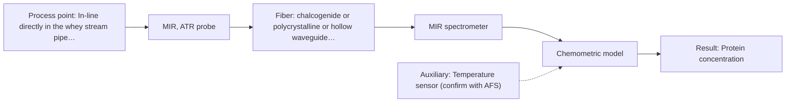

# First technical assessment: A clear whey stream before concentration

## Answer

**Customer request (our summary):** The customer wants to investigate using spectroscopy to track protein concentration in a dairy whey stream that transitions between clear and turbid states, using laboratory results as a reference.

### Brief answer

To track protein concentration in a whey stream shifting between clear and turbid states, we recommend NIR spectroscopy using a transflection probe configuration. A fixed transmission setup would saturate under high turbidity, whereas a transflection approach accommodates varying optical path requirements. Feasibility trials should test representative samples across both states with chemometric scatter correction and laboratory reference comparison.

### Proposal

- **Best current option:** O1 (simple)
- **Basis:** supplied AFS sources
- **What would change it:** If turbidity changes cause complete signal blockage in transflection mode, alternative configurations like MIR ATR or multi-method integration would be required.
- **Next step:** Conduct laboratory feasibility trials using NIR transflection on representative clear and turbid whey samples against customer reference data.

**Secondary evidence (external, not AFS material):** G1: E02 ¶12; G2: no usable external source found; G3: no usable external source found; G4: no usable external source found. See Expert detail.

**Decision status:** Premise not supported by the sources

### Solution options

| ID | Tier | Methods | Confidence | Cost class, S01 Table 1 (p.6) | Ease of use | Maintenance | Performance fit | Sources |
|---|---|---|---|---|---|---|---|---|
| O1 | Simple | M1 NIR, transmission/transflection probe | Low: open question: Q1 (starts at Medium); a customer premise is contradicted, status: premise not supported | average cost (row 7) | Straightforward transflection probe installation | Regular optical window cleaning | Handles moderate turbidity shifts via transflection | [1: S01 p.10] [2: S01 p.18] |
| O2 | Recommended | M3 MIR, ATR probe | Medium: a customer premise is contradicted, status: premise not supported | high cost (row 2) | Robust in-line probe setup with temperature tracking | Routine calibration maintenance and CIP cleaning | Provides high chemical selectivity via ATR fingerprinting | [3: S01 p.9] |

*Confidence rates the basis of the advice (how much is known and cited), not a predicted accuracy or probability of success. It starts at High, or at Medium when a key question on the method or the option is open, and drops one level per weakness listed (floor Low).*

*Cost class is the relative rating in S01 Table 1 (p.6) for the in-line method+technique rows named (the highest one for a multi-method option); it is not a price.*

### Setup sketch

*Recommended option O2; drawn by code from the option, a schematic, not a configuration.*

### Key questions

1. What is the expected range of turbidity or solid/fat content changes between the clear and turbid whey operating conditions?
2. What are the process temperature and pressure conditions at the proposed in-line installation point before the concentration stage?
3. What reference laboratory method and sampling frequency will be used for calibration and validation?

## Expert detail

**Customer enquiry**

> Our dairy process includes a relatively clear whey stream before a concentration stage. We want to investigate whether spectroscopy can track protein concentration as the stream changes, with laboratory results used as the reference. The stream can become more turbid under some operating conditions. We need a first measurement concept that handles this change rather than assuming the liquid always remains clear.

**Decision status:** Premise not supported by the sources. The customer's premise that a fixed transmission setup can handle whey streams transitioning between clear and turbid states is contradicted by sources showing transmission fails when liquids become opaque or thick.

### Parameters

| ID | Parameter | Kind | Need | Measured by | Why | Sources |
|---|---|---|---|---|---|---|
| P1 | Protein concentration | quantitative | required | Spectroscopy: NIR | Primary target variable for process control. | *(no verified source: engineering judgement)* |
| P2 | Turbidity / scattering state | quantitative | required | Spectroscopy: NIR | Tracks optical changes between clear and turbid stream conditions to ensure valid spectral acquisition. | *(no verified source: engineering judgement)* |
| P3 | Process temperature | quantitative | optional | Auxiliary sensor: Temperature sensor (engineering judgement: confirm availability with AFS) | Temperature variations can influence spectral baselines; should be available to ensure calibration stability. | *(no verified source: engineering judgement)* |

### Solution option details

- **O1 cost drivers:** Single NIR spectrometer and transflection probe
- **O2 cost drivers:** MIR spectrometer with ATR probe and auxiliary sensor

### Premise check

- **Contradicted:** A fixed transmission setup can reliably handle a whey stream that transitions between clear and turbid states. Transmission is suited for transparent or semi-transparent liquids, but transmission fails when the sample becomes too thick or turbid because light cannot penetrate it. [4: S01 p.18] [5: S01 p.18]

### Requirements

**Stated by the customer**

- Track protein concentration in a dairy whey stream before a concentration stage.
- Handle stream turbidity changes between clear and turbid states.
- Use laboratory results as a reference.

**Key unknowns**

- Exact range of optical density and turbidity variations between clear and turbid states
- Process temperature and pressure at the in-line measurement location
- Required measurement frequency and response time
- Cleaning-in-place (CIP) and fouling management requirements

### Clarification questions (most decision-relevant first)

Q1. What is the expected range of turbidity or solid/fat content changes between the clear and turbid whey operating conditions? *Why it matters:* Determines whether a fixed-pathlength transflection probe can bridge both states or if variable optics are required. *(affects: technique, M1)*
Q2. What are the process temperature and pressure conditions at the proposed in-line installation point before the concentration stage? *Why it matters:* Ensures probe materials and seals withstand operational environments. *(affects: installation)*
Q3. What reference laboratory method and sampling frequency will be used for calibration and validation? *Why it matters:* Defines the reference data quality required for chemometric model training. *(affects: status)*
Q4. Are there cleaning-in-place (CIP) or sterilization-in-place (SIP) requirements at this installation point? *Why it matters:* Dictates probe ruggedness, materials, and sealing standards. *(affects: installation)*

### Recommendation

- **M1 · Primary candidate: NIR, transmission/transflection probe.** NIR transflection handles varying scattering and concentration states in dairy streams using overtones of fundamental vibrations. *Conditions:* Pathlength must accommodate turbidity shifts without signal saturation. [1: S01 p.10] [2: S01 p.18]
- **M2 · Not recommended: NIR, diffuse reflection probe.** Diffuse reflection is unsuitable for clear liquids because Table 1 lists it for powders and scattering media. [6: S01 p.6]
- **M3 · Comparison candidate: MIR, ATR probe.** MIR ATR provides high selectivity for chemical fingerprinting but requires surface contact. *Conditions:* Applies if transmission signals are heavily scattered. [3: S01 p.9]

### Measurement concept

- **Probe and geometry:** NIR transflection probe configured to accommodate shifting optical clarity and turbidity.
- **Location:** In-line directly in the whey stream pipe before the concentration stage.
- **Fiber link:** Vis-NIR silica fibers with metal-coated buffer to prevent polymer fluorescence. [2: S01 p.18] [7: S02 p.6] [8: S02 p.7]

### Spectral range

- **NIR:** Nominal NIR range is 780-2500 nm; actual usable range depends on the instrument, fiber, and probe selected. [9: S01 p.10] [10: REF §5]

### Risks and uncertainty

- Increased turbidity causes light attenuation and signal saturation in transmission mode, preventing accurate protein reading. *(rules: R-GEO-2, R-GEN-4)* [5: S01 p.18]
- Physical scattering variations mimic chemical changes in NIR spectra unless scatter correction preprocessing is applied. *(rules: R-GEO-6, R-NIR-2)* [11: S01 p.17]
- Matrix shifts between clear whey and turbid phases degrade calibration model accuracy without dedicated multi-state training sets. *(rules: R-CAL-1)* [12: REF §5]

### First feasibility experiment

1. **Collect representative whey samples across the full spectrum of clear and turbid operating conditions.** Ensure experimental data captures physical and chemical variability. [13: REF §3]
2. **Acquire reference laboratory protein measurements for all collected samples using independent reference methods.** Provide accurate ground-truth concentration data for model calibration. [14: REF §3]
3. **Test NIR spectral acquisition using a transflection probe configuration across the sample set.** Evaluate signal quality and penetration across both clear and turbid states. [2: S01 p.18]
4. **Build and cross-validate chemometric calibration models using scatter correction linking NIR spectra to reference protein concentrations.** Isolate chemical protein absorption from physical scattering variations. [15: S01 p.10] [16: S01 p.17]
5. **Validate model prediction accuracy on held-out test runs representing both clear and turbid states against customer-defined error criteria.** Confirm robustness and readiness for in-line deployment. [17: REF §3]

**Reference measurements:** Standard laboratory protein reference assays provided by the customer.

**Decision basis:** Go/no-go decision based on achieving customer-specified prediction error and robustness across both clear and turbid operating states.

### Assumptions

- The customer will provide laboratory reference protein data for model calibration.
- The temperature and pressure of the whey stream are within standard industrial probe rating limits.

### Not covered by the supplied sources

- Specific baseline protein concentration values and turbidity ranges of the customer's specific whey stream.

### Further notes

- **Chemometrics:** NIR spectral bands overlap extensively, requiring chemometric regression (such as PLS) combined with scatter correction techniques like SNV or MSC to isolate protein concentration changes from physical turbidity fluctuations.
- **Real-time tracking:** In-line NIR spectroscopy enables continuous real-time monitoring of protein concentration directly in the whey stream before concentration.
- **Future direction:** Integration of cloud-based IoT sensor modules for remote tracking and automated process feedback.

### Secondary evidence (external, not AFS material)

*Found by a literature search for gaps the supplied AFS sources leave open. Not AFS material and not proof for this case; every quote below was verified verbatim against the fetched text.*

*Live search unavailable (library only: cache miss (europepmc); cache miss (openalex)); curated library only.*

**G1 · auxiliary sensor:** In-line measurement of Process temperature with Temperature sensor

- **E02 ¶12** The text notes that temperature sensitivity of certain bands is a severe drawback for measuring aqueous solutions in NIR and MIR, requiring tempered sample holders. *How it applies:* This suggests that temperature compensation or controlled sample holders should be tested to mitigate spectral artifacts from thermal fluctuations in the aqueous whey stream. *Limits and transfer risks:* The cited text addresses general aqueous bioprocess streams and laboratory sample holders rather than an in-line dairy whey process. *(supports O2)*
  > "Additionally, the temperature sensitivity of the OH bands is a severe drawback for measuring aqueous solution in NIR and MIR, which makes tempered sample holders necessary [29]."
  > A critical review of recent trends, and a future perspective of optical spectroscopy as PAT in biopharmaceutical downstream processing. (2020) · Analytical and bioanalytical chemistry · doi:10.1007/s00216-020-02407-z · https://europepmc.org/article/PMC/PMC7072065 · retrieved 2026-10-17, full text, licence: cc by, via curated library

**G2 · not in the supplied sources:** Specific baseline protein concentration values and turbidity ranges of the customer's specific whey stream.

- No usable external source found.

**G3 · parameter without a source:** Measuring Protein concentration: Primary target variable for process control.

- No usable external source found.

**G4 · parameter without a source:** Measuring Turbidity / scattering state: Tracks optical changes between clear and turbid stream conditions to ensure valid spectral acquisition.

- No usable external source found.

### Evidence (verified quotes)

1. ✓ **S01 p.10** (general): "NIR spectra (780-2500 nm) contain predominantly overtones and component bands of fundamental vibrations of molecules and atomic groups"
2. ✓ **S01 p.18** (application precedent): "In some cases, a Transflection probe can already be a combined solution working well for low-fat and high-fat containing milk products."
3. ✓ **S01 p.9** (general): "Vibrational spectroscopy in the mid-IR range (4000-400 cm-1) is one of the most informative methods of chemical analysis."
4. ✓ **S01 p.18** (general): "Transmission is the preferred method for transparent or semi-transparent liquids, such as skim milk, whey, or permeate."
5. ✓ **S01 p.18** (general): "it fails when the milk becomes too "thick" or fat-rich, as the light cannot penetrate the sample."
6. ✓ **S01 p.6** (general): "Scattering media, powder"
7. ✓ **S02 p.6** (general): "Standard VIS-NIR Silica Fibers Al/Cu-coated VIS-NIR Silica Fibers"
8. ✓ **S02 p.7** (general): "Free of Polymer jacket fluorescence for Raman and Fluo- Spectroscopy"
9. ✓ **S01 p.10** (general): "NIR spectra (780-2500 nm) contain predominantly overtones and component bands of fundamental vibrations"
10. ✓ **REF §5** (general): "It is not a product specification: actual spectral coverage, fiber length, component ratings, detection limits and accuracy depend on the configuration and the sample."
11. ✓ **S01 p.17** (general): "the method is sensitive to the surface characteristics and fat globule size."
12. ✓ **REF §5** (general): "Weak signal, fluorescence background; calibration specific to the matrix."
13. ✓ **REF §3** (general): "Representative samples or process states"
14. ✓ **REF §3** (general): "independent reference measurements"
15. ✓ **S01 p.10** (general): "The broad absorption bands observed in this region overlap, suggesting the use of chemometrics for quantitative and qualitative analysis of spectral data."
16. ✓ **S01 p.17** (general): "Multiplicative Scatter Correction (MSC) or Standard Normal Variate (SNV) transformations"
17. ✓ **REF §3** (general): "what is compared, and the basis for the go / no-go decision."

### Verification

- Citations verified: 20 of 20 (exact or whitespace/hyphen-tolerant match on the cited page, scope checked).
- Hard check failures before deterministic corrections: 0; still open: 0; soft warnings: 1; repair rounds: 1.
- External evidence (cache): 1 quote(s) verified verbatim (exact or whitespace/hyphen-tolerant, at most 400 characters and 2 sentences, against the cited paragraph); 0 item(s) dropped.
- External search: 4 query(ies), 0 hit(s), 3 source(s) (3 from the curated library); ⚠ library only: cache miss (europepmc); cache miss (openalex).
- External step: 2 model call(s), 2.1 s extra (cost in the run JSON).

*Run D03-20261018T072422Z-6560 · models google/gemini-3.5-flash-lite*
