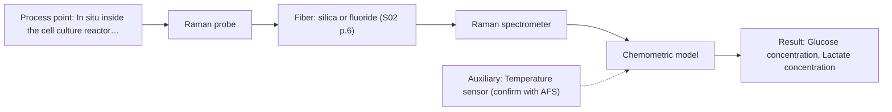
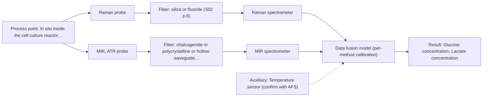

# First technical assessment: Glucose and lactate trends in an aqueous bioprocess

## Answer

**Customer request (our summary):** The customer is exploring an in situ spectroscopy pilot to monitor glucose and lactate concentrations in a cell culture process to overcome analytical delays from laboratory measurements.

### Brief answer

To monitor glucose and lactate in your cell culture process without delays, test Raman spectroscopy first using an in situ immersion probe due to its low water interference. Establish reference measurements and run feasibility trials to build initial chemometric calibration models. Further method combinations can be explored if cofactor tracking is needed.

### Proposal

- **Best current option:** O2 (recommended)
- **Basis:** supplied AFS sources
- **What would change it:** If water interference or fluorescence background prevents reliable Raman calibration, a multi-method or Mid-IR ATR approach will be required.
- **Next step:** Conduct multi-method laboratory trials using representative cell culture liquid samples and independent reference measurements.

**Secondary evidence (external, not AFS material):** G1: E03 ¶12; G2: E02 ¶36; G3: no usable external source found; G4: no usable external source found. See Expert detail.

**Decision status:** Provisional feasibility assessment

### Solution options

| ID | Tier | Methods | Confidence | Cost class, S01 Table 1 (p.6) | Ease of use | Maintenance | Performance fit | Sources |
|---|---|---|---|---|---|---|---|---|
| O1 | Simple | M2 MIR, ATR probe | Low: open question: Q1, Q2 (starts at Medium); uncited auxiliary sensor | high cost (row 2) | Easy ATR immersion probe setup | Regular crystal cleaning to avoid fouling | High chemical specificity for dissolved organics | [1: S01 p.9] |
| O2 | Recommended | M1 Raman probe | Low: open question: Q1, Q2 (starts at Medium); uncited auxiliary sensor | high cost (row 12) | Easy single-probe immersion | Periodic cleaning and calibration checks | Good water tolerance and metabolite specificity | [2: S01 p.16] |
| O3 | Extended (multi-method) | M1 Raman probe; M2 MIR, ATR probe | Low: open question: Q1, Q2 (starts at Medium); uncited auxiliary sensor; multi-method, fusion benefit not yet shown | high cost (rows 2, 12) | Moderate multi-probe maintenance | Dual instrument calibration and probe cleaning | Combined vibrational specificity for complex media | [2: S01 p.16] [1: S01 p.9] |

*Confidence rates the basis of the advice (how much is known and cited), not a predicted accuracy or probability of success. It starts at High, or at Medium when a key question on the method or the option is open, and drops one level per weakness listed (floor Low).*

*Cost class is the relative rating in S01 Table 1 (p.6) for the in-line method+technique rows named (the highest one for a multi-method option); it is not a price.*

### Setup sketch

*Recommended option O2; drawn by code from the option, a schematic, not a configuration.*

### Key questions

1. What are the target concentration ranges and required detection limits for glucose and lactate?
2. Does the cell culture medium contain fluorescent components or autofluorescence that could interfere with optical measurements?
3. What are the physical constraints of the bioreactor port and sterilization (SIP/CIP) requirements?

## Expert detail

**Customer enquiry**

> We run a cell culture process in an aqueous medium. Glucose and lactate are measured from samples, and the delay makes it difficult to see changes promptly. We are exploring an in situ spectroscopy pilot that can be checked against those existing laboratory measurements. The medium and cell population change during the run; we have not yet selected a probe or a calibration strategy.

**Decision status:** Provisional feasibility assessment. The customer stated the process is an aqueous cell culture and needs to monitor glucose and lactate without analytical delays, but key details such as concentration ranges, detection limits, and optical properties remain unknown. A provisional assessment focusing on Raman and Mid-IR spectroscopy is justified based on general aqueous bioprocess capabilities.

### Parameters

| ID | Parameter | Kind | Need | Measured by | Why | Sources |
|---|---|---|---|---|---|---|
| P1 | Glucose concentration | quantitative | required | Spectroscopy: Raman | Primary target analyte to monitor metabolic activity and avoid analytical delays. | *(no verified source: engineering judgement)* |
| P2 | Lactate concentration | quantitative | required | Spectroscopy: Raman | Secondary target analyte to monitor metabolic state and byproduct accumulation. | *(no verified source: engineering judgement)* |
| P3 | Process temperature | quantitative | required | Auxiliary sensor: Temperature sensor (engineering judgement: confirm availability with AFS) | Temperature affects spectral baselines and biological reaction rates. | *(no verified source: engineering judgement)* |

### Solution option details

- **O1 cost drivers:** Single Mid-IR spectrometer and ATR probe
- **O2 cost drivers:** Single Raman spectrometer and immersion probe
- **O3 cost drivers:** Raman and MIR spectrometers with immersion probes
- **O3 combining methods:** Join synchronized Raman and Mid-IR spectral blocks using block scaling from the same measurement spot, maintaining independent calibrations per block, and validate that the fused model outperforms the best single method on independent batches.

*Extended (multi-method) option O3; drawn by code from the option, a schematic, not a configuration.*

### Requirements

**Stated by the customer**

- Cell culture process run in an aqueous medium
- Glucose and lactate measured from samples with analytical delay
- Exploring an in situ spectroscopy pilot checked against existing lab measurements
- Medium and cell population change during the run
- No probe or calibration strategy selected yet

**Key unknowns**

- Target concentration ranges and required detection limits for glucose and lactate
- Presence of background fluorescence or luminescent components in the medium
- Bioreactor port dimensions and installation constraints
- Cleaning and sterilization (SIP/CIP) requirements
- Required measurement frequency and response time

### Clarification questions (most decision-relevant first)

Q1. What are the target concentration ranges and required detection limits for glucose and lactate? *Why it matters:* Determines whether spectroscopic sensitivity is sufficient or if pre-concentration or alternative methods are needed. *(affects: method, technique, M1, M2)*
Q2. Does the cell culture medium contain fluorescent components or autofluorescence that could interfere with optical measurements? *Why it matters:* Fluorescence background can swamp weak Raman signals and dictate whether optical filtering or alternative methods are required. *(affects: method, M1)*
Q3. What are the physical constraints of the bioreactor port and sterilization (SIP/CIP) requirements? *Why it matters:* Dictates probe mechanical design, optical window material, and thermal tolerance for in situ installation. *(affects: installation)*
Q4. What independent reference measurement method and sampling schedule will be used for calibration and validation? *Why it matters:* Ensures reliable ground-truth data for chemometric model building and verification against existing lab delays. *(affects: status)*

### Recommendation

- **M1 · Primary candidate: Raman probe.** Raman spectroscopy is well-suited for aqueous bioprocess monitoring because water exhibits low absorbance compared to infrared methods, enabling direct molecular detection of metabolites like glucose and lactate. [2: S01 p.16]
- **M2 · Comparison candidate: MIR, ATR probe.** Mid-IR ATR spectroscopy provides high chemical specificity for dissolved organic molecules, serving as a robust alternative method for comparison in aqueous media. *Conditions:* Aqueous background absorption and fouling on the ATR crystal must be managed. [1: S01 p.9]
- **M3 · Conditional candidate: fluorescence probe + Raman (combination).** Fluorescence spectroscopy provides high sensitivity for tracking metabolic cofactors and amino acids when combined with vibrational methods. *Conditions:* Applies only if trace cofactor tracking or high-sensitivity secondary monitoring is required alongside primary metabolite analysis. [3: S01 p.16] Later hypothesis, after single-method tests.

### Measurement concept

- **Probe and geometry:** Immersion Raman or ATR probe inserted directly into the bioreactor fluid.
- **Location:** In situ inside the cell culture reactor fluid flow or bulk medium.
- **Fiber link:** Fiber optic cables connecting the immersion probe to spectrometers located safely away from the process floor. [4: S01 p.3] [5: S01 p.15]

### Spectral range

- **Raman:** Raman shift expressed in cm-1 with laser excitation wavelength stated separately; usable range depends on the instrument, fiber, and probe configuration. [6: S01 p.11]
- **MIR:** Nominal range 4000-400 cm-1; usable range depends on the instrument, fiber, and probe configuration. [1: S01 p.9]

### Risks and uncertainty

- Weak Raman signals can be obscured by background fluorescence or scattering from cellular biomass in the culture. *(rules: R-RAM-1)* [7: S01 p.11]
- Dynamic changes in the medium and cell population during the run can invalidate static calibration models. *(rules: R-CAL-1)* [8: REF §5]
- Biological fouling or biofilm formation on the probe tip can cause signal drift during extended cell culture runs. *(rules: R-MIR-3)* [9: REF §5]

### First feasibility experiment

1. **Acquire representative liquid samples across the expected chemical and physical variation of the cell culture process.** Collect representative liquid samples across the expected chemical and physical variation of the cell culture process. *(no verified source: engineering judgement)*
2. **Perform independent reference measurements for glucose and lactate using existing laboratory methods.** Perform independent reference measurements for glucose and lactate using existing laboratory methods. *(no verified source: engineering judgement)*
3. **Test single methods using immersion probes to evaluate signal stability and water interference.** Test single methods (Raman and MIR ATR) using immersion probes to evaluate signal stability and water interference. *(no verified source: engineering judgement)*
4. **Build preliminary chemometric calibration models and validate on held-out runs or batches.** Build preliminary chemometric calibration models and validate on held-out runs or batches. *(no verified source: engineering judgement)*
5. **Evaluate calibration root mean square error against customer-defined accuracy criteria.** Evaluate calibration root mean square error against customer-defined accuracy criteria. *(no verified source: engineering judgement)*

**Reference measurements:** Existing laboratory measurements of glucose and lactate from samples.

**Decision basis:** Go/no-go decision based on whether model prediction error meets customer-defined numerical accuracy criteria for glucose and lactate tracking.

### Assumptions

- The cell culture medium is accessible via standard bioreactor immersion ports.
- Laboratory reference measurements provide reliable ground truth for model calibration.

### Not covered by the supplied sources

- Specific bioreactor port dimensions and pressure ratings
- Customer's exact required numerical accuracy and detection limits

### Further notes

- **Chemometrics:** Partial Least Squares (PLS) regression models must be constructed from spectral data and validated against laboratory reference measurements, accounting for changing medium composition.
- **Real-time tracking:** In-line immersion probes enable real-time tracking of glucose and lactate concentrations without sampling delays.
- **Future direction:** Development of customized optical multisensor systems (OMS) or LED-based sensors once key spectral bands are identified.

### Secondary evidence (external, not AFS material)

*Found by a literature search for gaps the supplied AFS sources leave open. Not AFS material and not proof for this case; every quote below was verified verbatim against the fetched text.*

*Live search unavailable (library only: cache miss (europepmc); cache miss (openalex)); curated library only.*

**G1 · auxiliary sensor:** In-line measurement of Process temperature with Temperature sensor

- **E03 ¶12** The source notes that temperature variations present challenges for aqueous solutions in specific spectral ranges, which requires tempered sample holders or temperature consideration. *How it applies:* This suggests that monitoring process temperature is critical when evaluating spectroscopic setups, and temperature effects should be tested during calibration. *Limits and transfer risks:* The cited reference discusses general optical setups rather than the exact cell culture system or sensor integration intended here. *(supports O2)*
  > "Additionally, the temperature sensitivity of the OH bands is a severe drawback for measuring aqueous solution in NIR and MIR, which makes tempered sample holders necessary [29]."
  > A critical review of recent trends, and a future perspective of optical spectroscopy as PAT in biopharmaceutical downstream processing. (2020) · Analytical and bioanalytical chemistry · doi:10.1007/s00216-020-02407-z · https://europepmc.org/article/PMC/PMC7072065 · retrieved 2026-10-17, full text, licence: cc by, via curated library

**G2 · multi-method:** Combining several spectroscopy methods (data fusion) (Join synchronized Raman and Mid-IR spectral blocks using block scaling from the same measurement spot, maintaining independent calibrations per block, and validate that the fused model outperforms the best single method on independent batches.)

- **E02 ¶36** The review discusses combining inputs using low-level data fusion or high-level decision-level fusion, while noting that instrument complementarity does not always guarantee improved predictive performance. *How it applies:* This indicates that testing data fusion methods requires careful evaluation of whether combining multiple spectral blocks genuinely improves performance over single methods. *Limits and transfer risks:* The review covers general PAT applications and food analysis studies, which may not directly translate to multi-method bioreactor cell culture monitoring. *(supports O3)*
  > "In some situations, instrument complementarity (not data complementarity) was not sufficient to improve the performance of predictive several CQAs, as shown by a Raman and FT-IR data based food analytical study [73]."
  > Challenges and Opportunities of Implementing Data Fusion in Process Analytical Technology-A Review. (2022) · Molecules (Basel, Switzerland) · doi:10.3390/molecules27154846 · https://europepmc.org/article/PMC/PMC9369811 · retrieved 2026-10-17, full text, licence: cc by, via curated library

**G3 · not in the supplied sources:** Specific bioreactor port dimensions and pressure ratings

- No usable external source found.

**G4 · not in the supplied sources:** Customer's exact required numerical accuracy and detection limits

- No usable external source found.

### Evidence (verified quotes)

1. ✓ **S01 p.9** (general): "Vibrational spectroscopy in the mid-IR range (4000-400 cm-1) is one of the most informative methods of chemical analysis."
2. ✓ **S01 p.16** (general): "This combination is practical because Raman is particularly well-suited for aqueous environments, as it exhibits low absorbance for water molecules compared to infrared methods."
3. ✓ **S01 p.16** (general): "Fluorescence spectroscopy can be used for high-sensitivity detection (down to the nM-μM range) of critical cofactors and amino acids like NADH, tryptophan, and riboflavin."
4. ✓ **S01 p.3** (general): "online analysis using fiber optic cables and probes"
5. ✓ **S01 p.15** (general): "located safely away from the vibration and dust of the manufacturing floor."
6. ✓ **S01 p.11** (general): "The Raman shift is used as the horizontal (spectral) axis in Raman spectroscopy, while the vertical axis shows the absolute intensity of the recorded signals (photon counts)."
7. ✓ **S01 p.11** (general): "Furthermore, observing Raman bands is often complicated by light scattering from the illuminating laser, and for many organic compounds, by the superposition of luminescence (fluorescence), which has a significantly higher intensity."
8. ✓ **REF §5** (general): "Weak signal, fluorescence background; calibration specific to the matrix."
9. ✓ **REF §5** (general): "Usable range limited by fiber and crystal; contact, fouling, compatibility."

### Verification

- Citations verified: 10 of 10 (exact or whitespace/hyphen-tolerant match on the cited page, scope checked).
- Hard check failures before deterministic corrections: 0; still open: 0; soft warnings: 1; repair rounds: 2.
- External evidence (cache): 2 quote(s) verified verbatim (exact or whitespace/hyphen-tolerant, at most 400 characters and 2 sentences, against the cited paragraph); 0 item(s) dropped.
- External search: 3 query(ies), 0 hit(s), 3 source(s) (3 from the curated library); ⚠ library only: cache miss (europepmc); cache miss (openalex).
- External step: 2 model call(s), 2.6 s extra (cost in the run JSON).

*Run D04-20261018T072422Z-2e49 · models google/gemini-3.5-flash-lite*
