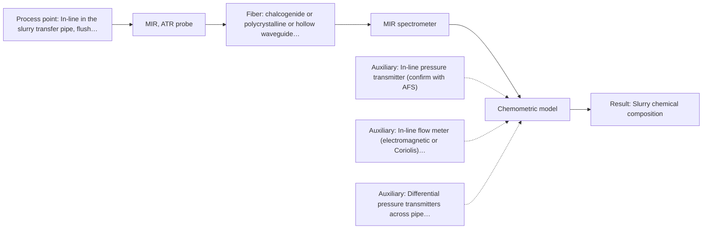

# First technical assessment: Pressure, flow and blockage of a slurry pipe

## Answer

**Customer request (our summary):** The customer is asking whether fiber optic products can measure line pressure, flow rate, and detect pipe blockage in a slurry transfer line.

### Brief answer

In-line fiber-optic spectroscopy cannot measure line pressure or flow rate, as optical spectroscopy is designed for chemical and molecular composition analysis rather than mechanical hydraulic properties. Dedicated commercial pressure transmitters and flow meters should be used for pressure, flow, and blockage monitoring. If you also need to monitor slurry chemical composition or solids identity, an in-line mid-infrared ATR probe can be tested once your slurry chemistry and operating conditions are clarified.

### Proposal

- **Best current option:** O2 (recommended)
- **Basis:** engineering judgement
- **What would change it:** If the customer does not require chemical or solids composition monitoring, all optical spectroscopy hardware can be omitted in favor of standard commercial pressure and flow instrumentation.
- **Next step:** Clarify whether chemical composition monitoring of the slurry is needed, and source dedicated in-line pressure transmitters and flow meters for the transfer pipe.

**Secondary evidence (external, not AFS material):** G1: no usable external source found; G2: no usable external source found; G3: no usable external source found; G4: no usable external source found. See Expert detail.

**Decision status:** Outside the supported scope

### Solution options

| ID | Tier | Methods | Confidence | Cost class, S01 Table 1 (p.6) | Ease of use | Maintenance | Performance fit | Sources |
|---|---|---|---|---|---|---|---|---|
| O1 | Simple | M2 Raman probe | Low: open question: Q1, Q2 (starts at Medium); uncited auxiliary sensor; status: outside supported scope | high cost (row 12) | Single Raman probe and standard transmitters | Laser alignment checks and window cleaning | Tolerates water while auxiliary sensors measure hydraulics | [1: S01 p.16] [2: S01 p.11] |
| O2 | Recommended | M1 MIR, ATR probe | Low: open question: Q1, Q2 (starts at Medium); uncited auxiliary sensor; status: outside supported scope | high cost (row 2) | Immersion ATR probe plus inline transmitters | Routine ATR surface de-fouling and sensor zeroing | Direct fundamental fingerprinting combined with dedicated hydraulic instrumentation | [3: S01 p.10] [4: S01 p.5] |

*Confidence rates the basis of the advice (how much is known and cited), not a predicted accuracy or probability of success. It starts at High, or at Medium when a key question on the method or the option is open, and drops one level per weakness listed (floor Low).*

*Cost class is the relative rating in S01 Table 1 (p.6) for the in-line method+technique rows named (the highest one for a multi-method option); it is not a price.*

### Setup sketch

*Recommended option O2; drawn by code from the option, a schematic, not a configuration.*

### Key questions

1. Are you seeking chemical composition or solids concentration monitoring of the slurry, or strictly mechanical line pressure and flow rate sensing?
2. What is the chemical composition of the slurry, including carrier liquid and suspended solids?
3. What are the pipe operating conditions (pressure range, temperature, flow velocity, pipe inner diameter, and slurry abrasiveness)?

## Expert detail

**Customer enquiry**

> We need to know the line pressure and the flow rate of a slurry in our transfer pipe, and we want an early warning when the pipe starts to block. Could your fiber optic products help with this?

**Decision status:** Outside the supported scope. The enquiry requests in-line measurement of line pressure, flow rate, and pipe blockage warning, which are mechanical and hydraulic process parameters rather than chemical or molecular properties. AFS fiber-optic products provide optical molecular spectroscopy (UV-Vis, NIR, MIR, Raman, fluorescence) for chemical composition and morphology, not physical pressure transducers or flowmeters.

### Parameters

| ID | Parameter | Kind | Need | Measured by | Why | Sources |
|---|---|---|---|---|---|---|
| P1 | Line pressure | quantitative | required | Auxiliary sensor: In-line pressure transmitter (engineering judgement: confirm availability with AFS) | Explicitly requested by customer to monitor transfer pipe pressure. | *(no verified source: engineering judgement)* |
| P2 | Slurry flow rate | quantitative | required | Auxiliary sensor: In-line flow meter (electromagnetic or Coriolis) (engineering judgement: confirm availability with AFS) | Explicitly requested by customer to track throughput in the transfer pipe. | *(no verified source: engineering judgement)* |
| P3 | Pipe blockage onset | qualitative | required | Auxiliary sensor: Differential pressure transmitters across pipe section (engineering judgement: confirm availability with AFS) | Explicitly requested by customer to provide early warning of pipe clogging. | *(no verified source: engineering judgement)* |
| P4 | Slurry chemical composition | quantitative | optional | Spectroscopy: MIR | Optional monitoring of carrier chemistry or solids identity if chemical process control is desired alongside physical monitoring. | [5: S01 p.4] |
| P5 | Aqueous carrier / solvent band tracking | qualitative | optional | Spectroscopy: Raman | Optional evaluation of solvent vibrational signals using Raman in aqueous environments. | [6: S01 p.16] |

### Solution option details

- **O1 cost drivers:** Raman spectrometer, laser source, physical flow and pressure sensors
- **O2 cost drivers:** FTIR spectrometer, PIR fiber cable, ATR diamond/ZrO2 probe, flow/pressure instrumentation

### Premise check

- **Not covered:** Fiber optic spectroscopy products can directly measure line pressure, slurry flow rate, and pipe blockage onset. The supplied technical sources cover optical molecular spectroscopy for qualitative and quantitative chemical analysis, not physical sensing transducers for pipe pressure, liquid flow rate, or hydraulic blockage. [5: S01 p.4] [7: S01 p.2]
- **Not covered:** Early warning of pipe blockage can be determined directly by fiber optic spectroscopy. The supplied documentation contains no methodology for mechanical pipe blockage detection; optical probes can only detect localized optical changes or fouling at the optical interface. [8: REF §5]

### Requirements

**Stated by the customer**

- Measure line pressure of a slurry in a transfer pipe.
- Measure flow rate of a slurry in a transfer pipe.
- Provide an early warning when the transfer pipe starts to block.

**Key unknowns**

- Slurry chemical composition, carrier liquid identity, and suspended solid properties.
- Operating hydraulic conditions including pipe diameter, flow velocity, line pressure, and temperature.
- Whether chemical composition or solids concentration monitoring is desired alongside mechanical parameters.
- Slurry abrasiveness, fouling tendencies, and pipe wall mounting constraints.

### Clarification questions (most decision-relevant first)

Q1. Are you seeking chemical composition or solids concentration monitoring of the slurry, or strictly mechanical line pressure and flow rate sensing? *Why it matters:* AFS specializes in optical spectroscopy for chemical and molecular analysis, not mechanical pressure transmitters or flow meters. *(affects: status, method)*
Q2. What is the chemical composition of the slurry, including carrier liquid and suspended solids? *Why it matters:* Determines which optical spectroscopy method is viable if chemical tracking is required. *(affects: method)*
Q3. What are the pipe operating conditions (pressure range, temperature, flow velocity, pipe inner diameter, and slurry abrasiveness)? *Why it matters:* Abrasiveness and hydraulic ratings determine whether an optical probe window can survive in the pipe wall. *(affects: installation, technique)*
Q4. How is pipe blockage characterized in your process (e.g. wall cake formation, settling, or upstream pressure rise)? *Why it matters:* Clarifies whether blockage can be anticipated by optical window deposition or requires differential pressure instrumentation. *(affects: technique, status)*

### Recommendation

- **M1 · Primary candidate: MIR, ATR probe.** ATR mid-infrared spectroscopy allows sampling of opaque slurries and pastes via a shallow penetration depth of a few micrometres at the crystal interface. It captures fundamental molecular vibrational fingerprints of both liquid carrier and solid components without bulk path attenuation. *Conditions:* Applies if the customer requires in-line chemical composition or solids monitoring and the slurry can maintain optical contact without abrasive damage to the ATR crystal. [3: S01 p.10] [4: S01 p.5]
- **M2 · Comparison candidate: Raman probe.** Raman spectroscopy evaluates molecular backbones and non-polar bonds, exhibiting minimal interference from water in aqueous slurry systems. However, Raman signals can be obscured by fluorescence or severe optical attenuation from high turbidity. [1: S01 p.16] [2: S01 p.11]

### Measurement concept

- **Probe and geometry:** If optical monitoring is integrated alongside conventional physical sensors, an in-line ATR immersion probe or Raman immersion probe flush-mounted in the pipe wall interacts with the flowing slurry layer. For physical parameters (pressure and flow), standard non-optical diaphragm pressure transducers and magnetic or coriolis flowmeters must be installed in the pipe.
- **Location:** In-line in the slurry transfer pipe, flush with the inner wall to minimize flow disruption and avoid dead zones, ideally before and across potential constriction zones.
- **Fiber link:** Polycrystalline infrared (PIR) fibers or chalcogenide (CIR) fibers for mid-IR ATR; silica fibers transmitting in the visible and near-infrared range for Raman spectroscopy. Link lengths should be determined based on spectrometer distance from pipe vibration. [9: S01 p.10] [10: S01 p.15]

### Spectral range

- **MIR:** The nominal mid-IR range is 4000-400 cm-1, representing fundamental molecular vibrations. The usable range depends on the instrument, fiber material, and the ATR crystal chosen, as the nominal range is not the range of a specific setup. [11: S01 p.9] [12: REF §3]
- **Raman:** Raman spectra are reported as Raman shift in units of frequency-wavenumbers (cm-1), while the laser excitation wavelength is stated separately. The usable range is governed by the excitation laser, probe filtering, and spectrometer detector. [13: S01 p.11]

### Risks and uncertainty

- Optical spectroscopy cannot replace dedicated mechanical instruments for bulk line pressure and flow rate measurement. *(rules: R-EVI-1)* [5: S01 p.4]
- Abrasive solids in the slurry flowing at high velocity could erode or damage the optical ATR crystal or probe window. *(rules: R-MIR-2, R-MIR-3)* [8: REF §5]
- Severe pipe fouling or cake layer deposition would blind the optical probe, reflecting only the stationary surface layer rather than bulk slurry dynamics. *(rules: R-MIR-3)* [14: S01 p.13]
- Turbulence and physical inhomogeneity in the slurry can cause severe baseline shifts and scatter fluctuations that mimic concentration changes. *(rules: R-GEN-5, R-GEO-6)* [15: S01 p.7]

### First feasibility experiment

1. **Evaluate dedicated non-optical process instrumentation (differential pressure transmitters and electromagnetic or coriolis flowmeters) for line pressure, flow rate, and blockage detection.** Address the customer's primary mechanical requirements that fall outside optical spectroscopy. *(no verified source: engineering judgement)*
2. **Collect representative slurry samples covering nominal solids concentration, carrier liquid variations, and potential settling conditions.** Provide offline characterization of slurry chemistry, particle size distribution, and optical properties. [16: REF §3]
3. **Conduct benchtop multi-method trials testing single methods (MIR-ATR vs Raman) on static and agitated slurry aliquots to evaluate signal quality and window fouling.** Determine whether optical spectroscopy yields useful chemical information and verify whether solids coat or abrade the probe interface. [17: S01 p.3]
4. **Validate any spectroscopic calibration on independent test batches across varied flow shear and solids loading against laboratory reference measurements.** Confirm predictive robustness of spectral models against physical matrix variation. *(no verified source: engineering judgement)*
5. **Establish a go/no-go evaluation based on whether auxiliary sensors achieve pressure and flow targets, and whether optical probes resist fouling without abrasion.** Form an objective operational basis for deployment in the transfer pipe. *(no verified source: engineering judgement)*

**Reference measurements:** Calibrated standard pressure gauges, gravimetric/volumetric flow testing, and laboratory gravimetric solids/moisture analysis.

**Decision basis:** Go/no-go criteria must be defined by customer-specified pressure accuracy, flow rate tolerance, and early warning lead time before pipe plugging.

### Assumptions

- The customer's primary operational targets are line pressure, flow rate, and pipe blockage warning in a slurry transfer pipe.
- The slurry consists of suspended solid particles in a liquid carrier medium under continuous pipe flow.
- The customer contacted AFS inquiring if fiber optic products can serve these hydraulic monitoring functions.

### Not covered by the supplied sources

- Fiber optic sensing methods or instruments for direct in-line measurement of line pressure.
- Fiber optic flowmeters or velocity sensors for slurry pipe flow.
- Techniques or algorithms for hydraulic pipe blockage detection using optical spectroscopy.
- Slurry chemical composition, abrasiveness, pipe dimensions, and operating pressure/temperature ratings.

### Further notes

- **Chemometrics:** If optical spectroscopy is utilized to track chemical composition or solids loading, multivariate calibration (such as PLS regression) will be required to relate overlapping spectral variations to reference laboratory values, with scatter correction applied if scattering suspensions are measured.
- **Real-time tracking:** Real-time process tracking of line pressure and flow rate must be handled continuously by high-speed electronic transmitters connected to the plant control system; optical spectroscopy can provide periodic spectral scans (seconds to minutes) for composition.
- **Future direction:** If hydraulic pipe blockage is preceded by slurry composition shifts or phase separation, correlation studies could investigate whether real-time spectral changes can anticipate settling before pressure spikes occur.

### Secondary evidence (external, not AFS material)

*Found by a literature search for gaps the supplied AFS sources leave open. Not AFS material and not proof for this case; every quote below was verified verbatim against the fetched text.*

*Live search unavailable (library only: cache miss (europepmc); cache miss (openalex)); curated library only.*

**G1 · decision status:** outside supported scope: The enquiry requests in-line measurement of line pressure, flow rate, and pipe blockage warning, which are mechanical and hydraulic process parameters rather than chemical or molecular properties. AFS fiber-optic products provide optical molecular spectroscopy (UV-Vis, NIR, MIR, Raman, fluorescence) for chemical composition and morphology, not physical pressure transducers or flowmeters.

- No usable external source found.

**G2 · auxiliary sensor:** In-line measurement of Line pressure with In-line pressure transmitter

- No usable external source found.

**G3 · auxiliary sensor:** In-line measurement of Slurry flow rate with In-line flow meter (electromagnetic or Coriolis)

- No usable external source found.

**G4 · auxiliary sensor:** In-line measurement of Pipe blockage onset with Differential pressure transmitters across pipe section

- No usable external source found.

### Evidence (verified quotes)

1. ✓ **S01 p.16** (general): "This combination is practical because Raman is particularly well-suited for aqueous environments, as it exhibits low absorbance for water molecules compared to infrared methods."
2. ✓ **S01 p.11** (general): "From a technical standpoint, measuring Raman spectra is hampered by the low intensity of Raman signals, which are several orders of magnitude weaker than IR absorption peaks in the IR range (when these spectra are compared in the original photon count units)."
3. ✓ **S01 p.10** (general): "ATR fiber probes (Fig.1) enable the analysis of liquids and solid elastic samples, such as biological tissue, using specialized probes utilizing high-transmission fiber optics in the Mid-IR region."
4. ✓ **S01 p.5** (general): "In contrast, strong absorption in the mid-IR region limits the corresponding spectral method to the analysis of very thin samples (usually less than 50 μm), but it opens up the possibility of using attenuated total reflectance (ATR) by connecting appropriate attachments and probes."
5. ✓ **S01 p.4** (general): "Spectral analysis provides information about the chemistry and morphology of the sample being studied: the concentrations of its components, their distribution, and particle sizes."
6. ✓ **S01 p.16** (general): "Raman is particularly well-suited for aqueous environments, as it exhibits low absorbance for water molecules compared to infrared methods."
7. ✓ **S01 p.2** (general): "Optical spectral analysis occupies a special place among physicochemical methods for studying substances and materials. It is based on measuring the result of the interaction of electromagnetic radiation with a sample over a wide range of wavelengths, from hard ultraviolet to far infrared light. The result of this interaction, measured using a spectrometric or sensor analyzer, carries a lot of chemical information about the analyzed object."
8. ✓ **REF §5** (general): "Usable range limited by fiber and crystal; contact, fouling, compatibility."
9. ✓ **S01 p.10** (general): "specialized probes utilizing high-transmission fiber optics in the Mid-IR region."
10. ✓ **S01 p.15** (general): "The use of fiber optics is critical here, as it allows the sensitive spectrometers to be located safely away from the vibration and dust of the manufacturing floor."
11. ✓ **S01 p.9** (general): "Vibrational spectroscopy in the mid-IR range (4000-400 cm-1) is one of the most informative methods of chemical analysis."
12. ✓ **REF §3** (general): "A nominal method range is not the range of a specific instrument, fiber or probe."
13. ✓ **S01 p.11** (general): "The difference between the observed frequencies and the laser frequency is called the Raman shift, expressed in units of frequency-wavenumbers (cm-1). The Raman shift is used as the horizontal (spectral) axis in Raman spectroscopy, while the vertical axis shows the absolute intensity of the recorded signals (photon counts)."
14. ✓ **S01 p.13** (general): "typically at a depth of few microns"
15. ✓ **S01 p.7** (general): "Morphological factors, such as sample inhomogeneity (e.g., biological tissue) or process turbulence, must also be considered when selecting a measurement technique."
16. ✓ **REF §3** (general): "Representative samples or process states, independent reference measurements, what is compared, and the basis for the go / no-go decision."
17. ✓ **S01 p.3** (general): "samples of incompletely known composition, in order to select the most suitable method or combination of methods."

### Verification

- Citations verified: 20 of 20 (exact or whitespace/hyphen-tolerant match on the cited page, scope checked).
- Hard check failures before deterministic corrections: 0; still open: 0; soft warnings: 0; repair rounds: 1.
- External evidence (cache): 0 quote(s) verified verbatim (exact or whitespace/hyphen-tolerant, at most 400 characters and 2 sentences, against the cited paragraph); 0 item(s) dropped.
- External search: 5 query(ies), 0 hit(s), 3 source(s) (3 from the curated library); ⚠ library only: cache miss (europepmc); cache miss (openalex).
- External step: 2 model call(s), 4.3 s extra (cost in the run JSON).

*Run A05-20261018T072422Z-98df · models google/gemini-3.8-flash*
