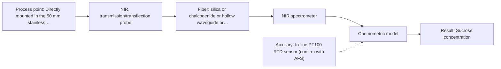

# First technical assessment: Complete enquiry for sugar concentration in a clear solution

## Answer

**Customer request (our summary):** The customer requests a suitable spectroscopy method and probe recommendation to monitor 5 to 15 % w/w sucrose concentration in an in-line aqueous process.

### Brief answer

We provisionally recommend in-line NIR transmission spectroscopy as the primary method to test first, routed via a 10 m low-OH silica fiber cable to the remote analyser. Raman spectroscopy serves as a secondary comparison option due to its low water background. Feasibility testing against your laboratory refractometer is required to verify whether the ±0.3 % w/w tolerance can be achieved, and probe seal compatibility with daily hot caustic cleaning must be confirmed.

### Proposal

- **Best current option:** O1 (recommended)
- **Basis:** supplied AFS sources
- **What would change it:** If the daily hot caustic CIP degrades transmission probe window seals, or if water absorption saturation cannot be resolved across the pathlength, option O2 (Raman immersion probe) would become the preferred method.
- **Next step:** Obtain caustic CIP temperature and line flange specifications, then conduct laboratory NIR transmission trials on 5 to 15 % w/w sucrose standards to establish calibration accuracy.

**Secondary evidence (external, not AFS material):** G1: E01 ¶12; G2: no usable external source found; G3: no usable external source found; G4: no usable external source found. See Expert detail.

**Decision status:** Provisional feasibility assessment

### Solution options

| ID | Tier | Methods | Confidence | Cost class, S01 Table 1 (p.6) | Ease of use | Maintenance | Performance fit | Sources |
|---|---|---|---|---|---|---|---|---|
| O1 | Recommended | M1 NIR, transmission/transflection probe | Low: open question: Q1, Q3 (starts at Medium); uncited auxiliary sensor | average cost (row 7) | Direct in-line transmission flow measurement | Automated cleaning during line CIP | Optimal transmission signal for clear liquids | [1: S01 p.18] [2: S02 p.7] |
| O2 | Simple | M2 Raman probe | Medium: open question: Q3 (starts at Medium) | high cost (row 12) | Single immersion probe without pathlength gap | Periodic window inspection during CIP | Low water background avoids pathlength balancing | [3: S01 p.16] [4: S01 p.11] |

*Confidence rates the basis of the advice (how much is known and cited), not a predicted accuracy or probability of success. It starts at High, or at Medium when a key question on the method or the option is open, and drops one level per weakness listed (floor Low).*

*Cost class is the relative rating in S01 Table 1 (p.6) for the in-line method+technique rows named (the highest one for a multi-method option); it is not a price.*

### Setup sketch

*Recommended option O1; drawn by code from the option, a schematic, not a configuration.*

### Key questions

1. What is the specific concentration, chemical formulation, and maximum temperature of the caustic solution used during daily CIP?
2. What port connection or mounting interface exists on the 50 mm pipe (for example, Tri-Clamp ferrule, weld socket, or bypass line)?
3. Are any other solutes, buffers, or flavour compounds present in the water besides sucrose?

## Expert detail

**Customer enquiry**

> We produce a clear, colourless aqueous sucrose solution and want to monitor its sucrose concentration in-line. The solution flows through a 50 mm stainless steel pipe at 20 to 30 °C and normal pressure; the expected range is 5 to 15 % w/w and our quality limit is plus or minus 0.3 % w/w. Our laboratory refractometer is the reference method and stays in use. The analyser can stand in a dry, safe room 10 m from the pipe, and the line is cleaned in place with hot caustic once a day. A reading every minute is enough. Please propose a method and probe for a first trial.

**Decision status:** Provisional feasibility assessment. A provisional assessment is justified because NIR transmission and transflection spectroscopy are technically well suited for clear liquids and compatible with a 10 m silica fiber link. Feasibility testing is required to verify that the required ±0.3 % w/w tolerance can be achieved against the reference refractometer and that probe materials withstand daily hot caustic CIP.

### Parameters

| ID | Parameter | Kind | Need | Measured by | Why | Sources |
|---|---|---|---|---|---|---|
| P1 | Sucrose concentration | quantitative | required | Spectroscopy: NIR | Primary process control parameter required to monitor quality within 5 to 15 % w/w and ±0.3 % w/w. | [1: S01 p.18] |
| P2 | Process fluid temperature | quantitative | required | Auxiliary sensor: In-line PT100 RTD sensor (engineering judgement: confirm availability with AFS) | Process temperature variations shift water absorption bands and must be tracked for calibration compensation. | *(no verified source: engineering judgement)* |
| P3 | Reference sucrose content | quantitative | required | Reference lab method: Laboratory refractometer | Required as the independent reference method to calibrate and validate multivariate spectroscopic models. | *(no verified source: engineering judgement)* |

### Solution option details

- **O1 cost drivers:** NIR spectrometer, transmission flow cell, 10 m silica fiber
- **O2 cost drivers:** Narrowband laser, Raman spectrometer, filtered immersion probe

### Premise check

- **Not covered:** An accuracy tolerance of ±0.3 % w/w is achievable in-line for aqueous sucrose using optical spectroscopy. The sources discuss quantitative NIR and Raman spectroscopy for bioprocesses and dairy streams, but provide no specific accuracy figures or detection limits for aqueous sucrose solutions. Meeting ±0.3 % w/w must be established experimentally. *(no verified source: engineering judgement)*
- **Supported:** Low-OH silica fiber optic cables can reliably transmit optical signals over a 10 m distance between the pipe and the safe room. Low-OH silica fibers are documented to support cable lengths of 100 to 300 m for remote industrial process control in Vis-NIR spectroscopy. [2: S02 p.7]
- **Not covered:** Standard in-line optical probes can withstand daily cleaning-in-place (CIP) with hot caustic. The sources do not specify caustic chemical resistance limits or maximum allowable CIP temperatures for fiber probe optical windows, housings, and sealing materials. *(no verified source: engineering judgement)*

### Requirements

**Stated by the customer**

- Aqueous sucrose solution at 5 to 15 % w/w concentration
- Liquid is clear and colourless
- Flow in a 50 mm stainless steel pipe at 20 to 30 °C and normal pressure
- Target accuracy tolerance of ±0.3 % w/w
- Laboratory refractometer serves as the continuing reference method
- Analyser located in a dry, safe room 10 m away from the sampling point
- Daily cleaning in place (CIP) using hot caustic
- Measurement response rate of at least one reading per minute

**Key unknowns**

- Exact CIP cleaning parameters (caustic concentration, peak temperature, and cycle duration)
- Available mechanical port or flange specification on the 50 mm pipe (e.g. Tri-Clamp, flange, flow cell)
- Flow velocity and potential presence of entrained gas bubbles in the line
- Achievable RMSEP accuracy of NIR transmission models for sucrose across the process temperature range
- Presence of any trace additives, minerals, or interfering dissolved compounds

### Clarification questions (most decision-relevant first)

Q1. What is the specific concentration, chemical formulation, and maximum temperature of the caustic solution used during daily CIP? *Why it matters:* Ensures the selected probe body, window material, and seals are chemically compatible and will not fail during cleaning. *(affects: installation, M1)*
Q2. What port connection or mounting interface exists on the 50 mm pipe (for example, Tri-Clamp ferrule, weld socket, or bypass line)? *Why it matters:* Determines whether an insertion transflection probe or a dedicated in-line flow cell should be used. *(affects: technique, installation)*
Q3. Are any other solutes, buffers, or flavour compounds present in the water besides sucrose? *Why it matters:* Additional dissolved species could introduce overlapping absorption bands that degrade calibration accuracy. *(affects: method, status)*
Q4. What is the typical liquid velocity and could cavitation or entrained bubbles pass the measurement zone? *Why it matters:* Bubbles cause baseline scattering shifts that interfere with transmission path measurements. *(affects: technique, M1)*

### Recommendation

- **M1 · Primary candidate: NIR, transmission/transflection probe.** NIR transmission or transflection is the established standard technique for clear, non-scattering liquids. It allows remote measurement over 10 m using standard low-OH silica optical fibers. [1: S01 p.18] [2: S02 p.7]
- **M2 · Comparison candidate: Raman probe.** Raman spectroscopy provides distinct fundamental vibrational bands with minimal spectral background from water. It uses standard silica fibers compatible with a 10 m run and avoids tight pathlength matching. [3: S01 p.16] [4: S01 p.11]
- **M3 · Not recommended: fluorescence probe.** Sucrose and water do not possess native fluorophores, making direct optical fluorimetry non-viable. Fluorescence is restricted to species exhibiting intrinsic emission. [5: S01 p.5] [6: REF §5]

### Measurement concept

- **Probe and geometry:** In-line transmission flow cell or immersion transflection probe with a controlled optical pathlength to sample the clear fluid volume without saturating water absorption bands.
- **Location:** Directly mounted in the 50 mm stainless steel process pipe in a flooded vertical or inclined section to prevent entrained gas bubble entrapment.
- **Fiber link:** Low-OH silica optical fiber cables spanning the 10 m distance between the in-line optical probe and the spectrometer located in the dry room. [7: S01 p.18] [8: S01 p.18] [2: S02 p.7]

### Spectral range

- **NIR:** Nominal NIR range is 780 to 2500 nm; the usable spectral range depends on the instrument, fiber and probe actually selected. [9: S01 p.10]
- **Raman:** Raman measurements typically use 785 nm laser excitation with the Raman shift measured in wavenumbers (cm-1); usable range depends on spectrometer filter cut-offs and detector sensitivity. [4: S01 p.11] [10: S01 p.15]

### Risks and uncertainty

- Intense water absorption bands in the near-infrared can saturate the spectral signal if the probe transmission gap is too wide. *(rules: R-GEN-3, R-GEN-4)* [11: S01 p.18]
- Process temperature fluctuations shift water vibrational bands and can degrade calibration accuracy beyond the required quality tolerance. *(rules: R-NIR-2, R-CAL-1)* [12: S01 p.10]
- Daily hot caustic CIP cycles could degrade internal probe seals, optical adhesives, or window mountings over time. *(rules: R-MIR-3)* [13: REF §5]
- Entrained gas bubbles or liquid turbulence in the 50 mm pipe can introduce baseline scattering offsets that distort transmission measurements. *(rules: R-GEN-5)* [14: S01 p.7]

### First feasibility experiment

1. **Prepare representative aqueous sucrose calibration standards spanning 5 to 15 % w/w across the process temperature range.** Cover the customer target concentration band and full operational temperature variation. *(no verified source: engineering judgement)*
2. **Measure each calibration sample using the laboratory refractometer to establish primary reference values.** Provide reference analytical data for chemometric model training and cross-validation. *(no verified source: engineering judgement)*
3. **Acquire NIR transmission spectra over controlled optical pathlengths across a 10 m silica fiber link.** Identify an optical pathlength that avoids water band saturation while preserving adequate sucrose signal-to-noise. [8: S01 p.18]
4. **Develop a PLS calibration model incorporating temperature compensation and validate on independent test samples.** Quantify prediction accuracy (RMSEP) and confirm robustness against thermal shifts. *(no verified source: engineering judgement)*
5. **Assess independent prediction errors against the target ±0.3 % w/w tolerance for go/no-go determination.** Establish whether the optical configuration meets the client process quality limit. *(no verified source: engineering judgement)*

**Reference measurements:** Laboratory refractometer measuring Brix / sucrose concentration across all calibration and validation runs.

**Decision basis:** Go if independent validation demonstrates an RMSEP within ±0.3 % w/w across the process temperature range; no-go if prediction error exceeds ±0.3 % w/w or water band saturation cannot be resolved.

### Assumptions

- The sucrose stream remains completely transparent and free of particulate matter or precipitation.
- Process flow and pressure in the 50 mm line do not generate optical path displacement or excessive gas entrainment.
- The 10 m cable conduit between the pipe and the dry room allows standard low-OH silica fiber routing.

### Not covered by the supplied sources

- Published quantitative limits of detection and RMSEP figures specifically for aqueous sucrose in-line monitoring.
- Caustic concentration and temperature tolerance ratings for standard AFS optical probe seals and bonding materials.

### Further notes

- **Chemometrics:** A Partial Least Squares (PLS) regression calibration is necessary to quantify sucrose overtone bands against the strong background water absorption. Temperature variations across 20 to 30 °C should be included in the calibration design to prevent baseline drift.
- **Real-time tracking:** A measurement interval of one reading per minute is easily satisfied by standard NIR or Raman acquisition times, providing robust trending and real-time process monitoring in the pipe.

### Secondary evidence (external, not AFS material)

*Found by a literature search for gaps the supplied AFS sources leave open. Not AFS material and not proof for this case; every quote below was verified verbatim against the fetched text.*

*Live search unavailable (library only: cache miss (europepmc); cache miss (openalex)); curated library only.*

**G1 · auxiliary sensor:** In-line measurement of Process fluid temperature with In-line PT100 RTD sensor

- **E01 ¶12** The strong sensitivity of OH bands to temperature presents a significant challenge when analyzing aqueous solutions with NIR and MIR, requiring the use of tempered sample holders. *How it applies:* This highlights the need to monitor and account for process fluid temperature, supporting the inclusion of an auxiliary temperature sensor like a PT100 RTD during NIR monitoring. *Limits and transfer risks:* The cited review references tempered sample holders in biopharmaceutical downstream processing rather than active temperature compensation with an in-line PT100 RTD in an industrial sucrose flow. *(supports O1)*
  > "Additionally, the temperature sensitivity of the OH bands is a severe drawback for measuring aqueous solution in NIR and MIR, which makes tempered sample holders necessary [29]."
  > A critical review of recent trends, and a future perspective of optical spectroscopy as PAT in biopharmaceutical downstream processing. (2020) · Analytical and bioanalytical chemistry · doi:10.1007/s00216-020-02407-z · https://europepmc.org/article/PMC/PMC7072065 · retrieved 2026-10-17, full text, licence: cc by, via curated library

**G2 · not in the supplied sources:** Published quantitative limits of detection and RMSEP figures specifically for aqueous sucrose in-line monitoring.

- No usable external source found.

**G3 · not in the supplied sources:** Caustic concentration and temperature tolerance ratings for standard AFS optical probe seals and bonding materials.

- No usable external source found.

**G4 · premise not covered:** An accuracy tolerance of ±0.3 % w/w is achievable in-line for aqueous sucrose using optical spectroscopy.

- No usable external source found.

### Evidence (verified quotes)

1. ✓ **S01 p.18** (general): "Transmission is the preferred method for transparent or semi-transparent liquids, such as skim milk, whey, or permeate."
2. ✓ **S02 p.7** (general): "Robust 100-300m cables made with Silica fibers of low OH-content (<0.1ppm OH) enable remote industrial process-control"
3. ✓ **S01 p.16** (general): "Raman is particularly well-suited for aqueous environments, as it exhibits low absorbance for water molecules compared to infrared methods."
4. ✓ **S01 p.11** (general): "The difference between the observed frequencies and the laser frequency is called the Raman shift, expressed in units of frequency-wavenumbers (cm-1)."
5. ✓ **S01 p.5** (general): "However, most chemicals do not exhibit this property."
6. ✓ **REF §5** (general): "Only a defined fluorescent species or a justified indicator."
7. ✓ **S01 p.18** (general): "The setup typically consists of a transmission / transflection probe, where light passes entirely through a defined layer of the sample to a detector on the opposite side."
8. ✓ **S01 p.18** (general): "the precise control of the optical pathlength (usually 1 - 10 mm); if the pathlength is too wide, the signal is lost to absorption; if too narrow, the sample represents a negligible volume."
9. ✓ **S01 p.10** (general): "NIR spectra (780-2500 nm) contain predominantly overtones and component bands of fundamental vibrations"
10. ✓ **S01 p.15** (application precedent): "Raman spectrometer and Raman fiber probe for contact measurements with 785 nm excitation wavelength"
11. ✓ **S01 p.18** (general): "if the pathlength is too wide, the signal is lost to absorption; if too narrow, the sample represents a negligible volume."
12. ✓ **S01 p.10** (general): "The broad absorption bands observed in this region overlap, suggesting the use of chemometrics for quantitative and qualitative analysis of spectral data."
13. ✓ **REF §5** (general): "Usable range limited by fiber and crystal; contact, fouling, compatibility."
14. ✓ **S01 p.7** (general): "Morphological factors, such as sample inhomogeneity (e.g., biological tissue) or process turbulence, must also be considered when selecting a measurement technique."

### Verification

- Citations verified: 22 of 22 (exact or whitespace/hyphen-tolerant match on the cited page, scope checked).
- Hard check failures before deterministic corrections: 0; still open: 0; soft warnings: 1; repair rounds: 1.
- External evidence (cache): 1 quote(s) verified verbatim (exact or whitespace/hyphen-tolerant, at most 400 characters and 2 sentences, against the cited paragraph); 0 item(s) dropped.
- External search: 4 query(ies), 0 hit(s), 3 source(s) (3 from the curated library); ⚠ library only: cache miss (europepmc); cache miss (openalex).
- External step: 2 model call(s), 5.8 s extra (cost in the run JSON).

*Run A07-20261018T072422Z-fd9d · models google/gemini-3.8-flash*
