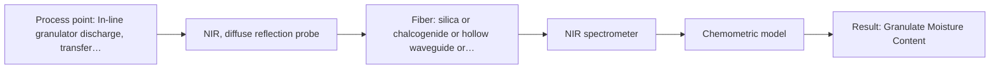

# First technical assessment: Accuracy guarantee, regulatory approval and price

## Answer

**Customer request:** Before we order, please confirm in writing that your NIR system will measure the moisture of our granulate to plus or minus 0.1 % and guarantee that our regulator will approve it for release testing. Please also include the price of the complete system.

### Brief answer

Written confirmation of plus or minus 0.1 % accuracy cannot be issued prior to testing, and regulatory approval cannot be promised by an instrument vendor. Diffuse reflectance NIR is the recommended technique to evaluate for granulate moisture, but quantitative performance depends on matrix-specific chemometric calibration against primary laboratory data. Feasibility trials on representative granulate samples are required to determine empirical performance, and commercial pricing will follow separately.

### Proposal

- **Best current option:** O2 (recommended)
- **Basis:** engineering judgement
- **What would change it:** Severe probe fouling or mechanical abrasion would favor the non-contact standoff configuration (O1).
- **Next step:** Conduct feasibility trials on representative granulate samples paired with primary laboratory reference testing to determine true empirical accuracy.

**Secondary evidence (external, not AFS material):** G1: no usable external source found; G2: no usable external source found; G3: no usable external source found. See Expert detail.

**Decision status:** Premise not supported by the sources

### Solution options

| ID | Tier | Methods | Confidence | Cost class, S01 Table 1 (p.6) | Ease of use | Maintenance | Performance fit | Sources |
|---|---|---|---|---|---|---|---|---|
| O1 | Simple | M2 NIR, diffuse reflection at a distance | Low: open question: Q1 (starts at Medium); a customer premise is contradicted, status: premise not supported | average cost (row 10) | Simple non-contact external optical installation | Periodic inspection of external window | Avoids material contact and fouling | [1: S01 p.10] [2: S01 p.6] [3: S01 p.10] |
| O2 | Recommended | M1 NIR, diffuse reflection probe | Low: open question: Q1, Q2 (starts at Medium); a customer premise is contradicted, status: premise not supported | average cost (row 8) | Direct probe mounting in vessel | Routine window inspection and cleaning | High signal collection in powders | [4: S01 p.6] [5: S01 p.10] |

*Confidence rates the basis of the advice (how much is known and cited), not a predicted accuracy or probability of success. It starts at High, or at Medium when a key question on the method or the option is open, and drops one level per weakness listed (floor Low).*

*Cost class is the relative rating in S01 Table 1 (p.6) for the in-line method+technique rows named (the highest one for a multi-method option); it is not a price.*

### Setup sketch

*Recommended option O2; drawn by code from the option, a schematic, not a configuration.*

### Key questions

1. What is the detailed formulation of the granulate, including active substances, binders, and baseline moisture range?
2. What primary laboratory reference method (such as Karl Fischer titration or Loss on Drying) and reference precision will be used for calibration?
3. What are the physical granulate properties (particle size, density, flow rate) and intended presentation geometry (direct contact probe vs. non-contact window)?

## Expert detail

**Customer enquiry**

> Before we order, please confirm in writing that your NIR system will measure the moisture of our granulate to plus or minus 0.1 % and guarantee that our regulator will approve it for release testing. Please also include the price of the complete system.

**Decision status:** Premise not supported by the sources. Written assurances of quantitative accuracy prior to testing and regulatory commitments are contradicted by engineering principles and reference guidance. An empirical feasibility trial and matrix-specific chemometric calibration are required before accuracy can be evaluated, and regulatory clearance depends on customer validation rather than vendor promises.

### Parameters

| ID | Parameter | Kind | Need | Measured by | Why | Sources |
|---|---|---|---|---|---|---|
| P1 | Granulate Moisture Content | quantitative | required | Spectroscopy: NIR | Directly required by the customer to monitor granulate drying and satisfy release specifications. | [6: S02 p.12] |
| P2 | Reference Water Content | quantitative | required | Reference lab method: Karl Fischer titration or Loss on Drying | Required to calibrate and validate the multivariate chemometric model against primary chemical measurements. | *(no verified source: engineering judgement)* |
| P3 | Granulate Temperature | quantitative | optional | Auxiliary sensor: In-line RTD or thermocouple (engineering judgement: confirm availability with AFS) | Temperature variations shift water absorption bands and should be tracked to maintain calibration robustness. | *(no verified source: engineering judgement)* |

### Solution option details

- **O1 cost drivers:** NIR spectrometer, non-contact reflection head, silica fiber cable
- **O2 cost drivers:** Industrial diffuse reflection immersion probe, process spectrometer, low-OH silica fibers

### Premise check

- **Contradicted:** An NIR system can be confirmed in writing to achieve plus or minus 0.1% moisture accuracy prior to feasibility testing and calibration. Quantitative accuracy cannot be confirmed beforehand; NIR bands overlap and depend on matrix-specific chemometric calibration, sample scattering, and physical variations. [7: REF §3] [8: REF §5] [9: S01 p.10]
- **Contradicted:** An equipment vendor can provide binding regulatory clearance for release testing. Vendors cannot promise regulatory clearance; analytical methods require customer-led qualification and formal validation against approved reference methods. [10: REF §3]

### Requirements

**Stated by the customer**

- Written confirmation of granulate moisture measurement to plus or minus 0.1%
- Assurance of regulatory acceptance for release testing
- Complete system pricing prior to ordering

**Key unknowns**

- Chemical composition and excipient matrix of the granulate
- Target moisture operating range and current reference method (e.g., Karl Fischer titration or Loss on Drying)
- Granulate particle size distribution and surface morphology
- Measurement interface geometry (in-line chute, pipe, bin, or at-line sample presentation)
- Target regulatory framework and formal validation requirements

### Clarification questions (most decision-relevant first)

Q1. What is the detailed formulation of the granulate, including active substances, binders, and baseline moisture range? *Why it matters:* Determines whether matrix absorption bands overlap with water absorption bands and whether calibration is feasible. *(affects: method, status)*
Q2. What primary laboratory reference method (such as Karl Fischer titration or Loss on Drying) and reference precision will be used for calibration? *Why it matters:* Spectroscopic calibration accuracy is mathematically bounded by the error and repeatability of the reference analytical method. *(affects: status, M1)*
Q3. What are the physical granulate properties (particle size, density, flow rate) and intended presentation geometry (direct contact probe vs. non-contact window)? *Why it matters:* Determines whether an immersion reflection probe or a stand-off non-contact reflection head is optimal to mitigate scattering variations. *(affects: technique, installation)*
Q4. Which regulatory guideline (such as ICH Q2/Q13 or pharmacopeial chapters) governs your release testing validation plan? *Why it matters:* Informs the structure of the multivariate method validation protocol required by your quality unit. *(affects: status)*

### Recommendation

- **M1 · Primary candidate: NIR, diffuse reflection probe.** Diffuse reflectance NIR is the standard optical technique for measuring moisture in scattering solid materials like granulates and powders. Water exhibits clear absorption bands in the near-infrared overtone region. [4: S01 p.6] [5: S01 p.10]
- **M2 · Comparison candidate: NIR, diffuse reflection at a distance.** Non-contact diffuse reflection measures scattering powders across a distance, avoiding direct probe fouling in moving solid beds. It provides an operational alternative to immersion contact probes. *Conditions:* Applicable if granulate flow tends to coat or abrade direct contact probe windows. [2: S01 p.6] [3: S01 p.10]
- **M3 · Not recommended: NIR, transmission/transflection probe.** Transmission fails in opaque solids and dense powders because optical penetration is insufficient. Transflection is designed for liquids and colloidal systems rather than dry granulates. [11: S01 p.18] [12: S01 p.6]

### Measurement concept

- **Probe and geometry:** Diffuse reflection probe in direct contact with flowing granulate, or a stand-off non-contact reflection head directed at the granulate stream through an optical viewport.
- **Location:** In-line granulator discharge, transfer chute, feed hopper, or tablet press feed frame.
- **Fiber link:** Standard or metal-coated Vis-NIR silica fiber-optic cable coupling the process reflection probe to a remote NIR spectrometer. [13: S01 p.10] [14: S01 p.15] [15: S02 p.6]

### Spectral range

- **NIR:** The nominal NIR range is 780 to 2500 nm; the usable range depends on the instrument, fiber and probe actually selected. [16: S01 p.10] [8: REF §5]

### Risks and uncertainty

- Particle size shifts and surface roughness can induce baseline scatter shifts that distort uncorrected moisture calibrations. *(rules: R-GEO-6, R-NIR-2)* [17: S01 p.17] [9: S01 p.10]
- Spectroscopic calibration performance is inherently limited by the uncertainty and reproducibility of the offline primary reference method. *(rules: R-CAL-1, R-GEN-2)* [18: REF §5]
- Window fouling or material buildup on an immersion probe can distort reflection readings over prolonged processing runs. *(rules: R-GEN-5)* [19: S01 p.7]

### First feasibility experiment

1. **Collect representative granulate samples across the expected manufacturing moisture range and particle size distributions.** Capture total physical and chemical matrix variance required for a robust calibration model. [20: REF §3]
2. **Perform duplicate primary reference laboratory measurements (e.g., Karl Fischer titration) for each calibration sample.** Establish reference values and quantify primary analytical error. [20: REF §3]
3. **Acquire diffuse reflectance NIR spectra using contact and non-contact probe interfaces under controlled conditions.** Evaluate optical signal-to-noise ratio and baseline stability across different measurement geometries. [21: S02 p.20]
4. **Develop multivariate PLS regression models with scatter pre-processing (SNV or second derivative) and validate on independent batches.** Determine empirical root mean square error of prediction (RMSEP) against the client accuracy goal. [22: S01 p.17]

**Reference measurements:** Independent primary analytical laboratory testing, such as Karl Fischer coulometric/volumetric titration or Loss on Drying (LOD).

**Decision basis:** Go/no-go is determined by whether the calibrated PLS model achieves the customer target prediction error of plus or minus 0.1% moisture on independent test sets.

### Assumptions

- The granulate matrix remains chemically consistent with moisture primarily present as free or bound water.
- A validated primary analytical reference method is available to generate reference values for calibration samples.

### Not covered by the supplied sources

- Commercial price lists, quotations, and equipment costs for complete turnkey NIR systems are not contained in the provided technical sources.

### Further notes

- **Chemometrics:** NIR moisture prediction relies on multivariate calibration (e.g., PLS regression) with scatter correction preprocessing such as Standard Normal Variate (SNV) or Multiplicative Scatter Correction (MSC) to suppress physical particle size variations.
- **Real-time tracking:** Fiber-optic diffuse reflection probes provide continuous, high-speed acquisition suited to tracking dynamic drying trajectories in granulators or fluid bed systems.

### Secondary evidence (external, not AFS material)

*Found by a literature search for gaps the supplied AFS sources leave open. Not AFS material and not proof for this case; every quote below was verified verbatim against the fetched text.*

*Live search unavailable (library only: cache miss (europepmc); cache miss (openalex)); curated library only.*

**G1 · auxiliary sensor:** In-line measurement of Granulate Temperature with In-line RTD or thermocouple

- No usable external source found.

**G2 · not in the supplied sources:** Commercial price lists, quotations, and equipment costs for complete turnkey NIR systems are not contained in the provided technical sources.

- No usable external source found.

**G3 · parameter without a source:** Measuring Reference Water Content: Required to calibrate and validate the multivariate chemometric model against primary chemical measurements.

- No usable external source found.

### Evidence (verified quotes)

1. ✓ **S01 p.10** (general): "measurements using diffuse reflectance, including measurements without direct contact with the sample, at a distance."
2. ✓ **S01 p.6** (general): "surface at a distance solid, powder 2-5 mm avera ge"
3. ✓ **S01 p.10** (general): "enables measurements using diffuse reflectance, including measurements without direct contact with the sample, at a distance."
4. ✓ **S01 p.6** (general): "Diffuse reflection-probe diffuse reflection Scattering media, powder 0.5-1 mm"
5. ✓ **S01 p.10** (general): "high light scattering by solid and dispersed samples, which enables measurements using diffuse reflectance"
6. ✓ **S02 p.12** (application precedent): "Optimal set of wavelengths to see moisture of media in contact"
7. ✓ **REF §3** (general): "Do not invent measured spectra or experimental results; accuracy, detection limits, response times, fiber lengths or other performance figures that no source supports"
8. ✓ **REF §5** (general): "It is not a product specification: actual spectral coverage, fiber length, component ratings, detection limits and accuracy depend on the configuration and the sample."
9. ✓ **S01 p.10** (general): "The broad absorption bands observed in this region overlap, suggesting the use of chemometrics for quantitative and qualitative analysis of spectral data."
10. ✓ **REF §3** (general): "a published application is a reason to test a method, not proof that it will work for a new customer."
11. ✓ **S01 p.18** (general): "it fails when the milk becomes too "thick" or fat-rich, as the light cannot penetrate the sample."
12. ✓ **S01 p.6** (general): "Transmission or transflection probe liquid, colloidal 1-10 mm avera ge"
13. ✓ **S01 p.10** (general): "the transparency of plain and quartz glass (which allows the use of standard optics and probes)"
14. ✓ **S01 p.15** (general): "located safely away from the vibration and dust of the manufacturing floor."
15. ✓ **S02 p.6** (general): "350 nm Standard VIS-NIR Silica Fibers Al/Cu-coated VIS-NIR Silica Fibers 2400 nm"
16. ✓ **S01 p.10** (general): "NIR spectra (780-2500 nm) contain predominantly overtones and component bands of fundamental vibrations"
17. ✓ **S01 p.17** (general): "the method is sensitive to the surface characteristics and fat globule size."
18. ✓ **REF §5** (general): "physical variation; calibration specific to the matrix."
19. ✓ **S01 p.7** (general): "Morphological factors, such as sample inhomogeneity (e.g., biological tissue) or process turbulence, must also be considered when selecting a measurement technique."
20. ✓ **REF §3** (general): "Representative samples or process states, independent reference measurements, what is compared, and the basis for the go / no-go decision."
21. ✓ **S02 p.20** (general): "1. Multi-Method Lab Trials AFS tests your process using all key fiber optic spectroscopy methods."
22. ✓ **S01 p.17** (general): "applying Multiplicative Scatter Correction (MSC) or Standard Normal Variate (SNV) transformations to remove physical interference caused by the scattering nature of the milk particles before using Partial Least Squares (PLS) regression"

### Verification

- Citations verified: 26 of 26 (exact or whitespace/hyphen-tolerant match on the cited page, scope checked).
- Hard check failures before deterministic corrections: 0; still open: 0; soft warnings: 0; repair rounds: 1.
- External evidence (cache): 0 quote(s) verified verbatim (exact or whitespace/hyphen-tolerant, at most 400 characters and 2 sentences, against the cited paragraph); 0 item(s) dropped.
- External search: 3 query(ies), 0 hit(s), 3 source(s) (3 from the curated library); ⚠ library only: cache miss (europepmc); cache miss (openalex).
- External step: 2 model call(s), 5.4 s extra (cost in the run JSON).

*Run A08-20261018T072422Z-448b · models google/gemini-3.8-flash*
