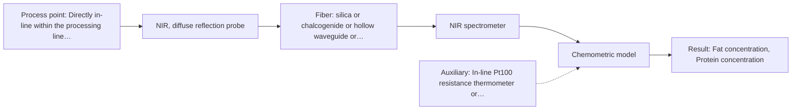

# First technical assessment: Fat and protein monitoring in opaque dairy product

## Answer

**Customer request (our summary):** The customer wants an initial spectroscopy concept and a practical comparison experiment to monitor fat and protein changes in an opaque, concentrated milk product flowing through a processing line.

### Brief answer

We recommend testing in-line NIR diffuse reflection as the primary method, using a flush-mounted probe in your pipe. Sourced precedents demonstrate that NIR reflection is well suited for opaque, concentrated dairy products, with scatter correction algorithms mitigating texture variations. A laboratory trial across your product's temperature and texture ranges, calibrated against your current laboratory checks, is the proposed next step.

### Proposal

- **Best current option:** O2 (recommended)
- **Basis:** supplied AFS sources
- **What would change it:** If the product opacity proves low enough that a transflection probe operates without saturation, O1 could provide a simpler alternative; conversely, if severe matrix interference prevents NIR separation, MIR-ATR (M2) would be re-evaluated.
- **Next step:** Run a laboratory feasibility trial with NIR diffuse reflection on representative concentrated milk samples across the full temperature and texture range, referencing your laboratory checks.

**Secondary evidence (external, not AFS material):** G1: no usable external source found; G2: no usable external source found; G3: no usable external source found; G4: no usable external source found. See Expert detail.

**Decision status:** Provisional feasibility assessment

### Solution options

| ID | Tier | Methods | Confidence | Cost class, S01 Table 1 (p.6) | Ease of use | Maintenance | Performance fit | Sources |
|---|---|---|---|---|---|---|---|---|
| O1 | Simple | M3 NIR, transmission/transflection probe | Low: open question: Q3 (starts at Medium); suitability for this sample not confirmed | average cost (row 7) | Straightforward immersion probe insertion | Regular cleaning to prevent gap clogging | Evaluates standard probe in viscous stream | [1: S01 p.18] [2: S01 p.18] |
| O2 | Recommended | M1 NIR, diffuse reflection probe | Low: open question: Q2, Q3 (starts at Medium); precedent only | average cost (row 8) | Flush-mount design avoids flow obstruction | Periodic optical window cleaning and CIP | Matches opaque scattering dairy product properties | [3: S01 p.17] [4: S01 p.17] [5: S01 p.17] |

*Confidence rates the basis of the advice (how much is known and cited), not a predicted accuracy or probability of success. It starts at High, or at Medium when a key question on the method or the option is open, and drops one level per weakness listed (floor Low).*

*Cost class is the relative rating in S01 Table 1 (p.6) for the in-line method+technique rows named (the highest one for a multi-method option); it is not a price.*

### Setup sketch

*Recommended option O2; drawn by code from the option, a schematic, not a configuration.*

### Key questions

1. What are the pipe dimensions, flow rates, operating pressures, and available sanitary port connections on the processing line?
2. What is the expected operating temperature range, and does the line undergo hot CIP/SIP cycles?
3. What are the baseline concentrations and expected variation ranges for fat and protein, along with your required measurement accuracy?

## Expert detail

**Customer enquiry**

> We produce an opaque, concentrated milk product that flows through a processing line. We currently sample it for fat and protein analysis and would like earlier information about composition changes. Product temperature and texture vary during production. We want an initial spectroscopy concept and a practical comparison experiment, while retaining our laboratory checks.

**Decision status:** Provisional feasibility assessment. In-line NIR diffuse reflection is well documented as the standard approach for quantifying fat and protein in opaque, concentrated dairy products. A provisional assessment is provided pending clarification of line operating conditions and validation against physical texture variations.

### Parameters

| ID | Parameter | Kind | Need | Measured by | Why | Sources |
|---|---|---|---|---|---|---|
| P1 | Fat concentration | quantitative | required | Spectroscopy: NIR | Primary target specified by the customer to monitor composition changes in the milk product. | [6: S01 p.17] |
| P2 | Protein concentration | quantitative | required | Spectroscopy: NIR | Primary target specified by the customer to track compositional quality and process consistency. | [6: S01 p.17] |
| P3 | Product temperature | quantitative | optional | Auxiliary sensor: In-line Pt100 resistance thermometer or thermocouple (engineering judgement: confirm availability with AFS) | Temperature variations alter NIR water absorption bands and sample rheology, making temperature tracking valuable for calibration compensation. | *(no verified source: engineering judgement)* |
| P4 | Reference laboratory fat and protein | quantitative | required | Reference lab method: Standard laboratory dairy analysis (e.g., Gerber/Rose-Gottlieb for fat, Kjeldahl for protein) | Required to train, calibrate, and independently validate multivariate chemometric models against an accepted analytical reference. | *(no verified source: engineering judgement)* |

### Solution option details

- **O1 cost drivers:** Standard NIR spectrometer, transflection probe, silica fiber
- **O2 cost drivers:** Process NIR spectrometer, sanitary diffuse reflection probe, silica cabling

### Premise check

- **Precedent only:** In-line optical spectroscopy can detect fat and protein composition changes in opaque, concentrated dairy products directly in the process line. Sourced literature demonstrates that NIR reflection spectroscopy can quantify fat and protein in opaque dairy products in-line, but this serves as an application precedent that must be validated under the customer's specific flow, temperature, and matrix conditions. [3: S01 p.17] [6: S01 p.17]

### Requirements

**Stated by the customer**

- Monitor composition changes in fat and protein earlier than manual sampling.
- Perform measurements directly on an opaque, concentrated milk product flowing through a processing line.
- Account for temperature and texture variations occurring during production.
- Establish an initial spectroscopy concept and a practical comparison experiment.
- Retain existing laboratory checks for reference validation.

**Key unknowns**

- Process line pipe diameter, flow velocity, operating pressure, and probe mounting port specifications.
- Specific operating temperature range and magnitude of thermal fluctuations.
- Expected quantitative concentration ranges for fat and protein, and target accuracy/repeatability.
- Cleaning-in-place (CIP) and steam-in-place (SIP) protocols, cleaning chemical exposures, and probe fouling tendency.
- Current laboratory reference analysis method, measurement precision, and sampling turnaround time.

### Clarification questions (most decision-relevant first)

Q1. What are the pipe dimensions, flow rates, operating pressures, and available sanitary port connections on the processing line? *Why it matters:* Determines the mechanical design, pressure rating, and mounting geometry of the immersion probe. *(affects: installation, technique)*
Q2. What is the expected operating temperature range, and does the line undergo hot CIP/SIP cycles? *Why it matters:* Dictates the thermal and chemical durability required for the probe optical head and seal materials. *(affects: installation, M1)*
Q3. What are the baseline concentrations and expected variation ranges for fat and protein, along with your required measurement accuracy? *Why it matters:* Establishes the quantitative dynamic range and performance criteria for multivariate model acceptance. *(affects: method, status)*
Q4. What reference laboratory method is currently used, and what is its analytical precision? *Why it matters:* The reference method precision defines the upper bound of calibration performance for the chemometric model. *(affects: status)*

### Recommendation

- **M1 · Primary candidate: NIR, diffuse reflection probe.** NIR diffuse reflection is specifically documented for opaque or concentrated dairy products, collecting backscattered light directly from the flowing stream. Multivariate scatter correction can mitigate physical interferences caused by texture and fat globule size variations. [3: S01 p.17] [4: S01 p.17] [5: S01 p.17]
- **M2 · Comparison candidate: MIR, ATR probe.** Mid-IR spectroscopy provides high molecular selectivity via fundamental vibrational bands, but requires tight optical contact with an ATR crystal. In concentrated dairy, fouling and shallow micrometre penetration pose operational challenges compared to NIR. *Conditions:* Evaluated as an alternative comparison if NIR cannot resolve specific overlapping components or if scatter interference proves unmanageable. [7: S01 p.18] [8: S01 p.5]
- **M3 · Conditional candidate: NIR, transmission/transflection probe.** Transflection probes offer a straightforward single-probe liquid interface that can sometimes bridge low- and high-fat dairy products. However, transmission setups often fail in thick or opaque media due to severe beam attenuation. *Conditions:* Applicable only if optical pathlength can be set narrow enough to avoid total signal saturation in the opaque product. [1: S01 p.18] [2: S01 p.18]

### Measurement concept

- **Probe and geometry:** A sanitary NIR diffuse reflection fiber probe flush-mounted into the processing pipe or vat wall. One set of fibers delivers light to the sample while adjacent fibers collect backscattered radiation from the flowing medium.
- **Location:** Directly in-line within the processing line pipe, positioned in a well-mixed zone free of air pockets.
- **Fiber link:** Low-OH Vis-NIR silica optical fiber cable connecting the in-line probe to a remote spectrometer located away from process vibration and washdown environments. [9: S01 p.17] [10: S02 p.7] [11: S01 p.15]

### Spectral range

- **NIR:** Nominal range is 780-2500 nm; usable range depends on the spectrometer detector, light source, and silica fiber transmission. [12: S01 p.10] [13: REF §5]

### Risks and uncertainty

- Variations in product texture and fat globule size alter physical light scattering, which can mimic composition changes if not adequately corrected. *(rules: R-GEO-6, R-NIR-2)* [14: S01 p.17]
- Fluctuations in product temperature shift water and organic absorption bands, causing systematic calibration drift unless compensated. *(rules: R-CAL-1, R-NIR-2)* [15: S01 p.10]
- Product deposition, milk stone formation, or biofilm accumulation on the optical probe window could degrade signal quality over time. *(rules: R-MIR-3)* [16: REF §5]
- Optical signal saturation or severe attenuation could occur if an unsuitable transflection pathlength is used in this opaque matrix. *(rules: R-GEO-2, R-GEN-4)* [2: S01 p.18]

### First feasibility experiment

1. **Collect representative samples of the concentrated milk product spanning expected production ranges of fat, protein, temperature, and texture.** Ensure the calibration dataset captures both chemical composition and matrix physical variability. [17: REF §3]
2. **Conduct laboratory benchtop NIR diffuse reflection measurements while recording sample temperatures and reference laboratory fat and protein values.** Evaluate spectral response, signal-to-noise ratio, and sensitivity to fat and protein overtone bands under controlled conditions. *(no verified source: engineering judgement)*
3. **Develop multivariate PLS regression models applying scatter correction algorithms (SNV/MSC) to decouple texture-induced scattering from chemical absorption.** Establish predictive capability and determine whether physical matrix shifts can be mathematically eliminated. [5: S01 p.17]
4. **Perform side-by-side comparative testing with an adjustable-path transflection probe and a MIR-ATR probe on the same sample set.** Confirm whether diffuse reflection outperforms transflection and evaluate whether mid-IR specificity justifies added hardware complexity. [18: REF §3]
5. **Validate PLS models on independent production batches collected over multiple production days and temperature runs.** Confirm model robustness against temporal process drift and unmodelled physical variations. *(no verified source: engineering judgement)*

**Reference measurements:** Parallel laboratory reference analyses of fat and protein content using the customer's established standard analytical testing protocols on all validation aliquots.

**Decision basis:** Go/no-go decision is based on achieving prediction error (RMSEP) and repeatability within the customer's specified target limits across the full operating temperature and texture range.

### Assumptions

- The concentrated milk product remains fluid enough under operating conditions to flow across a flush-mounted probe face without stagnant boundary layer stagnation.
- The customer's laboratory reference method provides sufficient repeatability and accuracy to serve as a reliable ground truth for PLS calibration.
- Process piping allows sanitary installation of a flush-mounted optical probe compatible with food-grade standards and CIP procedures.

### Not covered by the supplied sources

- Quantitative fat and protein prediction errors (e.g., specific RMSEP or R2 values) for concentrated milk.
- Maximum allowable line pressure and CIP temperature limits for specific AFS reflection probe assemblies.

### Further notes

- **Chemometrics:** Quantitative determination of fat and protein requires multivariate calibration using Partial Least Squares (PLS) regression. Spectral preprocessing, including Standard Normal Variate (SNV) or Multiplicative Scatter Correction (MSC), is necessary to eliminate physical baseline shifts caused by texture and fat globule size variations. Including sample temperature as an auxiliary variable or calibrating across the operational temperature range prevents thermal prediction errors.
- **Real-time tracking:** Continuous in-line diffuse reflection allows high-speed spectral acquisition, providing near real-time tracking of compositional trends directly in the pipe without manual sampling delays.
- **Future direction:** Once an in-line full-spectrum NIR model is established and key wavelengths are identified, the system could potentially transition to dedicated compact optical sensor systems (OMS) or LED-based photometers for cost-effective multi-point monitoring.

### Secondary evidence (external, not AFS material)

*Found by a literature search for gaps the supplied AFS sources leave open. Not AFS material and not proof for this case; every quote below was verified verbatim against the fetched text.*

*Live search unavailable (library only: cache miss (europepmc); cache miss (openalex)); curated library only.*

**G1 · auxiliary sensor:** In-line measurement of Product temperature with In-line Pt100 resistance thermometer or thermocouple

- No usable external source found.

**G2 · not in the supplied sources:** Quantitative fat and protein prediction errors (e.g., specific RMSEP or R2 values) for concentrated milk.

- No usable external source found.

**G3 · not in the supplied sources:** Maximum allowable line pressure and CIP temperature limits for specific AFS reflection probe assemblies.

- No usable external source found.

**G4 · parameter without a source:** Measuring Reference laboratory fat and protein: Required to train, calibrate, and independently validate multivariate chemometric models against an accepted analytical reference.

- No usable external source found.

### Evidence (verified quotes)

1. ✓ **S01 p.18** (application precedent): "In some cases, a Transflection probe can already be a combined solution working well for low-fat and high-fat containing milk products."
2. ✓ **S01 p.18** (general): "it fails when the milk becomes too "thick" or fat-rich, as the light cannot penetrate the sample."
3. ✓ **S01 p.17** (application precedent): "Inline NIR Reflection is primarily used for opaque or highly concentrated dairy products, such as yogurt, butter, or whole milk concentrates."
4. ✓ **S01 p.17** (general): "flush-mounted into a pipe or vat to interact directly with the flowing medium."
5. ✓ **S01 p.17** (general): "applying Multiplicative Scatter Correction (MSC) or Standard Normal Variate (SNV) transformations to remove physical interference caused by the scattering nature of the milk particles before using Partial Least Squares (PLS) regression to quantify fat and protein."
6. ✓ **S01 p.17** (application precedent): "using Partial Least Squares (PLS) regression to quantify fat and protein."
7. ✓ **S01 p.18** (application precedent): "advanced labs often incorporate Fluorescence, Raman, and Mid-Infrared (MIR) ATR fiber optic techniques to capture specific chemical or structural information that NIR might miss."
8. ✓ **S01 p.5** (general): "strong absorption in the mid-IR region limits the corresponding spectral method to the analysis of very thin samples (usually less than 50 μm), but it opens up the possibility of using attenuated total reflectance (ATR)"
9. ✓ **S01 p.17** (general): "the probe is flush-mounted into a pipe or vat to interact directly with the flowing medium. Because the light does not penetrate deeply, the method is sensitive to the surface characteristics and fat globule size."
10. ✓ **S02 p.7** (general): "Robust 100-300m cables made with Silica fibers of low OH-content (<0.1ppm OH) enable remote industrial process-control"
11. ✓ **S01 p.15** (general): "located safely away from the vibration and dust of the manufacturing floor."
12. ✓ **S01 p.10** (general): "NIR spectra (780-2500 nm) contain predominantly overtones and component bands of fundamental vibrations"
13. ✓ **REF §5** (general): "It is not a product specification: actual spectral coverage, fiber length, component ratings, detection limits and accuracy depend on the configuration and the sample."
14. ✓ **S01 p.17** (general): "the method is sensitive to the surface characteristics and fat globule size."
15. ✓ **S01 p.10** (general): "The broad absorption bands observed in this region overlap, suggesting the use of chemometrics for quantitative and qualitative analysis of spectral data."
16. ✓ **REF §5** (general): "Usable range limited by fiber and crystal; contact, fouling, compatibility."
17. ✓ **REF §3** (general): "Representative samples or process states, independent reference measurements, what is compared, and the basis for the go / no-go decision."
18. ✓ **REF §3** (general): "what is compared, and the basis for the go / no-go decision."

### Verification

- Citations verified: 27 of 27 (exact or whitespace/hyphen-tolerant match on the cited page, scope checked).
- Hard check failures before deterministic corrections: 0; still open: 0; soft warnings: 0; repair rounds: 1.
- External evidence (cache): 0 quote(s) verified verbatim (exact or whitespace/hyphen-tolerant, at most 400 characters and 2 sentences, against the cited paragraph); 0 item(s) dropped.
- External search: 4 query(ies), 0 hit(s), 3 source(s) (3 from the curated library); ⚠ library only: cache miss (europepmc); cache miss (openalex).
- External step: 2 model call(s), 4.4 s extra (cost in the run JSON).

*Run D02-20261018T072422Z-3e12 · models google/gemini-3.8-flash*
