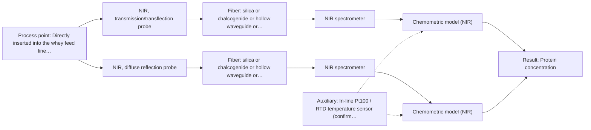

# First technical assessment: A clear whey stream before concentration

## Answer

**Customer request (our summary):** The customer wants to know whether optical spectroscopy can measure protein concentration in a dairy whey process stream that shifts between relatively clear and turbid conditions, against laboratory reference values.

### Brief answer

Near-infrared (NIR) spectroscopy using an immersible transflection probe is the primary candidate to test first. In dairy processing, transflection interfaces can handle both clear and scattering media within a single optical sensor. Laboratory feasibility trials on representative clear and turbid whey samples will establish the optimum optical pathlength and verify whether scatter-corrected chemometric models meet target accuracy across all operating states.

### Proposal

- **Best current option:** O1 (simple)
- **Basis:** supplied AFS sources
- **What would change it:** If laboratory feasibility testing demonstrates that extreme turbidity spikes completely block the transflection gap, a dual-probe approach (O2) or an ATR interface would be required.
- **Next step:** Obtain representative samples of clear and turbid whey to evaluate pathlength transmission limits and build a preliminary PLS calibration against reference laboratory values.

**Secondary evidence (external, not AFS material):** G1: E02 ¶12; G2: no usable external source found. See Expert detail.

**Decision status:** Provisional feasibility assessment

### Solution options

| ID | Tier | Methods | Confidence | Cost class, S01 Table 1 (p.6) | Ease of use | Maintenance | Performance fit | Sources |
|---|---|---|---|---|---|---|---|---|
| O1 | Simple | M1 NIR, transmission/transflection probe | Low: open question: Q1, Q2 (starts at Medium); precedent only | average cost (row 7) | Single probe in-line installation | Periodic optical gap cleaning check | Covers both clear and turbid whey | [1: S01 p.18] [2: S01 p.18] |
| O2 | Recommended | M1 NIR, transmission/transflection probe; M2 NIR, diffuse reflection probe | Medium: open question: Q1, Q2 (starts at Medium) | average cost (rows 7, 8) | Dual-probe testing or switchable geometry | Routine hygiene CIP and window inspection | Assures measurement across severe turbidity swings | [3: S01 p.18] [2: S01 p.18] [1: S01 p.18] [4: S01 p.17] [5: S01 p.18] |

*Confidence rates the basis of the advice (how much is known and cited), not a predicted accuracy or probability of success. It starts at High, or at Medium when a key question on the method or the option is open, and drops one level per weakness listed (floor Low).*

*Cost class is the relative rating in S01 Table 1 (p.6) for the in-line method+technique rows named (the highest one for a multi-method option); it is not a price.*

### Setup sketch

*Recommended option O2; drawn by code from the option, a schematic, not a configuration.*

### Key questions

1. What is the expected protein concentration range and the target analytical accuracy or precision?
2. What causes the turbidity increase (e.g., residual fat emulsion, suspended protein agglomerates, gas bubbles), and what is the maximum turbidity or optical density reached?
3. What are the line temperature, pressure, flow rate, and pipe diameter at the installation point before concentration?

## Expert detail

**Customer enquiry**

> Our dairy process includes a relatively clear whey stream before a concentration stage. We want to investigate whether spectroscopy can track protein concentration as the stream changes, with laboratory results used as the reference. The stream can become more turbid under some operating conditions. We need a first measurement concept that handles this change rather than assuming the liquid always remains clear.

**Decision status:** Provisional feasibility assessment. Near-infrared (NIR) spectroscopy is well established for dairy monitoring including whey streams, and a transflection probe offers a viable single-probe concept across varying turbidity levels, subject to experimental confirmation of optical pathlength and matrix bounds.

### Parameters

| ID | Parameter | Kind | Need | Measured by | Why | Sources |
|---|---|---|---|---|---|---|
| P1 | Protein concentration | quantitative | required | Spectroscopy: NIR | It is the primary target variable specified for in-line tracking before the concentration stage. | [6: S01 p.17] |
| P2 | Reference protein concentration | quantitative | required | Reference lab method: Laboratory Kjeldahl or Dumas protein analysis | Accurate primary chemical values are required to train and validate multivariate spectroscopic calibrations. | *(no verified source: engineering judgement)* |
| P3 | Stream temperature | quantitative | optional | Auxiliary sensor: In-line Pt100 / RTD temperature sensor (engineering judgement: confirm availability with AFS) | Fluid temperature shifts affect hydrogen bonding and water absorption bands in NIR, which can perturb quantitative calibrations if uncompensated. | *(no verified source: engineering judgement)* |

### Solution option details

- **O1 cost drivers:** Standard industrial NIR spectrometer and transflection fiber probe
- **O2 cost drivers:** NIR spectrometer with optical multiplexing, transflection and reflection probes, temperature input

### Premise check

- **Precedent only:** A single optical spectroscopy setup can handle dairy liquid streams transitioning between clear and turbid conditions. Published dairy PAT literature indicates that while transmission excels in clear whey and reflection in opaque streams, a transflection probe can provide a combined solution across low-fat and high-fat products, though this must be verified for the specific process stream. [1: S01 p.18]

### Requirements

**Stated by the customer**

- Monitor protein concentration in a dairy whey process stream located before a concentration stage
- Account for stream transitions between relatively clear and turbid operating conditions without assuming constant clarity
- Use laboratory analytical results as the calibration and validation reference

**Key unknowns**

- Expected protein concentration range and target measurement precision
- Physical and chemical source of turbidity changes (e.g., residual milk fat, suspended curd fines, mineral precipitation, pH shifts)
- Operating temperature, pressure, flow rate, and pipe geometry at the prospective probe location
- Cleaning-in-place (CIP) protocol, chemical exposure, and fouling tendencies on optical windows

### Clarification questions (most decision-relevant first)

Q1. What is the expected protein concentration range and the target analytical accuracy or precision? *Why it matters:* Defining the working range and required accuracy determines whether NIR overtone absorption has sufficient sensitivity or if specialized pathlength control is needed. *(affects: method, technique)*
Q2. What causes the turbidity increase (e.g., residual fat emulsion, suspended protein agglomerates, gas bubbles), and what is the maximum turbidity or optical density reached? *Why it matters:* Excessive turbidity will saturate transmission signals and necessitate either an adjustable transflection gap or a reflectance interface. *(affects: technique, M1, M2)*
Q3. What are the line temperature, pressure, flow rate, and pipe diameter at the installation point before concentration? *Why it matters:* Process mechanics dictate probe insertion depth, seal ratings, and the potential need for sample temperature compensation in the chemometric model. *(affects: installation)*
Q4. What cleaning-in-place (CIP) regimens and chemicals (e.g., hot caustic, nitric acid) are used, and how frequently does fouling occur? *Why it matters:* Wetted probe materials (sapphire window, stainless steel or Hastelloy shaft) and seal elastomers must withstand sanitation cycles without optical degradation. *(affects: installation)*

### Recommendation

- **M1 · Primary candidate: NIR, transmission/transflection probe.** NIR transmission is the standard approach for clear whey process streams, and transflection probes can accommodate both clear and scattering dairy products in a single interface. [2: S01 p.18] [1: S01 p.18]
- **M2 · Comparison candidate: NIR, diffuse reflection probe.** Diffuse reflection provides an alternative if process upsets generate high turbidity that completely blocks transflection light transmission. *Conditions:* Applies if the stream turbidity regularly exceeds the optical penetration depth of transflection geometries. [4: S01 p.17] [5: S01 p.18]
- **M3 · Conditional candidate: MIR, ATR probe.** Mid-IR ATR samples only an evanescent wave layer of a few micrometres, making the spectral measurement insensitive to changes in bulk liquid turbidity. *Conditions:* Applies if severe scatter variability prevents robust NIR calibration and protein deposition/fouling on the ATR crystal can be managed. [7: S01 p.10] [8: S01 p.13]

### Measurement concept

- **Probe and geometry:** An immersible NIR transflection fiber optic probe with a controlled optical pathlength to balance sensitivity in clear whey with light throughput during turbid excursions.
- **Location:** Directly inserted into the whey feed line upstream of the concentration unit, oriented to ensure continuous representative flow across the optical gap.
- **Fiber link:** Low-OH Vis-NIR silica fiber cables connecting the process probe to an industrial NIR spectrometer positioned safely away from process washdowns. [9: S01 p.18] [10: S02 p.7]

### Spectral range

- **NIR:** The nominal NIR range is 780 to 2500 nm; usable spectral coverage depends on the specific spectrometer, fiber attenuation, and probe optics chosen. [11: S01 p.10]

### Risks and uncertainty

- If turbidity becomes excessive during upset conditions, light transmission through a fixed transflection gap may extinguish completely, blinding the detector. *(rules: R-GEO-2, R-GEN-4)* [12: S01 p.18]
- Physical light scattering from turbidity shifts alters spectral baselines and can be conflated with protein concentration changes unless scatter correction is applied. *(rules: R-GEO-6, R-NIR-2)* [13: S01 p.17]
- Protein fouling or biofilm build-up on the probe optical surfaces can distort transmission and mimic false concentration drift. *(rules: R-MIR-3, R-CAL-1)* [14: REF §5]
- A multivariate calibration developed exclusively on clear whey will fail when the matrix shifts to a turbid scattering regime. *(rules: R-CAL-1)* [15: REF §5]

### First feasibility experiment

1. **Collect representative whey grab samples covering the full anticipated range of protein concentrations and turbidity levels (clear, intermediate, and peak turbid states).** Capture total chemical and physical variance in the calibration matrix. [16: REF §3]
2. **Record NIR spectra off-line across candidate optical pathlengths using a fiber probe to determine transmission saturation thresholds.** Identify an optical pathlength that avoids signal saturation during turbid episodes while retaining protein band sensitivity during clear operations. [17: S01 p.18]
3. **Perform standard reference laboratory analyses (e.g., Kjeldahl or Dumas total protein) on all collected samples.** Provide certified reference values for chemometric calibration and cross-validation. [16: REF §3]
4. **Develop partial least squares (PLS) regression models using scatter preprocessing algorithms such as Standard Normal Variate (SNV) or Multiplicative Scatter Correction (MSC).** Mathematically decouple physical light-scattering variations caused by turbidity from true chemical protein absorption. [18: S01 p.17]
5. **Validate the PLS model on independent process batches spanning both clear and turbid conditions to verify prediction accuracy against customer criteria.** Confirm model robustness against turbidity fluctuations without overfitting. *(no verified source: engineering judgement)*

**Reference measurements:** Independent laboratory reference protein analyses (such as Kjeldahl or Dumas nitrogen determinations) run on split samples taken concurrently with spectral acquisition.

**Decision basis:** The project proceeds to on-line pilot testing if the root mean square error of prediction (RMSEP) on independent held-out validation batches meets the customer's specified accuracy requirement across both clear and turbid operating states.

### Assumptions

- Protein concentration in the pre-concentration whey stream is within the detectable range for near-infrared spectroscopy.
- Turbidity excursions remain within an optical density range that does not entirely extinguish transmitted light at the chosen transflection gap.
- Process temperature variations can be monitored and integrated into multivariate calibration or controlled within reasonable bounds.

### Further notes

- **Chemometrics:** Quantitative protein determination in variable dairy streams requires multivariate calibration (PLS regression). Scatter-correction preprocessing, such as Standard Normal Variate (SNV) or Multiplicative Scatter Correction (MSC), must be applied to isolate protein absorption from baseline variations induced by turbidity changes.
- **Real-time tracking:** In-line fiber probes allow continuous, near-real-time spectrum acquisition without taking grab samples, providing immediate visibility into protein fluctuations prior to concentration.
- **Future direction:** If turbidity transitions correlate with residual fat globule size or suspension destabilization, the spectral scattering baseline itself can be evaluated as an indirect real-time indicator of upstream process stability.

### Secondary evidence (external, not AFS material)

*Found by a literature search for gaps the supplied AFS sources leave open. Not AFS material and not proof for this case; every quote below was verified verbatim against the fetched text.*

*Live search unavailable (library only: cache miss (europepmc); cache miss (openalex)); curated library only.*

**G1 · auxiliary sensor:** In-line measurement of Stream temperature with In-line Pt100 / RTD temperature sensor

- **E02 ¶12** Water OH bands exhibit substantial temperature sensitivity in NIR and MIR measurements of aqueous systems, requiring temperature-controlled sample holders. *How it applies:* Because temperature changes distort water absorption bands in aqueous streams, tracking stream temperature with an auxiliary sensor such as an RTD could be critical for compensation. The team should evaluate how temperature shifts in the whey process affect NIR spectral features and model stability. *Limits and transfer risks:* The cited review addresses biopharmaceutical downstream processing rather than dairy whey streams, and it mentions tempered sample holders rather than in-line RTD probe integration. *(supports O2)*
  > "Additionally, the temperature sensitivity of the OH bands is a severe drawback for measuring aqueous solution in NIR and MIR, which makes tempered sample holders necessary [29]."
  > A critical review of recent trends, and a future perspective of optical spectroscopy as PAT in biopharmaceutical downstream processing. (2020) · Analytical and bioanalytical chemistry · doi:10.1007/s00216-020-02407-z · https://europepmc.org/article/PMC/PMC7072065 · retrieved 2026-10-17, full text, licence: cc by, via curated library

**G2 · parameter without a source:** Measuring Reference protein concentration: Accurate primary chemical values are required to train and validate multivariate spectroscopic calibrations.

- No usable external source found.

### Evidence (verified quotes)

1. ✓ **S01 p.18** (application precedent): "In some cases, a Transflection probe can already be a combined solution working well for low-fat and high-fat containing milk products."
2. ✓ **S01 p.18** (application precedent): "Transmission is the preferred method for transparent or semi-transparent liquids, such as skim milk, whey, or permeate."
3. ✓ **S01 p.18** (application precedent): "The Advantage of Dual-Technique Availability: having both fiber optic techniques available in a lab rather than relying on one provides the flexibility needed to monitor the entire production chain."
4. ✓ **S01 p.17** (application precedent): "NIR Reflection is primarily used for opaque or highly concentrated dairy products, such as yogurt, butter, or whole milk concentrates."
5. ✓ **S01 p.18** (general): "reflection can work well in highly scattering environments but can be less representative for clear liquids."
6. ✓ **S01 p.17** (application precedent): "before using Partial Least Squares (PLS) regression to quantify fat and protein."
7. ✓ **S01 p.10** (general): "ATR fiber probes (Fig.1) enable the analysis of liquids and solid elastic samples, such as biological tissue, using specialized probes utilizing high-transmission fiber optics in the Mid-IR region."
8. ✓ **S01 p.13** (general): "typically at a depth of few microns"
9. ✓ **S01 p.18** (general): "the precise control of the optical pathlength (usually 1 - 10 mm); if the pathlength is too wide, the signal is lost to absorption; if too narrow, the sample represents a negligible volume."
10. ✓ **S02 p.7** (general): "Robust 100-300m cables made with Silica fibers of low OH-content (<0.1ppm OH) enable remote industrial process-control"
11. ✓ **S01 p.10** (general): "NIR spectra (780-2500 nm) contain predominantly overtones and component bands of fundamental vibrations of molecules and atomic groups"
12. ✓ **S01 p.18** (general): "it fails when the milk becomes too "thick" or fat-rich, as the light cannot penetrate the sample."
13. ✓ **S01 p.17** (general): "the method is sensitive to the surface characteristics and fat globule size."
14. ✓ **REF §5** (general): "Usable range limited by fiber and crystal; contact, fouling, compatibility."
15. ✓ **REF §5** (general): "physical variation; calibration specific to the matrix."
16. ✓ **REF §3** (general): "Representative samples or process states, independent reference measurements, what is compared, and the basis for the go / no-go decision."
17. ✓ **S01 p.18** (general): "if the pathlength is too wide, the signal is lost to absorption; if too narrow, the sample represents a negligible volume."
18. ✓ **S01 p.17** (general): "applying Multiplicative Scatter Correction (MSC) or Standard Normal Variate (SNV) transformations to remove physical interference caused by the scattering nature of the milk particles before using Partial Least Squares (PLS) regression to quantify fat and protein."

### Verification

- Citations verified: 22 of 22 (exact or whitespace/hyphen-tolerant match on the cited page, scope checked).
- Hard check failures before deterministic corrections: 0; still open: 0; soft warnings: 0; repair rounds: 1.
- External evidence (cache): 1 quote(s) verified verbatim (exact or whitespace/hyphen-tolerant, at most 400 characters and 2 sentences, against the cited paragraph); 0 item(s) dropped.
- External search: 4 query(ies), 0 hit(s), 3 source(s) (3 from the curated library); ⚠ library only: cache miss (europepmc); cache miss (openalex).
- External step: 2 model call(s), 5.9 s extra (cost in the run JSON).

*Run D03-20261018T072422Z-1613 · models google/gemini-3.8-flash*
