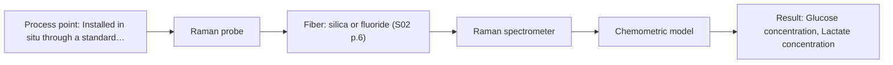

# First technical assessment: Glucose and lactate trends in an aqueous bioprocess

## Answer

**Customer request (our summary):** The customer is evaluating an in situ spectroscopy pilot to monitor glucose and lactate in an aqueous cell culture process against existing laboratory sample measurements.

### Brief answer

We recommend testing an in situ Raman spectroscopy immersion probe first, as Raman provides specific molecular fingerprints for glucose and lactate with minimal water interference. Laboratory reference data from discrete samples should be collected in parallel to build and validate chemometric calibration models across changing cell densities. Key open items to confirm are the expected metabolite concentration ranges, broth turbidity, and bioreactor port specifications.

### Proposal

- **Best current option:** O2 (recommended)
- **Basis:** supplied AFS sources
- **What would change it:** If media autofluorescence prevents resolution of Raman spectral peaks, or if cell turbidity remains very low throughout the run allowing a simpler NIR transmission setup.
- **Next step:** Measure offline broth samples from early, mid, and late cultivation stages with a benchtop Raman probe to evaluate signal-to-noise ratio and baseline fluorescence.

**Secondary evidence (external, not AFS material):** G1: no usable external source found; G2: no usable external source found. See Expert detail.

**Decision status:** Provisional feasibility assessment

### Solution options

| ID | Tier | Methods | Confidence | Cost class, S01 Table 1 (p.6) | Ease of use | Maintenance | Performance fit | Sources |
|---|---|---|---|---|---|---|---|---|
| O1 | Simple | M2 NIR, transmission/transflection probe | Low: open question: Q1 (starts at Medium); sample clarity unknown | average cost (row 7) | Standard optical immersion probe setup | Periodic optical path inspection and cleaning | Tracks millimolar nutrients if turbidity allows | [1: S01 p.16] [2: S01 p.18] |
| O2 | Recommended | M1 Raman probe | Medium: open question: Q1 (starts at Medium) | high cost (row 12) | Single immersion probe in reactor port | Probe window cleaning and laser verification | Direct fingerprinting with low water interference | [3: S01 p.16] [4: S01 p.16] |

*Confidence rates the basis of the advice (how much is known and cited), not a predicted accuracy or probability of success. It starts at High, or at Medium when a key question on the method or the option is open, and drops one level per weakness listed (floor Low).*

*Cost class is the relative rating in S01 Table 1 (p.6) for the in-line method+technique rows named (the highest one for a multi-method option); it is not a price.*

### Setup sketch

*Recommended option O2; drawn by code from the option, a schematic, not a configuration.*

### Key questions

1. What are the expected concentration ranges and required detection limits for glucose and lactate throughout the cultivation?
2. What is the expected peak cell density or turbidity of the broth, and is sparging or aeration active at the probe location?
3. What bioreactor port geometry, probe insertion length, and sterilization protocols (e.g. autoclaving, steam-in-place, or clean-in-place) must the probe meet?

## Expert detail

**Customer enquiry**

> We run a cell culture process in an aqueous medium. Glucose and lactate are measured from samples, and the delay makes it difficult to see changes promptly. We are exploring an in situ spectroscopy pilot that can be checked against those existing laboratory measurements. The medium and cell population change during the run; we have not yet selected a probe or a calibration strategy.

**Decision status:** Provisional feasibility assessment. Raman spectroscopy has documented precedent for monitoring glucose and lactate in aqueous bioprocesses with minimal water interference, but a provisional assessment is necessary because concentration ranges, turbidity, and bioreactor port specifications remain unconfirmed.

### Parameters

| ID | Parameter | Kind | Need | Measured by | Why | Sources |
|---|---|---|---|---|---|---|
| P1 | Glucose concentration | quantitative | required | Spectroscopy: Raman | Primary carbon source and key metabolic variable requiring prompt feedback to regulate feeding. | [4: S01 p.16] |
| P2 | Lactate concentration | quantitative | required | Spectroscopy: Raman | Major metabolic byproduct indicating cellular metabolic state and culture viability. | [4: S01 p.16] |
| P3 | Cell population / turbidity | quantitative | optional | Reference lab method: Laboratory cell counter or offline spectrophotometer | Cell density variations change background scattering and define the evolving matrix throughout the run. | *(no verified source: engineering judgement)* |

### Solution option details

- **O1 cost drivers:** Standard transmission probe and halogen source
- **O2 cost drivers:** Raman spectrometer, stabilized laser, filtered probe

### Premise check

- **Precedent only:** In situ optical spectroscopy can track dissolved glucose and lactate in an aqueous cell culture broth. Literature precedent demonstrates Raman spectroscopy tracking glucose and lactate in bioreactors, but feasibility and predictive performance depend on the specific media matrix and must be experimentally verified. [5: S01 p.16]

### Requirements

**Stated by the customer**

- In situ monitoring of glucose and lactate during an aqueous cell culture process.
- Eliminate delays associated with manual sample collection and offline analysis.
- Accommodate changing medium composition and cell population over the course of the run.
- Validate in situ optical measurements against existing laboratory sample measurements.

**Key unknowns**

- Expected concentration ranges and required detection limits for glucose and lactate.
- Broth optical turbidity, peak cell density, and presence of bubbles from aeration.
- Bioreactor port type, insertion length, and sanitization or sterilization requirements.
- Specific analytical method and precision of the current laboratory reference assays.
- Potential autofluorescence background originating from the cell culture media.

### Clarification questions (most decision-relevant first)

Q1. What are the expected concentration ranges and required detection limits for glucose and lactate throughout the cultivation? *Why it matters:* Confirms whether the target concentrations remain within the sensitivity and linear dynamic range of the spectroscopic technique. *(affects: method)*
Q2. What is the expected peak cell density or turbidity of the broth, and is sparging or aeration active at the probe location? *Why it matters:* High turbidity and bubbles cause optical scattering that dictates probe geometry and optical window placement. *(affects: technique)*
Q3. What bioreactor port geometry, probe insertion length, and sterilization protocols (e.g. autoclaving, steam-in-place, or clean-in-place) must the probe meet? *Why it matters:* Determines probe dimensions, sealing materials, and mechanical construction compatible with sanitary process requirements. *(affects: installation)*
Q4. What analytical instrumentation is used for the laboratory reference measurements, and what is its baseline measurement uncertainty? *Why it matters:* Reference measurement precision defines the upper bound of chemometric calibration model accuracy. *(affects: status)*

### Recommendation

- **M1 · Primary candidate: Raman probe.** Raman spectroscopy provides distinct molecular vibrational fingerprints for dissolved metabolites and is well suited to aqueous environments due to low water absorbance. It measures directly in situ via an optical immersion probe. [3: S01 p.16] [4: S01 p.16]
- **M2 · Conditional candidate: NIR, transmission/transflection probe.** NIR transmission or transflection can track major nutrients in the millimolar range using standard optical hardware. However, increasing cell density can attenuate the beam and limit transmission. *Conditions:* Applies only if broth turbidity and optical pathlength allow adequate transmission without light saturation across the entire run. [1: S01 p.16] [2: S01 p.18]
- **M3 · Comparison candidate: MIR, ATR probe.** Mid-IR spectroscopy provides strong fundamental vibrational bands via ATR immersion probes. However, strong water solvent absorption and biomass deposition onto the ATR crystal present significant practical operational hurdles. *Conditions:* Requires intimate contact with the crystal face and careful compensation of the strong water background. [6: S01 p.5] [7: S01 p.10]

### Measurement concept

- **Probe and geometry:** An immersion Raman fiber-optic probe with an optical filter assembly positioned directly in contact with the aqueous cell culture broth.
- **Location:** Installed in situ through a standard bioreactor port or an external recirculation loop to enable sampling-free process monitoring.
- **Fiber link:** Silica optical fiber cables connecting the bioreactor immersion probe to a remotely situated Raman spectrometer and excitation laser, isolating sensitive optics from vessel vibration. [8: S01 p.15] [9: S02 p.7]

### Spectral range

- **Raman:** Raman spectroscopy measures Raman shift in frequency-wavenumbers (cm-1), while the excitation wavelength is stated separately; the usable range depends on the instrument, fiber, and probe selected. [10: S01 p.11]
- **NIR:** Nominal NIR range is 780 to 2500 nm; usable range depends on the spectrometer detector, fiber material transmission, and chosen optical pathlength. [11: S01 p.10]

### Risks and uncertainty

- Autofluorescence from complex media components or extracellular metabolites could overlap and swamp weak Raman vibrational signals. *(rules: R-RAM-1)* [12: S01 p.11]
- Matrix alterations caused by nutrient consumption and biomass growth require robust chemometric calibration specific to the evolving matrix. *(rules: R-CAL-1)* [13: REF §5]
- Rising cell density and aeration turbulence can introduce physical scattering variations and potential biofilm adhesion to the probe face. *(rules: R-GEN-5)* [14: S01 p.7]
- NIR transmission approaches risk signal saturation as increasing biomass and turbidity impede light transmission through the pathlength. *(rules: R-GEO-2)* [2: S01 p.18]

### First feasibility experiment

1. **Collect representative broth samples across the complete cultivation run, spanning inoculation, exponential growth, and stationary phases.** Capture the full chemical, morphological, and optical matrix variation of the process. [15: REF §3]
2. **Perform benchtop Raman spectroscopic screening on broth samples across varied laser integration settings to evaluate signal strength and fluorescence background.** Confirm that characteristic glucose and lactate bands are detectable above background luminescence. *(no verified source: engineering judgement)*
3. **Acquire parallel independent reference measurements for glucose and lactate using the established laboratory analyzer.** Generate accurate reference values required to build multivariate calibration models. *(no verified source: engineering judgement)*
4. **Construct multivariate regression models (such as PLS) and evaluate their predictive accuracy on independent, held-out culture batches.** Validate model generalization against changing cell populations and unmodeled broth variations. *(no verified source: engineering judgement)*
5. **Compare the resulting predictive performance against customer-defined precision thresholds under simulated agitation conditions.** Establish a definitive go/no-go outcome before committing to bioreactor probe installation. *(no verified source: engineering judgement)*

**Reference measurements:** Validated laboratory assays (e.g., enzymatic bioanalyzer or HPLC) performed on discrete broth samples drawn synchronously with spectral acquisition.

**Decision basis:** Go/no-go criteria must be defined numerically by the customer based on required prediction accuracy (e.g., target RMSEP or relative percentage error) and required lower limits of detection for glucose and lactate.

### Assumptions

- The cell culture broth does not exhibit severe autofluorescence that completely obscures Raman inelastic scattering.
- The bioreactor contains an accessible port (or external recirculation bypass) suitable for in situ probe insertion.
- The customer's laboratory reference assay provides sufficient repeatability to serve as a reliable calibration standard.

### Not covered by the supplied sources

- Specific limits of detection (LOD) and root mean square error of prediction (RMSEP) for glucose and lactate in the customer's specific cell broth.
- Standard sanitary port fitting sizes, probe shaft lengths, and autoclavable sealing ratings.

### Further notes

- **Chemometrics:** A multivariate calibration model (such as Partial Least Squares regression) using spectral derivative or baseline preprocessing will be necessary to resolve overlapping Raman features and account for changing cell density backgrounds across the batch.
- **Real-time tracking:** In situ immersion Raman spectroscopy permits continuous or high-frequency periodic acquisition directly in the reactor vessel, eliminating sampling lag and allowing immediate visibility into nutrient consumption and metabolite accumulation.
- **Future direction:** If independent real-time monitoring of biomass or cell density becomes necessary alongside metabolites, an auxiliary UV-Vis transmission or ATR sensor channel could be integrated into the pilot to track cell suspension turbidity.

### Secondary evidence (external, not AFS material)

*Found by a literature search for gaps the supplied AFS sources leave open. Not AFS material and not proof for this case; every quote below was verified verbatim against the fetched text.*

*Live search unavailable (library only: cache miss (europepmc); cache miss (openalex)); curated library only.*

**G1 · not in the supplied sources:** Specific limits of detection (LOD) and root mean square error of prediction (RMSEP) for glucose and lactate in the customer's specific cell broth.

- No usable external source found.

**G2 · not in the supplied sources:** Standard sanitary port fitting sizes, probe shaft lengths, and autoclavable sealing ratings.

- No usable external source found.

### Evidence (verified quotes)

1. ✓ **S01 p.16** (application precedent): "NIR spectroscopy is effective for tracking major components like glucose or glycerol in the millimolar range but may lack the sensitivity to detect trace compounds below 0.1 percent."
2. ✓ **S01 p.18** (general): "it fails when the milk becomes too "thick" or fat-rich, as the light cannot penetrate the sample."
3. ✓ **S01 p.16** (general): "Raman is particularly well-suited for aqueous environments, as it exhibits low absorbance for water molecules compared to infrared methods."
4. ✓ **S01 p.16** (application precedent): "While UV/Vis tracks growth, Raman spectroscopy can be used in the same reactor to provide a "molecular fingerprint" for direct detection of specific metabolites like glucose, acetate, or lactate."
5. ✓ **S01 p.16** (application precedent): "While UV/Vis tracks growth, Raman spectroscopy can be used in the same reactor to provide a "molecular fingerprint" for direct detection of specific metabolites like glucose, acetate, or lactate. This combination is practical because Raman is particularly well-suited for aqueous environments, as it exhibits low absorbance for water molecules compared to infrared methods."
6. ✓ **S01 p.5** (general): "strong absorption in the mid-IR region limits the corresponding spectral method to the analysis of very thin samples (usually less than 50 μm), but it opens up the possibility of using attenuated total reflectance (ATR)"
7. ✓ **S01 p.10** (general): "ATR fiber probes (Fig.1) enable the analysis of liquids and solid elastic samples"
8. ✓ **S01 p.15** (general): "The use of fiber optics is critical here, as it allows the sensitive spectrometers to be located safely away from the vibration and dust of the manufacturing floor."
9. ✓ **S02 p.7** (general): "Free of Polymer jacket fluorescence for Raman and Fluo- Spectroscopy"
10. ✓ **S01 p.11** (general): "The difference between the observed frequencies and the laser frequency is called the Raman shift, expressed in units of frequency-wavenumbers (cm-1)."
11. ✓ **S01 p.10** (general): "NIR spectra (780-2500 nm) contain predominantly overtones and component bands of fundamental vibrations"
12. ✓ **S01 p.11** (general): "superposition of luminescence (fluorescence), which has a significantly higher intensity."
13. ✓ **REF §5** (general): "Weak signal, fluorescence background; calibration specific to the matrix."
14. ✓ **S01 p.7** (general): "Morphological factors, such as sample inhomogeneity (e.g., biological tissue) or process turbulence, must also be considered when selecting a measurement technique."
15. ✓ **REF §3** (general): "Representative samples or process states, independent reference measurements, what is compared, and the basis for the go / no-go decision."

### Verification

- Citations verified: 21 of 21 (exact or whitespace/hyphen-tolerant match on the cited page, scope checked).
- Hard check failures before deterministic corrections: 0; still open: 0; soft warnings: 1; repair rounds: 1.
- External evidence (cache): 0 quote(s) verified verbatim (exact or whitespace/hyphen-tolerant, at most 400 characters and 2 sentences, against the cited paragraph); 0 item(s) dropped.
- External search: 3 query(ies), 0 hit(s), 3 source(s) (3 from the curated library); ⚠ library only: cache miss (europepmc); cache miss (openalex).
- External step: 2 model call(s), 4.7 s extra (cost in the run JSON).

*Run D04-20261018T072422Z-93d7 · models google/gemini-3.8-flash*
