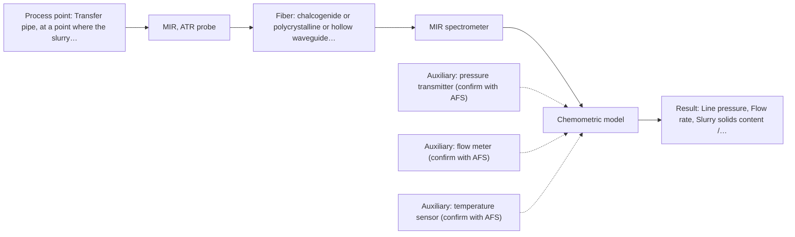
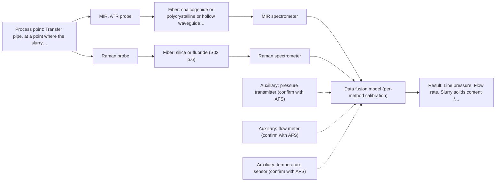

# First technical assessment: Pressure, flow and blockage of a slurry pipe

## Answer

**Customer request (our summary):** Customer asks whether fiber optic products can provide line pressure, flow rate and early blockage warning for a slurry in a transfer pipe. This is a process monitoring question but not an optical spectroscopy measurement of composition; key details (slurry nature, pipe conditions, required ranges) are missing.

### Brief answer

Fiber-optic spectroscopy does not measure line pressure or flow rate directly; those need conventional pressure and flow sensors, which can also give a blockage alarm. What fiber optics can add is compositional information on the slurry itself, which may reveal what is starting to block the pipe. We suggest a MIR ATR fiber-probe trial on slurry samples, alongside your pressure and flow instruments. Slurry properties, pipe details and warning requirements are still open.

### Proposal

- **Best current option:** O2 (recommended)
- **Basis:** engineering judgement
- **What would change it:** If the slurry turns out to be aqueous and strongly fluorescing, Raman would replace MIR ATR as the first method tested; if the blockage mechanism has no compositional signature, spectroscopy adds nothing and conventional pressure/flow alarming alone is the answer.
- **Next step:** Answer the slurry, pipe and instrumentation questions, then run the MIR ATR lab trial on representative slurry samples alongside the existing pressure and flow readings.

**Secondary evidence (external, not AFS material):** G1: no usable external source found; G2: no usable external source found; G3: no usable external source found; G4: E02 ¶12. See Expert detail.

**Decision status:** Insufficient information for a method choice

### Solution options

| ID | Tier | Methods | Confidence | Cost class, S01 Table 1 (p.6) | Ease of use | Maintenance | Performance fit | Sources |
|---|---|---|---|---|---|---|---|---|
| O1 | Simple | M2 Raman probe | Low: open question: Q2, Q3 (starts at Medium); status: insufficient information | high cost (row 12) | single benchtop trial, no process installation yet | minimal, laboratory trial only | quickest single-method check on real slurry samples | [1: S01 p.16] |
| O2 | Recommended | M1 MIR, ATR probe | Low: open question: Q2, Q3 (starts at Medium); uncited auxiliary sensor; status: insufficient information | high cost (row 2) | probe needs cleaning and periodic inspection | ATR crystal fouling and abrasion to monitor | adds compositional early warning of blockage cause to sensor trends | [2: S01 p.10] [3: S01 p.9] [4: S02 p.13] |
| O3 | Extended (multi-method) | M1 MIR, ATR probe; M2 Raman probe | Low: open question: Q2, Q3 (starts at Medium); uncited auxiliary sensor; status: insufficient information; multi-method, fusion benefit not yet shown | high cost (rows 2, 12) | two instruments to run and calibrate separately | two probes and two calibrations to maintain | covers complementary chemical information if one method is not enough | [5: S01 p.7] [3: S01 p.9] [4: S02 p.13] [1: S01 p.16] |

*Confidence rates the basis of the advice (how much is known and cited), not a predicted accuracy or probability of success. It starts at High, or at Medium when a key question on the method or the option is open, and drops one level per weakness listed (floor Low).*

*Cost class is the relative rating in S01 Table 1 (p.6) for the in-line method+technique rows named (the highest one for a multi-method option); it is not a price.*

### Setup sketch

*Recommended option O2; drawn by code from the option, a schematic, not a configuration.*

### Key questions

1. What is the slurry made of (liquid carrier, solids type and content), and how turbid or opaque is it?
2. What pressure and flow ranges do you need to monitor, and do you already have pressure transmitters and flow meters installed?
3. What actually causes the blockage (solids settling, scaling, crystallisation, agglomeration), and what should the early warning look like?

## Expert detail

**Customer enquiry**

> We need to know the line pressure and the flow rate of a slurry in our transfer pipe, and we want an early warning when the pipe starts to block. Could your fiber optic products help with this?

**Decision status:** Insufficient information for a method choice. The direct targets, line pressure and flow rate, are mechanical quantities that no supplied spectroscopic source covers, and the slurry and pipe details needed to judge any optical contribution are missing, so only a conditional shortlist with explicit assumptions is possible.

### Parameters

| ID | Parameter | Kind | Need | Measured by | Why | Sources |
|---|---|---|---|---|---|---|
| P1 | Line pressure | quantitative | required | Auxiliary sensor: pressure transmitter (engineering judgement: confirm availability with AFS) | It is a stated target and the primary signal for a blockage alarm, but it is a mechanical quantity no spectroscopic method measures. | *(no verified source: engineering judgement)* |
| P2 | Flow rate | quantitative | required | Auxiliary sensor: flow meter (engineering judgement: confirm availability with AFS) | It is a stated target and, together with pressure, the direct indicator of an impending blockage. | *(no verified source: engineering judgement)* |
| P3 | Slurry solids content / composition | quantitative | required | Reference lab method: solids content and composition by reference lab method | A blockage mechanism with a chemical signature (e.g. settling solids or scaling species) is the only quantity spectroscopy could track in-line. | [3: S01 p.9] |
| P4 | Slurry temperature | quantitative | optional | Auxiliary sensor: temperature sensor (engineering judgement: confirm availability with AFS) | Temperature shifts spectral bands and should be available to compensate the model; it should be available from existing process instrumentation. | *(no verified source: engineering judgement)* |

### Solution option details

- **O1 cost drivers:** one Raman probe and spectrometer for the trial, sample analysis, lab time
- **O2 cost drivers:** MIR ATR probe and spectrometer, lab trial, chemometric model, sensor integration
- **O3 cost drivers:** two spectrometers and probes, synchronisation software, dual calibration and maintenance
- **O3 combining methods:** Low-level fusion: MIR ATR and Raman spectra from the same sampling spot, synchronised to a common time step, joined into one matrix with block scaling. Each method keeps its own calibration and diagnostics. The fused model must beat the best single method on independent batches, otherwise the extra instrument is dropped.

*Extended (multi-method) option O3; drawn by code from the option, a schematic, not a configuration.*

### Premise check

- **Not covered:** Fiber-optic spectroscopy can measure the line pressure of the slurry. No supplied source describes any fiber-optic or spectroscopic measurement of pressure; spectroscopy measures chemical composition and morphology, not mechanical quantities. *(no verified source: engineering judgement)*
- **Not covered:** Fiber-optic spectroscopy can measure the flow rate of the slurry. No supplied source describes flow-rate measurement by fiber-optic spectroscopy; flow is again a mechanical quantity outside the optical methods covered. *(no verified source: engineering judgement)*
- **Not covered:** Fiber-optic spectroscopy can give an early warning when the pipe starts to block. No supplied source demonstrates blockage detection; spectroscopy could only contribute if the blockage mechanism has a compositional signature, which is unknown. *(no verified source: engineering judgement)*

### Requirements

**Stated by the customer**

- "the line pressure"
- "the flow rate of a slurry"
- "an early warning when the pipe starts to block"
- *Further statements: see the customer enquiry above.*

**Key unknowns**

- Slurry composition, solids content and turbidity
- Blockage mechanism and whether it has a spectral signature
- Existing or planned pressure and flow instrumentation
- Pipe geometry, temperature and fiber link distance
- Required accuracy and response time

### Clarification questions (most decision-relevant first)

Q1. What is the slurry made of (liquid carrier, solids type and content), and how turbid or opaque is it? *Why it matters:* It decides which optical technique can work at all, since transmission fails in thick or opaque media while ATR and reflection handle scattering samples. *(affects: technique)*
Q2. What pressure and flow ranges do you need to monitor, and do you already have pressure transmitters and flow meters installed? *Why it matters:* Pressure and flow are not spectroscopic measurands, so existing or planned conventional sensors determine whether spectroscopy is needed at all. *(affects: method, status)*
Q3. What actually causes the blockage (solids settling, scaling, crystallisation, agglomeration), and what should the early warning look like? *Why it matters:* Only a blockage mechanism with a chemical or physical spectral signature can be tracked by spectroscopy; otherwise the warning must come from pressure and flow trends alone. *(affects: method)*
Q4. What are the pipe diameter and material, the slurry temperature, and the distance from the measurement point to a safe instrument location? *Why it matters:* These determine probe type, fiber family and achievable fiber length, and no source states an achievable length for a mid-IR fiber link. *(affects: installation)*
Q5. What accuracy and response time do you require for pressure, flow and the blockage warning? *Why it matters:* The required performance decides whether simple sensor-based alarming is sufficient or whether added spectroscopy is justified. *(affects: status)*

### Recommendation

- **M1 · Primary candidate: MIR, ATR probe.** Mid-IR ATR is the most chemically informative single method and suits liquids and pastes in contact with the crystal; a published lab example shows water-in-petroleum ATR spectra, a related slurry-like application. It cannot measure pressure or flow, so it is proposed only as the first spectroscopy method to test for blockage-relevant composition. *Conditions:* The slurry must be a liquid or soft medium making tight contact with the ATR crystal, and the blockage mechanism must have a compositional signature. [3: S01 p.9] [4: S02 p.13]
- **M2 · Comparison candidate: Raman probe.** A Raman probe tolerates water much better than infrared methods and would be the comparison if the slurry carrier is aqueous or if fluorescence swamps the MIR signal. [1: S01 p.16]
- **M3 · Conditional candidate: NIR, diffuse reflection probe.** NIR diffuse reflection is the standard route for opaque, concentrated streams and penetrates up to several millimetres, but its suitability for this slurry is unconfirmed and it needs a matrix-specific chemometric calibration. *Conditions:* Applies only if the slurry proves to be a scattering, opaque medium and a solids-related NIR signature exists; the Table 1 sample fit is not yet confirmed. [6: S01 p.17]
- **M4 · Not recommended: NIR, transmission/transflection probe.** A reader might expect a transmission probe in a pipe, but transmission fails when the sample is too thick or opaque, which a slurry likely is; it is therefore not recommended before the slurry's optical behaviour is known. [7: S01 p.18]
- **M5 · Not recommended: fluorescence probe.** Fluorescence only measures species that actually fluoresce, and no fluorescent component or indicator has been identified in this slurry, so it is not a candidate at this stage. [8: S01 p.5]

### Measurement concept

- **Probe and geometry:** For the spectroscopy part: immersion MIR ATR fiber probe in contact with the slurry (surface layer of a few micrometres); pressure and flow are measured by conventional in-line sensors, not by the probe.
- **Location:** Transfer pipe, at a point where the slurry is representative and accessible for a probe; exact position to be agreed once pipe details are known.
- **Fiber link:** Unknown; long silica-fiber cables of 100-300 m are stated for low-OH silica fibers, but no source states an achievable length for a mid-IR fiber link, so this is an open question for the configuration. [2: S01 p.10] [9: S02 p.7]

### Spectral range

- **MIR:** Nominal mid-IR range 4000-400 cm-1 (2.5-25 µm); the usable range depends on the selected fiber (CIR/PIR) and ATR crystal, and is not fixed by the method alone. [3: S01 p.9]
- **Raman:** Raman is reported as Raman shift in cm-1 with the laser excitation wavelength stated separately; the excitation wavelength for this application is not yet chosen. [10: S01 p.11]

### Risks and uncertainty

- Spectroscopy cannot measure pressure or flow directly, so the core request can only be met by conventional sensors, with spectroscopy at best an addition. *(no verified source: engineering judgement)*
- If the slurry is opaque or heavily loaded, transmission-style optical access fails and only contact techniques such as ATR or reflection remain. *(rules: R-GEO-2)* [7: S01 p.18]
- An ATR crystal samples only a surface layer a few micrometres deep, so fouling, abrasion and surface representativeness in a slurry pipe are serious risks. *(rules: R-MIR-3)* [11: S01 p.13]
- Any spectral model would be specific to this slurry matrix and would need representative samples and independent reference data before it can be trusted. *(rules: R-CAL-1)* [12: S01 p.10]

### First feasibility experiment

1. **Collect representative slurry samples across the expected range of solids content and process conditions.** Cover the expected chemical and physical variation of the slurry, including clear and heavily loaded states. *(no verified source: engineering judgement)*
2. **Measure solids content and composition of each sample by an independent laboratory method.** Establish the reference values the spectra will be compared against. *(no verified source: engineering judgement)*
3. **Record MIR ATR spectra of each sample with a fiber ATR probe (single method).** Test the most informative single method first, on the real matrix. [4: S02 p.13]
4. **If the slurry is aqueous or fluorescence interferes, record Raman spectra of the same samples as a comparison (single method).** Check whether a second method adds information before any combination is considered. *(no verified source: engineering judgement)*
5. **Build a preliminary model, then validate on held-out samples or a separate batch.** Confirm the method works beyond the calibration set before any in-line decision. *(no verified source: engineering judgement)*

**Reference measurements:** Independent laboratory analysis of solids content and composition of each sample, plus the plant pressure and flow readings as the process reference.

**Decision basis:** Go/no-go agreed with the customer beforehand: for example, spectroscopy proceeds only if it tracks a blockage-relevant slurry parameter with accuracy the customer defines, and the fused or single-method result must beat the pressure/flow-trend-only alarm on the held-out runs.

### Not covered by the supplied sources

- Any fiber-optic or spectroscopic method for measuring line pressure
- Any fiber-optic or spectroscopic method for measuring flow rate
- Any demonstrated blockage or pipe-fouling early-warning application

### Further notes

- **Chemometrics:** If the spectroscopy trial is useful, a calibration or classification model for solids content or blockage-relevant components would need representative slurry samples and independent reference analyses; calibrations are specific to the sample matrix and must be re-validated after any matrix change.
- **Real-time tracking:** A blockage warning would be a continuous in-line trend: pressure rising and flow falling together indicate constriction. Spectral data, if useful, would need to be synchronised with these sensor trends on a common time step.

### Secondary evidence (external, not AFS material)

*Found by a literature search for gaps the supplied AFS sources leave open. Not AFS material and not proof for this case; every quote below was verified verbatim against the fetched text.*

*Live search unavailable (library only: cache miss (europepmc); cache miss (openalex)); curated library only.*

**G1 · decision status:** insufficient information: The direct targets, line pressure and flow rate, are mechanical quantities that no supplied spectroscopic source covers, and the slurry and pipe details needed to judge any optical contribution are missing, so only a conditional shortlist with explicit assumptions is possible.

- No usable external source found.

**G2 · auxiliary sensor:** In-line measurement of Line pressure with pressure transmitter

- No usable external source found.

**G3 · auxiliary sensor:** In-line measurement of Flow rate with flow meter

- No usable external source found.

**G4 · auxiliary sensor:** In-line measurement of Slurry temperature with temperature sensor

- **E02 ¶12** The source states that OH bands in NIR and MIR measurements of aqueous solutions are temperature sensitive, which is described as a severe drawback requiring tempered sample holders. *How it applies:* If an optical probe is considered alongside the slurry monitoring, tracking slurry temperature with a separate sensor would be a reason to test, since temperature variation could influence any spectroscopic signal. This supports adding a temperature sensor as an auxiliary measurement, but it does not itself demonstrate temperature measurement capability. *Limits and transfer risks:* The statement concerns aqueous solutions in NIR and MIR spectroscopy with tempered sample holders, not an in-line slurry in a transfer pipe, and it does not describe a temperature sensor or its performance. *(supports O2)*
  > "Additionally, the temperature sensitivity of the OH bands is a severe drawback for measuring aqueous solution in NIR and MIR, which makes tempered sample holders necessary [29]."
  > A critical review of recent trends, and a future perspective of optical spectroscopy as PAT in biopharmaceutical downstream processing. (2020) · Analytical and bioanalytical chemistry · doi:10.1007/s00216-020-02407-z · https://europepmc.org/article/PMC/PMC7072065 · retrieved 2026-10-17, full text, licence: cc by, via curated library

### Evidence (verified quotes)

1. ✓ **S01 p.16** (general): "Raman is particularly well-suited for aqueous environments, as it exhibits low absorbance for water molecules compared to infrared methods."
2. ✓ **S01 p.10** (general): "Probe-based analysis is gaining widespread use in online analysis, such as in-line, in-process (chemical, biotechnological, natural) environments"
3. ✓ **S01 p.9** (general): "Vibrational spectroscopy in the mid-IR range (4000-400 cm-1) is one of the most informative methods of chemical analysis."
4. ✓ **S02 p.13** (application precedent): "Application: measurement of water content in petroleum ATR-Probes with ATR-tips from ZrO2 (& Diamond, etc.)"
5. ✓ (precedent only) **S01 p.7** (method gain): "The analysis of such systems may require a combination of two or even more spectral methods."
6. ✓ **S01 p.17** (general): "NIR Reflection is primarily used for opaque or highly concentrated dairy products, such as yogurt, butter, or whole milk concentrates."
7. ✓ **S01 p.18** (general): "it fails when the milk becomes too "thick" or fat-rich, as the light cannot penetrate the sample."
8. ✓ **S01 p.5** (general): "However, most chemicals do not exhibit this property."
9. ✓ **S02 p.7** (performance figure): "Robust 100-300m cables made with Silica fibers of low OH-content (<0.1ppm OH) enable remote industrial process-control"
10. ✓ **S01 p.11** (general): "The Raman shift is used as the horizontal (spectral) axis in Raman spectroscopy"
11. ✓ **S01 p.13** (general): "typically at a depth of few microns"
12. ✓ **S01 p.10** (general): "The broad absorption bands observed in this region overlap, suggesting the use of chemometrics for quantitative and qualitative analysis of spectral data."

### Verification

- Citations verified: 19 of 19 (exact or whitespace/hyphen-tolerant match on the cited page, scope checked).
- Hard check failures before deterministic corrections: 0; still open: 0; soft warnings: 1; repair rounds: 1.
- External evidence (cache): 1 quote(s) verified verbatim (exact or whitespace/hyphen-tolerant, at most 400 characters and 2 sentences, against the cited paragraph); 0 item(s) dropped.
- External search: 5 query(ies), 0 hit(s), 3 source(s) (3 from the curated library); ⚠ library only: cache miss (europepmc); cache miss (openalex).
- External step: 2 model call(s), 14.6 s extra (cost in the run JSON).

*Run A05-20261018T072334Z-2546 · models z-ai/glm-5.3-flash*
