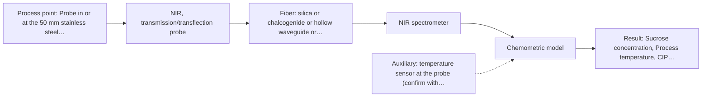
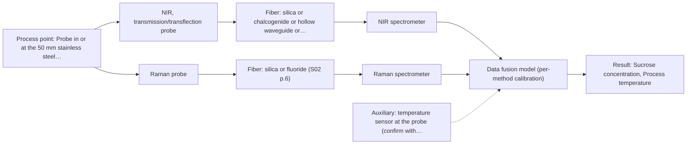

# First technical assessment: Complete enquiry for sugar concentration in a clear solution

## Answer

**Customer request (our summary):** In-line monitoring of sucrose concentration (5–15 % w/w, ±0.3 % w/w) in a clear, colourless aqueous solution flowing in a 50 mm stainless steel pipe at 20–30 °C and normal pressure; analyser 10 m away in a dry, safe room; daily hot caustic CIP; 1 reading per minute; laboratory refractometer as reference; customer asks for a proposed method and probe for a first trial.

### Brief answer

For a clear, colourless sucrose solution, test a NIR transmission/transflection fiber probe first, with the analyser 10 m away on a silica fiber link and a chemometric calibration against your refractometer. Test a Raman probe as the comparison single method. Still open: whether other dissolved solids are present, whether the probe can stay in-line during hot caustic CIP, and the exact acceptance criterion for the trial.

### Proposal

- **Best current option:** O2 (recommended)
- **Basis:** supplied AFS sources
- **What would change it:** If other dissolved solids are present (Q1) or the probe cannot survive the caustic CIP (Q2), the method and installation must be reconsidered. If the NIR model misses the agreed accuracy on held-out samples, move to the NIR+Raman comparison.
- **Next step:** Run a bench NIR transmission/transflection trial on grab samples spanning 5-15 % w/w and 20-30 °C, referenced to the refractometer, before specifying the in-line probe.

**Secondary evidence (external, not AFS material):** G1: no usable external source found; G2: E03 ¶31, E03 ¶82; G3: no usable external source found; G4: no usable external source found. See Expert detail.

**Decision status:** Provisional feasibility assessment

### Solution options

| ID | Tier | Methods | Confidence | Cost class, S01 Table 1 (p.6) | Ease of use | Maintenance | Performance fit | Sources |
|---|---|---|---|---|---|---|---|---|
| O1 | Simple | M2 Raman probe | Medium: uncited auxiliary sensor | high cost (row 12) | single probe, grab-sample bench test | low, no in-line installation yet | direct sucrose signal in aqueous media | [1: S01 p.16] |
| O2 | Recommended | M1 NIR, transmission/transflection probe | Low: open question: Q1, Q2 (starts at Medium); uncited auxiliary sensor | average cost (row 7) | flush-mounted probe, automated readings | probe cleaning and periodic recalibration | clear liquid, 10 m link, per-minute updates | [2: S01 p.18] [3: S02 p.7] [4: S01 p.5] [5: S01 p.10] |
| O3 | Extended (multi-method) | M1 NIR, transmission/transflection probe; M2 Raman probe; M4 NIR, transmission/transflection probe + Raman (combination) | Low: open question: Q1, Q2 (starts at Medium); uncited auxiliary sensor; multi-method, fusion benefit not yet shown | high cost (rows 7, 12) | two instruments, more complex operation | two instruments, per-block calibration | fallback if NIR alone misses the limit | [6: S01 p.7] [2: S01 p.18] [4: S01 p.5] [5: S01 p.10] [1: S01 p.16] |

*Confidence rates the basis of the advice (how much is known and cited), not a predicted accuracy or probability of success. It starts at High, or at Medium when a key question on the method or the option is open, and drops one level per weakness listed (floor Low).*

*Cost class is the relative rating in S01 Table 1 (p.6) for the in-line method+technique rows named (the highest one for a multi-method option); it is not a price.*

### Setup sketch

*Recommended option O2; drawn by code from the option, a schematic, not a configuration.*

### Key questions

1. Is the solution pure sucrose in water, or are other dissolved solids present that vary over time?
2. What is the CIP temperature and duration, and can the probe stay in-line during the daily hot caustic cleaning or must it be retracted/isolated?
3. What is the flow rate, and do you prefer an insertion probe in the 50 mm pipe or a bypass flow cell?

## Expert detail

**Customer enquiry**

> We produce a clear, colourless aqueous sucrose solution and want to monitor its sucrose concentration in-line. The solution flows through a 50 mm stainless steel pipe at 20 to 30 °C and normal pressure; the expected range is 5 to 15 % w/w and our quality limit is plus or minus 0.3 % w/w. Our laboratory refractometer is the reference method and stays in use. The analyser can stand in a dry, safe room 10 m from the pipe, and the line is cleaned in place with hot caustic once a day. A reading every minute is enough. Please propose a method and probe for a first trial.

**Decision status:** Provisional feasibility assessment. A method shortlist can be justified from the sample properties and the sources, but the matrix purity, CIP compatibility and the trial acceptance criterion are open, so the assessment stays provisional.

### Parameters

| ID | Parameter | Kind | Need | Measured by | Why | Sources |
|---|---|---|---|---|---|---|
| P1 | Sucrose concentration | quantitative | required | Reference lab method: laboratory refractometer (customer's reference) | It is the target variable to monitor in-line in the 5-15 % w/w range. | *(no verified source: engineering judgement)* |
| P2 | Process temperature | quantitative | required | Auxiliary sensor: temperature sensor at the probe (engineering judgement: confirm availability with AFS) | Spectral features shift with temperature over the stated 20-30 °C range, so it must be measured to keep the concentration model unbiased. | *(no verified source: engineering judgement)* |
| P3 | CIP temperature and duration | quantitative | optional | Not measurable in-line by spectroscopy; alternative: customer process records | It should be available from the process records and is needed to select wetted materials that survive the daily hot caustic cleaning. | *(no verified source: engineering judgement)* |
| P4 | Presence of other dissolved solids | qualitative | required | Not measurable in-line by spectroscopy; alternative: laboratory analysis of dissolved solids | Any additional dissolved components change the spectrum and the refractive index, affecting both the calibration and the adequacy of the refractometer reference. | *(no verified source: engineering judgement)* |

### Solution option details

- **O1 cost drivers:** Raman spectrometer, laser, probe, reference samples and chemometric modelling
- **O2 cost drivers:** NIR spectrometer, transflection/transmission probe, silica fiber link, calibration samples and model maintenance
- **O3 cost drivers:** two spectrometers and probes, synchronisation software, doubled calibration and maintenance effort
- **O3 combining methods:** Low-level fusion: NIR and Raman spectra from the same sampling spot are synchronised to a common time step and merged into one augmented matrix, with block scaling so neither method dominates. Each method keeps its own calibration and diagnostics, and the fused model must beat the best single method on held-out batches or it is dropped.

*Extended (multi-method) option O3; drawn by code from the option, a schematic, not a configuration.*

### Premise check

- **Not covered:** The laboratory refractometer is a suitable reference for validating the in-line sucrose measurement. No supplied source addresses refractometers or their suitability as a reference for in-line sucrose validation; the assumption is plausible for a pure sucrose solution but unverified, and it depends on the unresolved matrix question (Q1). *(no verified source: engineering judgement)*
- **Not covered:** An in-line accuracy of plus or minus 0.3 % w/w is achievable with the proposed method. No supplied source states an achievable accuracy for in-line sucrose measurement; the limit is the customer's requirement and must be confirmed in the trial, not assumed. *(no verified source: engineering judgement)*

### Requirements

**Stated by the customer**

- "clear, colourless aqueous sucrose solution"
- "monitor its sucrose concentration in-line"
- "flows through a 50 mm stainless steel pipe"
- "20 to 30 °C and normal pressure"
- "expected range is 5 to 15 % w/w"
- "plus or minus 0.3 % w/w"
- "The analyser can stand in a dry, safe room 10 m from the pipe"
- *Further statements: see the customer enquiry above.*

**Key unknowns**

- Whether other dissolved solids are present besides sucrose (matrix purity).
- CIP temperature and whether the probe must survive hot caustic in-line.
- Flow rate and preferred installation geometry (insertion probe vs bypass flow cell).
- The formal acceptance criterion for the first trial.
- Whether plus or minus 0.3 % w/w is achievable in-line with the chosen configuration.

### Clarification questions (most decision-relevant first)

Q1. Is the solution pure sucrose in water, or are other dissolved solids present that vary over time? *Why it matters:* Other dissolved solids would affect both the refractometer reference and the NIR calibration, and could change the method choice. *(affects: M1)*
Q2. What is the CIP temperature and duration, and can the probe stay in-line during the daily hot caustic cleaning or must it be retracted/isolated? *Why it matters:* Hot caustic determines which wetted materials and probe designs are viable, and whether an ATR crystal option survives. *(affects: installation, M1, M3)*
Q3. What is the flow rate, and do you prefer an insertion probe in the 50 mm pipe or a bypass flow cell? *Why it matters:* The installation geometry affects probe type, pathlength control and representativeness of the sampled volume. *(affects: installation)*
Q4. Is plus or minus 0.3 % w/w against the refractometer the formal go/no-go criterion for the first trial? *Why it matters:* The trial needs a numerical acceptance limit to decide whether the method proceeds. *(affects: status)*
Q5. Are there hygienic or wetted-material requirements (seals, certifications) for the probe? *Why it matters:* Material constraints can exclude certain probe designs before the spectroscopy is even assessed. *(affects: installation)*

### Recommendation

- **M1 · Primary candidate: NIR, transmission/transflection probe.** The sample is a clear, transparent liquid, exactly the case where NIR transmission (or transflection) is the preferred geometry, and NIR is described as ideal for online fiber-probe measurement. Sucrose and water have overtone bands in the nominal 780-2500 nm NIR range, so a quantitative model is feasible. [2: S01 p.18] [4: S01 p.5] [5: S01 p.10]
- **M2 · Comparison candidate: Raman probe.** Raman tolerates water well and can give a direct molecular signal for sucrose in an aqueous solution, making it a useful single-method comparison against NIR. Its weak signal and possible fluorescence background must be checked on real samples. [1: S01 p.16]
- **M3 · Conditional candidate: MIR, ATR probe.** MIR-ATR probes are made for in-line liquid analysis and offer well-defined, selective absorption bands. It is held back because ATR samples only a surface layer of a few micrometres and the crystal must survive hot caustic cleaning. *Conditions:* Only if the ATR crystal and wetted materials tolerate the daily hot caustic CIP and surface-layer sampling is acceptable. [7: S01 p.10] [8: S01 p.13]
- **M4 · Comparison candidate: NIR, transmission/transflection probe + Raman (combination).** If the NIR model alone does not reach the agreed accuracy, combining NIR with a second method is a published route to more information, but the gain is a hypothesis to test against the best single method. *Conditions:* Only after the single-method tests, and only if NIR alone does not meet the agreed accuracy. [6: S01 p.7]
- **M5 · Not recommended: fluorescence probe.** Fluorescence only measures species that fluoresce, and no fluorescent species or indicator has been identified in a clear sucrose solution, so it is not a candidate here. [9: S01 p.5]

### Measurement concept

- **Probe and geometry:** NIR transmission or transflection fiber probe for a clear aqueous liquid, with a controlled optical pathlength (typically 1-10 mm in the analogous dairy example).
- **Location:** Probe in or at the 50 mm stainless steel pipe (insertion or bypass flow cell, to be confirmed); analyser in the dry, safe room 10 m away.
- **Fiber link:** Vis-NIR silica fiber; the sources state robust 100-300 m low-OH silica cables for remote industrial process control, so a 10 m link is within the stated fiber family capability. The exact usable spectral range depends on the instrument, fiber and probe selected. [2: S01 p.18] [10: S01 p.18] [3: S02 p.7]

### Spectral range

- **NIR:** Nominal NIR range 780-2500 nm; the usable range depends on the spectrometer, silica fiber and probe actually selected. [5: S01 p.10]
- **Raman:** Raman is reported as Raman shift in cm-1 with the laser excitation wavelength stated separately; the excitation wavelength for a trial probe is not fixed by the sources and must be chosen with the supplier. [11: S01 p.11]

### Risks and uncertainty

- The NIR calibration is specific to the matrix, so any unmodelled variation in other dissolved solids or temperature would bias the sucrose prediction. *(rules: R-CAL-1)* [12: REF §5]
- Water absorbs strongly in the NIR, so the transmission pathlength must be controlled; a wrong pathlength loses the signal or the representativeness. *(rules: R-GEN-3, R-GEN-4)* [13: S01 p.18]
- The daily hot caustic CIP may exceed the wetted-material limits of the probe, which no supplied source quantifies. *(rules: R-MIR-3)* [14: REF §5]
- A refractometer responds to the refractive index of all dissolved solids, so it may not isolate sucrose if the matrix is not pure. *(no verified source: engineering judgement)*

### First feasibility experiment

1. **Collect representative grab samples across 5-15 % w/w sucrose and 20-30 °C, including process-relevant extremes.** Cover the expected chemical and physical variation of the process. *(no verified source: engineering judgement)*
2. **Measure each sample with the laboratory refractometer, and with an independent sucrose-specific laboratory method if the matrix is not pure.** Provide independent reference values for calibration and validation. *(no verified source: engineering judgement)*
3. **Record NIR transmission/transflection spectra through a fiber probe on the bench, then record Raman probe spectra on the same samples as the single-method comparison.** Test the primary method under realistic conditions before in-line installation. *(no verified source: engineering judgement)*
4. **Build a calibration model per method and validate it on held-out samples or a separate run.** Quantify single-method performance before considering any combination. [15: REF §3]
5. **Compare in-line or bench predictions against the refractometer on held-out material and apply the customer's go/no-go criterion.** Decide whether the method meets the quality limit. *(no verified source: engineering judgement)*

**Reference measurements:** Refractometer readings on every sample; if Q1 shows other dissolved solids, add an independent sucrose-specific laboratory method.

**Decision basis:** Go/no-go judged by the customer's acceptance limit for in-line prediction versus the refractometer reference; if the stated plus or minus 0.3 % w/w is the criterion, it must be met on held-out validation samples.

### Not covered by the supplied sources

- The suitability and uncertainty of a laboratory refractometer as the reference for in-line sucrose validation.
- Whether plus or minus 0.3 % w/w is achievable in-line for this application; no source states an accuracy for such a measurement.
- CIP (hot caustic) compatibility of specific probes; the sources discuss fouling and contact as general risks but give no CIP ratings.

### Further notes

- **Chemometrics:** A PLS regression against the refractometer reference is the expected model; samples should span 5-15 % w/w and 20-30 °C, and temperature should be included as a variable so the model does not confuse temperature effects with concentration changes.
- **Real-time tracking:** A reading every minute is consistent with the online fiber-probe concept described in the sources; diode-array detection is noted there as allowing instantaneous recording at all wavelengths, which supports fast process monitoring, though the actual update rate depends on the selected instrument.
- **Future direction:** If the trial succeeds, a compact LED-based NIR sensor tuned to the informative wavelengths could later replace the full spectrometer for routine control, following the multisensor approach described in the sources.

### Secondary evidence (external, not AFS material)

*Found by a literature search for gaps the supplied AFS sources leave open. Not AFS material and not proof for this case; every quote below was verified verbatim against the fetched text.*

*Live search unavailable (library only: cache miss (europepmc); cache miss (openalex)); curated library only.*

**G1 · auxiliary sensor:** In-line measurement of Process temperature with temperature sensor at the probe

- No usable external source found.

**G2 · multi-method:** Combining several spectroscopy methods (data fusion) (Low-level fusion: NIR and Raman spectra from the same sampling spot are synchronised to a common time step and merged into one augmented matrix, with block scaling so neither method dominates. Each method keeps its own calibration and diagnostics, and the fused model must beat the best single method on held-out batches or it is dropped.)

- **E03 ¶31** Low-level data fusion is described as the simplest combination approach, where variables from different sources are concatenated into a single new data matrix. *How it applies:* This supports the proposed low-level fusion design of merging NIR and Raman spectra from the same spot into one augmented matrix, and suggests it is a reasonable starting point to test against single-method models. *Limits and transfer risks:* The review is general PAT literature, not sucrose or this pipe application, and concatenation alone says nothing about block scaling or whether fusion improves accuracy here. *(supports O3)*
  > "Low-level data fusion (LLDF) is considered the simplest method to achieve a combination of inputs. In this case, the data is rearranged into a new data matrix, where the variables coming from different sources are placed one after the other."
  > Challenges and Opportunities of Implementing Data Fusion in Process Analytical Technology-A Review. (2022) · Molecules (Basel, Switzerland) · doi:10.3390/molecules27154846 · https://europepmc.org/article/PMC/PMC9369811 · retrieved 2026-10-17, full text, licence: cc by, via curated library
- **E03 ¶82** Before fusing data from multiple sources, the contribution and complementarity of each dataset should be evaluated. *How it applies:* The trial should first quantify what NIR and Raman each contribute on held-out batches, so fusion is only kept if it demonstrably adds value over the best single method. *Limits and transfer risks:* This is a general methodological recommendation from a review; it does not indicate that complementarity exists for sucrose in this matrix or at this concentration range. *(supports O3)*
  > "Before fusing data from multiple sources, it is essential to evaluate the contribution of each dataset to the model and its complementarity."
  > Challenges and Opportunities of Implementing Data Fusion in Process Analytical Technology-A Review. (2022) · Molecules (Basel, Switzerland) · doi:10.3390/molecules27154846 · https://europepmc.org/article/PMC/PMC9369811 · retrieved 2026-10-17, full text, licence: cc by, via curated library

**G3 · not in the supplied sources:** The suitability and uncertainty of a laboratory refractometer as the reference for in-line sucrose validation.

- No usable external source found.

**G4 · not in the supplied sources:** Whether plus or minus 0.3 % w/w is achievable in-line for this application; no source states an accuracy for such a measurement.

- No usable external source found.

### Evidence (verified quotes)

1. ✓ **S01 p.16** (general): "Raman is particularly well-suited for aqueous environments, as it exhibits low absorbance for water molecules compared to infrared methods."
2. ✓ **S01 p.18** (general): "Transmission is the preferred method for transparent or semi-transparent liquids, such as skim milk, whey, or permeate."
3. ✓ **S02 p.7** (general): "Robust 100-300m cables made with Silica fibers of low OH-content (<0.1ppm OH) enable remote industrial process-control"
4. ✓ **S01 p.5** (general): "making it ideal for online applications, including remote measurements via fiber optic probes."
5. ✓ **S01 p.10** (general): "NIR spectra (780-2500 nm) contain predominantly overtones and component bands of fundamental vibrations"
6. ✓ (precedent only) **S01 p.7** (method gain): "The analysis of such systems may require a combination of two or even more spectral methods."
7. ✓ **S01 p.10** (general): "ATR fiber probes (Fig.1) enable the analysis of liquids and solid elastic samples"
8. ✓ **S01 p.13** (general): "typically at a depth of few microns"
9. ✓ **S01 p.5** (general): "However, most chemicals do not exhibit this property."
10. ✓ **S01 p.18** (general): "the precise control of the optical pathlength (usually 1 - 10 mm); if the pathlength is too wide, the signal is lost to absorption; if too narrow, the sample represents a negligible volume."
11. ✓ **S01 p.11** (general): "The Raman shift is used as the horizontal (spectral) axis in Raman spectroscopy"
12. ✓ **REF §5** (general): "physical variation; calibration specific to the matrix."
13. ✓ **S01 p.18** (general): "if the pathlength is too wide, the signal is lost to absorption; if too narrow, the sample represents a negligible volume."
14. ✓ **REF §5** (general): "Usable range limited by fiber and crystal; contact, fouling, compatibility."
15. ✓ **REF §3** (general): "Representative samples or process states, independent reference measurements, what is compared, and the basis for the go / no-go decision."

### Verification

- Citations verified: 22 of 22 (exact or whitespace/hyphen-tolerant match on the cited page, scope checked).
- Hard check failures before deterministic corrections: 0; still open: 0; soft warnings: 3; repair rounds: 1.
- Corrected deterministically after verification (1):
  - ⚠ clarification_questions[0].affects: affects normalised to ['M1']; dropped ['P4'] (not method, technique, installation, status, an M id or an O id)
- External evidence (cache): 2 quote(s) verified verbatim (exact or whitespace/hyphen-tolerant, at most 400 characters and 2 sentences, against the cited paragraph); 2 item(s) dropped.
- External search: 6 query(ies), 0 hit(s), 3 source(s) (3 from the curated library); ⚠ library only: cache miss (europepmc); cache miss (openalex).
- External step: 2 model call(s), 29.7 s extra (cost in the run JSON).
  - ⚠ dropped G1 E02 ¶12: figure not in its own quote: 20-30 °C
  - ⚠ dropped G2 E03 ¶36: figure not in its own quote: 5-15 %

*Run A07-20261018T072334Z-c4ba · models z-ai/glm-5.3-flash*
