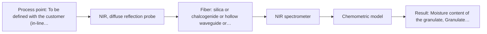

# First technical assessment: Accuracy guarantee, regulatory approval and price

## Answer

**Customer request:** Before we order, please confirm in writing that your NIR system will measure the moisture of our granulate to plus or minus 0.1 % and guarantee that our regulator will approve it for release testing. Please also include the price of the complete system.

### Brief answer

We cannot confirm ±0.1 % moisture accuracy in writing, promise regulatory approval, or quote a final price on the information given: no source supports those figures, and the supplied material is explicitly non-binding. NIR diffuse reflection is the most plausible first method for a granulate, with transmission/transflection as an alternative depending on the material. Please provide the granulate details, moisture range, reference method and installation point so a feasibility trial can be defined.

### Proposal

- **Best current option:** O2 (recommended)
- **Basis:** engineering judgement
- **What would change it:** If the granulate turns out to be a translucent, compact material, the transmission/transflection route (O1) becomes the better starting point; if the validation error does not meet the stated accuracy requirement, the requirement or the approach must be revisited.
- **Next step:** Answer Q1-Q6 and send representative granulate samples so the NIR feasibility trial with independent reference measurements can start.

**Secondary evidence (external, not AFS material):** G1: no usable external source found; G2: E02 ¶27; G3: E02 ¶11; G4: no usable external source found. See Expert detail.

**Decision status:** Insufficient information for a method choice

### Solution options

| ID | Tier | Methods | Confidence | Cost class, S01 Table 1 (p.6) | Ease of use | Maintenance | Performance fit | Sources |
|---|---|---|---|---|---|---|---|---|
| O1 | Simple | M2 NIR, transmission/transflection probe | Low: open question: Q1 (starts at Medium); physical state unknown, sample clarity unknown; a parameter is not measurable in-line; status: insufficient information | average cost (row 7) | Simple benchtop test, no installation | None during the trial | Fits translucent granulate; tests the alternative geometry cheaply | [1: S01 p.18] |
| O2 | Recommended | M1 NIR, diffuse reflection probe | Low: open question: Q1 (starts at Medium); physical state unknown, sample clarity unknown; a parameter is not measurable in-line; status: insufficient information | average cost (row 8) | Probe-based, routine after calibration | Probe window cleaning and periodic calibration checks | Best fit for a scattering granulate; accuracy proven by validation, not assumed | [2: S01 p.5] [3: S01 p.17] |

*Confidence rates the basis of the advice (how much is known and cited), not a predicted accuracy or probability of success. It starts at High, or at Medium when a key question on the method or the option is open, and drops one level per weakness listed (floor Low).*

*Cost class is the relative rating in S01 Table 1 (p.6) for the in-line method+technique rows named (the highest one for a multi-method option); it is not a price.*

### Setup sketch

*Recommended option O2; drawn by code from the option, a schematic, not a configuration.*

### Key questions

1. What is the granulate made of, and what is its particle size and physical form (free-flowing granules, powder, wet or sticky)?
2. Is the granulate optically opaque and strongly scattering, or more translucent and compact at the measurement point?
3. What moisture range must be covered, and is the required ±0.1 % absolute (e.g. % w/w) or relative, on which basis (wet or dry)?

## Expert detail

**Customer enquiry**

> Before we order, please confirm in writing that your NIR system will measure the moisture of our granulate to plus or minus 0.1 % and guarantee that our regulator will approve it for release testing. Please also include the price of the complete system.

**Decision status:** Insufficient information for a method choice. The known facts cannot justify a method choice or any of the three requested commitments: no supplied source states an accuracy figure for NIR moisture measurement, addresses regulatory approval for release testing, or gives prices, and the granulate's physical and optical properties are unknown. The deciding questions are listed and a conditional NIR shortlist with a feasibility trial is proposed.

### Parameters

| ID | Parameter | Kind | Need | Measured by | Why | Sources |
|---|---|---|---|---|---|---|
| P1 | Moisture content of the granulate | quantitative | required | Reference lab method: not named | Moisture is the target variable the NIR model must predict and validate. | *(no verified source: engineering judgement)* |
| P2 | Granulate material and composition | qualitative | required | Not measurable in-line by spectroscopy; alternative: Customer material specification | The matrix determines which NIR bands carry the moisture signal and whether interferences are present. | *(no verified source: engineering judgement)* |
| P3 | Particle size / physical form | quantitative | required | Not measurable in-line by spectroscopy; alternative: Sieve analysis or customer particle-size data | Particle size drives scattering, which strongly affects reflection spectra and must be represented in the calibration. | *(no verified source: engineering judgement)* |
| P4 | Moisture range of interest | quantitative | required | Not measurable in-line by spectroscopy; alternative: Customer process specification | The calibration must span the working range, and the accuracy requirement can only be judged within it. | *(no verified source: engineering judgement)* |

### Solution option details

- **O1 cost drivers:** Benchtop trial time, sample set preparation, reference lab measurements
- **O2 cost drivers:** Reflection probe and NIR spectrometer, calibration sample set, reference lab analyses, validation batches

### Premise check

- **Not covered:** The vendor can promise regulatory approval for release testing. No supplied source addresses regulatory approval of a spectroscopy system for release testing; regulatory acceptance depends on the customer's validation package and quality system, which cannot be promised in advance. *(no verified source: engineering judgement)*
- **Not covered:** A NIR system will measure moisture of their granulate to ±0.1 %. No supplied source states any accuracy figure for NIR moisture measurement, and accuracy depends on the unknown matrix, range and reference method; it can only be established in a feasibility trial. *(no verified source: engineering judgement)*
- **Not covered:** A complete system price can be quoted before the deciding facts are known. No source gives prices or cost figures, and a meaningful system configuration cannot be defined before the granulate, installation and validation requirements are known. *(no verified source: engineering judgement)*

### Requirements

**Stated by the customer**

- "measure the moisture of our granulate"
- "release testing"

**Key unknowns**

- Granulate material, particle size and physical form
- Optical regime of the granulate: opaque/scattering or translucent
- Moisture range of interest and the basis of the ±0.1 % requirement
- Reference (primary) moisture method available for calibration
- Installation point: in-line, at-line or off-line, and fiber distance
- Applicable regulator and validation requirements for release testing

### Clarification questions (most decision-relevant first)

Q1. What is the granulate made of, and what is its particle size and physical form (free-flowing granules, powder, wet or sticky)? *Why it matters:* The physical state decides whether diffuse reflection, transmission/transflection or another technique is feasible. *(affects: method, technique)*
Q2. Is the granulate optically opaque and strongly scattering, or more translucent and compact at the measurement point? *Why it matters:* The optical regime decides between diffuse reflection (opaque, scattering) and transmission/transflection (translucent), since transmission fails when light cannot penetrate the sample. *(affects: technique)*
Q3. What moisture range must be covered, and is the required ±0.1 % absolute (e.g. % w/w) or relative, on which basis (wet or dry)? *Why it matters:* The achievable accuracy depends on the range and matrix and can only be established experimentally, not confirmed in advance. *(affects: status, technique)*
Q4. Which reference (primary) method do you use for moisture today (e.g. Karl Fischer, oven drying), and what accuracy does it achieve? *Why it matters:* The NIR calibration and any accuracy claim can only be as good as the independent reference measurements used to build and validate it. *(affects: status, method)*
Q5. Is the measurement intended in-line in the process, at-line next to it, or off-line in a lab, and at what distance from the spectrometer? *Why it matters:* The installation point determines the probe type and the fiber link, and long links are only supported for silica fibers in the sources. *(affects: installation)*
Q6. Which regulator and guidelines apply to your release testing, and what validation evidence do they require? *Why it matters:* Regulatory acceptance depends on your validation package and quality system, which no vendor can promise in advance. *(affects: status)*

### Recommendation

- **M1 · Primary candidate: NIR, diffuse reflection probe.** NIR diffuse reflection suits scattering, opaque solids and works with glass optics and standard lamps, making it the natural first test for a granulate. Moisture has strong NIR absorption bands, but quantification requires a chemometric calibration on the customer's own material. *Conditions:* Applies if the granulate is an opaque or scattering solid, which is typical but must be confirmed (Q1, Q2). [2: S01 p.5] [3: S01 p.17]
- **M2 · Comparison candidate: NIR, transmission/transflection probe.** NIR transmission/transflection gives a more representative volume measurement where the material is not too thick or opaque, and a transflection probe can in some cases cover both low- and high-scattering states. It is kept as a comparison to test against the reflection route. *Conditions:* Only if the granulate behaves as a translucent, compact material; transmission fails when the sample is too thick or opaque. [1: S01 p.18]

### Measurement concept

- **Probe and geometry:** NIR diffuse-reflection fiber probe contacting or closely viewing the granulate; a transmission/transflection probe is the alternative if the granulate behaves as a translucent, compact material.
- **Location:** To be defined with the customer (in-line, at-line or off-line); the concept below assumes a probe in or near the granulate stream.
- **Fiber link:** Vis-NIR silica fiber link; achievable length depends on the installation and is an open point (long cables are documented only for low-OH silica fibers). *(no verified source: engineering judgement)*

### Spectral range

- **NIR:** Nominal NIR range 780-2500 nm; the usable range depends on the spectrometer, fiber and probe actually selected. [4: S01 p.10]

### Risks and uncertainty

- Reflection signals depend on surface characteristics and particle size, so physical variation of the granulate can mimic moisture changes unless the calibration covers it. *(rules: R-GEO-6)* [5: S01 p.17]
- NIR bands are broad and overlapping, so the ±0.1 % accuracy can only be demonstrated with a validated chemometric model, not promised in advance. *(rules: R-NIR-2)* [6: S01 p.10]
- The calibration is specific to the granulate matrix and must be re-validated after any change of material or supplier. *(rules: R-CAL-1)* [7: REF §5]
- If a long in-line fiber link is required, the documented long-cable evidence applies to silica fibers only, and the achievable NIR link length must be confirmed for the actual installation. *(rules: R-FIB-2)* [8: S02 p.7]

### First feasibility experiment

1. **Collect representative granulate samples across the expected moisture and physical variation** Collect representative granulate samples spanning the expected moisture range, particle sizes and batch variation. *(no verified source: engineering judgement)*
2. **Measure NIR diffuse-reflection spectra on all samples with a benchtop spectrometer and reflection probe** Measure NIR diffuse-reflection spectra on all samples with a benchtop spectrometer and reflection probe. *(no verified source: engineering judgement)*
3. **Measure the same samples by the independent reference lab method for the calibration set** Measure the same samples by the independent reference lab method to build the calibration set. *(no verified source: engineering judgement)*
4. **Build a PLS moisture model and validate it on held-out samples or batches** Build a PLS moisture model and validate it on held-out samples or batches not used in calibration. *(no verified source: engineering judgement)*
5. **Compare validation prediction error against the customer's stated accuracy requirement** Compare prediction error against the customer's stated accuracy requirement as the go/no-go basis. *(no verified source: engineering judgement)*

**Reference measurements:** Measure moisture of every sample by the customer's primary lab method (e.g. Karl Fischer or oven drying, to be confirmed in Q4) on the same day, in duplicate.

**Decision basis:** Go/no-go against the customer's own accuracy requirement (the ±0.1 % figure from the enquiry) judged on the independent validation set; if the requirement cannot be met, agree a realistic achievable accuracy or an alternative approach before any order.

### Not covered by the supplied sources

- Any accuracy figure for NIR moisture measurement (including ±0.1 %)
- Any statement on regulatory approval or validation of a system for release testing
- Any price or cost figure for a complete system

### Further notes

- **Chemometrics:** Moisture by NIR will require a PLS calibration built on the customer's own granulate with reference values spanning the working range, and re-validation whenever the matrix or supplier changes; the calibration is matrix-specific.

### Secondary evidence (external, not AFS material)

*Found by a literature search for gaps the supplied AFS sources leave open. Not AFS material and not proof for this case; every quote below was verified verbatim against the fetched text.*

*Live search unavailable (library only: cache miss (europepmc); cache miss (openalex)); curated library only.*

**G1 · decision status:** insufficient information: The known facts cannot justify a method choice or any of the three requested commitments: no supplied source states an accuracy figure for NIR moisture measurement, addresses regulatory approval for release testing, or gives prices, and the granulate's physical and optical properties are unknown. The deciding questions are listed and a conditional NIR shortlist with a feasibility trial is proposed.

- No usable external source found.

**G2 · not in the supplied sources:** Any accuracy figure for NIR moisture measurement (including ±0.1 %)

- **E02 ¶27** Accurate measurement may not be possible if the probe window becomes contaminated, for example by a binder added during the process. *How it applies:* For an in-line or contact probe configuration, window fouling by the granulate or its additives should be tested as a potential error source before any accuracy commitment is made. *Limits and transfer risks:* The statement concerns a binder in a pharmaceutical process, not the customer's granulate, and no quantitative accuracy figure is given.
  > "However, an accurate measurement may not be possible because of contamination of the probe window due to the addition of a binder during the process, which is a disadvantage."
  > Process Analytical Technology Tools for Monitoring Pharmaceutical Unit Operations: A Control Strategy for Continuous Process Verification. (2021) · Pharmaceutics · doi:10.3390/pharmaceutics13060919 · https://europepmc.org/article/PMC/PMC8234957 · retrieved 2026-10-17, full text, licence: cc by, via curated library

**G3 · not in the supplied sources:** Any statement on regulatory approval or validation of a system for release testing

- **E02 ¶11** In-line measurement is described as real-time monitoring using software without collecting a sample from the process flow. *How it applies:* This frames NIR as a PAT monitoring tool; regulatory use for release testing would require a validation and control strategy specific to the customer's process, which no source here demonstrates. *Limits and transfer risks:* The source describes PAT concepts for pharmaceutical unit operations, not approval of a commercial system for release testing, and gives no regulatory requirements or approval pathway.
  > "In-line is a real time monitoring method using software without collecting a sample from the process flow [121]."
  > Process Analytical Technology Tools for Monitoring Pharmaceutical Unit Operations: A Control Strategy for Continuous Process Verification. (2021) · Pharmaceutics · doi:10.3390/pharmaceutics13060919 · https://europepmc.org/article/PMC/PMC8234957 · retrieved 2026-10-17, full text, licence: cc by, via curated library

**G4 · not in the supplied sources:** Any price or cost figure for a complete system

- No usable external source found.

### Evidence (verified quotes)

1. ✓ **S01 p.18** (general): "Transmission is the preferred method for transparent or semi-transparent liquids, such as skim milk, whey, or permeate."
2. ✓ **S01 p.5** (general): "NIR spectroscopy, with its relatively large penetration depth (up to several millimetres) even into dense solid samples due to low absorption and strong scattering, allows the use of ordinary glass for optics"
3. ✓ **S01 p.17** (general): "NIR Reflection is primarily used for opaque or highly concentrated dairy products, such as yogurt, butter, or whole milk concentrates."
4. ✓ **S01 p.10** (general): "NIR spectra (780-2500 nm) contain predominantly overtones and component bands of fundamental vibrations"
5. ✓ **S01 p.17** (general): "the method is sensitive to the surface characteristics and fat globule size."
6. ✓ **S01 p.10** (general): "The broad absorption bands observed in this region overlap, suggesting the use of chemometrics for quantitative and qualitative analysis of spectral data."
7. ✓ **REF §5** (general): "physical variation; calibration specific to the matrix."
8. ✓ **S02 p.7** (general): "Robust 100-300m cables made with Silica fibers of low OH-content (<0.1ppm OH) enable remote industrial process-control"

### Verification

- Citations verified: 8 of 8 (exact or whitespace/hyphen-tolerant match on the cited page, scope checked).
- Hard check failures before deterministic corrections: 0; still open: 0; soft warnings: 0; repair rounds: 1.
- External evidence (cache): 2 quote(s) verified verbatim (exact or whitespace/hyphen-tolerant, at most 400 characters and 2 sentences, against the cited paragraph); 1 item(s) dropped.
- External search: 4 query(ies), 0 hit(s), 3 source(s) (3 from the curated library); ⚠ library only: cache miss (europepmc); cache miss (openalex).
- External step: 2 model call(s), 16.1 s extra (cost in the run JSON).
  - ⚠ dropped G2 E02 ¶13: figure not in its own quote: 0.1 %

*Run A08-20261018T072334Z-b7df · models z-ai/glm-5.3-flash*
