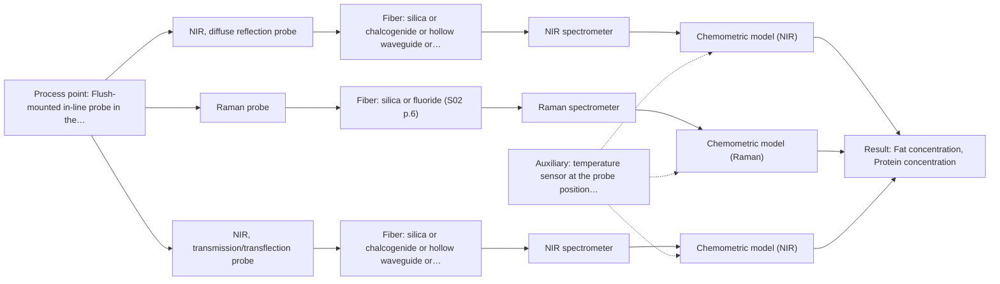
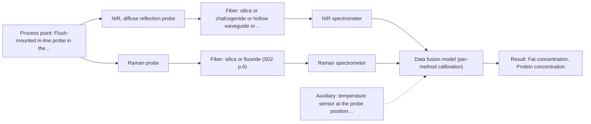

# First technical assessment: Fat and protein monitoring in opaque dairy product

## Answer

**Customer request (our summary):** Producer of an opaque, concentrated milk product flowing through a processing line currently samples for fat and protein analysis and wants earlier information about composition changes. Temperature and texture vary during production. They request an initial spectroscopy concept and a practical comparison experiment while retaining laboratory checks.

### Brief answer

Start with an in-line NIR diffuse-reflection probe, the established technique for opaque, concentrated dairy products, and test it against your laboratory fat and protein results. In the same comparison trial, test a Raman probe and an NIR transflection probe as alternatives. Open points: your required accuracy, the temperature and texture range, and the installation point.

### Proposal

- **Best current option:** O2 (recommended)
- **Basis:** supplied AFS sources
- **What would change it:** If the required accuracy is modest and the texture variation is mild, the simple single-probe NIR reflection option may be enough; if NIR reflection fails the accuracy criteria on held-out batches, the fused NIR+Raman option becomes the candidate.
- **Next step:** Run the multi-method comparison trial on representative production samples with laboratory fat and protein reference values, using the customer's accuracy criteria as the go/no-go basis.

**Secondary evidence (external, not AFS material):** G1: E01 ¶12, E03 ¶19; G2: E02 ¶31, E02 ¶36, E02 ¶82; G3: E03 ¶72; G4: E01 ¶20. See Expert detail.

**Decision status:** Provisional feasibility assessment

### Solution options

| ID | Tier | Methods | Confidence | Cost class, S01 Table 1 (p.6) | Ease of use | Maintenance | Performance fit | Sources |
|---|---|---|---|---|---|---|---|---|
| O1 | Simple | M1 NIR, diffuse reflection probe | Low: open question: Q1, Q3 (starts at Medium); uncited auxiliary sensor | average cost (row 8) | simple flush-mount probe, routine operation | probe window cleaning and calibration checks | matches opaque concentrated dairy, needs scatter-robust calibration | [1: S01 p.17] [2: S01 p.5] |
| O2 | Recommended | M1 NIR, diffuse reflection probe; M2 Raman probe; M3 NIR, transmission/transflection probe | Low: open question: Q1, Q3 (starts at Medium); suitability for this sample not confirmed; uncited auxiliary sensor | high cost (rows 7, 8, 12) | trial-based, then single-probe operation | same as single probe after selection | selects the best method on real product variation before investing | [3: S02 p.20] [1: S01 p.17] [2: S01 p.5] [4: S01 p.16] [5: S01 p.18] [6: S01 p.18] |
| O3 | Extended (multi-method) | M4 NIR, diffuse reflection probe + Raman (combination); M2 Raman probe | Low: open question: Q1, Q3 (starts at Medium); uncited auxiliary sensor; multi-method, fusion benefit not yet shown | high cost (rows 8, 12) | two instruments to run and maintain | two calibrations and two probe diagnostics | candidate only if single methods miss the accuracy targets | [7: S01 p.15] [8: S01 p.7] [4: S01 p.16] [5: S01 p.18] |

*Confidence rates the basis of the advice (how much is known and cited), not a predicted accuracy or probability of success. It starts at High, or at Medium when a key question on the method or the option is open, and drops one level per weakness listed (floor Low).*

*Cost class is the relative rating in S01 Table 1 (p.6) for the in-line method+technique rows named (the highest one for a multi-method option); it is not a price.*

### Setup sketch

*Recommended option O2; drawn by code from the option, a schematic, not a configuration.*

### Key questions

1. What accuracy, precision and detection limits do you need for fat and protein, and over what concentration ranges?
2. What temperature and pressure range does the product cover, and where in the line (diameter, access, distance to a safe analyser location) could a probe be mounted?
3. What does the texture variation consist of: changing viscosity, phase separation, air bubbles or homogenisation state?

## Expert detail

**Customer enquiry**

> We produce an opaque, concentrated milk product that flows through a processing line. We currently sample it for fat and protein analysis and would like earlier information about composition changes. Product temperature and texture vary during production. We want an initial spectroscopy concept and a practical comparison experiment, while retaining our laboratory checks.

**Decision status:** Provisional feasibility assessment. A method shortlist can be justified from documented dairy in-line applications, but the accuracy requirements, temperature range and texture behaviour of this specific product are unknown, so the assessment stays provisional pending the comparison experiment.

### Parameters

| ID | Parameter | Kind | Need | Measured by | Why | Sources |
|---|---|---|---|---|---|---|
| P1 | Fat concentration | quantitative | required | Spectroscopy: NIR | Fat is a stated composition target and the main calibration response for the reflection model. | [9: S01 p.17] |
| P2 | Protein concentration | quantitative | required | Spectroscopy: NIR | Protein is the second stated composition target and must be calibrated together with fat. | [9: S01 p.17] |
| P3 | Product temperature | quantitative | required | Auxiliary sensor: temperature sensor at the probe position (engineering judgement: confirm availability with AFS) | Temperature varies during production and shifts spectra, so it must be recorded to build a temperature-robust calibration. | *(no verified source: engineering judgement)* |
| P4 | Texture / homogenisation state | qualitative | optional | Not measurable in-line by spectroscopy; alternative: laboratory texture/viscosity assessment and microscopy of samples | Texture and globule size change the scattering that reflection spectra depend on, so samples should be characterised to separate physical from chemical effects; it should be available from existing product knowledge. | [10: S01 p.17] |

### Solution option details

- **O1 cost drivers:** one reflection probe, one NIR spectrometer, calibration samples and laboratory reference analyses
- **O2 cost drivers:** trial with several probe types, larger representative sample set, laboratory reference analyses
- **O3 cost drivers:** two spectrometers and probes, synchronisation software, fused model development and validation
- **O3 combining methods:** Low-level fusion: NIR reflection and Raman spectra from the same sampling spot are synchronised to a common time step and merged into one augmented matrix for PLS regression. Each method keeps its own calibration and diagnostics, and the fused model must beat the best single method on held-out batches or it is dropped.

*Extended (multi-method) option O3; drawn by code from the option, a schematic, not a configuration.*

### Premise check

- **Precedent only:** Spectroscopy can provide earlier composition information in their opaque, concentrated milk product in-line. Inline NIR monitoring of dairy products is a documented application area, but for this specific opaque, concentrated product it is a reason to test, not proof of performance. [11: S01 p.17]
- **Precedent only:** A single probe geometry could cover the product despite its opacity and concentration. The source says transflection works in some milk cases; whether it works for this opaque, concentrated product is unknown and must be tested. [6: S01 p.18]
- **Not covered:** The varying temperature and texture will not prevent a usable in-line measurement. No supplied source addresses how varying temperature and texture affect in-line measurement of this product; it is handled as a risk and a calibration question. *(no verified source: engineering judgement)*

### Requirements

**Stated by the customer**

- "We produce an opaque, concentrated milk product"
- "flows through a processing line"
- "We currently sample it for fat and protein analysis"
- "would like earlier information about composition changes"
- *Further statements: see the customer enquiry above.*

**Key unknowns**

- Required accuracy, precision and detection limits for fat and protein
- Temperature range and its effect on the spectra
- Nature of the texture variation (viscosity, phase separation, air, homogenisation)
- Fat and protein concentration ranges in the product
- Installation point, line diameter and distance to a safe analyser location
- Cleaning-in-place and fouling constraints

### Clarification questions (most decision-relevant first)

Q1. What accuracy, precision and detection limits do you need for fat and protein, and over what concentration ranges? *Why it matters:* This decides whether NIR reflection alone is sufficient or a more specific method such as Raman must be added. *(affects: method, technique)*
Q2. What temperature and pressure range does the product cover, and where in the line (diameter, access, distance to a safe analyser location) could a probe be mounted? *Why it matters:* Temperature variation shifts spectra and the installation point and fibre distance determine which probe and fibre designs are feasible. *(affects: installation, technique)*
Q3. What does the texture variation consist of: changing viscosity, phase separation, air bubbles or homogenisation state? *Why it matters:* Scattering and texture changes can mimic composition changes in reflection spectra, so the calibration design depends on their nature. *(affects: technique, method)*
Q4. What are the cleaning-in-place and hygiene constraints at the measuring point, and is the probe expected to withstand CIP chemicals and flow? *Why it matters:* Fouling or damage of a flush-mounted probe is a main operational risk for in-line dairy measurement. *(affects: installation, status)*
Q5. How quickly do you need composition information (update frequency), and how accurate and fast is your current laboratory method? *Why it matters:* The response time requirement and reference quality set the go/no-go criteria for the comparison experiment. *(affects: status)*

### Recommendation

- **M1 · Primary candidate: NIR, diffuse reflection probe.** NIR diffuse reflection is the documented technique for opaque, concentrated dairy products in-line, and NIR suits remote fibre-probe measurement. Its calibration must handle scatter and temperature variation. [1: S01 p.17] [2: S01 p.5]
- **M2 · Comparison candidate: Raman probe.** Raman tolerates water and offers molecular specificity that can capture what NIR reflection misses in a complex dairy matrix. Weak signals and possible fluorescence background must be checked on real samples. [4: S01 p.16] [5: S01 p.18]
- **M3 · Conditional candidate: NIR, transmission/transflection probe.** A transflection probe could in some cases serve both low-fat and high-fat dairy products with one instrument, but transmission-style geometries fail when the product is too thick or fat-rich, so it is unproven here. *Conditions:* Only if the trial shows the transflection geometry gives usable signal on this opaque, concentrated product at the process temperatures. [6: S01 p.18]
- **M4 · Comparison candidate: NIR, diffuse reflection probe + Raman (combination).** A fused NIR and Raman model is a later hypothesis: the sources report that combined NIR and Raman models can predict with higher accuracy and robustness than single-method models in pharma powders, which is precedent, not proof for this product. *Conditions:* Only if the single-method tests show that neither NIR reflection nor Raman alone meets the accuracy targets. [8: S01 p.7]
- **M6 · Not recommended: UV-Vis, transmission/transflection probe.** UV-Vis transmission is excluded for this opaque liquid because the signal saturates when light cannot penetrate, and UV-Vis has low selectivity for fat and protein in complex mixtures. [12: S01 p.5]

### Measurement concept

- **Probe and geometry:** NIR diffuse-reflection fibre probe as the primary concept; Raman fibre probe and NIR transflection probe as comparison techniques in the trial.
- **Location:** Flush-mounted in-line probe in the processing pipe, at a point representative of the product stream and accessible for cleaning.
- **Fiber link:** Vis-NIR silica fibre for the NIR reflection probe; the usable fibre length depends on the selected fibre and configuration and must be confirmed with AFS. Fibre optics allow the spectrometer to sit away from the process point. [13: S01 p.17] [14: S01 p.15]

### Spectral range

- **NIR:** NIR nominal range 780-2500 nm; the usable range depends on the spectrometer, fibre and probe actually selected. [15: S01 p.10]
- **Raman:** Raman is reported as Raman shift in cm-1 with the laser excitation wavelength stated separately; the usable range depends on the selected configuration. [16: S01 p.11]

### Risks and uncertainty

- Texture, globule size and surface changes can mimic composition changes in reflection spectra, so physical variation must be separated from fat and protein change in the calibration. *(rules: R-GEO-6)* [10: S01 p.17]
- The calibration is specific to this product matrix; any change in recipe, homogenisation or temperature range requires re-validation. *(rules: R-CAL-1)* [17: REF §5]
- A flush-mounted probe can foul or be damaged by cleaning-in-place, degrading the signal over time. *(rules: R-MIR-3)* [18: REF §5]
- Temperature variation shifts NIR spectra; without temperature recording and compensation the predictions may drift with process temperature. *(no verified source: engineering judgement)*

### First feasibility experiment

1. **Collect representative samples across the expected variation in fat, protein, temperature and texture (including any phase-separated or viscous states).** Cover the expected chemical and physical variation so the calibration sees the real process range. *(no verified source: engineering judgement)*
2. **Analyse all samples for fat and protein with the retained laboratory method.** Provide the independent reference data for calibration and validation. *(no verified source: engineering judgement)*
3. **Measure each sample with an NIR diffuse-reflection probe in a flow cell or flush-mount geometry, and in the same trial with a Raman probe and an NIR transflection probe, at representative process temperatures.** Compare the candidate single methods on identical material under process-like conditions. [13: S01 p.17]
4. **Build PLS calibrations for fat and protein per method, with scatter correction, and validate on held-out batches or runs.** Quantify what each single method can deliver before considering any combination. [19: S01 p.17]
5. **Compare prediction error of each method against the customer's required accuracy; only if no single method suffices, test a fused NIR+Raman model against the best single method.** Decide objectively whether the spectroscopic concept meets the process need. *(no verified source: engineering judgement)*

**Reference measurements:** Laboratory fat and protein analysis on every sample, using the customer's existing method, with its own accuracy documented.

**Decision basis:** Go/no-go against the accuracy, precision and response-time criteria the customer sets (Q1, Q5), judged on held-out validation batches; a method is kept only if it meets these criteria on independent material.

### Assumptions

- The product is an aqueous, opaque, concentrated dairy liquid flowing in a pipe; fat and protein are the composition targets.
- Laboratory fat and protein analysis on grab samples remains available as the reference method.
- The exact temperature range, line geometry and accuracy requirements are not yet known and are asked as questions.

### Not covered by the supplied sources

- In-line accuracy, response time and calibration performance for this specific opaque, concentrated product are not in the supplied sources; they must come from the comparison experiment.

### Further notes

- **Chemometrics:** Fat and protein calibration will need scatter correction (e.g. MSC or SNV, as used for inline milk reflection) and PLS regression on representative samples spanning fat, protein, temperature and texture variation; the laboratory analyses provide the reference data, and the model must be validated on held-out production runs.
- **Real-time tracking:** The goal is earlier information on composition changes in a flowing product: a flush-mounted probe with continuous spectral acquisition and PLS prediction gives time-resolved fat and protein trends, with the laboratory checks retained as reference and validation.
- **Future direction:** If the trial shows a stable calibration, a later step could be a compact LED-based NIR sensor at selected wavelengths for routine line monitoring, following the multisensor concept described in the sources.

### Secondary evidence (external, not AFS material)

*Found by a literature search for gaps the supplied AFS sources leave open. Not AFS material and not proof for this case; every quote below was verified verbatim against the fetched text.*

*Live search unavailable (library only: cache miss (europepmc); cache miss (openalex)); curated library only.*

**G1 · auxiliary sensor:** In-line measurement of Product temperature with temperature sensor at the probe position

- **E01 ¶12** The review states that the temperature sensitivity of the OH bands is a severe drawback for NIR and MIR measurements of aqueous solutions, making tempered sample holders necessary. *How it applies:* Since the product is aqueous and temperature varies, the comparison experiment should record product temperature at the probe position and test whether temperature variation degrades the NIR models, e.g. by including temperature as a variable or checking residuals against temperature. *Limits and transfer risks:* The statement concerns NIR/MIR of aqueous solutions in laboratory setups with tempered holders, not in-line probes on an opaque concentrated dairy product, so the magnitude of the effect here is unknown. *(supports O2)*
  > "Additionally, the temperature sensitivity of the OH bands is a severe drawback for measuring aqueous solution in NIR and MIR, which makes tempered sample holders necessary [29]."
  > A critical review of recent trends, and a future perspective of optical spectroscopy as PAT in biopharmaceutical downstream processing. (2020) · Analytical and bioanalytical chemistry · doi:10.1007/s00216-020-02407-z · https://europepmc.org/article/PMC/PMC7072065 · retrieved 2026-10-17, full text, licence: cc by, via curated library
- **E03 ¶19** In this FT-IR and Raman study, temperature was deliberately varied, alongside concentrations and ionic strength, to obtain a robust model. *How it applies:* This supports building temperature variation into the calibration design of the comparison experiment rather than controlling it, so the in-line model can be tested under the temperature range the production line actually shows. *Limits and transfer risks:* The source is a lithium-recycling liquid-liquid extraction process with a different matrix and analytes, so the achievable robustness to temperature may not carry over to a concentrated milk product. *(supports O2)*
  > "The concentrations of nitric acid and hydrochloric acid as well as the ionic strength and temperature were varied to obtain a robust model."
  > Process Analytical Technology-Integrated FT-IR and Raman Spectroscopies for Efficient Reactive Liquid-Liquid Extraction Processing in Lithium Recycling. (2025) · ACS omega · doi:10.1021/acsomega.5c05705 · https://europepmc.org/article/PMC/PMC12573149 · retrieved 2026-10-17, full text, licence: cc by, via curated library

**G2 · multi-method:** Combining several spectroscopy methods (data fusion) (Low-level fusion: NIR reflection and Raman spectra from the same sampling spot are synchronised to a common time step and merged into one augmented matrix for PLS regression. Each method keeps its own calibration and diagnostics, and the fused model must beat the best single method on held-out batches or it is dropped.)

- **E02 ¶31** Low-level data fusion is described as the simplest combination method, where variables from different sources are concatenated one after the other into a new data matrix. *How it applies:* This matches the planned approach of merging synchronised NIR and Raman spectra into one augmented matrix for PLS regression, and suggests it is a reasonable starting point for the comparison experiment. *Limits and transfer risks:* The review discusses fusion in general PAT contexts; it does not establish that low-level fusion of NIR reflection and Raman works for an opaque concentrated dairy product in-line. *(supports O3)*
  > "Low-level data fusion (LLDF) is considered the simplest method to achieve a combination of inputs. In this case, the data is rearranged into a new data matrix, where the variables coming from different sources are placed one after the other."
  > Challenges and Opportunities of Implementing Data Fusion in Process Analytical Technology-A Review. (2022) · Molecules (Basel, Switzerland) · doi:10.3390/molecules27154846 · https://europepmc.org/article/PMC/PMC9369811 · retrieved 2026-10-17, full text, licence: cc by, via curated library
- **E02 ¶36** A food analytical study combining Raman and FT-IR data showed that in some situations instrument complementarity alone was not sufficient to improve the prediction of several quality attributes. *How it applies:* This is a reason to apply the planned acceptance rule strictly: the fused model must outperform the best single method on held-out batches, otherwise it should be dropped as foreseen. *Limits and transfer risks:* The cited example used Raman with FT-IR rather than NIR reflection, and was a food analytical study, so the outcome for this NIR-Raman pairing is unknown. *(supports O3)*
  > "In some situations, instrument complementarity (not data complementarity) was not sufficient to improve the performance of predictive several CQAs, as shown by a Raman and FT-IR data based food analytical study [73]."
  > Challenges and Opportunities of Implementing Data Fusion in Process Analytical Technology-A Review. (2022) · Molecules (Basel, Switzerland) · doi:10.3390/molecules27154846 · https://europepmc.org/article/PMC/PMC9369811 · retrieved 2026-10-17, full text, licence: cc by, via curated library
- **E02 ¶82** The review states that before fusing data from multiple sources it is essential to evaluate each dataset's contribution to the model and its complementarity. *How it applies:* The comparison experiment should therefore first characterise the single-method NIR and Raman calibrations and diagnostics before building the fused model, so each method's contribution can be judged. *Limits and transfer risks:* This is a general methodological recommendation from a review, not a demonstrated result for this product or for in-line NIR-Raman fusion. *(supports O3)*
  > "Before fusing data from multiple sources, it is essential to evaluate the contribution of each dataset to the model and its complementarity."
  > Challenges and Opportunities of Implementing Data Fusion in Process Analytical Technology-A Review. (2022) · Molecules (Basel, Switzerland) · doi:10.3390/molecules27154846 · https://europepmc.org/article/PMC/PMC9369811 · retrieved 2026-10-17, full text, licence: cc by, via curated library

**G3 · not in the supplied sources:** In-line accuracy, response time and calibration performance for this specific opaque, concentrated product are not in the supplied sources; they must come from the comparison experiment.

- **E03 ¶72** The study notes that in-line methods require maintenance such as calibration and handling of sensor drift and aging, which it addressed by checking the baseline in each cycle and monitoring drift. *How it applies:* This supports planning ongoing calibration maintenance and drift monitoring in the comparison experiment, since laboratory checks are retained and can serve as reference for detecting drift. *Limits and transfer risks:* The approach relies on recurring pure-component phases in that specific process, which a continuous milk production line may not have, so an equivalent drift-check routine must be designed separately. *(supports O2)*
  > "Potential typical drawbacks of any in-line method are maintenance efforts like calibration, and actions to sensor drift and aging could be easily overcome by checking the baseline in each cycle of pure component phases of process operation and monitoring any drift in order to be able to react."
  > Process Analytical Technology-Integrated FT-IR and Raman Spectroscopies for Efficient Reactive Liquid-Liquid Extraction Processing in Lithium Recycling. (2025) · ACS omega · doi:10.1021/acsomega.5c05705 · https://europepmc.org/article/PMC/PMC12573149 · retrieved 2026-10-17, full text, licence: cc by, via curated library

**G4 · premise not covered:** The varying temperature and texture will not prevent a usable in-line measurement.

- **E01 ¶20** Raman spectroscopy is frequently applied in bioprocessing because of its high selectivity and low water interference, despite relatively long measurement times. *How it applies:* Low water interference is relevant for an aqueous, opaque product where NIR water bands dominate, but the noted long measurement times mean the achievable response time must be measured in the experiment, not assumed. *Limits and transfer risks:* The statement concerns upstream biopharmaceutical processing, not in-line dairy measurement, and says nothing about accuracy or response time for this product. *(supports O3)*
  > "Raman spectroscopy is frequently applied in upstream processing in research and industry due to its high selectivity and low water interference [55] despite the relatively long measurement times."
  > A critical review of recent trends, and a future perspective of optical spectroscopy as PAT in biopharmaceutical downstream processing. (2020) · Analytical and bioanalytical chemistry · doi:10.1007/s00216-020-02407-z · https://europepmc.org/article/PMC/PMC7072065 · retrieved 2026-10-17, full text, licence: cc by, via curated library

### Evidence (verified quotes)

1. ✓ **S01 p.17** (application precedent): "NIR Reflection is primarily used for opaque or highly concentrated dairy products, such as yogurt, butter, or whole milk concentrates."
2. ✓ **S01 p.5** (general): "making it ideal for online applications, including remote measurements via fiber optic probes."
3. ✓ **S02 p.20** (general): "1. Multi-Method Lab Trials AFS tests your process using all key fiber optic spectroscopy methods."
4. ✓ **S01 p.16** (general): "Raman is particularly well-suited for aqueous environments, as it exhibits low absorbance for water molecules compared to infrared methods."
5. ✓ **S01 p.18** (general): "advanced labs often incorporate Fluorescence, Raman, and Mid-Infrared (MIR) ATR fiber optic techniques to capture specific chemical or structural information that NIR might miss."
6. ✓ **S01 p.18** (general): "In some cases, a Transflection probe can already be a combined solution working well for low-fat and high-fat containing milk products."
7. ✓ (precedent only) **S01 p.15** (method gain): "By combining Raman and NIR, these models can predict API potency or coating thickness with higher accuracy and robustness than single-method models."
8. ✓ (precedent only) **S01 p.7** (method gain): "The analysis of such systems may require a combination of two or even more spectral methods."
9. ✓ **S01 p.17** (application precedent): "using Partial Least Squares (PLS) regression to quantify fat and protein"
10. ✓ **S01 p.17** (general): "the method is sensitive to the surface characteristics and fat globule size."
11. ✓ **S01 p.17** (application precedent): "The use of Near-Infrared (NIR) spectroscopy for the inline monitoring of milk is a cornerstone of modern dairy "Process Analytical Technology" (PAT)."
12. ✓ **S01 p.5** (general): "the strong overlap of spectral signals in UV spectra complicates the analysis of real samples"
13. ✓ **S01 p.17** (application precedent): "Experimentally, the probe is flush-mounted into a pipe or vat to interact directly with the flowing medium."
14. ✓ **S01 p.15** (general): "located safely away from the vibration and dust of the manufacturing floor."
15. ✓ **S01 p.10** (general): "NIR spectra (780-2500 nm) contain predominantly overtones and component bands of fundamental vibrations"
16. ✓ **S01 p.11** (general): "The Raman shift is used as the horizontal (spectral) axis in Raman spectroscopy"
17. ✓ **REF §5** (general): "physical variation; calibration specific to the matrix."
18. ✓ **REF §5** (general): "contact, fouling, compatibility."
19. ✓ **S01 p.17** (application precedent): "Data processing may involve converting the reflectance values to absorbance and applying Multiplicative Scatter Correction (MSC) or Standard Normal Variate (SNV) transformations"

### Verification

- Citations verified: 24 of 24 (exact or whitespace/hyphen-tolerant match on the cited page, scope checked).
- Hard check failures before deterministic corrections: 0; still open: 0; soft warnings: 2; repair rounds: 1.
- External evidence (cache): 7 quote(s) verified verbatim (exact or whitespace/hyphen-tolerant, at most 400 characters and 2 sentences, against the cited paragraph); 0 item(s) dropped.
- External search: 6 query(ies), 0 hit(s), 3 source(s) (3 from the curated library); ⚠ library only: cache miss (europepmc); cache miss (openalex).
- External step: 2 model call(s), 34.1 s extra (cost in the run JSON).

*Run D02-20261018T072334Z-81c2 · models z-ai/glm-5.3-flash*
