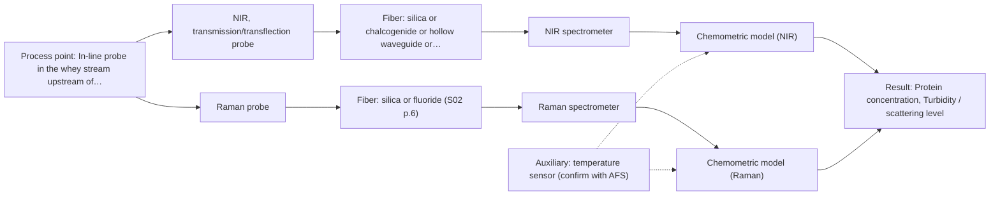
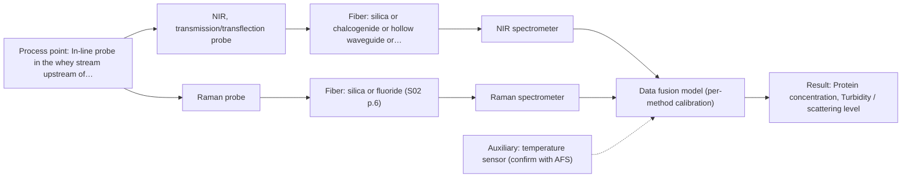

# First technical assessment: A clear whey stream before concentration

## Answer

**Customer request (our summary):** Dairy processor asks whether in-line spectroscopy can track protein concentration in a relatively clear whey stream before a concentration stage, with lab results as reference; the stream may become turbid under some operating conditions and the concept must handle this.

### Brief answer

Test NIR transmission/transflection first: it is the standard in-line technique for clear dairy streams such as whey, and a transflection probe may in some cases also cover the turbid states. Raman is the comparison method because it tolerates water and scattering. Open points: the protein range, the cause and degree of turbidity, the lab reference method, and the installation point. A lab feasibility trial on representative samples with your lab results as reference is the proposed next step.

### Proposal

- **Best current option:** O2 (recommended)
- **Basis:** supplied AFS sources
- **What would change it:** If the turbidity change proves severe or the protein range is very low, the Raman comparison or the NIR+Raman combination would move up; if the lab reference method or accuracy requirement differs from what is assumed, the whole plan needs revisiting.
- **Next step:** Run a lab feasibility trial on representative whey samples spanning the turbidity range, with your laboratory protein results as reference.

**Secondary evidence (external, not AFS material):** G1: E01 ¶19, E01 ¶72; G2: E02 ¶31, E02 ¶82, E02 ¶36; G3: no usable external source found; G4: no usable external source found. See Expert detail.

**Decision status:** Provisional feasibility assessment

### Solution options

| ID | Tier | Methods | Confidence | Cost class, S01 Table 1 (p.6) | Ease of use | Maintenance | Performance fit | Sources |
|---|---|---|---|---|---|---|---|---|
| O1 | Simple | M1 NIR, transmission/transflection probe | Low: open question: Q1 (starts at Medium); uncited auxiliary sensor | average cost (row 7) | Standard dairy PAT setup, straightforward operation | Low; window cleaning and periodic recalibration | Fits the clear whey baseline but may not cover turbid states | [1: S01 p.18] [2: S01 p.10] |
| O2 | Recommended | M1 NIR, transmission/transflection probe; M2 Raman probe | Low: open question: Q1 (starts at Medium); uncited auxiliary sensor | high cost (rows 7, 12) | Trial tests both methods side by side | Low-moderate; window fouling checks needed | Covers clear and turbid states by testing both methods before committing | [1: S01 p.18] [3: S01 p.16] [2: S01 p.10] |
| O3 | Extended (multi-method) | M3 NIR, transmission/transflection probe + Raman (combination) | Low: open question: Q1 (starts at Medium); precedent only; uncited auxiliary sensor; multi-method, fusion benefit not yet shown | high cost (rows 7, 12) | More complex; two instruments to run and maintain | Higher; two calibrations and two probes to maintain | Fallback if turbidity or interferences limit single-method accuracy | [4: S01 p.15] [5: S01 p.7] |

*Confidence rates the basis of the advice (how much is known and cited), not a predicted accuracy or probability of success. It starts at High, or at Medium when a key question on the method or the option is open, and drops one level per weakness listed (floor Low).*

*Cost class is the relative rating in S01 Table 1 (p.6) for the in-line method+technique rows named (the highest one for a multi-method option); it is not a price.*

### Setup sketch

*Recommended option O2; drawn by code from the option, a schematic, not a configuration.*

### Key questions

1. What is the expected protein concentration range and how much does it change over the process?
2. What causes the turbidity change (fat, precipitated protein, air) and how severe does it get?
3. Which laboratory reference method will be used for protein, and at what sampling frequency and accuracy?

## Expert detail

**Customer enquiry**

> Our dairy process includes a relatively clear whey stream before a concentration stage. We want to investigate whether spectroscopy can track protein concentration as the stream changes, with laboratory results used as the reference. The stream can become more turbid under some operating conditions. We need a first measurement concept that handles this change rather than assuming the liquid always remains clear.

**Decision status:** Provisional feasibility assessment. A method shortlist can be justified from the dairy precedents in the sources, but the protein range, turbidity behaviour and reference method are unknown, so the assessment is provisional and hinges on the feasibility trial.

### Parameters

| ID | Parameter | Kind | Need | Measured by | Why | Sources |
|---|---|---|---|---|---|---|
| P1 | Protein concentration | quantitative | required | Spectroscopy: NIR | It is the target variable the in-line model must predict. | [6: S01 p.17] |
| P2 | Turbidity / scattering level | quantitative | required | Spectroscopy: NIR | Scattering variation can mimic composition change and must be tracked or corrected in the calibration. | [7: S01 p.17] |
| P3 | Sample temperature | quantitative | required | Auxiliary sensor: temperature sensor (engineering judgement: confirm availability with AFS) | Temperature affects NIR spectra of aqueous streams and must be recorded for the calibration. | *(no verified source: engineering judgement)* |
| P4 | Lactose and fat content | quantitative | optional | Reference lab method: laboratory whey composition analysis (lactose, fat, minerals) | These overlapping components should be available from existing lab results to check for spectral interference in the protein model. | *(no verified source: engineering judgement)* |

### Solution option details

- **O1 cost drivers:** One NIR spectrometer, one transmission probe, lab trial samples and reference analyses
- **O2 cost drivers:** Two spectrometers for the trial, transflection probe, pathlength optimisation, broader sample set covering turbidity range
- **O3 cost drivers:** Two spectrometers, two probes or a combined probe, fusion software, extended calibration
- **O3 combining methods:** Low-level data fusion: NIR and Raman spectra synchronised to a common time step and merged into one augmented matrix, with per-method calibration blocks. Both probes must sample the same material at the same point in the stream. The fused model must beat the best single method on held-out runs, otherwise the second instrument should be dropped.

*Extended (multi-method) option O3; drawn by code from the option, a schematic, not a configuration.*

### Premise check

- **Precedent only:** Laboratory results can serve as the reference for building and validating the spectroscopic calibration. The dairy examples in the sources use laboratory-referenced PLS calibration for fat and protein, so the approach is precedented, but its accuracy for this whey stream must be established in the trial. [6: S01 p.17]
- **Precedent only:** A first measurement concept can handle the turbidity change without assuming the stream stays clear. The sources only state that a transflection probe can in some cases cover both low- and high-scattering dairy products; for this whey stream it is a hypothesis to test, not an established capability. [8: S01 p.18]

### Requirements

**Stated by the customer**

- Track protein concentration in-line as the whey stream changes
- Handle the turbidity change rather than assuming the stream stays clear
- Use laboratory results as the reference

**Key unknowns**

- Protein concentration range and expected change
- Cause and degree of the turbidity change
- Laboratory reference method, accuracy and sampling frequency
- Required accuracy, detection limit and response time
- Installation point, temperature and analyzer distance
- Other whey components and spectral interferences

### Clarification questions (most decision-relevant first)

Q1. What is the expected protein concentration range and how much does it change over the process? *Why it matters:* The range determines whether NIR sensitivity is sufficient or a more selective method is needed. *(affects: method)*
Q2. What causes the turbidity change (fat, precipitated protein, air) and how severe does it get? *Why it matters:* The degree and nature of scattering decide between transmission and transflection geometry and whether scatter correction will suffice. *(affects: technique, installation)*
Q3. Which laboratory reference method will be used for protein, and at what sampling frequency and accuracy? *Why it matters:* Calibration quality is limited by the reference method and the number of samples covering the process variation. *(affects: status)*
Q4. Where can the probe be installed (pipe size, flow, temperature) and how far is the analyzer location? *Why it matters:* Temperature and fiber distance constrain the probe and spectrometer configuration. *(affects: installation)*
Q5. What accuracy, detection limit and response time does the process control actually need? *Why it matters:* The requirement decides whether a single NIR method is enough or a second method must be considered. *(affects: status)*

### Recommendation

- **M1 · Primary candidate: NIR, transmission/transflection probe.** NIR transmission/transflection is the standard in-line technique for clear dairy liquids and whey is named as a suitable sample in the dairy example. The nominal NIR range is 780-2500 nm; the usable range depends on the instrument, fiber and probe selected. [1: S01 p.18] [2: S01 p.10]
- **M2 · Comparison candidate: Raman probe.** Raman tolerates water and scattering better than absorption methods, making it a useful comparison if turbidity degrades the NIR signal. Weak Raman signals and possible fluorescence background must be checked on real whey samples. [3: S01 p.16]
- **M3 · Conditional candidate: NIR, transmission/transflection probe + Raman (combination).** If turbidity or overlapping whey components limit the single methods, a combined NIR+Raman option is the next hypothesis, to be tested against the best single method. Any fusion gain is a hypothesis and requires synchronised, same-spot measurement. *Conditions:* Only if the feasibility trial shows that neither NIR nor Raman alone meets the required accuracy across the turbidity range. [5: S01 p.7] Later hypothesis, after single-method tests.
- **M4 · Not recommended: NIR, diffuse reflection probe.** NIR diffuse reflection is designated for opaque, highly concentrated dairy products and is sensitive to surface characteristics, so it does not fit a relatively clear liquid stream and was screened out for this sample type. [9: S01 p.17]

### Measurement concept

- **Probe and geometry:** NIR transmission or transflection fiber probe with a controlled optical pathlength (typically 1-10 mm in the dairy example); a transflection probe is the candidate that may cover both clear and turbid states.
- **Location:** In-line probe in the whey stream upstream of the concentration stage, at a point that is representative across the turbidity variation.
- **Fiber link:** Vis-NIR silica fibers are compatible with the NIR range; the achievable cable length depends on the selected fiber and installation and must be confirmed with AFS. [10: S01 p.18] [1: S01 p.18]

### Spectral range

- **NIR:** Nominal NIR range 780-2500 nm; the usable range depends on the spectrometer, fiber and probe actually selected. [2: S01 p.10]
- **Raman:** Raman is reported as Raman shift in cm-1 with the laser excitation wavelength stated separately; the excitation wavelength for this application is not yet selected. [11: S01 p.11]

### Risks and uncertainty

- If the turbidity becomes severe, NIR transmission signal may be lost and the transflection hypothesis may fail, forcing a geometry or method change. *(rules: R-GEN-4)* [12: S01 p.18]
- Scattering variation can mimic protein change in the spectra, so the calibration must explicitly cover the turbidity range or it will not generalise. *(rules: R-GEO-6, R-CAL-1)* [7: S01 p.17]
- Overlapping NIR bands of lactose, fat and protein in whey mean the calibration quality depends heavily on the number and representativeness of reference samples. *(rules: R-NIR-2)* [13: S01 p.10]
- Fouling of the optical window at the in-line installation point could drift the signal and is not addressed by the supplied sources. *(rules: R-MIR-3)* *(no verified source: engineering judgement)*

### First feasibility experiment

1. **Collect representative whey samples spanning the full expected variation in protein concentration and turbidity, including the turbid operating states.** Collect representative whey samples spanning the full expected variation in protein concentration and turbidity, including the turbid operating states. *(no verified source: engineering judgement)*
2. **Measure each sample with the NIR transmission/transflection probe under controlled pathlength and temperature, and record a turbidity value per sample.** Measure each sample with the NIR transmission/transflection probe under controlled pathlength and temperature, and record a turbidity value per sample. *(no verified source: engineering judgement)*
3. **Measure the same samples with the Raman probe as the comparison method, checking for fluorescence background.** Measure the same samples with the Raman probe as the comparison method, checking for fluorescence background. *(no verified source: engineering judgement)*
4. **Build a PLS calibration for protein on part of the samples and validate it on held-out samples and, later, held-out production runs.** Build a PLS calibration for protein on part of the samples and validate it on held-out samples and, later, held-out production runs. *(no verified source: engineering judgement)*
5. **Compare single-method and (only if needed) fused NIR+Raman models against the required accuracy to decide go/no-go.** Compare single-method and (only if needed) fused NIR+Raman models against the required accuracy to decide go/no-go. *(no verified source: engineering judgement)*

**Reference measurements:** Laboratory protein results (customer's stated reference, Q3) taken on each sample, ideally with duplicates to quantify reference uncertainty.

**Decision basis:** Go/no-go against the customer's required protein accuracy and response time (Q5), judged on held-out validation runs; the customer must supply the numerical criteria.

### Not covered by the supplied sources

- Protein calibration performance specifically for whey streams with varying turbidity is not shown in the supplied material; the dairy examples cover fat and protein in milk products.
- No source states an achievable fiber length for a specific installation; long-cable figures are given only for low-OH silica fibers in general, and must be confirmed for this installation.

### Further notes

- **Chemometrics:** A PLS calibration for protein will need representative samples spanning the full turbidity and composition range; scatter correction (e.g. MSC or SNV) is standard practice for scattering dairy samples, and the model must be validated on held-out production runs.
- **Real-time tracking:** The goal is continuous in-line tracking of protein as the stream changes; NIR diode-array instruments allow fast acquisition, and the calibration must remain valid across the turbidity transients, which is exactly what the trial must demonstrate.
- **Future direction:** If the feasibility trial succeeds, a customized in-line system at the measurement point with automated data transfer for process control is a later extension.

### Secondary evidence (external, not AFS material)

*Found by a literature search for gaps the supplied AFS sources leave open. Not AFS material and not proof for this case; every quote below was verified verbatim against the fetched text.*

*Live search unavailable (library only: cache miss (europepmc); cache miss (openalex)); curated library only.*

**G1 · auxiliary sensor:** In-line measurement of Sample temperature with temperature sensor

- **E01 ¶19** In an FT-IR/Raman extraction study, concentration, ionic strength and temperature were deliberately varied to obtain a robust model. *How it applies:* This suggests building the whey calibration with temperature deliberately varied (and recorded) so temperature effects are represented, and using the temperature sensor readings to check whether the model stays robust across the operating range. *Limits and transfer risks:* The result comes from a lithium-recycling liquid-liquid extraction system, not a dairy whey stream, and concerns model design rather than a specific temperature sensor specification. *(supports O2)*
  > "The concentrations of nitric acid and hydrochloric acid as well as the ionic strength and temperature were varied to obtain a robust model."
  > Process Analytical Technology-Integrated FT-IR and Raman Spectroscopies for Efficient Reactive Liquid-Liquid Extraction Processing in Lithium Recycling. (2025) · ACS omega · doi:10.1021/acsomega.5c05705 · https://europepmc.org/article/PMC/PMC12573149 · retrieved 2026-10-17, full text, licence: cc by, via curated library
- **E01 ¶72** The study reports that in-line maintenance burdens such as calibration and sensor drift or aging can be addressed by checking the baseline in each cycle of pure component phases and monitoring drift so one can react. *How it applies:* For the whey concept, a routine baseline/drift check (with temperature logged alongside) can be planned as part of the auxiliary-sensor and maintenance regime to detect drift that might otherwise be mistaken for composition changes. *Limits and transfer risks:* This practice is described for a reactive extraction process with recurring pure-component phases, which a continuous whey stream may not have; transfer of the exact check cycle is uncertain. *(supports O2)*
  > "Potential typical drawbacks of any in-line method are maintenance efforts like calibration, and actions to sensor drift and aging could be easily overcome by checking the baseline in each cycle of pure component phases of process operation and monitoring any drift in order to be able to react."
  > Process Analytical Technology-Integrated FT-IR and Raman Spectroscopies for Efficient Reactive Liquid-Liquid Extraction Processing in Lithium Recycling. (2025) · ACS omega · doi:10.1021/acsomega.5c05705 · https://europepmc.org/article/PMC/PMC12573149 · retrieved 2026-10-17, full text, licence: cc by, via curated library

**G2 · multi-method:** Combining several spectroscopy methods (data fusion) (Low-level data fusion: NIR and Raman spectra synchronised to a common time step and merged into one augmented matrix, with per-method calibration blocks. Both probes must sample the same material at the same point in the stream. The fused model must beat the best single method on held-out runs, otherwise the second instrument should be dropped.)

- **E02 ¶31** Low-level data fusion is described as the simplest way to combine inputs, by rearranging variables from different sources into a single new data matrix placed one after the other. *How it applies:* This supports the proposed O3 concept of merging synchronised NIR and Raman spectra into one augmented matrix; the assessment can check that the implementation follows this simple concatenation approach with per-method calibration blocks. *Limits and transfer risks:* The review is general and not dairy- or whey-specific; it describes the method concept, not measured performance for protein in turbid whey. *(supports O3)*
  > "Low-level data fusion (LLDF) is considered the simplest method to achieve a combination of inputs. In this case, the data is rearranged into a new data matrix, where the variables coming from different sources are placed one after the other."
  > Challenges and Opportunities of Implementing Data Fusion in Process Analytical Technology-A Review. (2022) · Molecules (Basel, Switzerland) · doi:10.3390/molecules27154846 · https://europepmc.org/article/PMC/PMC9369811 · retrieved 2026-10-17, full text, licence: cc by, via curated library
- **E02 ¶82** The review states that before fusing data from multiple sources, the contribution of each dataset and its complementarity must be evaluated. *How it applies:* This justifies the acceptance rule that the fused model must beat the best single method on held-out runs, and that the second instrument should be dropped if it adds no contribution. *Limits and transfer risks:* It is a methodological recommendation from a review, not a demonstrated result for NIR/Raman fusion on whey; actual benefit must be tested on this stream. *(supports O3)*
  > "Before fusing data from multiple sources, it is essential to evaluate the contribution of each dataset to the model and its complementarity."
  > Challenges and Opportunities of Implementing Data Fusion in Process Analytical Technology-A Review. (2022) · Molecules (Basel, Switzerland) · doi:10.3390/molecules27154846 · https://europepmc.org/article/PMC/PMC9369811 · retrieved 2026-10-17, full text, licence: cc by, via curated library
- **E02 ¶36** The review notes that in some situations, including a Raman and FT-IR food analytical study, instrument complementarity alone was not sufficient to improve predictive performance for several quality attributes. *How it applies:* This is a reason to test, on held-out runs, whether adding Raman to NIR actually improves protein prediction in whey rather than assuming the second instrument helps. *Limits and transfer risks:* The cited study is food analysis with Raman/FT-IR, not in-line NIR/Raman on a whey process, so the outcome may differ for this matrix and setup. *(supports O3)*
  > "In some situations, instrument complementarity (not data complementarity) was not sufficient to improve the performance of predictive several CQAs, as shown by a Raman and FT-IR data based food analytical study [73]."
  > Challenges and Opportunities of Implementing Data Fusion in Process Analytical Technology-A Review. (2022) · Molecules (Basel, Switzerland) · doi:10.3390/molecules27154846 · https://europepmc.org/article/PMC/PMC9369811 · retrieved 2026-10-17, full text, licence: cc by, via curated library

**G3 · not in the supplied sources:** Protein calibration performance specifically for whey streams with varying turbidity is not shown in the supplied material; the dairy examples cover fat and protein in milk products.

- No usable external source found.

**G4 · not in the supplied sources:** No source states an achievable fiber length for a specific installation; long-cable figures are given only for low-OH silica fibers in general, and must be confirmed for this installation.

- No usable external source found.

### Evidence (verified quotes)

1. ✓ **S01 p.18** (application precedent): "Transmission is the preferred method for transparent or semi-transparent liquids, such as skim milk, whey, or permeate."
2. ✓ **S01 p.10** (general): "NIR spectra (780-2500 nm) contain predominantly overtones and component bands of fundamental vibrations"
3. ✓ **S01 p.16** (general): "Raman is particularly well-suited for aqueous environments, as it exhibits low absorbance for water molecules compared to infrared methods."
4. ✓ (precedent only) **S01 p.15** (method gain): "By combining Raman and NIR, these models can predict API potency or coating thickness with higher accuracy and robustness than single-method models."
5. ✓ (precedent only) **S01 p.7** (method gain): "The analysis of such systems may require a combination of two or even more spectral methods."
6. ✓ **S01 p.17** (application precedent): "before using Partial Least Squares (PLS) regression to quantify fat and protein"
7. ✓ **S01 p.17** (general): "the method is sensitive to the surface characteristics and fat globule size."
8. ✓ **S01 p.18** (general): "In some cases, a Transflection probe can already be a combined solution working well for low-fat and high-fat containing milk products."
9. ✓ **S01 p.17** (general): "NIR Reflection is primarily used for opaque or highly concentrated dairy products, such as yogurt, butter, or whole milk concentrates."
10. ✓ **S01 p.18** (general): "the precise control of the optical pathlength (usually 1 - 10 mm); if the pathlength is too wide, the signal is lost to absorption; if too narrow, the sample represents a negligible volume."
11. ✓ **S01 p.11** (general): "The Raman shift is used as the horizontal (spectral) axis in Raman spectroscopy"
12. ✓ **S01 p.18** (general): "if the pathlength is too wide, the signal is lost to absorption"
13. ✓ **S01 p.10** (general): "The broad absorption bands observed in this region overlap, suggesting the use of chemometrics for quantitative and qualitative analysis of spectral data."

### Verification

- Citations verified: 20 of 20 (exact or whitespace/hyphen-tolerant match on the cited page, scope checked).
- Hard check failures before deterministic corrections: 0; still open: 0; soft warnings: 2; repair rounds: 1.
- External evidence (cache): 5 quote(s) verified verbatim (exact or whitespace/hyphen-tolerant, at most 400 characters and 2 sentences, against the cited paragraph); 0 item(s) dropped.
- External search: 6 query(ies), 0 hit(s), 3 source(s) (3 from the curated library); ⚠ library only: cache miss (europepmc); cache miss (openalex).
- External step: 2 model call(s), 26.5 s extra (cost in the run JSON).

*Run D03-20261018T072334Z-6b9a · models z-ai/glm-5.3-flash*
