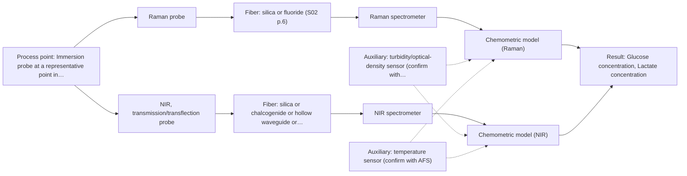
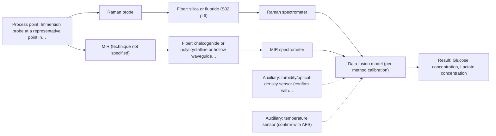

# First technical assessment: Glucose and lactate trends in an aqueous bioprocess

## Answer

**Customer request (our summary):** Cell culture process in an aqueous medium; glucose and lactate currently measured off-line from samples with a delay that hinders prompt visibility of changes. Customer is exploring an in situ spectroscopy pilot to be checked against the existing laboratory measurements, and notes that the medium and cell population change during the run. No probe or calibration strategy has been selected yet.

### Brief answer

Test a Raman fiber probe first: it tolerates water and has published precedent for direct glucose and lactate detection in bioreactors. Test NIR transmission/transflection alongside it in a multi-method lab trial, since the medium's turbidity decides whether NIR transmission is viable. Fluorescence is not recommended until a relevant fluorophore is identified. Open points: concentration ranges, turbidity over the run, and installation/sterilisation constraints.

### Proposal

- **Best current option:** O2 (recommended)
- **Basis:** supplied AFS sources
- **What would change it:** If the medium proves too turbid for any transmission path, the comparison shifts toward reflection or ATR geometries; if a relevant fluorophore is confirmed, a fluorescence complement becomes worth testing.
- **Next step:** Run a multi-method lab trial on representative samples from several runs, with Raman tested first and NIR transmission/transflection second, against the laboratory glucose and lactate references.

**Secondary evidence (external, not AFS material):** G1: E03 ¶7; G2: E02 ¶12; G3: E01 ¶31, E01 ¶82, E01 ¶36; G4: no usable external source found. See Expert detail.

**Decision status:** Provisional feasibility assessment

### Solution options

| ID | Tier | Methods | Confidence | Cost class, S01 Table 1 (p.6) | Ease of use | Maintenance | Performance fit | Sources |
|---|---|---|---|---|---|---|---|---|
| O1 | Simple | M1 Raman probe | Medium: open question: Q1 (starts at Medium) | high cost (row 12) | Immersion probe, moderate integration effort | Probe window fouling checks needed | Water-tolerant direct metabolite fingerprint | [1: S01 p.16] [2: S01 p.16] |
| O2 | Recommended | M1 Raman probe; M2 NIR, transmission/transflection probe | Low: open question: Q1 (starts at Medium); sample clarity unknown | high cost (rows 7, 12) | Lab trial first, then single-probe install | Standard probe cleaning and recalibration | Selects the method that fits the real medium | [3: S02 p.20] [2: S01 p.16] [1: S01 p.16] [4: S01 p.16] [5: S01 p.18] |
| O3 | Extended (multi-method) | M3 Raman probe + MIR (combination) | Low: precedent only; multi-method, fusion benefit not yet shown | at least high cost (row 12); MIR row not identified | Two instruments, higher integration effort | Two calibrations and two probe diagnostics | Covers turbidity and surface-layer chemistry together | [6: S01 p.7] |

*Confidence rates the basis of the advice (how much is known and cited), not a predicted accuracy or probability of success. It starts at High, or at Medium when a key question on the method or the option is open, and drops one level per weakness listed (floor Low).*

*Cost class is the relative rating in S01 Table 1 (p.6) for the in-line method+technique rows named (the highest one for a multi-method option); it is not a price.*

### Setup sketch

*Recommended option O2; drawn by code from the option, a schematic, not a configuration.*

### Key questions

1. What concentration ranges do glucose and lactate take during a typical run, and what accuracy and detection limits does the customer require?
2. How turbid does the medium become over the run (cell density, colour, scattering), and does it stay transmissive enough for a transmission path?
3. Where would the probe be installed, and what sterilisation, cleaning and fouling constraints apply at that point?

## Expert detail

**Customer enquiry**

> We run a cell culture process in an aqueous medium. Glucose and lactate are measured from samples, and the delay makes it difficult to see changes promptly. We are exploring an in situ spectroscopy pilot that can be checked against those existing laboratory measurements. The medium and cell population change during the run; we have not yet selected a probe or a calibration strategy.

**Decision status:** Provisional feasibility assessment. A method shortlist can be justified from the aqueous-medium fit and published bioprocess precedents, but the deciding facts (turbidity, concentration ranges, installation constraints) are still open, so the assessment is provisional and rests on stated assumptions.

### Parameters

| ID | Parameter | Kind | Need | Measured by | Why | Sources |
|---|---|---|---|---|---|---|
| P1 | Glucose concentration | quantitative | required | Spectroscopy: Raman | Glucose is a stated target and the calibration must cover its full run range. | [1: S01 p.16] |
| P2 | Lactate concentration | quantitative | required | Spectroscopy: Raman | Lactate is a stated target and the calibration must cover its full run range. | [1: S01 p.16] |
| P3 | Medium turbidity / cell density | quantitative | required | Auxiliary sensor: turbidity/optical-density sensor (cited; confirm availability with AFS) | Turbidity change over the run decides whether NIR transmission is viable and is a major source of spectral scatter variation. | [7: S01 p.16] |
| P4 | Temperature at the measurement point | quantitative | optional | Auxiliary sensor: temperature sensor (engineering judgement: confirm availability with AFS) | Temperature should be available because it shifts spectra and should be recorded as a covariate during calibration. | *(no verified source: engineering judgement)* |
| P5 | Presence of a relevant fluorescent species in the medium | qualitative | optional | Reference lab method: laboratory fluorescence scan | It should be checked because a confirmed fluorophore would reopen fluorescence as a complementary method, but most chemicals do not fluoresce. | [8: S01 p.5] |

### Solution option details

- **O1 cost drivers:** Raman spectrometer and laser, probe design, calibration samples and reference analyses
- **O2 cost drivers:** Two spectrometers for the trial, representative samples across runs, laboratory reference analyses
- **O3 cost drivers:** Two spectrometers and probes, fusion software development, doubled calibration and diagnostics effort
- **O3 combining methods:** Low-level fusion: Raman and MIR-ATR probes must sample the same small area, ideally via a combined probe, since alternating separate probes cannot guarantee the same spot. Data from the two methods must be synchronised to a common time step and block-scaled before fusion, starting from one model per method. The fused model must beat the best single method on held-out runs, otherwise the second instrument is dropped.

*Extended (multi-method) option O3; drawn by code from the option, a schematic, not a configuration.*

### Premise check

- **Precedent only:** An in situ spectroscopy pilot can be validated against the existing laboratory measurements. Published bioprocess examples show fiber-optic spectroscopy tracking metabolites in reactors, which supports testing an in situ pilot, but they are precedents, not proof for this customer's process. [1: S01 p.16]
- **Not covered:** A probe and calibration strategy can be selected now, before the deciding facts are known. The sources stress that method selection depends on many sample and process factors that are not yet known here, so the choice should follow a lab trial rather than be fixed now. [9: S01 p.5]

### Requirements

**Stated by the customer**

- In situ measurement of glucose and lactate in an aqueous cell-culture medium
- Validation against the existing laboratory sample measurements
- Robustness to the medium and cell population changing during the run

**Key unknowns**

- Expected glucose and lactate concentration ranges and required accuracy
- Turbidity and optical behaviour of the medium over the run
- Installation point, sterilisation and fouling constraints
- Reference sampling frequency and batch-to-batch variability
- Distance from measurement point to analyser (fiber link length)

### Clarification questions (most decision-relevant first)

Q1. What concentration ranges do glucose and lactate take during a typical run, and what accuracy and detection limits does the customer require? *Why it matters:* The ranges and required accuracy decide whether Raman or NIR sensitivity is sufficient and how the calibration must be designed. *(affects: M1, M2)*
Q2. How turbid does the medium become over the run (cell density, colour, scattering), and does it stay transmissive enough for a transmission path? *Why it matters:* Turbidity decides whether NIR transmission/transflection is viable or whether reflection or ATR geometries are needed. *(affects: technique)*
Q3. Where would the probe be installed, and what sterilisation, cleaning and fouling constraints apply at that point? *Why it matters:* Sterilisation and fouling determine the probe format and whether an immersion ATR or contact probe is practical. *(affects: installation)*
Q4. How often are samples taken for the laboratory reference, and how long and variable are the runs available for calibration and validation? *Why it matters:* Reference sampling frequency and batch-to-batch variability determine whether a robust calibration can be built and validated. *(affects: status)*
Q5. What distance separates the measurement point from where the analyser can be placed? *Why it matters:* Link length constrains the fiber family; long cables are documented for silica fibers, while achievable MIR link lengths remain an open question. *(affects: installation)*

### Recommendation

- **M1 · Primary candidate: Raman probe.** Raman tolerates water far better than infrared methods and has published precedent for direct detection of glucose and lactate in bioreactors. The weak-signal and fluorescence-background risks must be checked on the real medium. [2: S01 p.16] [1: S01 p.16]
- **M2 · Comparison candidate: NIR, transmission/transflection probe.** NIR has published precedent for tracking glucose in bioprocess media and is the standard online fiber method, but transmission viability depends on the medium's turbidity, which is unknown. It is the natural comparison against the Raman baseline. *Conditions:* Viable only if the medium stays transmissive enough over the run; otherwise reflection or ATR geometries take over. [4: S01 p.16] [5: S01 p.18]
- **M3 · Conditional candidate: Raman probe + MIR (combination).** For a changing, complex medium a second method may add complementary information, but any fusion gain is a hypothesis to test after the single-method baseline. MIR-ATR is the candidate complement because it reads a thin surface layer regardless of bulk turbidity. *Conditions:* Only if the single-method tests show that neither Raman nor NIR alone meets the required accuracy across the changing medium. [6: S01 p.7]
- **M4 · Not recommended: fluorescence probe.** Fluorescence is often used in bioprocessing, but it only measures species that actually fluoresce, and none has been identified in this medium. It is therefore not recommended as a glucose or lactate measurement route at this stage. *Conditions:* Reconsider only if a relevant fluorophore or indicator in the medium is identified and justified. [8: S01 p.5]

### Measurement concept

- **Probe and geometry:** Raman fiber probe (immersion) as the primary concept; NIR transmission/transflection probe with a controlled pathlength as the comparison geometry.
- **Location:** Immersion probe at a representative point in the bioreactor or process line; exact installation point to be agreed once sterilisation and fouling constraints are known.
- **Fiber link:** Silica fibers are the natural family for Raman and NIR; the achievable link length depends on the selected cable and is an open question for the customer's layout. [1: S01 p.16]

### Spectral range

- **Raman:** Raman is reported as Raman shift in cm-1 with the laser excitation wavelength stated separately; the excitation wavelength for this application is not yet selected. [10: S01 p.11]
- **NIR:** Nominal NIR range 780-2500 nm; the usable range depends on the spectrometer, fiber and probe actually selected. [11: S01 p.10]
- **MIR:** Nominal MIR range 4000-400 cm-1 (2.5-25 µm); the usable range is limited by the selected fiber and ATR crystal. [12: S01 p.9]

### Risks and uncertainty

- Fluorescence background from medium components could swamp the weak Raman signal and undermine the primary recommendation. *(rules: R-RAM-1)* [13: S01 p.11]
- The medium and cell population change during the run, so a calibration built on early-run samples may not hold later or across batches. *(rules: R-CAL-1)* [14: REF §5]
- If glucose or lactate concentrations fall near trace levels, NIR sensitivity may be insufficient and the comparison option fails. *(rules: R-NIR-4)* [15: S01 p.16]
- Inhomogeneity or turbulence at the chosen installation point could make the probe see unrepresentative material. *(rules: R-GEN-5)* [16: S01 p.7]

### First feasibility experiment

1. **Collect representative samples spanning the expected variation.** Cover the expected chemical and physical variation: several runs sampled across the full glucose and lactate range and across the turbidity change caused by cell growth. *(no verified source: engineering judgement)*
2. **Measure each sample with the existing laboratory glucose and lactate methods.** Provide the independent reference values against which the spectral models are calibrated and judged. *(no verified source: engineering judgement)*
3. **Test the Raman probe first as a single method on the collected samples.** Establish the single-method baseline in the aqueous medium and check the fluorescence background risk on real samples. [2: S01 p.16]
4. **Test NIR transmission/transflection as a second single method, with controlled pathlength.** Determine whether the medium stays transmissive enough, and with which pathlength, for NIR quantification. [5: S01 p.18]
5. **Validate the models on held-out runs or batches, and only then test any combined Raman+NIR model against the best single method.** Confirm the chosen method generalises beyond the calibration runs before any in-line installation. [17: REF §3]

**Reference measurements:** Every sample is analysed by the existing laboratory method for glucose and lactate, with cell density recorded as an auxiliary measurement.

**Decision basis:** Go/no-go agreed with the customer in advance, e.g. a required prediction accuracy for glucose and lactate against the laboratory reference and a minimum acceptable response behaviour; the numerical criteria come from the customer.

### Assumptions

- The medium is a liquid cell-culture broth whose turbidity and composition change over the run; the optical regime (clear vs strongly scattering) is not yet known.
- Glucose and lactate are the primary quantitative targets; the existing laboratory measurements are the reference for validation.
- No fluorescent species or indicator has been identified in the medium, so fluorescence is not assumed available.

### Not covered by the supplied sources

- Achievable fiber link length for this installation: long cables are documented only for silica fibers, and no source states an achievable MIR link length.
- Specific detection limits or accuracy for glucose and lactate in this medium with any of the shortlisted methods.

### Further notes

- **Chemometrics:** Both Raman and NIR calibrations are matrix-specific; with the medium and cell population changing over the run, the calibration set must span the full run and several batches, and be validated on held-out runs against the laboratory reference.
- **Real-time tracking:** The aim is in-line, time-resolved tracking of glucose and lactate through the run; acquisition rate and data synchronisation with any second method must be planned so results arrive fast enough to replace the delayed sample measurements.
- **Future direction:** If the lab trial shows a fusion gain, a later step could be a compact multispectral probe or sensor system specialised to this process, following the published combined-probe concept.

### Secondary evidence (external, not AFS material)

*Found by a literature search for gaps the supplied AFS sources leave open. Not AFS material and not proof for this case; every quote below was verified verbatim against the fetched text.*

*Live search unavailable (library only: cache miss (europepmc); cache miss (openalex)); curated library only.*

**G1 · auxiliary sensor:** In-line measurement of Medium turbidity / cell density with turbidity/optical-density sensor

- **E03 ¶7** When selecting a fiber-optic probe for turbid media, the desired sampling volume where optical scattering is significant is an important selection question. *How it applies:* Since the cell population changes during the run, turbidity-related scattering will vary; the pilot should consider how the chosen probe's sampling volume interacts with changing turbidity when comparing spectra to off-line references. *Limits and transfer risks:* The source discusses probe selection for turbid media generally, not cell density measurement or a specific turbidity sensor, so it does not evidence that in-line turbidity measurement is achievable here. *(supports O2)*
  > "An important question when selecting a fiber-optic probe for measurements in turbid media or solids is the desired sampling volume where optical scattering is significant."
  > Raman spectroscopy as a process analytical technology for pharmaceutical manufacturing and bioprocessing. (2017) · Analytical and bioanalytical chemistry · doi:10.1007/s00216-016-9824-1 · https://europepmc.org/article/PMC/PMC5233728 · retrieved 2026-10-17, full text, licence: cc by, via curated library

**G2 · auxiliary sensor:** In-line measurement of Temperature at the measurement point with temperature sensor

- **E02 ¶12** The OH bands in aqueous solution are temperature sensitive in both NIR and MIR, which the review notes makes tempered sample holders necessary. *How it applies:* This indicates that temperature at the measurement point is relevant to spectral interpretation in aqueous media, so recording temperature alongside the spectra during the pilot would be prudent. It does not establish that a specific temperature sensor is required or sufficient. *Limits and transfer risks:* The statement concerns sample holders in laboratory NIR/MIR measurement, not an in situ probe in a changing bioreactor, so transfer to an in-line temperature reading is indirect. *(supports O2)*
  > "Additionally, the temperature sensitivity of the OH bands is a severe drawback for measuring aqueous solution in NIR and MIR, which makes tempered sample holders necessary [29]."
  > A critical review of recent trends, and a future perspective of optical spectroscopy as PAT in biopharmaceutical downstream processing. (2020) · Analytical and bioanalytical chemistry · doi:10.1007/s00216-020-02407-z · https://europepmc.org/article/PMC/PMC7072065 · retrieved 2026-10-17, full text, licence: cc by, via curated library

**G3 · multi-method:** Combining several spectroscopy methods (data fusion) (Low-level fusion: Raman and MIR-ATR probes must sample the same small area, ideally via a combined probe, since alternating separate probes cannot guarantee the same spot. Data from the two methods must be synchronised to a common time step and block-scaled before fusion, starting from one model per method. The fused model must beat the best single method on held-out runs, otherwise the second instrument is dropped.)

- **E01 ¶31** Low-level data fusion is described as the simplest way to combine inputs, by rearranging variables from different sources into a single data matrix placed one after the other. *How it applies:* This supports the gap's premise that a low-level fusion of Raman and MIR-ATR data is a recognised starting approach; a pilot could begin with one model per method and then test a concatenated matrix. Whether the fused model outperforms the best single method must be verified on held-out runs. *Limits and transfer risks:* The review describes general methodology, not cell culture spectroscopy, and does not state any performance gain, so no benefit can be assumed for this installation. *(supports O3)*
  > "Low-level data fusion (LLDF) is considered the simplest method to achieve a combination of inputs. In this case, the data is rearranged into a new data matrix, where the variables coming from different sources are placed one after the other."
  > Challenges and Opportunities of Implementing Data Fusion in Process Analytical Technology-A Review. (2022) · Molecules (Basel, Switzerland) · doi:10.3390/molecules27154846 · https://europepmc.org/article/PMC/PMC9369811 · retrieved 2026-10-17, full text, licence: cc by, via curated library
- **E01 ¶82** Before fusing data from multiple sources, the contribution of each dataset and its complementarity should be evaluated. *How it applies:* This suggests the pilot should first quantify what each single method (Raman, MIR-ATR) contributes against the laboratory glucose and lactate reference before committing to a fused model, and drop the second instrument if it adds nothing. *Limits and transfer risks:* The statement is a general PAT recommendation from a review, not a result from bioprocess media, so the actual complementarity of Raman and MIR-ATR in this medium remains to be tested. *(supports O3)*
  > "Before fusing data from multiple sources, it is essential to evaluate the contribution of each dataset to the model and its complementarity."
  > Challenges and Opportunities of Implementing Data Fusion in Process Analytical Technology-A Review. (2022) · Molecules (Basel, Switzerland) · doi:10.3390/molecules27154846 · https://europepmc.org/article/PMC/PMC9369811 · retrieved 2026-10-17, full text, licence: cc by, via curated library
- **E01 ¶36** A cited Raman and FT-IR food study showed that instrument complementarity alone was sometimes not sufficient to improve prediction of several quality attributes. *How it applies:* This is a caution that adding a second spectroscopy method does not automatically improve predictions, so the fused model should be benchmarked against the best single method on held-out runs before keeping both instruments. *Limits and transfer risks:* The evidence comes from a food analytical study, not cell culture, and involves FT-IR rather than specifically MIR-ATR probe configurations, so the outcome may differ here. *(supports O3)*
  > "In some situations, instrument complementarity (not data complementarity) was not sufficient to improve the performance of predictive several CQAs, as shown by a Raman and FT-IR data based food analytical study [73]."
  > Challenges and Opportunities of Implementing Data Fusion in Process Analytical Technology-A Review. (2022) · Molecules (Basel, Switzerland) · doi:10.3390/molecules27154846 · https://europepmc.org/article/PMC/PMC9369811 · retrieved 2026-10-17, full text, licence: cc by, via curated library

**G4 · not in the supplied sources:** Achievable fiber link length for this installation: long cables are documented only for silica fibers, and no source states an achievable MIR link length.

- No usable external source found.

### Evidence (verified quotes)

1. ✓ **S01 p.16** (application precedent): "Raman spectroscopy can be used in the same reactor to provide a "molecular fingerprint" for direct detection of specific metabolites like glucose, acetate, or lactate."
2. ✓ **S01 p.16** (general): "Raman is particularly well-suited for aqueous environments, as it exhibits low absorbance for water molecules compared to infrared methods."
3. ✓ **S02 p.20** (general): "1. Multi-Method Lab Trials AFS tests your process using all key fiber optic spectroscopy methods."
4. ✓ **S01 p.16** (general): "NIR spectroscopy is effective for tracking major components like glucose or glycerol in the millimolar range"
5. ✓ **S01 p.18** (general): "the precise control of the optical pathlength (usually 1 - 10 mm); if the pathlength is too wide, the signal is lost to absorption; if too narrow, the sample represents a negligible volume."
6. ✓ (precedent only) **S01 p.7** (method gain): "The analysis of such systems may require a combination of two or even more spectral methods."
7. ✓ **S01 p.16** (general): "cell suspension turbidity correlates well with cell density."
8. ✓ **S01 p.5** (general): "However, most chemicals do not exhibit this property."
9. ✓ **S01 p.5** (general): "selecting a spectral method for a specific analytical problem is a complex task requiring specialized knowledge in chemistry, physics, and mathematics."
10. ✓ **S01 p.11** (general): "The Raman shift is used as the horizontal (spectral) axis in Raman spectroscopy"
11. ✓ **S01 p.10** (general): "NIR spectra (780-2500 nm) contain predominantly overtones and component bands of fundamental vibrations"
12. ✓ **S01 p.9** (general): "Vibrational spectroscopy in the mid-IR range (4000-400 cm-1) is one of the most informative methods of chemical analysis."
13. ✓ **S01 p.11** (general): "superposition of luminescence (fluorescence), which has a significantly higher intensity."
14. ✓ **REF §5** (general): "physical variation; calibration specific to the matrix."
15. ✓ **S01 p.16** (general): "may lack the sensitivity to detect trace compounds below 0.1 percent."
16. ✓ **S01 p.7** (general): "Morphological factors, such as sample inhomogeneity (e.g., biological tissue) or process turbulence, must also be considered when selecting a measurement technique."
17. ✓ **REF §3** (general): "Representative samples or process states, independent reference measurements, what is compared, and the basis for the go / no-go decision."

### Verification

- Citations verified: 26 of 26 (exact or whitespace/hyphen-tolerant match on the cited page, scope checked).
- Hard check failures before deterministic corrections: 0; still open: 0; soft warnings: 3; repair rounds: 0.
- External evidence (cache): 5 quote(s) verified verbatim (exact or whitespace/hyphen-tolerant, at most 400 characters and 2 sentences, against the cited paragraph); 0 item(s) dropped.
- External search: 6 query(ies), 0 hit(s), 3 source(s) (3 from the curated library); ⚠ library only: cache miss (europepmc); cache miss (openalex).
- External step: 2 model call(s), 27.7 s extra (cost in the run JSON).

*Run D04-20261018T072334Z-3651 · models z-ai/glm-5.3-flash*
