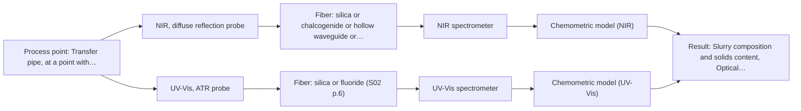

# First technical assessment: Pressure, flow and blockage of a slurry pipe

## Answer

**Customer request (our summary):** The customer asks if fiber optic products can measure line pressure, flow rate, and provide early warning of blockages in a slurry transfer pipe.

### Brief answer

Line pressure and flow rate are not quantities our spectroscopic fiber products measure; they need conventional pressure and flow sensors. What fiber-optic spectroscopy could offer is a trial of NIR diffuse reflection (or UV-ATR if the slurry is very opaque) to see whether slurry consistency changes measurably before a blockage. That link is unproven and must be tested on your slurry; please share its composition, opacity and past blockage behaviour.

### Proposal

- **Best current option:** O2 (recommended)
- **Basis:** engineering judgement
- **What would change it:** If the slurry turns out to have no measurable optical contrast, or blockages occur with no preceding consistency change, the optical part of O2 should be dropped and only conventional pressure and flow instrumentation remains.
- **Next step:** Answer Q1-Q4 and run the lab trial of M1 (with M2 as fallback) on representative slurry samples against independent solids-content references.

**Secondary evidence (external, not AFS material):** G1: no usable external source found; G2: no usable external source found; G3: no usable external source found; G4: no usable external source found. See Expert detail.

**Decision status:** Outside the supported scope

### Solution options

| ID | Tier | Methods | Confidence | Cost class, S01 Table 1 (p.6) | Ease of use | Maintenance | Performance fit | Sources |
|---|---|---|---|---|---|---|---|---|
| O1 | Simple | M1 NIR, diffuse reflection probe | Low: open question: Q1 (starts at Medium); physical state unknown, sample clarity unknown; status: outside supported scope | average cost (row 8) | Simple lab trial, no pipe modification | None during trial phase | Tests feasibility cheaply before any hardware commitment | [1: S01 p.17] [2: S01 p.5] |
| O2 | Recommended | M1 NIR, diffuse reflection probe; M2 UV-Vis, ATR probe | Low: open question: Q1 (starts at Medium); physical state unknown, sample clarity unknown; a parameter is not measurable in-line; status: outside supported scope | average cost (rows 8, 14) | Standard instrumentation plus one optical probe | Pressure and flow sensors are routine; optical probe needs window cleaning | Covers all three stated targets: pressure, flow and tested blockage indication | [1: S01 p.17] [2: S01 p.5] [3: S01 p.16] |

*Confidence rates the basis of the advice (how much is known and cited), not a predicted accuracy or probability of success. It starts at High, or at Medium when a key question on the method or the option is open, and drops one level per weakness listed (floor Low).*

*Cost class is the relative rating in S01 Table 1 (p.6) for the in-line method+technique rows named (the highest one for a multi-method option); it is not a price.*

### Setup sketch

*Recommended option O2; drawn by code from the option, a schematic, not a configuration.*

### Key questions

1. What is the slurry made of (solid phase, liquid phase, typical solids content and particle size)?
2. How opaque is the slurry, and what temperature and pressure does the pipe see at the possible measurement point?
3. What accuracy and response time do you need for line pressure and flow rate?

## Expert detail

**Customer enquiry**

> We need to know the line pressure and the flow rate of a slurry in our transfer pipe, and we want an early warning when the pipe starts to block. Could your fiber optic products help with this?

**Decision status:** Outside the supported scope. Line pressure and flow rate are physical process quantities, not chemical composition, and no supplied source describes any fiber-optic spectroscopic method for measuring them; the sources cover molecular spectroscopy of liquids, solids and gases.

### Parameters

| ID | Parameter | Kind | Need | Measured by | Why | Sources |
|---|---|---|---|---|---|---|
| P1 | Slurry composition and solids content | quantitative | required | Spectroscopy: NIR | It determines whether any optical signal exists and what the probe would actually be measuring. | [4: S01 p.10] |
| P2 | Optical density / turbidity of the slurry | quantitative | required | Spectroscopy: UV-Vis | It decides between transmission-style and ATR-style geometries. | [5: S01 p.16] |
| P3 | Line pressure | quantitative | required | Not measurable in-line by spectroscopy; alternative: conventional pressure transducer at the pipe | It is a stated customer target, but not a spectroscopic measurand. | *(no verified source: engineering judgement)* |
| P4 | Flow rate | quantitative | required | Not measurable in-line by spectroscopy; alternative: conventional flow meter (e.g. magnetic or ultrasonic) on the pipe | It is a stated customer target, but not a spectroscopic measurand. | *(no verified source: engineering judgement)* |

### Solution option details

- **O1 cost drivers:** Lab probe and spectrometer time, sample collection, reference lab analysis
- **O2 cost drivers:** Pressure transducer and flow meter, optical probe and spectrometer, calibration effort, pipe integration

### Premise check

- **Not covered:** Fiber-optic spectroscopy products can measure line pressure in a pipe. The supplied sources describe spectroscopic measurement of chemical composition and morphology; none mentions pressure measurement. *(no verified source: engineering judgement)*
- **Not covered:** Fiber-optic spectroscopy products can measure slurry flow rate. No supplied source describes flow measurement; the methods covered (NIR, MIR, Raman, UV-Vis, fluorescence) measure spectral signals, not velocity or flow. *(no verified source: engineering judgement)*
- **Not covered:** An optical in-line signal can give early warning of pipe blockage in a slurry. No supplied source addresses slurries or blockage detection; at most, spectroscopy could track composition or consistency changes if those change before a blockage, which is untested. *(no verified source: engineering judgement)*

### Requirements

**Stated by the customer**

- Measure line pressure in a slurry transfer pipe
- Measure slurry flow rate
- Early warning when the pipe starts to block

**Key unknowns**

- Slurry composition, solids content and particle size
- Optical properties of the slurry (opacity, scattering, optical density)
- Whether blockage onset is preceded by a measurable change in slurry consistency or composition
- Required accuracy and response time for pressure and flow
- Pipe access, temperature and installation constraints for any probe

### Clarification questions (most decision-relevant first)

Q1. What is the slurry made of (solid phase, liquid phase, typical solids content and particle size)? *Why it matters:* It decides whether any optical method can see a useful signal and which probe geometry survives the sample. *(affects: method)*
Q2. How opaque is the slurry, and what temperature and pressure does the pipe see at the possible measurement point? *Why it matters:* Optical density decides between transmission and ATR-type geometries, and conditions set the fiber and probe requirements. *(affects: technique)*
Q3. What accuracy and response time do you need for line pressure and flow rate? *Why it matters:* These targets cannot be met by the spectroscopic methods in the sources, so they define what auxiliary instrumentation is required. *(affects: status)*
Q4. In past blockages, did the slurry consistency, solids concentration or composition change before the pipe blocked? *Why it matters:* Only if a measurable slurry property changes before blockage can an optical in-line signal serve as an early warning. *(affects: M1)*

### Recommendation

- **M1 · Primary candidate: NIR, diffuse reflection probe.** A slurry is a strongly scattering, likely opaque medium, and NIR diffuse reflection is the geometry the sources give for opaque or highly concentrated products, with fiber-probe access suited to in-line use. Whether its signal tracks a consistency change that precedes blockage is a hypothesis that only a trial on your slurry can test. *Conditions:* Only meaningful if the slurry's composition or consistency actually changes in a way that precedes blockage (see Q4). [1: S01 p.17] [2: S01 p.5]
- **M2 · Conditional candidate: UV-Vis, ATR probe.** If the slurry is so opaque or turbid that a transmission signal saturates, a UV-ATR probe with its very short evanescent path is the geometry the sources give for black or highly scattering fluids. It would be a second single-method trial, compared against M1, not a first choice. *Conditions:* Applies only if Q2 shows the slurry is too optically dense for transmission-style measurement. [3: S01 p.16]

### Measurement concept

- **Probe and geometry:** Immersion or flush-mounted NIR diffuse-reflection probe at a representative point in the transfer pipe (trial first in the lab); UV-ATR as fallback geometry if the slurry is too optically dense.
- **Location:** Transfer pipe, at a point with representative flow; exact position to be agreed after technical clarification.
- **Fiber link:** Standard VIS-NIR silica fibers for remote probe coupling; usable range and link length depend on the specific fiber and probe selected. [6: S02 p.6]

### Spectral range

- **NIR:** Nominal NIR range 780-2500 nm; the usable range depends on the spectrometer, fiber and probe actually selected. [7: S01 p.10]
- **UV-Vis:** UV-Vis range depends on the target and setup; the sources give high sensitivity especially in the UV region (190-360 nm). [8: S01 p.5]

### Risks and uncertainty

- Pressure and flow rate cannot be measured by the spectroscopic methods in the sources, so the core of the enquiry needs conventional instrumentation regardless of any optical trial. *(no verified source: engineering judgement)*
- A blockage may develop without any change in slurry composition or consistency, in which case no optical method in the sources can give early warning. *(rules: R-GEN-5)* *(no verified source: engineering judgement)*
- Reflection signals are sensitive to surface characteristics and particle size, so physical slurry variation could mimic or mask composition changes. *(rules: R-GEO-6)* *(no verified source: engineering judgement)*
- Any optical model would be calibration-specific to this slurry and would need re-validation if the feed material changes. *(rules: R-CAL-1)* *(no verified source: engineering judgement)*

### First feasibility experiment

1. **Collect representative slurry samples across the expected variation in solids content, particle size and composition.** Cover the chemical and physical variation the in-line probe would see. *(no verified source: engineering judgement)*
2. **Measure each sample in the lab with an NIR diffuse-reflection probe (and UV-ATR where transmission saturates), alongside independent reference measurements of solids content from the laboratory.** Establish whether the optical signal carries information about the slurry properties. *(no verified source: engineering judgement)*
3. **Build a first calibration or classification model per single method and validate it on held-out samples or batches.** Quantify whether the optical signal predicts consistency-related variables reliably. *(no verified source: engineering judgement)*
4. **Compare the optical signal against historical or test-rig data on blockage onset, if such data exist.** Test the early-warning hypothesis directly rather than assuming it. *(no verified source: engineering judgement)*
5. **Define go/no-go with the customer: agreed numerical criteria for prediction accuracy and for the lead time of any blockage warning.** Decide objectively whether an in-line optical system is worth installing. *(no verified source: engineering judgement)*

**Reference measurements:** Laboratory solids-content and composition analysis of each sample, independent of the optical measurements.

**Decision basis:** Customer-defined numerical criteria for model accuracy and warning lead time; these are not set by the sources and must come from the customer.

### Assumptions

- The slurry is a liquid-carried particulate medium that is at least partly optically accessible.
- Blockage onset may be preceded by a change in slurry consistency or solids distribution; this is an assumption to test, not a fact.

### Not covered by the supplied sources

- Measurement of line pressure by any fiber-optic or spectroscopic method
- Measurement of flow rate by any fiber-optic or spectroscopic method
- Early warning of pipe blockage in slurries

### Further notes

- **Chemometrics:** If the trial shows the optical signal tracks solids content or consistency, a PLS calibration per method would be needed, validated on held-out batches; the sources stress that NIR bands overlap and require chemometrics.
- **Real-time tracking:** Any in-line optical signal would be continuous and time-resolved, but its value as a blockage warning depends entirely on the outcome of the Q4 correlation check.

### Secondary evidence (external, not AFS material)

*Found by a literature search for gaps the supplied AFS sources leave open. Not AFS material and not proof for this case; every quote below was verified verbatim against the fetched text.*

*Live search unavailable (library only: cache miss (europepmc); cache miss (openalex)); curated library only.*

**G1 · decision status:** outside supported scope: Line pressure and flow rate are physical process quantities, not chemical composition, and no supplied source describes any fiber-optic spectroscopic method for measuring them; the sources cover molecular spectroscopy of liquids, solids and gases.

- No usable external source found.

**G2 · not in the supplied sources:** Measurement of line pressure by any fiber-optic or spectroscopic method

- No usable external source found.

**G3 · not in the supplied sources:** Measurement of flow rate by any fiber-optic or spectroscopic method

- No usable external source found.

**G4 · not in the supplied sources:** Early warning of pipe blockage in slurries

- No usable external source found.

### Evidence (verified quotes)

1. ✓ **S01 p.17** (general): "NIR Reflection is primarily used for opaque or highly concentrated dairy products, such as yogurt, butter, or whole milk concentrates."
2. ✓ **S01 p.5** (general): "making it ideal for online applications, including remote measurements via fiber optic probes."
3. ✓ **S01 p.16** (general): "extremely short path length that enables the measurement of "black" or highly scattering fluids without dilution."
4. ✓ **S01 p.10** (general): "The broad absorption bands observed in this region overlap, suggesting the use of chemometrics for quantitative and qualitative analysis of spectral data."
5. ✓ **S01 p.16** (general): "the selection of an optical probe is primarily dictated by the sample's optical density (OD) and its ability to attenuate light."
6. ✓ **S02 p.6** (general): "350 nm Standard VIS-NIR Silica Fibers Al/Cu-coated VIS-NIR Silica Fibers 2400 nm"
7. ✓ **S01 p.10** (general): "NIR spectra (780-2500 nm) contain predominantly overtones and component bands of fundamental vibrations"
8. ✓ **S01 p.5** (general): "It has very high sensitivity, especially in the UV region (190-360 nm)"

### Verification

- Citations verified: 8 of 8 (exact or whitespace/hyphen-tolerant match on the cited page, scope checked).
- Hard check failures before deterministic corrections: 0; still open: 0; soft warnings: 0; repair rounds: 1.
- External evidence (cache): 0 quote(s) verified verbatim (exact or whitespace/hyphen-tolerant, at most 400 characters and 2 sentences, against the cited paragraph); 0 item(s) dropped.
- External search: 2 query(ies), 0 hit(s), 3 source(s) (3 from the curated library); ⚠ library only: cache miss (europepmc); cache miss (openalex).
- External step: 2 model call(s), 1.4 s extra (cost in the run JSON).

*Run A05-20261018T073230Z-177a · models google/gemini-3.5-flash-lite, google/gemini-3.8-flash, z-ai/glm-5.3-flash*
