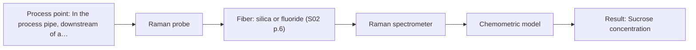

# First technical assessment: Complete enquiry for sugar concentration in a clear solution

## Answer

**Customer request (our summary):** The customer wants to monitor sucrose concentration in-line for a clear aqueous sucrose solution and asks for a method and probe proposal.

### Brief answer

For a clear aqueous sucrose solution, test NIR transmission with a fiber probe first as the simple, lower-cost option: it is suited to transparent liquids and operates over a 10 m silica link. Raman is recommended as the optimal technical fit if water background shifts prevent reaching plus or minus 0.3 % w/w. Key open items are optical pathlength, pipe fitting, CIP compatibility, and whether other dissolved solids exist.

### Proposal

- **Best current option:** O1 (simple)
- **Basis:** supplied AFS sources
- **What would change it:** If the bench trial shows that NIR water absorption or 20-30 °C temperature shifts prevent achieving ±0.3 % w/w, Raman (O2) becomes the choice; if other solutes are present, calibration needs re-evaluation.
- **Next step:** Test NIR transmission on representative sucrose solutions first, and compare against refractometer readings to verify whether ±0.3 % w/w is achieved.

**Secondary evidence (external, not AFS material):** G1: E03 ¶12; G2: no usable external source found; G3: no usable external source found; G4: no usable external source found. See Expert detail.

**Decision status:** Provisional feasibility assessment

### Solution options

| ID | Tier | Methods | Confidence | Cost class, S01 Table 1 (p.6) | Ease of use | Maintenance | Performance fit | Sources |
|---|---|---|---|---|---|---|---|---|
| O1 | Simple | M1 NIR, transmission/transflection probe | Low: open question: Q1, Q2, Q3 (starts at Medium); physical state unknown; uncited auxiliary sensor | average cost (row 7) | Straightforward transmission probe, standard lamp optics | Low; periodic probe window cleaning | Transmission covers sucrose range at lowest effort | [1: S01 p.18] [2: S01 p.18] [3: S01 p.5] [4: S01 p.10] |
| O2 | Recommended | M2 Raman probe | Low: open question: Q1, Q3 (starts at Medium); physical state unknown | high cost (row 12) | Single immersion Raman probe | Low; optical window cleaning | Raman avoids water interference for tight limit | [5: S01 p.16] [6: S01 p.12] [7: S01 p.11] |

*Confidence rates the basis of the advice (how much is known and cited), not a predicted accuracy or probability of success. It starts at High, or at Medium when a key question on the method or the option is open, and drops one level per weakness listed (floor Low).*

*Cost class is the relative rating in S01 Table 1 (p.6) for the in-line method+technique rows named (the highest one for a multi-method option); it is not a price.*

### Setup sketch

*Recommended option O2; drawn by code from the option, a schematic, not a configuration.*

### Key questions

1. What other dissolved solids, if any, does the solution contain, so that the refractometer reading can be interpreted as sucrose rather than total soluble solids?
2. What insertion fitting or sight glass is available on the 50 mm pipe, and what pathlength can be accommodated?
3. What temperature and duration does the daily hot caustic CIP reach, and must the probe survive it in place or be removed?

## Expert detail

**Customer enquiry**

> We produce a clear, colourless aqueous sucrose solution and want to monitor its sucrose concentration in-line. The solution flows through a 50 mm stainless steel pipe at 20 to 30 °C and normal pressure; the expected range is 5 to 15 % w/w and our quality limit is plus or minus 0.3 % w/w. Our laboratory refractometer is the reference method and stays in use. The analyser can stand in a dry, safe room 10 m from the pipe, and the line is cleaned in place with hot caustic once a day. A reading every minute is enough. Please propose a method and probe for a first trial.

**Decision status:** Provisional feasibility assessment. The sample is a transparent liquid, so an NIR transmission trial can be justified from the supplied material, but pathlength, pipe fitting, and CIP survival remain open.

### Parameters

| ID | Parameter | Kind | Need | Measured by | Why | Sources |
|---|---|---|---|---|---|---|
| P1 | Sucrose concentration | quantitative | required | Spectroscopy: NIR | It is the target variable to monitor in-line within plus or minus 0.3 % w/w. | [8: S01 p.10] |
| P2 | Solution temperature | quantitative | required | Auxiliary sensor: temperature sensor (engineering judgement: confirm availability with AFS) | The 20-30 °C span shifts water and sucrose NIR bands, so temperature is needed as a model variable or for compensation. | *(no verified source: engineering judgement)* |
| P3 | Refractometer reference value (total soluble solids) | quantitative | required | Reference lab method: laboratory refractometer | It is the customer's stated reference against which the spectral calibration is built and validated. | *(no verified source: engineering judgement)* |

### Solution option details

- **O1 cost drivers:** One NIR spectrometer, transmission probe, silica cable, calibration
- **O2 cost drivers:** Raman spectrometer, laser source, Raman probe, silica cable

### Premise check

- **Precedent only:** NIR transmission/transflection is suitable for a clear aqueous sucrose stream in-line. The sources show NIR transmission/transflection for clear aqueous liquids in the dairy example; sucrose solution itself is not covered, so this is a reason to test, not proof. [1: S01 p.18]
- **Supported:** A 10 m fiber link from the pipe to the analyser room is feasible for NIR. The sources state robust 100-300 m low-OH silica cables for remote industrial process control, which covers the 10 m distance for the NIR range. [9: S02 p.7]
- **Not covered:** A laboratory refractometer is an adequate reference for sucrose concentration at plus or minus 0.3 % w/w. No supplied source addresses refractometer accuracy or its specificity for sucrose against other dissolved solids; this must be confirmed with the customer. *(no verified source: engineering judgement)*

### Requirements

**Stated by the customer**

- In-line monitoring of sucrose concentration, 5-15 % w/w, quality limit plus or minus 0.3 % w/w
- Clear, colourless aqueous solution in a 50 mm stainless steel pipe at 20-30 °C, normal pressure
- Reading every minute; analyser 10 m away in a dry, safe room; daily hot caustic CIP
- Laboratory refractometer remains the reference method

**Key unknowns**

- Required optical path length for 5-15 % w/w sucrose in NIR transmission
- Whether other dissolved solids are present, i.e. whether refractometer reading equals sucrose
- Pipe fitting or insertion port available on the 50 mm pipe
- CIP temperature and required probe materials/seals for hot caustic exposure
- Achievable accuracy of the refractometer reference at the 0.3 % w/w limit

### Clarification questions (most decision-relevant first)

Q1. What other dissolved solids, if any, does the solution contain, so that the refractometer reading can be interpreted as sucrose rather than total soluble solids? *Why it matters:* If other solutes vary, a refractometer reference and any spectral calibration track total solids, not sucrose, and the method choice changes. *(affects: method, M1, M2)*
Q2. What insertion fitting or sight glass is available on the 50 mm pipe, and what pathlength can be accommodated? *Why it matters:* In NIR transmission the optical pathlength must be controlled; too wide loses signal to absorption, too narrow samples a negligible volume. *(affects: installation, M1)*
Q3. What temperature and duration does the daily hot caustic CIP reach, and must the probe survive it in place or be removed? *Why it matters:* Probe window, seals and fiber materials must tolerate the cleaning, which constrains the probe selection. *(affects: installation, M1, M2)*
Q4. What is the stated accuracy of the laboratory refractometer over 5-15 % w/w, and how is the plus or minus 0.3 % w/w limit defined? *Why it matters:* The reference must be at least as accurate as the target limit for the go/no-go criteria to be meaningful. *(affects: status, M1)*

### Recommendation

- **M1 · Primary candidate: NIR, transmission/transflection probe.** For a clear, colourless aqueous liquid, NIR transmission with a controlled pathlength (or transflection) is the primary method to test first. Water and sucrose O-H and C-H bands appear in the NIR, and standard silica fibers support the 10 m link. *Conditions:* The optical pathlength must be selected and controlled for 5-15 % w/w sucrose, and calibration must be validated on the actual solution. [1: S01 p.18] [3: S01 p.5] [4: S01 p.10] [2: S01 p.18]
- **M2 · Comparison candidate: Raman probe.** Raman is particularly well-suited for aqueous media because water absorbs weakly compared to infrared methods, providing sharper peaks for dissolved sugars. It serves as the alternative single method if NIR cannot meet the tight plus or minus 0.3 % w/w limit. *Conditions:* Pursued if NIR transmission falls short of the target accuracy or if water background shifts obscure the sucrose signal. [5: S01 p.16] [7: S01 p.11] [6: S01 p.12]
- **M3 · Not recommended: MIR, ATR probe.** MIR-ATR is a common laboratory expectation for sugars, but water absorbs very strongly in the mid-IR and no supplied source supports a 10 m MIR fiber link. It adds risk and complexity without advantage over NIR or Raman for this clear liquid. [10: S01 p.5] [11: S01 p.13]

### Measurement concept

- **Probe and geometry:** Immersion transmission or transflection NIR fiber probe inserted into the 50 mm pipe through a suitable fitting, with a defined optical pathlength chosen for 5-15 % w/w sucrose.
- **Location:** In the process pipe, downstream of a straight section; probe flush or immersed in the flowing solution.
- **Fiber link:** Low-OH Vis-NIR silica fiber cable from the probe to the NIR spectrometer in the dry room 10 m away; the sources state 100-300 m silica cables for remote process control, so 10 m is within the stated capability, but the exact cable is selected with the probe. [12: S01 p.10] [9: S02 p.7]

### Spectral range

- **NIR:** Nominal NIR method range 780-2500 nm; the usable range depends on the spectrometer, the Vis-NIR silica fiber (nominally to about 2400 nm) and the probe actually selected. [13: S01 p.10] [14: S02 p.6]
- **Raman:** Raman shift in cm-1 with the laser excitation wavelength stated separately (e.g. 785 nm in the pharma example); the exact range depends on the chosen laser and spectrometer. [15: S01 p.11] [16: S01 p.15]

### Risks and uncertainty

- The pathlength needed for 5-15 % w/w sucrose is unknown; too long a path saturates the water-dominated NIR signal. *(rules: R-GEN-4, R-GEN-3)* [17: S01 p.18]
- The 20-30 °C process temperature span shifts the water and sucrose bands, so temperature compensation or an auxiliary temperature sensor is likely needed. *(no verified source: engineering judgement)*
- Daily hot caustic CIP may attack the probe window, seals or fiber, and the sources give no compatibility data for this duty. *(no verified source: engineering judgement)*
- If other dissolved solids are present, the refractometer reference and the spectral model track total soluble solids rather than sucrose specifically. *(no verified source: engineering judgement)*

### First feasibility experiment

1. **Collect representative sucrose solutions spanning 5-15 % w/w and the 20-30 °C temperature span, including any other solutes present in the real stream.** Cover the expected chemical and physical variation before any calibration is attempted. *(no verified source: engineering judgement)*
2. **Measure each sample independently with the laboratory refractometer, and confirm its accuracy against gravimetrically prepared sucrose standards at the 0.3 % w/w limit.** Establish a trustworthy reference before judging the spectral method. *(no verified source: engineering judgement)*
3. **On the bench, acquire NIR transmission spectra at candidate pathlengths and, if available, transflection spectra with the same spectrometer; record solution temperature with each spectrum.** Select the geometry with adequate signal and sensitivity across the range. *(no verified source: engineering judgement)*
4. **Build a chemometric calibration (e.g. PLS) per technique against the refractometer values, with temperature as a variable, and validate on held-out batches not used in calibration.** Quantify prediction error honestly, including the temperature effect. *(no verified source: engineering judgement)*
5. **Go/no-go: the customer defines the criterion, e.g. prediction error within plus or minus 0.3 % w/w on held-out samples at 1-minute acquisition; only if NIR falls short, test Raman as the next single method.** Give the customer a clear, numeric decision basis for the in-line trial. *(no verified source: engineering judgement)*

**Reference measurements:** Laboratory refractometer on every calibration and validation sample, checked against gravimetric sucrose standards.

**Decision basis:** Customer-defined: prediction error within plus or minus 0.3 % w/w on held-out samples at the required 1-minute cadence.

### Assumptions

- The solution contains no other optically relevant solutes unless the customer says otherwise (Q1).
- A transmission or transflection probe can be mounted in the 50 mm pipe with a suitable fitting (Q2).
- The probe can be protected from, or removed during, the daily hot caustic CIP (Q3).

### Not covered by the supplied sources

- Refractometer accuracy and its specificity for sucrose versus total soluble solids
- CIP compatibility of probe materials with hot caustic
- Optimal pathlength for 5-15 % w/w aqueous sucrose

### Further notes

- **Chemometrics:** A PLS calibration against the refractometer values is needed because NIR bands are broad and overlapping; include temperature as a variable and validate on held-out batches, since the calibration is specific to this matrix.
- **Real-time tracking:** A reading every minute is compatible with NIR diode-array acquisition, which records all wavelengths simultaneously and suits fast processes; the actual cadence depends on the selected instrument.
- **Future direction:** If the trial succeeds, a compact LED-based NIR sensor at selected wavelengths could later replace the full spectrometer for routine monitoring, following the sensor-simplification approach shown in the literature.

### Secondary evidence (external, not AFS material)

*Found by a literature search for gaps the supplied AFS sources leave open. Not AFS material and not proof for this case; every quote below was verified verbatim against the fetched text.*

*Live search unavailable (library only: cache miss (europepmc); cache miss (openalex)); curated library only.*

**G1 · auxiliary sensor:** In-line measurement of Solution temperature with temperature sensor

- **E03 ¶12** The temperature sensitivity of the OH bands is a severe drawback for measuring aqueous solution in NIR and MIR, which makes tempered sample holders necessary. *How it applies:* This indicates that temperature compensation or controlled sample temperature should be considered when designing the in-line monitoring setup. *Limits and transfer risks:* The cited study discusses general biopharmaceutical downstream processing in a laboratory or review context rather than an in-line clear aqueous sucrose manufacturing line. *(supports O1)*
  > "Additionally, the temperature sensitivity of the OH bands is a severe drawback for measuring aqueous solution in NIR and MIR, which makes tempered sample holders necessary [29]."
  > A critical review of recent trends, and a future perspective of optical spectroscopy as PAT in biopharmaceutical downstream processing. (2020) · Analytical and bioanalytical chemistry · doi:10.1007/s00216-020-02407-z · https://europepmc.org/article/PMC/PMC7072065 · retrieved 2026-10-17, full text, licence: cc by, via curated library

**G2 · not in the supplied sources:** Refractometer accuracy and its specificity for sucrose versus total soluble solids

- No usable external source found.

**G3 · not in the supplied sources:** CIP compatibility of probe materials with hot caustic

- No usable external source found.

**G4 · not in the supplied sources:** Optimal pathlength for 5-15 % w/w aqueous sucrose

- No usable external source found.

### Evidence (verified quotes)

1. ✓ **S01 p.18** (general): "Transmission is the preferred method for transparent or semi-transparent liquids, such as skim milk, whey, or permeate."
2. ✓ **S01 p.18** (general): "the precise control of the optical pathlength (usually 1 - 10 mm); if the pathlength is too wide, the signal is lost to absorption; if too narrow, the sample represents a negligible volume."
3. ✓ **S01 p.5** (general): "making it ideal for online applications, including remote measurements via fiber optic probes."
4. ✓ **S01 p.10** (general): "The broad absorption bands observed in this region overlap, suggesting the use of chemometrics for quantitative and qualitative analysis of spectral data."
5. ✓ **S01 p.16** (general): "Raman is particularly well-suited for aqueous environments, as it exhibits low absorbance for water molecules compared to infrared methods."
6. ✓ **S01 p.12** (general): "dependence on concentration is linear over a wide range of intensities."
7. ✓ **S01 p.11** (general): "signals, which are several orders of magnitude weaker than IR absorption peaks"
8. ✓ **S01 p.10** (general): "NIR spectra (780-2500 nm) contain predominantly overtones and component bands of fundamental vibrations of molecules and atomic groups, such as -OH, -NH2=NH, -CH3, =CH2, ≥CH, etc., found in many organic and inorganic compounds."
9. ✓ **S02 p.7** (performance figure): "Robust 100-300m cables made with Silica fibers of low OH-content (<0.1ppm OH) enable remote industrial process-control"
10. ✓ **S01 p.5** (general): "strong absorption in the mid-IR region limits the corresponding spectral method to the analysis of very thin samples (usually less than 50 μm)"
11. ✓ **S01 p.13** (general): "typically at a depth of few microns"
12. ✓ **S01 p.10** (general): "NIR spectra (780-2500 nm) contain predominantly overtones and component bands of fundamental vibrations of molecules and atomic groups"
13. ✓ **S01 p.10** (general): "NIR spectra (780-2500 nm) contain predominantly overtones and component bands of fundamental vibrations"
14. ✓ **S02 p.6** (performance figure): "350 nm Standard VIS-NIR Silica Fibers Al/Cu-coated VIS-NIR Silica Fibers 2400 nm"
15. ✓ **S01 p.11** (general): "The Raman shift is used as the horizontal (spectral) axis in Raman spectroscopy"
16. ✓ **S01 p.15** (general): "Raman spectrometer and Raman fiber probe for contact measurements with 785 nm excitation wavelength"
17. ✓ **S01 p.18** (general): "if the pathlength is too wide, the signal is lost to absorption; if too narrow, the sample represents a negligible volume."

### Verification

- Citations verified: 23 of 23 (exact or whitespace/hyphen-tolerant match on the cited page, scope checked).
- Hard check failures before deterministic corrections: 0; still open: 0; soft warnings: 2; repair rounds: 2.
- Removed 1 intake item(s) not quoted verbatim from the enquiry:
  - intake.sample.physical_state: slot value without a verbatim enquiry quote; reset to unknown
- External evidence (cache): 1 quote(s) verified verbatim (exact or whitespace/hyphen-tolerant, at most 400 characters and 2 sentences, against the cited paragraph); 0 item(s) dropped.
- External search: 3 query(ies), 0 hit(s), 3 source(s) (3 from the curated library); ⚠ library only: cache miss (europepmc); cache miss (openalex).
- External step: 2 model call(s), 2.6 s extra (cost in the run JSON).

*Run A07-20261018T073230Z-e528 · models google/gemini-3.5-flash-lite, google/gemini-3.8-flash, z-ai/glm-5.3-flash*
