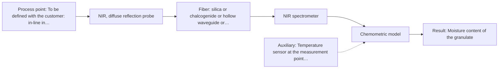

# First technical assessment: Accuracy guarantee, regulatory approval and price

## Answer

**Customer request:** Before we order, please confirm in writing that your NIR system will measure the moisture of our granulate to plus or minus 0.1 % and guarantee that our regulator will approve it for release testing. Please also include the price of the complete system.

### Brief answer

Written confirmation of plus or minus 0.1 % moisture accuracy, regulatory approval assurance, or a system price cannot be provided at this stage: no accuracy figure, approval status or price is supported by the available material, and the granulate is not yet characterised. NIR diffuse reflection is the method worth testing first, via a feasibility trial with your reference moisture method. The accuracy target, granulate properties, reference method and installation point are the open questions.

### Proposal

- **Best current option:** O2 (recommended)
- **Basis:** engineering judgement
- **What would change it:** Answers to Q1-Q5, especially the origin of the plus or minus 0.1 % target and granulate physical properties, could shift the technique selection; the feasibility trial results are decisive.
- **Next step:** Conduct a laboratory feasibility trial on representative granulate samples with paired reference moisture analyses before any ordering commitment.

**Secondary evidence (external, not AFS material):** G1: no usable external source found; G2: E02 ¶12; G3: no usable external source found; G4: no usable external source found. See Expert detail.

**Decision status:** Insufficient information for a method choice

### Solution options

| ID | Tier | Methods | Confidence | Cost class, S01 Table 1 (p.6) | Ease of use | Maintenance | Performance fit | Sources |
|---|---|---|---|---|---|---|---|---|
| O1 | Simple | M2 NIR, diffuse reflection at a distance | Low: open question: Q2 (starts at Medium); status: insufficient information | average cost (row 10) | Non-contact measurement, avoids sample fouling | Minimal probe cleaning required | Non-contact reflection for scattering granulate | [1: S01 p.10] |
| O2 | Recommended | M1 NIR, diffuse reflection probe | Low: open question: Q1, Q2, Q3 (starts at Medium); status: insufficient information | average cost (row 8) | Direct contact probe, straightforward alignment | Periodic probe window inspection and cleaning | Direct diffuse reflection maximises signal reproducibility | [2: S01 p.17] [3: S01 p.10] [4: S01 p.5] |

*Confidence rates the basis of the advice (how much is known and cited), not a predicted accuracy or probability of success. It starts at High, or at Medium when a key question on the method or the option is open, and drops one level per weakness listed (floor Low).*

*Cost class is the relative rating in S01 Table 1 (p.6) for the in-line method+technique rows named (the highest one for a multi-method option); it is not a price.*

### Setup sketch

*Recommended option O2; drawn by code from the option, a schematic, not a configuration.*

### Key questions

1. Where does the plus or minus 0.1 % requirement come from (regulatory monograph, internal spec, customer contract), and over what moisture range must it hold?
2. What is the granulate made of, what is its particle size distribution, and what moisture range is expected?
3. Which reference method do you use today for moisture (e.g. Karl Fischer titration or loss-on-drying), and what is its own uncertainty?

## Expert detail

**Customer enquiry**

> Before we order, please confirm in writing that your NIR system will measure the moisture of our granulate to plus or minus 0.1 % and guarantee that our regulator will approve it for release testing. Please also include the price of the complete system.

**Decision status:** Insufficient information for a method choice. The requested written confirmation of plus or minus 0.1 % moisture accuracy, formal regulatory approval assurance and a system price cannot be given from the supplied material: no source states any accuracy figure, approval status or price for this application, and the granulate's properties are not yet characterised.

### Parameters

| ID | Parameter | Kind | Need | Measured by | Why | Sources |
|---|---|---|---|---|---|---|
| P1 | Moisture content of the granulate | quantitative | required | Spectroscopy: NIR | It is the target variable the NIR calibration must predict. | [5: S02 p.12] |
| P2 | Reference moisture value per calibration sample | quantitative | required | Reference lab method: Customer's lab moisture method (e.g. Karl Fischer titration or loss-on-drying; to be named) | A chemometric calibration needs independent lab reference values paired with each spectrum. | *(no verified source: engineering judgement)* |
| P3 | Granulate particle size / scattering characteristics | qualitative | optional | Not measurable in-line by spectroscopy; alternative: Laboratory particle-size analysis of representative granulate samples | Scattering variation can mimic moisture changes in reflection spectra, so it should be characterised to design preprocessing and sampling. | *(no verified source: engineering judgement)* |
| P4 | Sample temperature during measurement | quantitative | optional | Auxiliary sensor: Temperature sensor at the measurement point (engineering judgement: confirm availability with AFS) | Temperature shifts affect NIR water bands and should be recorded so their influence can be assessed in the calibration. | *(no verified source: engineering judgement)* |

### Solution option details

- **O1 cost drivers:** NIR spectrometer, remote reflection optics, silica fibers, calibration reference samples
- **O2 cost drivers:** NIR spectrometer, contact diffuse-reflection probe, silica fibers, chemometric calibration development

### Premise check

- **Not covered:** An NIR system can be confirmed in advance to measure moisture in this granulate to plus or minus 0.1 %. No supplied source states any accuracy figure for NIR moisture measurement; accuracy depends on the sample, the calibration and the reference method, so it must be established in a feasibility trial, not confirmed in advance. [6: REF §3]
- **Not covered:** A supplier can assure that the regulator will approve the system for release testing. Regulatory approval is outside what the supplied material addresses; nothing in the sources supports assurance of regulatory approval, and no supplier can commit on the regulator's behalf. *(no verified source: engineering judgement)*
- **Precedent only:** NIR spectroscopy is a plausible method for moisture in granulate. NIR covers O-H overtones and has published moisture-sensing examples, which is a reason to test, not proof for this granulate. [7: S01 p.10] [5: S02 p.12]

### Requirements

**Stated by the customer**

- Written confirmation of plus or minus 0.1 % moisture accuracy before ordering.
- Assurance of regulatory approval for release testing.
- The price of the complete system.

**Key unknowns**

- Whether the plus or minus 0.1 % figure is a regulatory requirement, an internal specification or an assumption, and over what moisture range it must hold
- Granulate composition, particle size and expected moisture range
- The reference (lab) moisture method against which any calibration would be built
- Whether the measurement is needed in-line in the process or at-line/in the laboratory
- The optical scattering behaviour of the granulate (transparent vs opaque, scattering regime)

### Clarification questions (most decision-relevant first)

Q1. Where does the plus or minus 0.1 % requirement come from (regulatory monograph, internal spec, customer contract), and over what moisture range must it hold? *Why it matters:* It determines whether the target is realistic for a spectroscopic calibration and what the go/no-go criterion of the feasibility trial must be. *(affects: status, M1)*
Q2. What is the granulate made of, what is its particle size distribution, and what moisture range is expected? *Why it matters:* Scattering particles and composition drive the choice between reflection and transmission geometry and the calibration design. *(affects: technique, M1, M2)*
Q3. Which reference method do you use today for moisture (e.g. Karl Fischer titration or loss-on-drying), and what is its own uncertainty? *Why it matters:* The calibration can never be more accurate than the reference data it is built on, so the reference method bounds any achievable accuracy. *(affects: M1, status)*
Q4. Is the measurement needed in-line in the process, at-line next to it, or in the quality-control laboratory for release testing? *Why it matters:* Release testing and in-line process control are different installations with different probe, housing and validation requirements. *(affects: installation, status)*
Q5. Which regulator and which release-testing framework applies (e.g. pharmacopoeial method requirements)? *Why it matters:* Approval depends on the applicable validation framework, which no supplier can confirm in advance; it defines what must be demonstrated. *(affects: status)*

### Recommendation

- **M1 · Primary candidate: NIR, diffuse reflection probe.** NIR diffuse reflection is the screening-pass option for a scattering granulate and NIR is established for moisture via O-H overtones. A chemometric calibration against a lab reference method is required. [2: S01 p.17] [3: S01 p.10] [4: S01 p.5]
- **M2 · Comparison candidate: NIR, diffuse reflection at a distance.** Non-contact diffuse reflection measures powders at a distance without direct sample contact, avoiding probe fouling, though variations in distance can affect signal intensity. [1: S01 p.10]
- **M3 · Not recommended: MIR, ATR probe.** Screening failed this option: ATR needs tight contact and suits liquids, pastes and soft solids, not a granulate, and it samples only a thin surface layer. [8: S01 p.10] [9: S01 p.13]

### Measurement concept

- **Probe and geometry:** NIR diffuse-reflection fiber probe on the granulate (contact or near-contact), spectrometer remote from the measurement point via a silica fiber link.
- **Location:** To be defined with the customer: in-line in the process, at-line, or laboratory bench for release testing.
- **Fiber link:** Vis-NIR silica fibers; the usable spectral range and achievable cable length depend on the selected instrument and probe. [10: S01 p.15]

### Spectral range

- **NIR:** Nominal NIR method range 780-2500 nm; the usable range depends on the spectrometer, fiber and probe actually selected. The relevant water bands lie in the NIR O-H overtone region. [7: S01 p.10]

### Risks and uncertainty

- The plus or minus 0.1 % target may be unattainable for this granulate, since achievable accuracy depends on the sample, the calibration and the reference method, none of which are yet characterised. *(rules: R-GEN-1)* *(no verified source: engineering judgement)*
- Diffuse-reflection signals are sensitive to surface characteristics and particle size, so physical variation of the granulate can mimic moisture changes unless corrected and calibrated for. *(rules: R-GEO-6)* [11: S01 p.17]
- The calibration is specific to the granulate matrix and must be re-validated if the formulation or supplier changes. *(rules: R-CAL-1)* [12: REF §5]
- Even a technically successful calibration does not by itself satisfy a release-testing approval, which depends on the applicable regulatory framework and validation evidence. *(rules: R-EVI-2)* *(no verified source: engineering judgement)*

### First feasibility experiment

1. **Collect representative granulate samples spanning the expected moisture range and the expected variation in composition and particle size.** Cover the chemical and physical variation the calibration must handle. *(no verified source: engineering judgement)*
2. **Measure each sample with the NIR diffuse-reflection probe under fixed conditions and, in parallel, determine moisture with the customer's independent reference method.** Build paired spectral/reference data and quantify the reference method's own uncertainty. *(no verified source: engineering judgement)*
3. **Test contact NIR diffuse reflection first as a primary single method, and compare with remote diffuse reflection on the same sample set.** Single methods before any combination, per the agreed approach. *(no verified source: engineering judgement)*
4. **Build and validate the chemometric calibration on held-out samples or batches not used in model building.** Estimate real prediction error rather than calibration fit. *(no verified source: engineering judgement)*
5. **Compare the achieved prediction error against the customer's required accuracy figure as the go/no-go criterion, set by the customer.** Decide whether the requirement can be met before any order. *(no verified source: engineering judgement)*

**Reference measurements:** Customer's existing lab moisture method (to be named, e.g. Karl Fischer or loss-on-drying) run on every calibration and validation sample.

**Decision basis:** Go/no-go: the validated prediction error on held-out batches must meet the accuracy figure the customer specifies in answer to Q1.

### Assumptions

- The granulate is a scattering particulate solid, so diffuse reflection is the default geometry until samples show otherwise.
- The customer's accuracy figure refers to moisture content on the scale of their reference method.

### Not covered by the supplied sources

- Any accuracy figure for NIR moisture measurement, including plus or minus 0.1 %.
- Any statement about regulatory approval or release-testing acceptance.
- Any price or cost figure for a complete system.

### Further notes

- **Chemometrics:** A PLS-type calibration against the customer's reference moisture values is the core of any solution; it must be built on representative samples and validated on held-out batches before any accuracy statement can be made.
- **Future direction:** If the feasibility trial succeeds, the same calibration could later support in-line moisture tracking in the process, and a reduced multi-wavelength sensor version could be considered once the informative wavelengths are known.

### Secondary evidence (external, not AFS material)

*Found by a literature search for gaps the supplied AFS sources leave open. Not AFS material and not proof for this case; every quote below was verified verbatim against the fetched text.*

*Live search unavailable (library only: cache miss (europepmc); cache miss (openalex)); curated library only.*

**G1 · decision status:** insufficient information: The requested written confirmation of plus or minus 0.1 % moisture accuracy, formal regulatory approval assurance and a system price cannot be given from the supplied material: no source states any accuracy figure, approval status or price for this application, and the granulate's properties are not yet characterised.

- No usable external source found.

**G2 · auxiliary sensor:** In-line measurement of Sample temperature during measurement with Temperature sensor at the measurement point

- **E02 ¶12** The text notes that temperature sensitivity of certain bands is a drawback for measuring in specific spectral regions, requiring tempered sample holders. *How it applies:* This supports testing whether temperature fluctuations impact the spectral readings, indicating that monitoring sample temperature could be useful to assess potential variation. *Limits and transfer risks:* This refers to aqueous solutions and different spectroscopic regions rather than the customer's specific granulate matrix, so the thermal sensitivity may differ in scale and effect. *(supports O2)*
  > "Additionally, the temperature sensitivity of the OH bands is a severe drawback for measuring aqueous solution in NIR and MIR, which makes tempered sample holders necessary [29]."
  > A critical review of recent trends, and a future perspective of optical spectroscopy as PAT in biopharmaceutical downstream processing. (2020) · Analytical and bioanalytical chemistry · doi:10.1007/s00216-020-02407-z · https://europepmc.org/article/PMC/PMC7072065 · retrieved 2026-10-17, full text, licence: cc by, via curated library

**G3 · not in the supplied sources:** Any accuracy figure for NIR moisture measurement, including plus or minus 0.1 %.

- No usable external source found.

**G4 · not in the supplied sources:** Any statement about regulatory approval or release-testing acceptance.

- No usable external source found.

### Evidence (verified quotes)

1. ✓ **S01 p.10** (general): "which enables measurements using diffuse reflectance, including measurements without direct contact with the sample, at a distance."
2. ✓ **S01 p.17** (general): "NIR Reflection is primarily used for opaque or highly concentrated dairy products, such as yogurt, butter, or whole milk concentrates."
3. ✓ **S01 p.10** (general): "The broad absorption bands observed in this region overlap, suggesting the use of chemometrics for quantitative and qualitative analysis of spectral data."
4. ✓ **S01 p.5** (general): "making it ideal for online applications, including remote measurements via fiber optic probes."
5. ✓ **S02 p.12** (application precedent): "IoT Concept of NIR-LED Fiber Sensor to control Moisture Level"
6. ✓ **REF §3** (general): "Do not invent measured spectra or experimental results; accuracy, detection limits, response times, fiber lengths or other performance figures that no source supports"
7. ✓ **S01 p.10** (general): "NIR spectra (780-2500 nm) contain predominantly overtones and component bands of fundamental vibrations"
8. ✓ **S01 p.10** (general): "ATR fiber probes (Fig.1) enable the analysis of liquids and solid elastic samples"
9. ✓ **S01 p.13** (general): "typically at a depth of few microns"
10. ✓ **S01 p.15** (general): "located safely away from the vibration and dust of the manufacturing floor."
11. ✓ **S01 p.17** (general): "the method is sensitive to the surface characteristics and fat globule size."
12. ✓ **REF §5** (general): "physical variation; calibration specific to the matrix."

### Verification

- Citations verified: 16 of 16 (exact or whitespace/hyphen-tolerant match on the cited page, scope checked).
- Hard check failures before deterministic corrections: 0; still open: 0; soft warnings: 0; repair rounds: 1.
- External evidence (cache): 1 quote(s) verified verbatim (exact or whitespace/hyphen-tolerant, at most 400 characters and 2 sentences, against the cited paragraph); 0 item(s) dropped.
- External search: 3 query(ies), 0 hit(s), 3 source(s) (3 from the curated library); ⚠ library only: cache miss (europepmc); cache miss (openalex).
- External step: 2 model call(s), 2.2 s extra (cost in the run JSON).

*Run A08-20261018T073230Z-2ce3 · models google/gemini-3.5-flash-lite, google/gemini-3.8-flash, z-ai/glm-5.3-flash*
