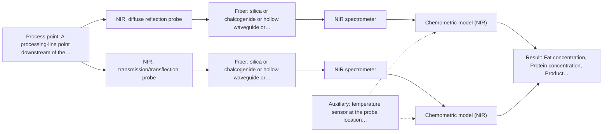
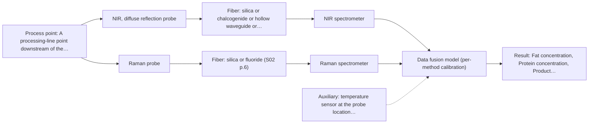

# First technical assessment: Fat and protein monitoring in opaque dairy product

## Answer

**Customer request (our summary):** The customer wants an initial spectroscopy concept and comparison experiment for in-line fat and protein monitoring of a flowing, opaque, concentrated milk product with varying temperature and texture.

### Brief answer

Start with in-line NIR diffuse reflection on your opaque concentrated product: it is the documented approach for such dairy streams and quantifies fat and protein via a PLS calibration against your laboratory results. In the same trial, test an NIR transflection probe as a comparison, since transmission alone will not penetrate the product. Keep Raman as a conditional second method if NIR selectivity falls short. Open points: concentration ranges, pipe/CIP installation details, and your accuracy and response-time targets.

### Proposal

- **Best current option:** O2 (recommended)
- **Basis:** supplied AFS sources
- **What would change it:** If the concentration ranges turn out very low (Q1) or the accuracy target is beyond what NIR reflection achieves in the trial, Raman (M3) or a combined option moves up; if installation or CIP constraints rule out probe contact, the whole concept must be revisited.
- **Next step:** Run the multi-technique feasibility trial on representative samples with laboratory reference values, using customer-defined accuracy and response-time targets as the go/no-go criteria.

**Secondary evidence (external, not AFS material):** G1: no usable external source found; G2: no usable external source found; G3: no usable external source found; G4: no usable external source found. See Expert detail.

**Decision status:** Provisional feasibility assessment

### Solution options

| ID | Tier | Methods | Confidence | Cost class, S01 Table 1 (p.6) | Ease of use | Maintenance | Performance fit | Sources |
|---|---|---|---|---|---|---|---|---|
| O1 | Simple | M1 NIR, diffuse reflection probe | Medium: uncited auxiliary sensor | average cost (row 8) | Straightforward flush-mounted probe and standard NIR hardware | Probe window cleaning and periodic calibration checks | Fits opaque flowing dairy; accuracy unproven until validated | [1: S01 p.17] [2: S01 p.5] [3: S01 p.10] |
| O2 | Recommended | M1 NIR, diffuse reflection probe; M2 NIR, transmission/transflection probe | Low: suitability for this sample not confirmed; uncited auxiliary sensor | average cost (rows 7, 8) | Same NIR spectrometer, two probe geometries to compare | Two probe windows to keep clean; one calibration per technique | Fits varying texture by letting data pick the more robust geometry | [4: S01 p.18] [1: S01 p.17] [2: S01 p.5] [3: S01 p.10] [5: S01 p.18] |
| O3 | Extended (multi-method) | M1 NIR, diffuse reflection probe; M3 Raman probe | Low: uncited auxiliary sensor; multi-method, fusion benefit not yet shown | high cost (rows 8, 12) | Two instruments and probes to install and operate | Two calibrations and two instrument diagnostics to maintain | Fits only if NIR alone lacks selectivity for fat versus protein | [6: S01 p.15] [7: S01 p.8] [8: S01 p.8] [1: S01 p.17] [2: S01 p.5] [3: S01 p.10] [9: S01 p.16] [10: S01 p.11] |

*Confidence rates the basis of the advice (how much is known and cited), not a predicted accuracy or probability of success. It starts at High, or at Medium when a key question on the method or the option is open, and drops one level per weakness listed (floor Low).*

*Cost class is the relative rating in S01 Table 1 (p.6) for the in-line method+technique rows named (the highest one for a multi-method option); it is not a price.*

### Setup sketch

*Recommended option O2; drawn by code from the option, a schematic, not a configuration.*

### Key questions

1. What are the expected fat and protein concentration ranges, and how much do they vary between production runs?
2. What are the pipe dimensions and material at the intended measuring point, and what cleaning-in-place or sterilization must the probe survive?
3. What accuracy and response time do you need for the in-line fat and protein values?

## Expert detail

**Customer enquiry**

> We produce an opaque, concentrated milk product that flows through a processing line. We currently sample it for fat and protein analysis and would like earlier information about composition changes. Product temperature and texture vary during production. We want an initial spectroscopy concept and a practical comparison experiment, while retaining our laboratory checks.

**Decision status:** Provisional feasibility assessment. A method shortlist can be justified from the dairy precedents in the supplied material, but concentration ranges, installation constraints and accuracy targets are unknown, so the assessment stays provisional.

### Parameters

| ID | Parameter | Kind | Need | Measured by | Why | Sources |
|---|---|---|---|---|---|---|
| P1 | Fat concentration | quantitative | required | Reference lab method: customer laboratory fat analysis (e.g. existing wet-chemical or instrumental method) | Fat is one of the two target variables the in-line model must predict. | *(no verified source: engineering judgement)* |
| P2 | Protein concentration | quantitative | required | Reference lab method: customer laboratory protein analysis (e.g. existing wet-chemical or instrumental method) | Protein is the second target variable the in-line model must predict. | *(no verified source: engineering judgement)* |
| P3 | Product temperature at the measuring point | quantitative | required | Auxiliary sensor: temperature sensor at the probe location (engineering judgement: confirm availability with AFS) | Temperature varies during production and shifts the spectra, so it must be recorded to build and correct the calibration. | *(no verified source: engineering judgement)* |
| P4 | Texture state (viscosity / particle or globule size class) | qualitative | optional | Not measurable in-line by spectroscopy; alternative: process records and laboratory texture/viscosity checks on calibration samples | Reflection signals depend on surface characteristics and scatterer size, so texture classes should be represented in the calibration set; it should be available from process records. | *(no verified source: engineering judgement)* |

### Solution option details

- **O1 cost drivers:** One NIR spectrometer, one reflection probe, fiber cable, calibration samples and laboratory reference analyses
- **O2 cost drivers:** Additional transflection probe and extra trial measurements; spectrometer and calibration effort shared with O1
- **O3 cost drivers:** Second spectrometer (Raman), second probe, synchronisation software and doubled calibration effort
- **O3 combining methods:** Low-level fusion: synchronized NIR reflection and Raman spectra merged into one augmented matrix for PLS models, as shown for the tablet-press example. Both probes must sample the same product volume at the same time step, with per-method calibration and block scaling so neither dominates. The fused model must beat the best single method on held-out batches, otherwise the Raman instrument is dropped.

*Extended (multi-method) option O3; drawn by code from the option, a schematic, not a configuration.*

### Premise check

- **Precedent only:** In-line optical spectroscopy can give earlier fat and protein information on an opaque concentrated dairy stream. The sources show inline NIR reflection used for opaque dairy products; this is a reason to test, not proof for this customer's product. [1: S01 p.17]

### Requirements

**Stated by the customer**

- Earlier information about fat and protein composition changes than current sampling provides
- An initial spectroscopy concept
- A practical comparison experiment
- Retention of existing laboratory checks

**Key unknowns**

- Fat and protein concentration ranges to be monitored
- Pipe dimensions, material and access point for probe installation
- Cleaning-in-place and sterilization requirements for the probe
- Required accuracy and response time
- Temperature and texture range over which the calibration must hold

### Clarification questions (most decision-relevant first)

Q1. What are the expected fat and protein concentration ranges, and how much do they vary between production runs? *Why it matters:* The ranges determine whether NIR reflection sensitivity suffices or a second method is needed. *(affects: technique)*
Q2. What are the pipe dimensions and material at the intended measuring point, and what cleaning-in-place or sterilization must the probe survive? *Why it matters:* This decides the probe type, its mounting and whether a hygienic design is needed. *(affects: installation)*
Q3. What accuracy and response time do you need for the in-line fat and protein values? *Why it matters:* These targets set the go/no-go criteria for the feasibility experiment and the choice between full spectra and simpler sensing. *(affects: status)*
Q4. Over what temperature and texture (viscosity, particle/globule size) range must one calibration remain valid? *Why it matters:* Reflection signals are sensitive to surface characteristics and scatterer size, so physical variation must be covered by the calibration samples. *(affects: technique)*

### Recommendation

- **M1 · Primary candidate: NIR, diffuse reflection probe.** Inline NIR reflection is the documented approach for opaque, concentrated dairy products and suits remote fiber-probe measurement. Quantification will need a chemometric calibration against your laboratory fat and protein results. [1: S01 p.17] [2: S01 p.5] [3: S01 p.10]
- **M2 · Comparison candidate: NIR, transmission/transflection probe.** Pure transmission is expected to fail on this opaque product, but a transflection probe can in some cases serve both low-fat and high-fat dairy streams, so it is worth testing against reflection. It uses the same NIR spectrometer, so the comparison is inexpensive. *Conditions:* Test only if the transflection geometry gives usable signal on the concentrated product; otherwise stay with reflection. [4: S01 p.18] [5: S01 p.18]
- **M3 · Conditional candidate: Raman probe.** Raman tolerates water well and gives molecular specificity that NIR might miss, which is relevant if NIR reflection cannot separate fat from protein effects. Weak signals and fluorescence background must be checked on the real product first. *Conditions:* Test only if the single-NIR feasibility trial shows insufficient selectivity or accuracy for fat and protein. [9: S01 p.16] [10: S01 p.11]

### Measurement concept

- **Probe and geometry:** NIR diffuse-reflection fiber probe flush-mounted into the pipe or vat so the probe interacts directly with the flowing product; a transflection probe on the same spectrometer as the comparison arm.
- **Location:** A processing-line point downstream of the main composition-determining steps, chosen with the customer once pipe details are known.
- **Fiber link:** Vis-NIR silica fiber cable from the probe to the spectrometer, which can sit away from vibration and dust; the usable length depends on the selected configuration and is not stated in the sources. [11: S01 p.17] [12: S01 p.15]

### Spectral range

- **NIR:** Nominal NIR range 780-2500 nm; the usable range depends on the spectrometer, silica fiber and probe actually selected. [13: S01 p.10]
- **Raman:** Raman is reported as Raman shift in cm-1 with the laser excitation wavelength stated separately; the sources describe 785 nm excitation for a process Raman probe, and the usable shift range depends on the selected instrument. [14: S01 p.11] [15: S01 p.15]

### Risks and uncertainty

- Reflection signals are sensitive to surface characteristics and fat globule size, so the varying texture could mimic or mask composition changes unless the calibration covers it. *(rules: R-GEO-6)* [16: S01 p.17]
- The calibration is specific to this product matrix and must be re-validated if the recipe, temperature window or texture range changes. *(rules: R-CAL-1)* [17: REF §5]
- NIR may lack sensitivity if fat or protein must be tracked at very low levels, which would push towards Raman or another method. *(rules: R-NIR-4)* [18: S01 p.16]
- Sample inhomogeneity and process turbulence at the measuring point can degrade representativeness and must be considered when placing the probe. *(rules: R-GEN-5)* [19: S01 p.7]

### First feasibility experiment

1. **Collect representative samples across the expected fat, protein, temperature and texture variation of the product, including start-up, normal and off-spec states.** Cover the physical and chemical variation the in-line model must handle. *(no verified source: engineering judgement)*
2. **Measure each sample with the NIR reflection probe (and the transflection probe as comparison) under controlled conditions, recording sample temperature.** Compare the two NIR geometries on the same samples. *(no verified source: engineering judgement)*
3. **Run independent laboratory fat and protein reference analysis on every sample, keeping the existing laboratory checks as the reference method.** Provide the reference values for calibration and validation. *(no verified source: engineering judgement)*
4. **Build PLS calibration models per technique and validate them on held-out runs or batches not used for calibration.** Estimate real prediction accuracy and check whether texture variation is handled. *(no verified source: engineering judgement)*
5. **Decide go/no-go against accuracy and response-time targets set by the customer (Q3); if NIR alone falls short, test Raman as a single method before any combination.** Give an objective basis for proceeding, changing technique or adding a method. *(no verified source: engineering judgement)*

**Reference measurements:** Laboratory fat and protein analysis on all calibration and validation samples, as the customer already performs.

**Decision basis:** Customer-defined accuracy and response-time targets (Q3) evaluated on held-out validation runs; no numerical criteria are stated in the sources, so the customer must supply them.

### Assumptions

- The product is water-based (as dairy concentrates are), which favours NIR and Raman over mid-IR transmission.
- The existing laboratory fat and protein methods can serve as reference measurements for calibration.

### Not covered by the supplied sources

- Achievable accuracy, detection limits or response times for fat and protein in this specific concentrated product
- Hygienic/CIP-rated probe designs and their installation requirements
- Any demonstrated in-line fat and protein result for a product of this concentration

### Further notes

- **Chemometrics:** A PLS regression model per technique will be needed, calibrated against the laboratory fat and protein values and validated on held-out runs; scatter-related variation (SNV/MSC-type corrections) is standard for reflection data but must be tested, since in a comparable NIR case scatter correction even reduced discrimination power.
- **Real-time tracking:** Once validated, the models give continuous fat and protein values along the line, replacing delayed sampling for trend detection while the laboratory checks remain the reference.
- **Future direction:** If a compact solution is later wanted, the validated spectral regions can be reduced to a few key wavelengths in a dedicated fiber sensor, following the LED-sensor approach shown in the sources.

### Secondary evidence (external, not AFS material)

*Found by a literature search for gaps the supplied AFS sources leave open. Not AFS material and not proof for this case; every quote below was verified verbatim against the fetched text.*

*Live search unavailable (library only: cache miss (europepmc); cache miss (openalex)); curated library only.*

**G1 · auxiliary sensor:** In-line measurement of Product temperature at the measuring point with temperature sensor at the probe location

- No usable external source found.

**G2 · multi-method:** Combining several spectroscopy methods (data fusion) (Low-level fusion: synchronized NIR reflection and Raman spectra merged into one augmented matrix for PLS models, as shown for the tablet-press example. Both probes must sample the same product volume at the same time step, with per-method calibration and block scaling so neither dominates. The fused model must beat the best single method on held-out batches, otherwise the Raman instrument is dropped.)

- No usable external source found.

**G3 · not in the supplied sources:** Achievable accuracy, detection limits or response times for fat and protein in this specific concentrated product

- No usable external source found.

**G4 · not in the supplied sources:** Hygienic/CIP-rated probe designs and their installation requirements

- No usable external source found.

### Evidence (verified quotes)

1. ✓ **S01 p.17** (application precedent): "NIR Reflection is primarily used for opaque or highly concentrated dairy products, such as yogurt, butter, or whole milk concentrates."
2. ✓ **S01 p.5** (general): "making it ideal for online applications, including remote measurements via fiber optic probes."
3. ✓ **S01 p.10** (general): "The broad absorption bands observed in this region overlap, suggesting the use of chemometrics for quantitative and qualitative analysis of spectral data."
4. ✓ **S01 p.18** (application precedent): "In some cases, a Transflection probe can already be a combined solution working well for low-fat and high-fat containing milk products."
5. ✓ **S01 p.18** (general): "it fails when the milk becomes too "thick" or fat-rich, as the light cannot penetrate the sample."
6. ✓ **S01 p.15** (application precedent): "Data processing for pharmaceutical tasks relies on "low-level data fusion," where the synchronized NIR and Raman spectra are merged into a single augmented matrix."
7. ✓ **S01 p.8** (general): "collected from the same small, even pinpoint, area of the sample."
8. ✓ **S01 p.8** (general): "the measurement data must be normalized to a common time step."
9. ✓ **S01 p.16** (general): "Raman is particularly well-suited for aqueous environments, as it exhibits low absorbance for water molecules compared to infrared methods."
10. ✓ **S01 p.11** (general): "superposition of luminescence (fluorescence), which has a significantly higher intensity."
11. ✓ **S01 p.17** (application precedent): "Experimentally, the probe is flush-mounted into a pipe or vat to interact directly with the flowing medium."
12. ✓ **S01 p.15** (general): "located safely away from the vibration and dust of the manufacturing floor."
13. ✓ **S01 p.10** (general): "NIR spectra (780-2500 nm) contain predominantly overtones and component bands of fundamental vibrations"
14. ✓ **S01 p.11** (general): "The Raman shift is used as the horizontal (spectral) axis in Raman spectroscopy"
15. ✓ **S01 p.15** (general): "Raman spectrometer and Raman fiber probe for contact measurements with 785 nm excitation wavelength"
16. ✓ **S01 p.17** (general): "the method is sensitive to the surface characteristics and fat globule size."
17. ✓ **REF §5** (general): "physical variation; calibration specific to the matrix."
18. ✓ **S01 p.16** (general): "may lack the sensitivity to detect trace compounds below 0.1 percent."
19. ✓ **S01 p.7** (general): "Morphological factors, such as sample inhomogeneity (e.g., biological tissue) or process turbulence, must also be considered when selecting a measurement technique."

### Verification

- Citations verified: 22 of 22 (exact or whitespace/hyphen-tolerant match on the cited page, scope checked).
- Hard check failures before deterministic corrections: 0; still open: 0; soft warnings: 0; repair rounds: 0.
- External evidence (cache): 0 quote(s) verified verbatim (exact or whitespace/hyphen-tolerant, at most 400 characters and 2 sentences, against the cited paragraph); 0 item(s) dropped.
- External search: 5 query(ies), 0 hit(s), 3 source(s) (3 from the curated library); ⚠ library only: cache miss (europepmc); cache miss (openalex).
- External step: 2 model call(s), 1.8 s extra (cost in the run JSON).

*Run D02-20261018T073230Z-26a2 · models google/gemini-3.5-flash-lite, z-ai/glm-5.3-flash*
