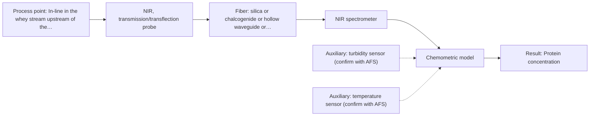
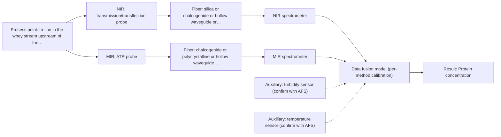

# First technical assessment: A clear whey stream before concentration

## Answer

**Customer request (our summary):** The customer wants to know if spectroscopy can track protein concentration in a dairy whey stream that transitions from relatively clear to turbid.

### Brief answer

Test NIR with a transmission/transflection fiber probe first: it is the documented dairy approach for inline protein tracking, and a transflection probe is the candidate that can handle both the clear and the turbid state with one probe. Validate it against your laboratory protein results on samples spanning both states. Open points: your protein range and accuracy target, how fast turbidity changes, and the installation conditions. If turbidity degrades NIR performance, MIR-ATR is the fallback to compare.

### Proposal

- **Best current option:** O2 (recommended)
- **Basis:** supplied AFS sources
- **What would change it:** If the transflection probe cannot meet the accuracy target on turbid samples, the extended NIR+MIR-ATR option (O3) or the turbidity-insensitive MIR-ATR option (O1) becomes preferred; the answers to Q1-Q4 on range, turbidity dynamics and installation could also shift the choice.
- **Next step:** Run the laboratory feasibility trial on representative clear and turbid whey samples with the lab protein reference, comparing transmission, transflection and MIR-ATR spectra.

**Secondary evidence (external, not AFS material):** G1: no usable external source found; G2: E01 ¶12; G3: E02 ¶31; G4: no usable external source found. See Expert detail.

**Decision status:** Provisional feasibility assessment

### Solution options

| ID | Tier | Methods | Confidence | Cost class, S01 Table 1 (p.6) | Ease of use | Maintenance | Performance fit | Sources |
|---|---|---|---|---|---|---|---|---|
| O1 | Simple | M2 MIR, ATR probe | Low: open question: Q1 (starts at Medium); uncited auxiliary sensor | high cost (row 2) | Simple contact probe, no pathlength setting | Crystal cleaning and fouling checks needed | Turbidity-insensitive surface measurement of protein bands | [1: S01 p.10] [2: S01 p.13] [3: S01 p.5] |
| O2 | Recommended | M1 NIR, transmission/transflection probe | Low: open question: Q1 (starts at Medium); uncited auxiliary sensor | average cost (row 7) | Standard dairy PAT practice, immersion probe | Probe window cleaning, periodic recalibration | Documented dairy protein tracking across clear and turbid states | [4: S01 p.18] [5: S01 p.18] [6: S01 p.10] |
| O3 | Extended (multi-method) | M1 NIR, transmission/transflection probe; M2 MIR, ATR probe | Low: open question: Q1 (starts at Medium); uncited auxiliary sensor; multi-method, fusion benefit not yet shown | high cost (rows 2, 7) | Two instruments and fused model to run | Each block needs its own calibration and diagnostics | Fallback if turbidity degrades NIR beyond the accuracy target | [7: S01 p.8] [8: S01 p.8] [9: S01 p.9] [5: S01 p.18] [6: S01 p.10] [1: S01 p.10] [2: S01 p.13] [3: S01 p.5] |

*Confidence rates the basis of the advice (how much is known and cited), not a predicted accuracy or probability of success. It starts at High, or at Medium when a key question on the method or the option is open, and drops one level per weakness listed (floor Low).*

*Cost class is the relative rating in S01 Table 1 (p.6) for the in-line method+technique rows named (the highest one for a multi-method option); it is not a price.*

### Setup sketch

*Recommended option O2; drawn by code from the option, a schematic, not a configuration.*

### Key questions

1. What protein concentration range must be tracked, and what accuracy and response time do you need?
2. Under which operating conditions does the stream become turbid, and how quickly does the change occur?
3. Where exactly would the probe be installed, and what are the process temperature, pressure and hygiene requirements?

## Expert detail

**Customer enquiry**

> Our dairy process includes a relatively clear whey stream before a concentration stage. We want to investigate whether spectroscopy can track protein concentration as the stream changes, with laboratory results used as the reference. The stream can become more turbid under some operating conditions. We need a first measurement concept that handles this change rather than assuming the liquid always remains clear.

**Decision status:** Provisional feasibility assessment. A method shortlist can be justified from dairy NIR precedents and ATR evidence, but the concentration range, turbidity behaviour and installation details are open, so the assessment is provisional.

### Parameters

| ID | Parameter | Kind | Need | Measured by | Why | Sources |
|---|---|---|---|---|---|---|
| P1 | Protein concentration | quantitative | required | Spectroscopy: NIR | It is the target analyte concentration that the in-line optical model must monitor. | [10: S01 p.17] |
| P2 | Turbidity / optical density of the stream | quantitative | required | Auxiliary sensor: turbidity sensor (cited; confirm availability with AFS) | It defines the physical states the calibration must cover and flags when the transmission signal risks saturation. | [11: S01 p.16] |
| P3 | Process temperature | quantitative | required | Auxiliary sensor: temperature sensor (engineering judgement: confirm availability with AFS) | Temperature shifts spectral bands and must be recorded so the calibration can account for it. | *(no verified source: engineering judgement)* |

### Solution option details

- **O1 cost drivers:** MIR spectrometer, CIR/PIR fiber probe, ATR crystal material
- **O2 cost drivers:** NIR spectrometer, transflection/transmission probe, calibration samples and lab reference analyses
- **O3 cost drivers:** Second spectrometer and probe, synchronisation software, doubled calibration effort
- **O3 combining methods:** Low-level fusion of synchronized NIR and MIR-ATR spectra from the same sampling spot, with per-method calibration and block scaling before joining. Data from the two methods must be normalized to a common time step, and variables from different methods are not equivalent and need normalization such as autoscaling. The fused model must beat the best single method on independent batches, otherwise the extra instrument should be dropped.

*Extended (multi-method) option O3; drawn by code from the option, a schematic, not a configuration.*

### Premise check

- **Supported:** The measurement concept must handle turbidity changes rather than assuming the liquid always remains clear. The dairy source confirms that transmission fails when the liquid becomes too thick or fat-rich because light cannot penetrate, so the concept must account for turbidity variation rather than assuming clear conditions. [12: S01 p.18]
- **Precedent only:** Fiber-optic spectroscopy can track protein in dairy streams such as whey. Published dairy examples show inline NIR transmission and reflection for fat and protein with PLS models; this is a reason to test, not proof for this customer's whey and turbidity range. [10: S01 p.17]
- **Not covered:** Turbidity is the only physical variation the calibration must handle. No supplied source addresses this specific whey stream; temperature, composition drift and fouling are unquantified and must be checked in the feasibility trial. *(no verified source: engineering judgement)*

### Requirements

**Stated by the customer**

- Track protein concentration in a relatively clear whey stream before a concentration stage.
- Handle the stream becoming more turbid under some operating conditions.
- Use laboratory results as the reference.

**Key unknowns**

- Protein concentration range and required accuracy
- How often and how fast the turbidity changes, and what causes it
- Installation point, temperature and available path length
- Laboratory reference method and achievable sampling frequency
- Whether the stream contains fluorescent species worth exploiting

### Clarification questions (most decision-relevant first)

Q1. What protein concentration range must be tracked, and what accuracy and response time do you need? *Why it matters:* The range decides whether NIR sensitivity suffices or a more selective method is needed, and the accuracy target sets the go/no-go criterion. *(affects: method, technique)*
Q2. Under which operating conditions does the stream become turbid, and how quickly does the change occur? *Why it matters:* The speed and frequency of the turbidity change decide between a transflection probe, a dual-technique probe or an added second method. *(affects: technique, installation)*
Q3. Where exactly would the probe be installed, and what are the process temperature, pressure and hygiene requirements? *Why it matters:* These determine the probe type, crystal material and fiber family that can actually be mounted in-line. *(affects: installation)*
Q4. Which laboratory method will serve as the protein reference, and how many samples per operating state can you provide? *Why it matters:* The calibration needs representative reference values across both clear and turbid states, and the reference method defines the achievable accuracy. *(affects: status, method)*

### Recommendation

- **M1 · Primary candidate: NIR, transmission/transflection probe.** NIR is the documented dairy workhorse for inline protein tracking, and a transflection probe is described as in some cases serving both low-fat and high-fat products, i.e. clear and scattering streams with one probe. Broad overlapping bands mean a chemometric calibration against the lab reference is required. *Conditions:* The transflection path must be validated on both clear and turbid whey samples; if turbid-state performance fails, the combined option (O3) becomes relevant. [5: S01 p.18] [6: S01 p.10]
- **M2 · Comparison candidate: MIR, ATR probe.** MIR-ATR probes measure liquids in contact with the crystal and the evanescent wave samples only a few micrometres, so a turbidity-driven change in scattering affects it far less than a transmission measurement. Well-defined mid-IR bands give higher selectivity for protein bands, at the cost of crystal contact and fouling risk. [1: S01 p.10] [2: S01 p.13] [3: S01 p.5]
- **M3 · Conditional candidate: Raman probe.** Raman tolerates aqueous media better than infrared methods and gives molecular specificity for protein bands, but the weak signal can be swamped by fluorescence, which must be checked on real whey samples first. *Conditions:* Only if the fluorescence background on actual whey samples proves low enough for usable protein signals. [13: S01 p.16] [14: S01 p.11]
- **M4 · Not recommended: NIR, diffuse reflection probe.** A reader familiar with dairy might expect NIR reflection because it is used for opaque dairy products, but the screening excludes it here: Table 1 lists it for scattering media and powders, and for a stream that is mostly clear it is less representative than transmission. [15: S01 p.18]

### Measurement concept

- **Probe and geometry:** Immersion NIR transmission/transflection fiber probe at the whey line before the concentration stage; a transflection geometry is the candidate that can cover both clear and turbid states with one probe. MIR-ATR immersion probe as the comparison technique.
- **Location:** In-line in the whey stream upstream of the concentration stage; exact installation point to be confirmed (Q3).
- **Fiber link:** Vis-NIR silica fibers cover the NIR range; the usable range depends on the spectrometer, fiber and probe actually selected. MIR-ATR would require CIR or PIR fibers, whose achievable link length is an open question. [16: S02 p.6] [17: S02 p.6]

### Spectral range

- **NIR:** Nominal NIR range 780-2500 nm; the usable range depends on the spectrometer, fiber and probe actually selected. [18: S01 p.10]
- **MIR:** Nominal mid-IR range 4000-400 cm-1 (2.5-25 µm); the usable range is limited by the fiber and ATR crystal selected. [19: S01 p.9]

### Risks and uncertainty

- The turbidity change may be accompanied by composition or temperature changes that a protein calibration could mistake for protein variation. *(rules: R-GEO-6, R-CAL-1)* [20: S01 p.17]
- The transflection probe may not in practice cover the full clear-to-turbid range of this whey, since the dairy precedent is stated only as 'in some cases'. *(rules: R-GEO-5)* *(no verified source: engineering judgement)*
- Protein levels may fall near the NIR detection limit for minor components, which the source flags as below 0.1 percent in a bioprocess context. *(rules: R-NIR-4)* [21: S01 p.16]
- An ATR crystal in the whey line could foul or lose representative contact, biasing the measurement toward the surface layer. *(rules: R-MIR-3)* *(no verified source: engineering judgement)*

### First feasibility experiment

1. **Collect representative whey samples spanning the expected protein range and both clear and turbid states, across the operating conditions that cause turbidity.** Cover the chemical and physical variation the calibration must handle. *(no verified source: engineering judgement)*
2. **Measure each sample with the lab reference protein method, taken close in time to the spectral measurement.** Provide independent reference values for calibration and validation. *(no verified source: engineering judgement)*
3. **Record NIR spectra of all samples with a transmission probe and a transflection probe in the lab, and MIR-ATR spectra as the comparison; test Raman only if the fluorescence background check on real whey allows it.** Compare single methods before any combination. *(no verified source: engineering judgement)*
4. **Build PLS calibration models per technique and validate on held-out samples or a separate batch, including turbid-state samples not used in calibration.** Estimate prediction error honestly for each technique. *(no verified source: engineering judgement)*
5. **Apply the customer's accuracy criterion as the go/no-go basis: proceed to an in-line trial only if the validated error on both clear and turbid samples meets the target set with the customer.** Define an objective decision point before hardware investment. *(no verified source: engineering judgement)*

**Reference measurements:** Laboratory protein results per sample, as the customer stated; the specific lab method is to be confirmed (Q4).

**Decision basis:** Customer-defined accuracy on held-out clear and turbid samples; no numerical criterion is stated in the enquiry, so it must be agreed (Q1).

### Assumptions

- The stream is aqueous whey, so water absorption constrains path lengths in NIR transmission and rules out long MIR transmission paths.
- Laboratory protein results can be timed to match in-line or at-line spectral sampling.

### Not covered by the supplied sources

- Protein concentration range, required accuracy and response time for this whey stream.
- Achievable link length for a mid-IR fiber link in this installation.

### Further notes

- **Chemometrics:** A PLS regression model per technique is the baseline; calibration samples must span both clear and turbid states, and validation should use held-out runs or batches. Scatter-related variation may need correction, but the correction must be validated so it does not remove real protein information.
- **Real-time tracking:** The goal is continuous in-line tracking of protein as the stream changes; diode-array NIR detectors allow instantaneous recording at all wavelengths, which matters if the turbidity changes quickly.
- **Future direction:** If the trial succeeds, a compact LED-based NIR sensor at selected wavelengths is a documented simplification path for routine monitoring.

### Secondary evidence (external, not AFS material)

*Found by a literature search for gaps the supplied AFS sources leave open. Not AFS material and not proof for this case; every quote below was verified verbatim against the fetched text.*

*Live search unavailable (library only: cache miss (europepmc); cache miss (openalex)); curated library only.*

**G1 · auxiliary sensor:** In-line measurement of Turbidity / optical density of the stream with turbidity sensor

- No usable external source found.

**G2 · auxiliary sensor:** In-line measurement of Process temperature with temperature sensor

- **E01 ¶12** The text notes that temperature sensitivity of certain bands is a drawback for measuring aqueous solutions in NIR and MIR, requiring tempered sample holders. *How it applies:* This suggests that monitoring and controlling process temperature should be tested or accounted for during spectral collection to minimize temperature-induced spectral variations in the whey stream. *Limits and transfer risks:* The source discusses general aqueous solutions in laboratory or review contexts, and the exact thermal sensitivity may differ for a dynamic dairy whey matrix at industrial scale. *(supports O2)*
  > "Additionally, the temperature sensitivity of the OH bands is a severe drawback for measuring aqueous solution in NIR and MIR, which makes tempered sample holders necessary [29]."
  > A critical review of recent trends, and a future perspective of optical spectroscopy as PAT in biopharmaceutical downstream processing. (2020) · Analytical and bioanalytical chemistry · doi:10.1007/s00216-020-02407-z · https://europepmc.org/article/PMC/PMC7072065 · retrieved 2026-10-17, full text, licence: cc by, via curated library

**G3 · multi-method:** Combining several spectroscopy methods (data fusion) (Low-level fusion of synchronized NIR and MIR-ATR spectra from the same sampling spot, with per-method calibration and block scaling before joining. Data from the two methods must be normalized to a common time step, and variables from different methods are not equivalent and need normalization such as autoscaling. The fused model must beat the best single method on independent batches, otherwise the extra instrument should be dropped.)

- **E02 ¶31** Low-level data fusion is described as the simplest method for combining inputs by rearranging data into a new matrix where variables from different sources are placed sequentially. *How it applies:* This approach can be evaluated if multiple spectroscopic methods are deployed, ensuring that the combined dataset structure aligns with low-level fusion strategies. *Limits and transfer risks:* Data fusion outcomes depend heavily on the specific instrument combination and sample matrix, so findings from general reviews may not directly transfer to a specific dairy whey processing line. *(supports O3)*
  > "Low-level data fusion (LLDF) is considered the simplest method to achieve a combination of inputs. In this case, the data is rearranged into a new data matrix, where the variables coming from different sources are placed one after the other."
  > Challenges and Opportunities of Implementing Data Fusion in Process Analytical Technology-A Review. (2022) · Molecules (Basel, Switzerland) · doi:10.3390/molecules27154846 · https://europepmc.org/article/PMC/PMC9369811 · retrieved 2026-10-17, full text, licence: cc by, via curated library

**G4 · not in the supplied sources:** Protein concentration range, required accuracy and response time for this whey stream.

- No usable external source found.

### Evidence (verified quotes)

1. ✓ **S01 p.10** (general): "ATR fiber probes (Fig.1) enable the analysis of liquids and solid elastic samples"
2. ✓ **S01 p.13** (general): "typically at a depth of few microns"
3. ✓ **S01 p.5** (general): "Mid-IR band spectra contain well-defined peaks (absorption bands), while NIR, UV, and fluorescence spectra contain broad, highly overlapping signals"
4. ✓ **S01 p.18** (application precedent): "By maintaining both, a lab can calibrate models for every stage of production - from raw milk intake to final evaporation - ensuring that no matter how the physical state of the milk changes during processing, the inline monitoring remains accurate and robust."
5. ✓ **S01 p.18** (application precedent): "In some cases, a Transflection probe can already be a combined solution working well for low-fat and high-fat containing milk products."
6. ✓ **S01 p.10** (general): "The broad absorption bands observed in this region overlap, suggesting the use of chemometrics for quantitative and qualitative analysis of spectral data."
7. ✓ **S01 p.8** (general): "Ultimately, the measurement data must be normalized to a common time step."
8. ✓ **S01 p.8** (general): "Variables obtained from different spectral methods are not equivalent."
9. ✓ **S01 p.9** (general): "One of the challenges of multispectral analysis is the need to simultaneously connect at least two independently operating measuring instruments."
10. ✓ **S01 p.17** (application precedent): "The use of Near-Infrared (NIR) spectroscopy for the inline monitoring of milk is a cornerstone of modern dairy "Process Analytical Technology" (PAT)."
11. ✓ **S01 p.16** (general): "transmission setup becomes saturated because the light cannot penetrate the bulk of the sample."
12. ✓ **S01 p.18** (general): "it fails when the milk becomes too "thick" or fat-rich, as the light cannot penetrate the sample."
13. ✓ **S01 p.16** (general): "Raman is particularly well-suited for aqueous environments, as it exhibits low absorbance for water molecules compared to infrared methods."
14. ✓ **S01 p.11** (general): "superposition of luminescence (fluorescence), which has a significantly higher intensity."
15. ✓ **S01 p.18** (general): "reflection can work well in highly scattering environments but can be less representative for clear liquids."
16. ✓ **S02 p.6** (general): "350 nm Standard VIS-NIR Silica Fibers Al/Cu-coated VIS-NIR Silica Fibers 2400 nm"
17. ✓ **S02 p.6** (general): "3000 nm Polycrystalline Infrared Fibers 17 μm"
18. ✓ **S01 p.10** (general): "NIR spectra (780-2500 nm) contain predominantly overtones and component bands of fundamental vibrations"
19. ✓ **S01 p.9** (general): "Vibrational spectroscopy in the mid-IR range (4000-400 cm-1) is one of the most informative methods of chemical analysis."
20. ✓ **S01 p.17** (general): "the method is sensitive to the surface characteristics and fat globule size."
21. ✓ **S01 p.16** (general): "may lack the sensitivity to detect trace compounds below 0.1 percent."

### Verification

- Citations verified: 23 of 23 (exact or whitespace/hyphen-tolerant match on the cited page, scope checked).
- Hard check failures before deterministic corrections: 0; still open: 0; soft warnings: 1; repair rounds: 1.
- External evidence (cache): 2 quote(s) verified verbatim (exact or whitespace/hyphen-tolerant, at most 400 characters and 2 sentences, against the cited paragraph); 0 item(s) dropped.
- External search: 2 query(ies), 0 hit(s), 3 source(s) (3 from the curated library); ⚠ library only: cache miss (europepmc); cache miss (openalex).
- External step: 2 model call(s), 2.6 s extra (cost in the run JSON).

*Run D03-20261018T073230Z-bd5f · models google/gemini-3.5-flash-lite, google/gemini-3.8-flash, z-ai/glm-5.3-flash*
