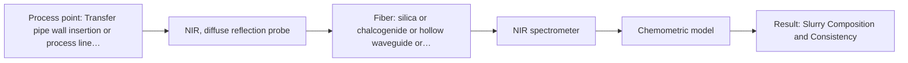

# First technical assessment: Pressure, flow and blockage of a slurry pipe

## Answer

**Customer request (our summary):** The customer wants to know if fiber optic products can measure the line pressure and flow rate of a slurry in a transfer pipe and provide early warning for pipe blockage.

### Brief answer

Direct measurement of line pressure and flow rate requires standard electromechanical pressure and flow sensors rather than fiber-optic spectroscopy, which is designed for chemical and compositional analysis. However, optical sensors can be considered if you wish to monitor slurry consistency or scattering changes to detect early pipe blockage precursors.

### Proposal

- **Best current option:** O2 (recommended)
- **Basis:** engineering judgement
- **What would change it:** Confirmation from the customer on whether optical detection of slurry consistency changes or turbidity is desired alongside standard electromechanical pressure and flow sensors.
- **Next step:** Deploy standard pressure transmitters and flow meters for physical line parameters, and evaluate NIR reflection or UV-Vis ATR if optical blockage precursor tracking is needed.

**Secondary evidence (external, not AFS material):** G1: no usable external source found; G2: no usable external source found; G3: no usable external source found; G4: no usable external source found. See Expert detail.

**Decision status:** Outside the supported scope

### Solution options

| ID | Tier | Methods | Confidence | Cost class, S01 Table 1 (p.6) | Ease of use | Maintenance | Performance fit | Sources |
|---|---|---|---|---|---|---|---|---|
| O1 | Simple | M2 UV-Vis, ATR probe | Low: open question: Q1 (starts at Medium); a parameter is not measurable in-line; status: outside supported scope | average cost (row 14) | Direct probe contact with pipe stream | Periodic optical crystal cleaning and check | Tracks high-OD turbidity changes at interface | [1: S01 p.16] |
| O2 | Recommended | M1 NIR, diffuse reflection probe | Low: open question: Q1 (starts at Medium); sample clarity unknown; precedent only; a parameter is not measurable in-line; status: outside supported scope | average cost (row 8) | Requires chemometric model calibration maintenance | Periodic optical window cleaning and calibration | Monitors slurry consistency and solids scattering | [2: S01 p.17] |

*Confidence rates the basis of the advice (how much is known and cited), not a predicted accuracy or probability of success. It starts at High, or at Medium when a key question on the method or the option is open, and drops one level per weakness listed (floor Low).*

*Cost class is the relative rating in S01 Table 1 (p.6) for the in-line method+technique rows named (the highest one for a multi-method option); it is not a price.*

### Setup sketch

*Recommended option O2; drawn by code from the option, a schematic, not a configuration.*

### Key questions

1. Are you looking to measure pressure and flow via standard electromechanical sensors, or do you intend to detect chemical composition changes and turbidity variations that precede pipe blockage using optical spectroscopy?
2. What are the physical and chemical characteristics of the slurry (e.g., solids loading, particle size distribution, and optical transparency)?
3. What specific pipe interface or port availability exists for installing probes?

## Expert detail

**Customer enquiry**

> We need to know the line pressure and the flow rate of a slurry in our transfer pipe, and we want an early warning when the pipe starts to block. Could your fiber optic products help with this?

**Decision status:** Outside the supported scope. The customer's request to measure mechanical line pressure and flow rate of a slurry goes beyond the scope of optical spectroscopy, which is designed for chemical and compositional analysis rather than direct physical pressure or flow measurement.

### Parameters

| ID | Parameter | Kind | Need | Measured by | Why | Sources |
|---|---|---|---|---|---|---|
| P1 | Line Pressure | quantitative | required | Not measurable in-line by spectroscopy; alternative: Standard electromechanical pressure transmitter | Stated as a primary customer measurement target. | *(no verified source: engineering judgement)* |
| P2 | Flow Rate | quantitative | required | Not measurable in-line by spectroscopy; alternative: Standard flow meter (e.g., magnetic or Coriolis flow meter) | Stated as a primary customer measurement target. | *(no verified source: engineering judgement)* |
| P3 | Slurry Composition and Consistency | qualitative | optional | Spectroscopy: NIR | Monitors solids concentration and chemical variations to warn of settling or blockage. | [2: S01 p.17] |
| P4 | Slurry Optical Density and Turbidity | qualitative | optional | Spectroscopy: UV-Vis | Monitors extreme optical density and interface attenuation changes during slurry flow. | [1: S01 p.16] |

### Solution option details

- **O1 cost drivers:** UV-Vis spectrometer, ATR probe, pressure/flow sensors
- **O2 cost drivers:** NIR spectrometer, diffuse reflection probe, chemometrics software

### Premise check

- **Not covered:** Fiber optic products can be used to measure line pressure, flow rate, and pipe blockages directly. The supplied sources cover optical spectroscopy methods for chemical composition, concentration, and material identification, but do not address optical measurement of mechanical line pressure or flow rate. [3: S01 p.2]

### Requirements

**Stated by the customer**

- Measure line pressure of slurry in a transfer pipe
- Measure flow rate of slurry in a transfer pipe
- Provide early warning when the pipe starts to block

**Key unknowns**

- Whether the customer requires optical/spectroscopic monitoring of slurry composition changes preceding blockage rather than direct mechanical pressure and flow measurement
- Slurry composition, solids concentration, and particle size
- Pipe dimensions, material, and optical accessibility

### Clarification questions (most decision-relevant first)

Q1. Are you looking to measure pressure and flow via standard electromechanical sensors, or do you intend to detect chemical composition changes and turbidity variations that precede pipe blockage using optical spectroscopy? *Why it matters:* Direct pressure and flow measurement are mechanical variables outside optical spectroscopy scope, whereas blockage warning can potentially be addressed via optical turbidity or composition monitoring. *(affects: method, status)*
Q2. What are the physical and chemical characteristics of the slurry (e.g., solids loading, particle size distribution, and optical transparency)? *Why it matters:* Optical probing depends heavily on whether the slurry is scattering, opaque, or transparent. *(affects: technique)*
Q3. What specific pipe interface or port availability exists for installing probes? *Why it matters:* Determines whether immersion probes or flush-mounted window installations are feasible. *(affects: installation)*

### Recommendation

- **M1 · Primary candidate: NIR, diffuse reflection probe.** Near-infrared diffuse reflection can monitor concentrated or scattering slurries and suspensions to track compositional or physical consistency changes if blockage is related to solids settling or concentration spikes. [2: S01 p.17]
- **M2 · Comparison candidate: UV-Vis, ATR probe.** UV-Vis ATR uses an evanescent wave with a penetration depth of a few micrometers to measure highly scattering or opaque fluids without dilution. *Conditions:* Applies if the slurry is highly opaque such that backscattered reflection signals saturate or suffer excessive attenuation. [1: S01 p.16]
- **M3 · Not recommended: NIR, transmission/transflection probe.** Transmission and transflection are unsuitable for thick or opaque slurries because light cannot penetrate high-solids media. [4: S01 p.18]

### Measurement concept

- **Probe and geometry:** Flush-mounted diffuse reflection probe for NIR scattering monitoring, or ATR interface for high-OD UV-Vis monitoring; pressure and flow require non-optical mechanical sensors.
- **Location:** Transfer pipe wall insertion or process line interface.
- **Fiber link:** Standard silica fiber cables connecting process probes to remote spectrometers. [5: S01 p.17]

### Spectral range

- **NIR:** Nominal NIR range is 780-2500 nm; usable range depends on the selected instrument, fiber, and probe configuration. [6: S01 p.10]
- **UV-Vis:** The UV region covers 190-360 nm; usable range depends on the instrument, optical fiber, and probe selected. [7: S01 p.5]

### Risks and uncertainty

- Attempting to measure mechanical pressure and flow rate using optical spectroscopy, which only measures chemical and physical interaction with light. *(rules: R-EVI-1)* [8: S01 p.2]
- Severe optical scattering or clogging in a high-solids slurry blocking light transmission to optical probes. *(rules: R-GEO-2)* [4: S01 p.18]

### First feasibility experiment

1. **Clarify monitoring objectives** Determine whether the customer requires standard mechanical sensors for pressure/flow or optical monitoring for blockage precursors. *(no verified source: engineering judgement)*
2. **Sample optical evaluation** Test representative slurry samples in a laboratory setup to check optical penetration and scattering. *(no verified source: engineering judgement)*

**Reference measurements:** Standard industrial pressure transducers and flow meters for pressure and flow rate verification.

**Decision basis:** Customer-defined thresholds for pressure drops, flow reductions, and optical turbidity changes indicating impending blockage.

### Assumptions

- The customer's primary engineering concern is monitoring slurry transfer status and preventing line blockage.
- Direct measurement of pressure and flow rate requires conventional pressure transmitters and flow meters rather than optical spectroscopy.

### Not covered by the supplied sources

- Direct fiber-optic or spectroscopic measurement of mechanical line pressure
- Direct measurement of fluid flow rate in pipes

### Further notes

- **Chemometrics:** If optical monitoring is used to detect slurry consistency changes leading to blockage, multivariate calibration (such as PLS) is required to correlate optical scatter spectra with process state variations.
- **Real-time tracking:** In-line optical probes can track scattering and compositional changes continuously if optical access is maintained.
- **Future direction:** Combining optical turbidity monitoring with standard pressure telemetry for comprehensive blockage prediction.

### Secondary evidence (external, not AFS material)

*Found by a literature search for gaps the supplied AFS sources leave open. Not AFS material and not proof for this case; every quote below was verified verbatim against the fetched text.*

*Live search unavailable (library only: cache miss (europepmc); cache miss (openalex)); curated library only.*

**G1 · decision status:** outside supported scope: The customer's request to measure mechanical line pressure and flow rate of a slurry goes beyond the scope of optical spectroscopy, which is designed for chemical and compositional analysis rather than direct physical pressure or flow measurement.

- No usable external source found.

**G2 · not in the supplied sources:** Direct fiber-optic or spectroscopic measurement of mechanical line pressure

- No usable external source found.

**G3 · not in the supplied sources:** Direct measurement of fluid flow rate in pipes

- No usable external source found.

**G4 · premise not covered:** Fiber optic products can be used to measure line pressure, flow rate, and pipe blockages directly.

- No usable external source found.

### Evidence (verified quotes)

1. ✓ **S01 p.16** (general): "extremely short path length that enables the measurement of "black" or highly scattering fluids without dilution."
2. ✓ **S01 p.17** (application precedent): "NIR Reflection is primarily used for opaque or highly concentrated dairy products, such as yogurt, butter, or whole milk concentrates."
3. ✓ **S01 p.2** (general): "Optical spectral analysis occupies a special place among physicochemical methods for studying substances and materials. It is based on measuring the result of the interaction of electromagnetic radiation with a sample over a wide range of wavelengths"
4. ✓ **S01 p.18** (general): "it fails when the milk becomes too "thick" or fat-rich, as the light cannot penetrate the sample."
5. ✓ **S01 p.17** (application precedent): "the probe is flush-mounted into a pipe or vat to interact directly with the flowing medium."
6. ✓ **S01 p.10** (general): "NIR spectra (780-2500 nm) contain predominantly overtones and component bands of fundamental vibrations"
7. ✓ **S01 p.5** (general): "UV-visible spectroscopy is based on electronic transitions between molecular energy levels. It has very high sensitivity, especially in the UV region (190-360 nm), but requires the use of special light sources and fiber optic probes."
8. ✓ **S01 p.2** (general): "Optical spectral analysis occupies a special place among physicochemical methods for studying substances and materials."

### Verification

- Citations verified: 13 of 13 (exact or whitespace/hyphen-tolerant match on the cited page, scope checked).
- Hard check failures before deterministic corrections: 0; still open: 0; soft warnings: 0; repair rounds: 2.
- External evidence (cache): 0 quote(s) verified verbatim (exact or whitespace/hyphen-tolerant, at most 400 characters and 2 sentences, against the cited paragraph); 0 item(s) dropped.
- External search: 4 query(ies), 0 hit(s), 3 source(s) (3 from the curated library); ⚠ library only: cache miss (europepmc); cache miss (openalex).
- External step: 2 model call(s), 2.1 s extra (cost in the run JSON).

*Run A05-20261018T073230Z-d9a3 · models google/gemini-3.5-flash-lite, google/gemini-3.8-flash*
