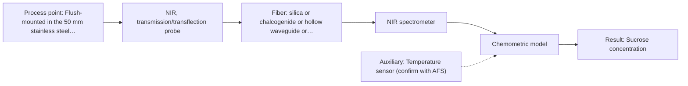

# First technical assessment: Complete enquiry for sugar concentration in a clear solution

## Answer

**Customer request (our summary):** The customer wants to monitor sucrose concentration in an in-line clear aqueous solution and asks for a method and probe proposal.

### Brief answer

For monitoring your clear aqueous sucrose solution, we recommend starting with NIR spectroscopy using a transmission or transflection probe connected via Vis-NIR silica fibers to the analyser 10 m away. A feasibility trial with representative 5 to 15 % w/w samples referenced against your laboratory refractometer will establish the chemometric calibration model. Material compatibility with daily hot caustic CIP remains to be confirmed.

### Proposal

- **Best current option:** O2 (recommended)
- **Basis:** supplied AFS sources
- **What would change it:** Incompatibility of probe seals with daily hot caustic cleaning or unacceptable light attenuation over the 10 m silica fiber link.
- **Next step:** Perform benchtop multi-method trials using representative aqueous sucrose samples referenced against your laboratory refractometer.

**Secondary evidence (external, not AFS material):** G1: no usable external source found. See Expert detail.

**Decision status:** Provisional feasibility assessment

### Solution options

| ID | Tier | Methods | Confidence | Cost class, S01 Table 1 (p.6) | Ease of use | Maintenance | Performance fit | Sources |
|---|---|---|---|---|---|---|---|---|
| O1 | Simple | M2 MIR, ATR probe | Low: open question: Q3 (starts at Medium); uncited auxiliary sensor | high cost (row 2) | Fixed immersion ATR interface | Routine crystal cleaning and inspection | Direct contact measurement without pathlength control | [1: S01 p.9] |
| O2 | Recommended | M1 NIR, transmission/transflection probe | Low: open question: Q3 (starts at Medium); uncited auxiliary sensor | average cost (row 7) | Robust fiber link to remote room | Scheduled calibration and caustic verification | Optimal fit for remote 10 m line | [2: S02 p.7] [3: S01 p.5] [4: S01 p.18] |

*Confidence rates the basis of the advice (how much is known and cited), not a predicted accuracy or probability of success. It starts at High, or at Medium when a key question on the method or the option is open, and drops one level per weakness listed (floor Low).*

*Cost class is the relative rating in S01 Table 1 (p.6) for the in-line method+technique rows named (the highest one for a multi-method option); it is not a price.*

### Setup sketch

*Recommended option O2; drawn by code from the option, a schematic, not a configuration.*

### Key questions

1. What is the exact chemical concentration and temperature of the hot caustic solution used during daily CIP?
2. What specific process connection standard (e.g., Tri-Clamp, flanged, or threaded) is fitted on the 50 mm pipe?
3. Can representative aqueous sucrose samples across the 5 to 15 % w/w range be supplied for baseline laboratory feasibility testing?

## Expert detail

**Customer enquiry**

> We produce a clear, colourless aqueous sucrose solution and want to monitor its sucrose concentration in-line. The solution flows through a 50 mm stainless steel pipe at 20 to 30 °C and normal pressure; the expected range is 5 to 15 % w/w and our quality limit is plus or minus 0.3 % w/w. Our laboratory refractometer is the reference method and stays in use. The analyser can stand in a dry, safe room 10 m from the pipe, and the line is cleaned in place with hot caustic once a day. A reading every minute is enough. Please propose a method and probe for a first trial.

**Decision status:** Provisional feasibility assessment. The clear, colourless aqueous sucrose stream provides a well-defined analytical target allowing a provisional method shortlist, while specific probe wetted materials for daily hot caustic cleaning and the exact 10 m fiber routing remain to be confirmed.

### Parameters

| ID | Parameter | Kind | Need | Measured by | Why | Sources |
|---|---|---|---|---|---|---|
| P1 | Sucrose concentration | quantitative | required | Spectroscopy: NIR | It is the primary process target variable to be monitored in-line. | [5: S01 p.10] |
| P2 | Process temperature | quantitative | required | Auxiliary sensor: Temperature sensor (engineering judgement: confirm availability with AFS) | Process temperature fluctuations affect aqueous solution spectra and require compensation in the calibration model. | *(no verified source: engineering judgement)* |

### Solution option details

- **O1 cost drivers:** FTIR spectrometer and diamond ATR probe
- **O2 cost drivers:** Vis-NIR spectrometer, transmission probe, silica fiber

### Premise check

- **Supported:** NIR transmission is suitable for clear or semi-transparent liquid streams. The supplied sources explicitly identify transmission as the preferred method for transparent or semi-transparent liquid streams. [4: S01 p.18]
- **Supported:** Remote measurements via fiber optic probes over meters of distance are feasible in industrial process environments. Low-OH silica fiber cables enable remote industrial process control over distances up to 300 m. [2: S02 p.7]

### Requirements

**Stated by the customer**

- Monitor sucrose concentration in-line for a clear, colourless aqueous solution
- Process conditions: 50 mm stainless steel pipe, 20 to 30 °C, normal pressure
- Expected concentration range: 5 to 15 % w/w with a quality limit of plus or minus 0.3 % w/w
- Analyzer located in a dry, safe room 10 m from the pipe
- Daily clean-in-place (CIP) with hot caustic
- Measurement frequency: one reading every minute
- Reference method: laboratory refractometer remaining in use

**Key unknowns**

- Specific process connection type on the 50 mm pipe
- Exact concentration and temperature of the hot caustic used during daily CIP
- Material compatibility of probe wetted parts and seals with hot caustic
- Detailed optical attenuation across the 10 m fiber link

### Clarification questions (most decision-relevant first)

Q1. What is the exact chemical concentration and temperature of the hot caustic solution used during daily CIP? *Why it matters:* It determines the chemical compatibility and material selection for probe wetted parts and optical seals. *(affects: installation, technique)*
Q2. What specific process connection standard (e.g., Tri-Clamp, flanged, or threaded) is fitted on the 50 mm pipe? *Why it matters:* It dictates the mechanical mounting design of the immersion probe. *(affects: installation)*
Q3. Can representative aqueous sucrose samples across the 5 to 15 % w/w range be supplied for baseline laboratory feasibility testing? *Why it matters:* It enables empirical calibration model development and verification against the target precision limit. *(affects: method)*

### Recommendation

- **M1 · Primary candidate: NIR, transmission/transflection probe.** Near-infrared transmission/transflection spectroscopy is well suited for clear aqueous solution analysis and allows remote spectrometer placement via robust silica fiber cables. [3: S01 p.5] [4: S01 p.18]
- **M2 · Comparison candidate: MIR, ATR probe.** Mid-infrared ATR spectroscopy provides high chemical specificity for carbohydrate fingerprint bands if higher molecular selectivity is required. *Conditions:* Evaluated if NIR transmission calibration precision requires additional carbohydrate specificity. [1: S01 p.9]

### Measurement concept

- **Probe and geometry:** NIR transmission or transflection insertion probe with a defined optical pathlength
- **Location:** Flush-mounted in the 50 mm stainless steel process pipe
- **Fiber link:** Low-OH Vis-NIR silica fiber cable spanning the 10 m distance between the process line and the safe analyzer room [6: S01 p.18] [2: S02 p.7]

### Spectral range

- **NIR:** Nominal method range is 780-2500 nm; the usable range depends on the instrument, fiber and probe actually selected. [5: S01 p.10]
- **MIR:** Nominal method range is 4000-400 cm-1; the usable range depends on the instrument, fiber and probe actually selected. [1: S01 p.9]

### Risks and uncertainty

- Daily hot caustic CIP cleaning may degrade probe optical window seals or housing materials if chemical compatibility is inadequate. *(rules: R-MIR-3, R-CAL-1)* [7: S01 p.10]
- Process temperature fluctuations may induce spectral shifts that require appropriate temperature compensation in the chemometric calibration model. *(rules: R-NIR-2, R-CAL-1)* [8: S01 p.10]

### First feasibility experiment

1. **Prepare representative aqueous sucrose solutions across the expected concentration range** Span the full 5 to 15 % w/w range to capture chemical variation. *(no verified source: engineering judgement)*
2. **Measure reference sucrose values using the laboratory refractometer** Provide independent reference values for each calibration sample. *(no verified source: engineering judgement)*
3. **Acquire single-method transmission spectra of calibration samples** Obtain baseline optical spectra using a controlled pathlength probe. *(no verified source: engineering judgement)*
4. **Construct multivariate chemometric calibration model** Correlate spectral absorption features with sucrose concentration. *(no verified source: engineering judgement)*
5. **Validate model accuracy on independent held-out samples** Verify prediction performance against the customer's plus or minus 0.3 % w/w limit. *(no verified source: engineering judgement)*

**Reference measurements:** Laboratory refractometer

**Decision basis:** Go/no-go based on achieving the customer's quality limit of plus or minus 0.3 % w/w on independent validation runs.

### Assumptions

- The 50 mm process pipe can accommodate an insertion transmission or transflection probe.
- Low-OH Vis-NIR silica fibers can span the 10 m distance without excessive signal attenuation.

### Further notes

- **Chemometrics:** Partial least squares (PLS) calibration models must be constructed using spectra acquired across the 5 to 15 % w/w sucrose range, incorporating scatter correction and temperature compensation.
- **Real-time tracking:** Continuous 1-minute interval spectral acquisitions can be logged and processed in real time to monitor sucrose concentration trends.
- **Future direction:** Integration of automated temperature compensation or expansion to multi-component monitoring if additional solutes are introduced.

### Secondary evidence (external, not AFS material)

*Found by a literature search for gaps the supplied AFS sources leave open. Not AFS material and not proof for this case; every quote below was verified verbatim against the fetched text.*

*Live search unavailable (library only: cache miss (europepmc); cache miss (openalex)); curated library only.*

**G1 · auxiliary sensor:** In-line measurement of Process temperature with Temperature sensor

- No usable external source found.

### Evidence (verified quotes)

1. ✓ **S01 p.9** (general): "Vibrational spectroscopy in the mid-IR range (4000-400 cm-1) is one of the most informative methods of chemical analysis."
2. ✓ **S02 p.7** (general): "Robust 100-300m cables made with Silica fibers of low OH-content (<0.1ppm OH) enable remote industrial process-control"
3. ✓ **S01 p.5** (general): "making it ideal for online applications, including remote measurements via fiber optic probes."
4. ✓ **S01 p.18** (general): "Transmission is the preferred method for transparent or semi-transparent liquids, such as skim milk, whey, or permeate."
5. ✓ **S01 p.10** (general): "NIR spectra (780-2500 nm) contain predominantly overtones and component bands of fundamental vibrations"
6. ✓ **S01 p.18** (general): "The setup typically consists of a transmission / transflection probe, where light passes entirely through a defined layer of the sample to a detector on the opposite side."
7. ✓ **S01 p.10** (general): "ATR fiber probes (Fig.1) enable the analysis of liquids and solid elastic samples, such as biological tissue, using specialized probes utilizing high-transmission fiber optics in the Mid-IR region."
8. ✓ **S01 p.10** (general): "The broad absorption bands observed in this region overlap, suggesting the use of chemometrics for quantitative and qualitative analysis of spectral data."

### Verification

- Citations verified: 14 of 14 (exact or whitespace/hyphen-tolerant match on the cited page, scope checked).
- Hard check failures before deterministic corrections: 0; still open: 0; soft warnings: 0; repair rounds: 1.
- External evidence (cache): 0 quote(s) verified verbatim (exact or whitespace/hyphen-tolerant, at most 400 characters and 2 sentences, against the cited paragraph); 0 item(s) dropped.
- External search: 2 query(ies), 0 hit(s), 3 source(s) (3 from the curated library); ⚠ library only: cache miss (europepmc); cache miss (openalex).
- External step: 2 model call(s), 1.6 s extra (cost in the run JSON).

*Run A07-20261018T073230Z-ffa1 · models google/gemini-3.5-flash-lite, google/gemini-3.8-flash*
