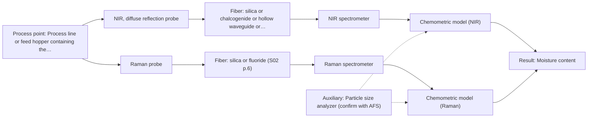

# First technical assessment: Accuracy guarantee, regulatory approval and price

## Answer

**Customer request:** Before we order, please confirm in writing that your NIR system will measure the moisture of our granulate to plus or minus 0.1 % and guarantee that our regulator will approve it for release testing. Please also include the price of the complete system.

### Brief answer

Specific measurement accuracy figures and regulatory approval cannot be confirmed prior to testing. Actual accuracy depends on the sample matrix and optical configuration. We recommend feasibility trials using NIR diffuse reflection alongside laboratory reference measurements to determine achievable performance on your granulate.

### Proposal

- **Best current option:** O2 (recommended)
- **Basis:** supplied AFS sources
- **What would change it:** Confirmation of granulate optical properties and reference accuracy requirements could refine the recommendation to a single NIR sensor configuration.
- **Next step:** Conduct feasibility trials using representative granulate samples across the expected moisture range.

**Secondary evidence (external, not AFS material):** G1: no usable external source found; G2: no usable external source found; G3: no usable external source found; G4: no usable external source found. See Expert detail.

**Decision status:** Premise not supported by the sources

### Solution options

| ID | Tier | Methods | Confidence | Cost class, S01 Table 1 (p.6) | Ease of use | Maintenance | Performance fit | Sources |
|---|---|---|---|---|---|---|---|---|
| O1 | Simple | M1 NIR, diffuse reflection probe | Low: open question: Q1, Q2 (starts at Medium); a customer premise is contradicted, status: premise not supported | average cost (row 8) | Standard online fiber probe | Periodic optical window cleaning | Directly targets moisture using NIR diffuse reflection | [1: S01 p.10] [2: S01 p.6] |
| O2 | Recommended | M1 NIR, diffuse reflection probe; M2 Raman probe | Low: open question: Q1, Q2 (starts at Medium); a customer premise is contradicted, status: premise not supported | high cost (rows 8, 12) | Multispectral laboratory testing setup | Independent calibration per instrument channel | Allows comparative evaluation of NIR and Raman to handle matrix interferences | [3: S01 p.3] [2: S01 p.6] [1: S01 p.10] [4: S01 p.16] |

*Confidence rates the basis of the advice (how much is known and cited), not a predicted accuracy or probability of success. It starts at High, or at Medium when a key question on the method or the option is open, and drops one level per weakness listed (floor Low).*

*Cost class is the relative rating in S01 Table 1 (p.6) for the in-line method+technique rows named (the highest one for a multi-method option); it is not a price.*

### Setup sketch

*Recommended option O2; drawn by code from the option, a schematic, not a configuration.*

### Key questions

1. What is the baseline reference method and associated error used for your current moisture determination?
2. What is the expected concentration range of moisture in the granulate?
3. What are the physical dimensions, flow rate, and temperature of the granulate process stream where the probe would be installed?

## Expert detail

**Customer enquiry**

> Before we order, please confirm in writing that your NIR system will measure the moisture of our granulate to plus or minus 0.1 % and guarantee that our regulator will approve it for release testing. Please also include the price of the complete system.

**Decision status:** Premise not supported by the sources. The customer requests written confirmation of plus or minus 0.1 % measurement accuracy and regulatory approval for release testing, which is contradicted by technical guidance stating that accuracy depends on configuration and sample matrix, while regulatory compliance is not covered.

### Parameters

| ID | Parameter | Kind | Need | Measured by | Why | Sources |
|---|---|---|---|---|---|---|
| P1 | Moisture content | quantitative | required | Spectroscopy: NIR | Direct target variable for release testing. | [1: S01 p.10] |
| P2 | Granulate particle size and scattering properties | qualitative | optional | Auxiliary sensor: Particle size analyzer (cited; confirm availability with AFS) | Affects diffuse reflectance scattering background and requires scatter correction. | [5: S01 p.17] |

### Solution option details

- **O1 cost drivers:** NIR spectrometer and diffuse reflection fiber probe
- **O2 cost drivers:** Multispectral laboratory setup with multiple optical modules

### Premise check

- **Contradicted:** Expects confirmation that the NIR system will achieve an accuracy of plus or minus 0.1 % moisture. Sources state that accuracy depends entirely on specific configuration, calibration matrix, and sample properties, so numerical accuracy cannot be confirmed prior to testing. [6: REF §5]
- **Not covered:** Asks for assurance of regulatory approval for release testing. The supplied technical sources do not cover regulatory release testing or specific regulatory agency approvals for granulate products. *(no verified source: engineering judgement)*

### Requirements

**Stated by the customer**

- Written confirmation of NIR moisture measurement accuracy to plus or minus 0.1 %
- Assurance of regulatory approval for release testing
- System pricing

**Key unknowns**

- Exact granulate chemical composition and particle size distribution
- Required moisture measurement range
- Reference laboratory method used for calibration
- Process temperature and environmental conditions at the installation point

### Clarification questions (most decision-relevant first)

Q1. What is the baseline reference method and associated error used for your current moisture determination? *Why it matters:* Spectroscopic chemometric models require reliable reference laboratory measurements for calibration and validation. *(affects: method, installation)*
Q2. What is the expected concentration range of moisture in the granulate? *Why it matters:* Defines the required dynamic range and verifies whether NIR sensitivity is adequate. *(affects: method)*
Q3. What are the physical dimensions, flow rate, and temperature of the granulate process stream where the probe would be installed? *Why it matters:* Determines mechanical probe compatibility, optical interface design, and temperature compensation needs. *(affects: installation, technique)*

### Recommendation

- **M1 · Primary candidate: NIR, diffuse reflection probe.** NIR diffuse reflection is well suited for analyzing scattering powder and granulate materials and directly targets moisture absorption bands. *Conditions:* Requires matrix-specific chemometric calibration based on representative sample granulates. [2: S01 p.6] [1: S01 p.10]
- **M2 · Comparison candidate: Raman probe.** Raman spectroscopy provides complementary molecular backbone information and exhibits low water absorbance in aqueous or hydrated matrices. *Conditions:* Applicable if secondary chemical components or complex structural interferences require differentiation alongside moisture. [4: S01 p.16]

### Measurement concept

- **Probe and geometry:** NIR diffuse reflection fiber probe flush-mounted or positioned with a spacer in contact with the granulate flow.
- **Location:** Process line or feed hopper containing the granulate.
- **Fiber link:** Vis-NIR silica fiber cable connecting the probe to the spectrometer located safely away from process dust and vibration. [7: S01 p.17] [8: S01 p.15]

### Spectral range

- **NIR:** Nominal range 780-2500 nm; usable range depends on the specific instrument, fiber optics, and probe configuration. [9: S01 p.10] [6: REF §5]

### Risks and uncertainty

- Granulate physical variations such as particle size changes or surface scattering can mimic chemical composition changes if scatter correction is not applied. *(rules: R-GEO-6)* [5: S01 p.17]
- Without matrix-specific calibration transfer and validation samples, the chemometric model may fail to achieve the required precision. *(rules: R-CAL-1)* [10: REF §5]

### First feasibility experiment

1. **Collect representative granulate samples covering the expected variation in moisture and physical properties.** Ensure the calibration set reflects real production heterogeneity. *(no verified source: engineering judgement)*
2. **Obtain independent reference laboratory measurements for all sample lots.** Provide ground truth data for chemometric model training and validation. *(no verified source: engineering judgement)*
3. **Perform benchtop NIR diffuse reflectance spectral acquisition using representative fiber probes.** Determine spectral reproducibility and feature correlation with moisture. *(no verified source: engineering judgement)*
4. **Validate the chemometric calibration model using held-out test runs or independent validation batches.** Quantify actual predictive accuracy and robustness. *(no verified source: engineering judgement)*

**Reference measurements:** Independent standard laboratory reference method for moisture content.

**Decision basis:** Go/no-go based on customer-defined acceptable prediction error thresholds established during laboratory trials.

### Assumptions

- The granulate is sufficiently scattering to permit diffuse reflectance measurement.
- Reference laboratory data are available to build and validate chemometric models.

### Not covered by the supplied sources

- System pricing and commercial terms
- Specific regulatory approval processes for customer release testing

### Further notes

- **Chemometrics:** Quantitative moisture prediction requires PLS regression models built on reference laboratory data and preprocessed with scatter correction algorithms such as SNV or MSC.
- **Real-time tracking:** High-speed spectral acquisition enables near-real-time tracking of moisture variations in flowing granulate processes.
- **Future direction:** Transition from laboratory multispectral evaluation to customized industrial optical sensor deployment.

### Secondary evidence (external, not AFS material)

*Found by a literature search for gaps the supplied AFS sources leave open. Not AFS material and not proof for this case; every quote below was verified verbatim against the fetched text.*

*Live search unavailable (library only: cache miss (europepmc); cache miss (openalex)); curated library only.*

**G1 · auxiliary sensor:** In-line measurement of Granulate particle size and scattering properties with Particle size analyzer

- No usable external source found.

**G2 · not in the supplied sources:** System pricing and commercial terms

- No usable external source found.

**G3 · not in the supplied sources:** Specific regulatory approval processes for customer release testing

- No usable external source found.

**G4 · premise not covered:** Asks for assurance of regulatory approval for release testing.

- No usable external source found.

### Evidence (verified quotes)

1. ✓ **S01 p.10** (general): "Near-IR vibrational spectroscopy (NIR) is the most common online analysis method performed using fiber optic probes."
2. ✓ **S01 p.6** (general): "Diffuse reflection-probe diffuse reflection Scattering media, powder 0.5-1 mm"
3. ✓ **S01 p.3** (general): "The ability to test various optical spectroscopy approaches is crucial for solving complex analytical problems"
4. ✓ **S01 p.16** (general): "Raman is particularly well-suited for aqueous environments, as it exhibits low absorbance for water molecules compared to infrared methods."
5. ✓ **S01 p.17** (general): "the method is sensitive to the surface characteristics and fat globule size."
6. ✓ **REF §5** (general): "It is not a product specification: actual spectral coverage, fiber length, component ratings, detection limits and accuracy depend on the configuration and the sample."
7. ✓ **S01 p.17** (general): "NIR Reflection is primarily used for opaque or highly concentrated dairy products, such as yogurt, butter, or whole milk concentrates."
8. ✓ **S01 p.15** (general): "The use of fiber optics is critical here, as it allows the sensitive spectrometers to be located safely away from the vibration and dust of the manufacturing floor."
9. ✓ **S01 p.10** (general): "NIR spectra (780-2500 nm) contain predominantly overtones and component bands of fundamental vibrations"
10. ✓ **REF §5** (general): "Weak signal, fluorescence background; calibration specific to the matrix."

### Verification

- Citations verified: 14 of 14 (exact or whitespace/hyphen-tolerant match on the cited page, scope checked).
- Hard check failures before deterministic corrections: 0; still open: 0; soft warnings: 1; repair rounds: 1.
- External evidence (cache): 0 quote(s) verified verbatim (exact or whitespace/hyphen-tolerant, at most 400 characters and 2 sentences, against the cited paragraph); 0 item(s) dropped.
- External search: 2 query(ies), 0 hit(s), 3 source(s) (3 from the curated library); ⚠ library only: cache miss (europepmc); cache miss (openalex).
- External step: 2 model call(s), 1.6 s extra (cost in the run JSON).

*Run A08-20261018T073230Z-8f64 · models google/gemini-3.5-flash-lite, google/gemini-3.8-flash*
