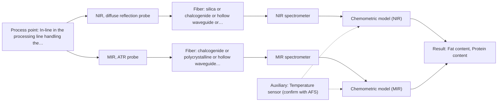

# First technical assessment: Fat and protein monitoring in opaque dairy product

## Answer

**Customer request (our summary):** The customer wants an in-line spectroscopy concept and a comparison experiment to monitor fat and protein changes earlier in a flowing, opaque milk product.

### Brief answer

To monitor fat and protein in your concentrated milk product, we recommend testing NIR diffuse reflection as the primary in-line method, with MIR-ATR as a comparison. A practical comparison experiment using representative samples with varying temperature and texture should be conducted alongside your laboratory checks.

### Proposal

- **Best current option:** O1 (simple)
- **Basis:** supplied AFS sources
- **What would change it:** Feasibility trial results showing insufficient prediction accuracy or robustness to texture changes with NIR alone.
- **Next step:** Conduct multi-method laboratory trials using representative concentrated milk samples across expected temperature and texture ranges.

**Secondary evidence (external, not AFS material):** G1: E03 ¶12; G2: no usable external source found; G3: no usable external source found. See Expert detail.

**Decision status:** Provisional feasibility assessment

### Solution options

| ID | Tier | Methods | Confidence | Cost class, S01 Table 1 (p.6) | Ease of use | Maintenance | Performance fit | Sources |
|---|---|---|---|---|---|---|---|---|
| O1 | Simple | M1 NIR, diffuse reflection probe | Low: open question: Q1, Q3 (starts at Medium); precedent only; uncited auxiliary sensor | average cost (row 8) | Moderate setup ease | Periodic optical cleaning | Suits opaque scattering dairy matrix well | [1: S01 p.17] |
| O2 | Recommended | M1 NIR, diffuse reflection probe; M2 MIR, ATR probe | Low: open question: Q1, Q3 (starts at Medium); uncited auxiliary sensor | high cost (rows 2, 8) | Higher configuration effort | Regular probe checks | Compares complementary vibrational ranges for robust monitoring | [2: S01 p.7] [1: S01 p.17] [3: S01 p.10] |

*Confidence rates the basis of the advice (how much is known and cited), not a predicted accuracy or probability of success. It starts at High, or at Medium when a key question on the method or the option is open, and drops one level per weakness listed (floor Low).*

*Cost class is the relative rating in S01 Table 1 (p.6) for the in-line method+technique rows named (the highest one for a multi-method option); it is not a price.*

### Setup sketch

*Recommended option O2; drawn by code from the option, a schematic, not a configuration.*

### Key questions

1. What are the exact process temperature range and flow velocity at the proposed installation point?
2. What pipe dimensions and mounting connections (e.g., flange, thread, or sanitary fitting) are available on the processing line?
3. What are the target accuracy and precision required for fat and protein quantification?

## Expert detail

**Customer enquiry**

> We produce an opaque, concentrated milk product that flows through a processing line. We currently sample it for fat and protein analysis and would like earlier information about composition changes. Product temperature and texture vary during production. We want an initial spectroscopy concept and a practical comparison experiment, while retaining our laboratory checks.

**Decision status:** Provisional feasibility assessment. A provisional assessment is possible using NIR diffuse reflection and MIR-ATR as screening-passed options for concentrated, opaque milk products, pending confirmation of exact optical properties and installation details.

### Parameters

| ID | Parameter | Kind | Need | Measured by | Why | Sources |
|---|---|---|---|---|---|---|
| P1 | Fat content | quantitative | required | Spectroscopy: NIR | Core target component for process monitoring and quality control. | *(no verified source: engineering judgement)* |
| P2 | Protein content | quantitative | required | Spectroscopy: NIR | Core target component for process monitoring and quality control. | *(no verified source: engineering judgement)* |
| P3 | Product temperature | quantitative | required | Auxiliary sensor: Temperature sensor (engineering judgement: confirm availability with AFS) | Temperature variations affect optical spectra and require chemometric compensation. | *(no verified source: engineering judgement)* |

### Solution option details

- **O1 cost drivers:** Single NIR spectrometer and diffuse reflection probe
- **O2 cost drivers:** Multi-method laboratory evaluation and dual probe setup

### Premise check

- **Supported:** An initial spectroscopy concept and a practical comparison experiment can be provided while retaining laboratory checks. Supplied materials demonstrate that multi-method laboratory trials and comparison experiments support industrial process monitoring while retaining laboratory reference checks. [4: S01 p.18]

### Requirements

**Stated by the customer**

- Earlier information about fat and protein composition changes
- In-line measurement in a flowing, opaque, concentrated milk product
- Handling varying product temperature and texture during production
- Practical comparison experiment while retaining laboratory checks

**Key unknowns**

- Exact temperature range and variation magnitude during production
- Pipe dimensions, material, and available mounting port for probe installation
- Required measurement accuracy and precision for fat and protein

### Clarification questions (most decision-relevant first)

Q1. What are the exact process temperature range and flow velocity at the proposed installation point? *Why it matters:* Temperature variations affect optical properties and probe material compatibility. *(affects: method, installation)*
Q2. What pipe dimensions and mounting connections (e.g., flange, thread, or sanitary fitting) are available on the processing line? *Why it matters:* Determines mechanical installation constraints and probe design requirements. *(affects: installation)*
Q3. What are the target accuracy and precision required for fat and protein quantification? *Why it matters:* Defines the necessary chemometric model complexity and sensor performance requirements. *(affects: method, technique)*

### Recommendation

- **M1 · Primary candidate: NIR, diffuse reflection probe.** NIR diffuse reflection is well-suited for opaque, concentrated dairy streams and handles scattering media effectively. [1: S01 p.17]
- **M2 · Comparison candidate: MIR, ATR probe.** MIR-ATR provides high chemical selectivity and distinct functional group absorption bands for fat and protein components. *Conditions:* To be tested if NIR scatter sensitivity proves too sensitive to texture variations. [3: S01 p.10]

### Measurement concept

- **Probe and geometry:** Flush-mounted NIR diffuse reflection fiber probe or MIR-ATR immersion probe
- **Location:** In-line in the processing line handling the concentrated milk product
- **Fiber link:** Robust fiber optic cables connecting the process probe to spectrometers located safely away from the processing floor [5: S01 p.15] [6: S01 p.17]

### Spectral range

- **NIR:** Nominal range 780-2500 nm; usable range depends on the instrument, fiber, and probe configuration. [7: S01 p.10]
- **MIR:** Nominal range 4000-400 cm-1; usable range depends on the fiber and ATR crystal configuration. [8: S01 p.9]

### Risks and uncertainty

- Surface deposition or fouling on the probe tip can distort reflection and ATR signals in concentrated dairy products. *(rules: R-MIR-3)* [9: S01 p.13]
- Physical variations such as fat globule size and texture changes can mimic compositional changes in diffuse reflection measurements. *(rules: R-GEO-6)* [10: S01 p.17]

### First feasibility experiment

1. **Collect representative sample batches spanning the expected range of temperature and texture variations.** Ensure the test set captures process variability. *(no verified source: engineering judgement)*
2. **Perform independent reference laboratory measurements for fat and protein on all sample batches.** Provide ground-truth data for chemometric calibration. *(no verified source: engineering judgement)*
3. **Test NIR diffuse reflection and MIR-ATR probes in a laboratory flow loop or bench setup.** Compare signal quality and stability under varying physical conditions. *(no verified source: engineering judgement)*
4. **Build and validate partial least squares (PLS) calibration models using scatter correction preprocessing.** Evaluate prediction accuracy against reference data. *(no verified source: engineering judgement)*

**Reference measurements:** Standard laboratory reference assays for fat and protein content.

**Decision basis:** Go/no-go determined by achieving customer-specified prediction accuracy and robustness against temperature and texture fluctuations.

### Assumptions

- The concentrated milk product flows in a pipe or vessel capable of accommodating an insertion probe.
- Standard laboratory reference methods are available for calibration.

### Further notes

- **Chemometrics:** Multivariate calibration (PLS) using scatter correction such as Standard Normal Variate (SNV) is required to remove physical scattering interference caused by texture and fat globule size variations.
- **Real-time tracking:** In-line fiber optic probes enable real-time tracking of fat and protein composition changes directly in the flowing processing line.

### Secondary evidence (external, not AFS material)

*Found by a literature search for gaps the supplied AFS sources leave open. Not AFS material and not proof for this case; every quote below was verified verbatim against the fetched text.*

*Live search unavailable (library only: cache miss (europepmc); cache miss (openalex)); curated library only.*

**G1 · auxiliary sensor:** In-line measurement of Product temperature with Temperature sensor

- **E03 ¶12** The text notes that the temperature sensitivity of the OH bands represents a severe drawback for measuring aqueous solutions in NIR and MIR, requiring tempered sample holders. *How it applies:* This suggests that temperature fluctuations in the flowing milk product could impact the spectral baseline, meaning temperature compensation or sample conditioning should be tested. *Limits and transfer risks:* This finding refers to biopharmaceutical downstream processing and general aqueous solutions rather than an opaque flowing milk product in an in-line system. *(supports O1)*
  > "Additionally, the temperature sensitivity of the OH bands is a severe drawback for measuring aqueous solution in NIR and MIR, which makes tempered sample holders necessary [29]."
  > A critical review of recent trends, and a future perspective of optical spectroscopy as PAT in biopharmaceutical downstream processing. (2020) · Analytical and bioanalytical chemistry · doi:10.1007/s00216-020-02407-z · https://europepmc.org/article/PMC/PMC7072065 · retrieved 2026-10-17, full text, licence: cc by, via curated library

**G2 · parameter without a source:** Measuring Fat content: Core target component for process monitoring and quality control.

- No usable external source found.

**G3 · parameter without a source:** Measuring Protein content: Core target component for process monitoring and quality control.

- No usable external source found.

### Evidence (verified quotes)

1. ✓ **S01 p.17** (application precedent): "NIR Reflection is primarily used for opaque or highly concentrated dairy products, such as yogurt, butter, or whole milk concentrates."
2. ✓ **S01 p.7** (general): "The analysis of such systems may require a combination of two or even more spectral methods."
3. ✓ **S01 p.10** (general): "ATR fiber probes (Fig.1) enable the analysis of liquids and solid elastic samples, such as biological tissue, using specialized probes utilizing high-transmission fiber optics in the Mid-IR region."
4. ✓ **S01 p.18** (application precedent): "having both fiber optic techniques available in a lab rather than relying on one provides the flexibility needed to monitor the entire production chain."
5. ✓ **S01 p.15** (general): "The use of fiber optics is critical here, as it allows the sensitive spectrometers to be located safely away from the vibration and dust of the manufacturing floor."
6. ✓ **S01 p.17** (application precedent): "the probe is flush-mounted into a pipe or vat to interact directly with the flowing medium."
7. ✓ **S01 p.10** (general): "NIR spectra (780-2500 nm) contain predominantly overtones and component bands of fundamental vibrations of molecules and atomic groups"
8. ✓ **S01 p.9** (general): "Vibrational spectroscopy in the mid-IR range (4000-400 cm-1) is one of the most informative methods of chemical analysis."
9. ✓ **S01 p.13** (general): "typically at a depth of few microns"
10. ✓ **S01 p.17** (general): "the method is sensitive to the surface characteristics and fat globule size."

### Verification

- Citations verified: 11 of 11 (exact or whitespace/hyphen-tolerant match on the cited page, scope checked).
- Hard check failures before deterministic corrections: 0; still open: 0; soft warnings: 1; repair rounds: 1.
- External evidence (cache): 1 quote(s) verified verbatim (exact or whitespace/hyphen-tolerant, at most 400 characters and 2 sentences, against the cited paragraph); 0 item(s) dropped.
- External search: 3 query(ies), 0 hit(s), 3 source(s) (3 from the curated library); ⚠ library only: cache miss (europepmc); cache miss (openalex).
- External step: 2 model call(s), 3.2 s extra (cost in the run JSON).

*Run D02-20261018T073230Z-57bc · models google/gemini-3.5-flash-lite, google/gemini-3.8-flash*
