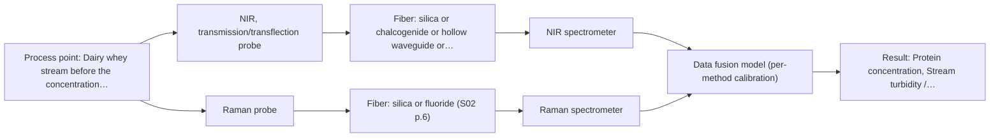

# First technical assessment: A clear whey stream before concentration

## Answer

**Customer request (our summary):** The customer wants a spectroscopic measurement concept to track protein concentration in a dairy whey stream that transitions from relatively clear to turbid.

### Brief answer

To track protein concentration in a dairy whey stream transitioning between clear and turbid states, start with an NIR transflection probe that accommodates varying optical path conditions. Laboratory reference measurements should be paired with multi-sample trials across both clear and turbid operating states. If scattering proves too high for NIR alone, Raman spectroscopy provides a robust alternative with lower water interference for aqueous process streams.

### Proposal

- **Best current option:** O1 (simple)
- **Basis:** supplied AFS sources
- **What would change it:** If stream turbidity causes excessive signal loss or saturation in NIR transflection tests, transitioning to Raman or a combined multispectral approach (O2) would be warranted.
- **Next step:** Perform benchtop or trial loop multi-method testing on representative clear and turbid whey samples against laboratory reference data.

**Secondary evidence (external, not AFS material):** G1: no usable external source found. See Expert detail.

**Decision status:** Provisional feasibility assessment

### Solution options

| ID | Tier | Methods | Confidence | Cost class, S01 Table 1 (p.6) | Ease of use | Maintenance | Performance fit | Sources |
|---|---|---|---|---|---|---|---|---|
| O1 | Simple | M1 NIR, transmission/transflection probe | Low: open question: Q1, Q2 (starts at Medium); precedent only | average cost (row 7) | Simple inline probe operation | Periodic optical window cleaning | Handles clear to moderate turbidity via transflection | [1: S01 p.18] |
| O2 | Recommended | M1 NIR, transmission/transflection probe; M2 Raman probe | Low: open question: Q1, Q2 (starts at Medium); multi-method, fusion benefit not yet shown | high cost (rows 7, 12) | Robust automated inline monitoring | Probe cleaning and laser safety check | Combines NIR transflection with Raman for robust turbidity handling | [2: S01 p.15] [1: S01 p.18] [3: S01 p.16] |

*Confidence rates the basis of the advice (how much is known and cited), not a predicted accuracy or probability of success. It starts at High, or at Medium when a key question on the method or the option is open, and drops one level per weakness listed (floor Low).*

*Cost class is the relative rating in S01 Table 1 (p.6) for the in-line method+technique rows named (the highest one for a multi-method option); it is not a price.*

### Setup sketch

*Recommended option O2; drawn by code from the option, a schematic, not a configuration.*

### Key questions

1. What is the expected range of turbidity variations and how frequently do turbid conditions occur during processing?
2. What is the expected quantitative concentration range of protein in the whey stream?
3. What are the physical dimensions and flow characteristics of the pipe or process line where the probe will be installed?

## Expert detail

**Customer enquiry**

> Our dairy process includes a relatively clear whey stream before a concentration stage. We want to investigate whether spectroscopy can track protein concentration as the stream changes, with laboratory results used as the reference. The stream can become more turbid under some operating conditions. We need a first measurement concept that handles this change rather than assuming the liquid always remains clear.

**Decision status:** Provisional feasibility assessment. The enquiry outlines a dairy whey stream transitioning between clear and turbid conditions while tracking protein concentration. NIR transflection provides a proven starting technique to handle varying optical path conditions in dairy streams, subject to laboratory feasibility testing across the process turbidity range.

### Parameters

| ID | Parameter | Kind | Need | Measured by | Why | Sources |
|---|---|---|---|---|---|---|
| P1 | Protein concentration | quantitative | required | Spectroscopy: NIR | Primary target variable to track in the whey stream. | [4: S01 p.17] |
| P2 | Stream turbidity / scattering level | quantitative | required | Spectroscopy: NIR | Determines optical path behavior and probe suitability across operating conditions. | [5: S01 p.17] |

### Solution option details

- **O1 cost drivers:** Standard NIR spectrometer and transflection probe
- **O2 cost drivers:** NIR and Raman spectrometers with specialized fiber probes
- **O2 combining methods:** Combines NIR and Raman data blocks after synchronisation to a common time step, using block scaling to handle scattering and chemical variations; must outperform single-method calibration.

### Premise check

- **Precedent only:** In-line optical spectroscopy can track protein concentration in dairy whey as the stream transitions between clear and turbid conditions. Dairy applications demonstrate using NIR spectroscopy to quantify protein in milk and dairy streams, with transflection probes noted as working across low-fat and high-fat products, but feasibility across this specific stream's turbidity fluctuations must be tested. [4: S01 p.17] [1: S01 p.18]

### Requirements

**Stated by the customer**

- Track protein concentration in a dairy whey stream before a concentration stage
- Handle stream turbidity changes ranging from clear to turbid
- Use laboratory results as reference

**Key unknowns**

- Extent and frequency of turbidity fluctuations
- Expected protein concentration range
- Process temperature and pressure
- Pipe or flow cell dimensions

### Clarification questions (most decision-relevant first)

Q1. What is the expected range of turbidity variations and how frequently do turbid conditions occur during processing? *Why it matters:* Determines whether a single transflection probe can span the optical changes or if a more robust scattering compensation or alternative method is needed. *(affects: method, technique, installation)*
Q2. What is the expected quantitative concentration range of protein in the whey stream? *Why it matters:* Informs sensitivity requirements and calibration model design. *(affects: method, technique)*
Q3. What are the physical dimensions and flow characteristics of the pipe or process line where the probe will be installed? *Why it matters:* Guides mechanical integration and probe mounting design. *(affects: installation)*

### Recommendation

- **M1 · Primary candidate: NIR, transmission/transflection probe.** NIR transflection probes can accommodate both transparent and scattering dairy streams by controlling the optical path length. [1: S01 p.18]
- **M2 · Comparison candidate: Raman probe.** Raman spectroscopy exhibits low water interference and robust performance in aqueous process environments when turbidity scattering challenges infrared methods. *Conditions:* Applies if NIR transflection experiences excessive signal loss during high turbidity states. [3: S01 p.16]

### Measurement concept

- **Probe and geometry:** NIR transflection fiber probe flush-mounted in the process pipe with a controlled optical path length to handle varying turbidity.
- **Location:** Dairy whey stream before the concentration stage.
- **Fiber link:** Standard Vis-NIR silica fiber cables connecting the process probe to the spectrometer located safely away from the vibration and dust of the manufacturing floor. [6: S01 p.15] [1: S01 p.18] [7: S02 p.6]

### Spectral range

- **NIR:** Nominal range 780-2500 nm; usable range depends on the actual instrument, fiber and probe configuration. [8: S01 p.10] [9: REF §5]
- **Raman:** Raman shift expressed in cm-1 with laser excitation wavelength stated separately. [10: S01 p.11]

### Risks and uncertainty

- Stream turbidity fluctuations can cause severe optical scattering or signal saturation in standard transmission setups. *(rules: R-GEN-4, R-GEO-2)* [11: S01 p.18]
- Broad and overlapping NIR absorption bands require robust chemometric calibration that must be re-validated if the matrix composition drifts. *(rules: R-CAL-1, R-NIR-2)* [12: S01 p.10]

### First feasibility experiment

1. **Collect representative whey samples across clear and turbid operating conditions.** Gather representative whey samples covering the full range of clear and turbid operating conditions. [13: S01 p.3]
2. **Obtain independent laboratory reference measurements for protein concentration.** Provide analytical reference data for model training and validation. *(no verified source: engineering judgement)*
3. **Perform spectroscopic measurements using NIR transflection and Raman probes.** Acquire spectral datasets across the varying turbidity states for both methods. *(no verified source: engineering judgement)*
4. **Construct multivariate chemometric calibration models for protein tracking.** Build and evaluate calibration models relating spectra to reference protein concentrations. [14: S01 p.5]
5. **Validate calibration models on independent held-out runs against customer criteria.** Evaluate model performance against customer-defined accuracy criteria on held-out runs. *(no verified source: engineering judgement)*

**Reference measurements:** Standard laboratory reference measurements for protein concentration.

**Decision basis:** Go/no-go based on achieving customer-defined prediction accuracy across both clear and turbid operating states.

### Assumptions

- Representative whey samples covering both clear and turbid conditions can be provided for initial testing
- Laboratory reference methods for protein are available

### Not covered by the supplied sources

- Exact protein concentration numerical ranges and required measurement response times

### Further notes

- **Chemometrics:** Multivariate calibration using PLS regression with scattering corrections (such as MSC or SNV) is required due to broad overlapping NIR bands and physical scattering changes from turbidity.
- **Real-time tracking:** In-line probe installation before the concentration stage enables real-time near-continuous tracking of protein concentration.
- **Future direction:** Integration of automated process control feedback loops based on real-time chemometric concentration predictions.

### Secondary evidence (external, not AFS material)

*Found by a literature search for gaps the supplied AFS sources leave open. Not AFS material and not proof for this case; every quote below was verified verbatim against the fetched text.*

*Live search unavailable (library only: cache miss (europepmc); cache miss (openalex)); curated library only.*

**G1 · not in the supplied sources:** Exact protein concentration numerical ranges and required measurement response times

- No usable external source found.

### Evidence (verified quotes)

1. ✓ **S01 p.18** (application precedent): "In some cases, a Transflection probe can already be a combined solution working well for low-fat and high-fat containing milk products."
2. ✓ **S01 p.15** (application precedent): "Data processing for pharmaceutical tasks relies on "low-level data fusion," where the synchronized NIR and Raman spectra are merged into a single augmented matrix."
3. ✓ **S01 p.16** (general): "Raman is particularly well-suited for aqueous environments, as it exhibits low absorbance for water molecules compared to infrared methods."
4. ✓ **S01 p.17** (application precedent): "Partial Least Squares (PLS) regression to quantify fat and protein."
5. ✓ **S01 p.17** (application precedent): "Multiplicative Scatter Correction (MSC) or Standard Normal Variate (SNV) transformations to remove physical interference caused by the scattering nature of the milk particles"
6. ✓ **S01 p.15** (general): "The use of fiber optics is critical here, as it allows the sensitive spectrometers to be located safely away from the vibration and dust of the manufacturing floor."
7. ✓ **S02 p.6** (general): "350 nm Standard VIS-NIR Silica Fibers Al/Cu-coated VIS-NIR Silica Fibers 2400 nm"
8. ✓ **S01 p.10** (general): "NIR spectra (780-2500 nm) contain predominantly overtones and component bands of fundamental vibrations"
9. ✓ **REF §5** (general): "It is not a product specification: actual spectral coverage, fiber length, component ratings, detection limits and accuracy depend on the configuration and the sample."
10. ✓ **S01 p.11** (general): "The Raman shift is used as the horizontal (spectral) axis in Raman spectroscopy, while the vertical axis shows the absolute intensity of the recorded signals"
11. ✓ **S01 p.18** (general): "it fails when the milk becomes too "thick" or fat-rich, as the light cannot penetrate the sample."
12. ✓ **S01 p.10** (general): "The broad absorption bands observed in this region overlap, suggesting the use of chemometrics for quantitative and qualitative analysis of spectral data."
13. ✓ **S01 p.3** (general): "The ability to test various optical spectroscopy approaches is crucial for solving complex analytical problems, such as analyzing natural and industrial samples of incompletely known composition"
14. ✓ **S01 p.5** (general): "Extracting the information necessary for quantitative and qualitative analysis from optical spectra requires special methods for analyzing multidimensional data, called the above-mentioned term chemometrics."

### Verification

- Citations verified: 19 of 19 (exact or whitespace/hyphen-tolerant match on the cited page, scope checked).
- Hard check failures before deterministic corrections: 0; still open: 0; soft warnings: 1; repair rounds: 1.
- External evidence (cache): 0 quote(s) verified verbatim (exact or whitespace/hyphen-tolerant, at most 400 characters and 2 sentences, against the cited paragraph); 0 item(s) dropped.
- External search: 2 query(ies), 0 hit(s), 3 source(s) (3 from the curated library); ⚠ library only: cache miss (europepmc); cache miss (openalex).
- External step: 2 model call(s), 1.4 s extra (cost in the run JSON).

*Run D03-20261018T073230Z-7e60 · models google/gemini-3.5-flash-lite, google/gemini-3.8-flash*
