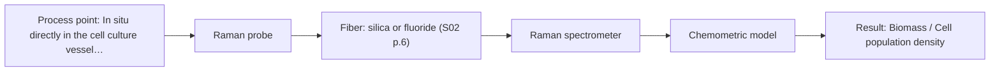
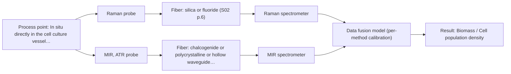

# First technical assessment: Glucose and lactate trends in an aqueous bioprocess

## Answer

**Customer request (our summary):** The customer is exploring an in situ spectroscopy pilot to monitor glucose and lactate in a cell culture process to avoid laboratory measurement delays.

### Brief answer

To monitor glucose and lactate in your aqueous cell culture in situ, test Raman spectroscopy first because of its low water interference in aqueous environments. Pair this with independent reference measurements from your lab to build chemometric calibration models that account for changing cell populations.

### Proposal

- **Best current option:** O2 (recommended)
- **Basis:** supplied AFS sources
- **What would change it:** If severe fluorescence background obscures Raman spectra, switch to MIR ATR or a combined multi-method approach.
- **Next step:** Conduct multi-method laboratory trials using representative cell culture samples and independent reference measurements.

**Secondary evidence (external, not AFS material):** G1: E02 ¶31; G2: no usable external source found; G3: no usable external source found. See Expert detail.

**Decision status:** Provisional feasibility assessment

### Solution options

| ID | Tier | Methods | Confidence | Cost class, S01 Table 1 (p.6) | Ease of use | Maintenance | Performance fit | Sources |
|---|---|---|---|---|---|---|---|---|
| O1 | Simple | M2 MIR, ATR probe | Medium: open question: Q1 (starts at Medium) | high cost (row 2) | Direct contact ATR probe setup | Crystal cleaning and fouling monitoring | Direct mid-IR absorption for dissolved metabolites | [1: S01 p.9] |
| O2 | Recommended | M1 Raman probe | Medium: open question: Q1, Q2 (starts at Medium) | high cost (row 12) | Immersion probe in bioreactor port | Periodic optical window cleaning | Aqueous tolerance with low water background | [2: S01 p.16] |
| O3 | Extended (multi-method) | M1 Raman probe; M2 MIR, ATR probe | Low: open question: Q1, Q2 (starts at Medium); multi-method, fusion benefit not yet shown | high cost (rows 2, 12) | Dual spectrometer and sensor alignment | Dual probe maintenance and ATR checks | Complementary Raman and MIR vibrational bands | [2: S01 p.16] [1: S01 p.9] |

*Confidence rates the basis of the advice (how much is known and cited), not a predicted accuracy or probability of success. It starts at High, or at Medium when a key question on the method or the option is open, and drops one level per weakness listed (floor Low).*

*Cost class is the relative rating in S01 Table 1 (p.6) for the in-line method+technique rows named (the highest one for a multi-method option); it is not a price.*

### Setup sketch

*Recommended option O2; drawn by code from the option, a schematic, not a configuration.*

### Key questions

1. What are the expected concentration ranges for glucose and lactate in the cell culture?
2. What is the maximum cell density and turbidity expected during the cultivation run?
3. How frequently are reference laboratory measurements available for calibration building?

## Expert detail

**Customer enquiry**

> We run a cell culture process in an aqueous medium. Glucose and lactate are measured from samples, and the delay makes it difficult to see changes promptly. We are exploring an in situ spectroscopy pilot that can be checked against those existing laboratory measurements. The medium and cell population change during the run; we have not yet selected a probe or a calibration strategy.

**Decision status:** Provisional feasibility assessment. The aqueous cell culture environment requires methods that tolerate water interference, making Raman spectroscopy a strong primary candidate and Mid-IR a conditional alternative, while calibration and probe selection require experimental trials.

### Parameters

| ID | Parameter | Kind | Need | Measured by | Why | Sources |
|---|---|---|---|---|---|---|
| P1 | Glucose concentration | quantitative | required | Reference lab method: Standard lab assay | Primary target analyte to monitor metabolization and avoid delays. | *(no verified source: engineering judgement)* |
| P2 | Lactate concentration | quantitative | required | Reference lab method: Standard lab assay | Primary metabolite byproduct indicating cell culture state. | *(no verified source: engineering judgement)* |
| P3 | Biomass / Cell population density | quantitative | optional | Spectroscopy: Raman | Tracks cell growth phase which impacts scattering and medium turbidity. | *(no verified source: engineering judgement)* |

### Solution option details

- **O1 cost drivers:** Mid-IR spectrometer and ATR probe
- **O2 cost drivers:** Raman spectrometer and immersion fiber probe
- **O3 cost drivers:** Two spectrometers and combined probe assembly
- **O3 combining methods:** Data fusion requires synchronized spectral acquisition from the same measurement volume, with variables normalized to a common time step. Preprocessing requires block scaling to balance Raman and mid-IR variances before multivariate modeling. The fused calibration must demonstrate superior prediction accuracy over single-method models to justify the dual-instrument setup.

*Extended (multi-method) option O3; drawn by code from the option, a schematic, not a configuration.*

### Requirements

**Stated by the customer**

- Monitor glucose and lactate concentrations in situ
- Replace delayed offline laboratory measurements
- Handle changing medium and cell population during the run

**Key unknowns**

- Concentration ranges of glucose and lactate
- Exact optical density and turbidity of the cell culture
- Calibration strategy and reference frequency
- Probe fouling and sterilization requirements

### Clarification questions (most decision-relevant first)

Q1. What are the expected concentration ranges for glucose and lactate in the cell culture? *Why it matters:* Determines the required sensitivity and dynamic range of the spectroscopic setup. *(affects: method, M1, M2)*
Q2. What is the maximum cell density and turbidity expected during the cultivation run? *Why it matters:* High turbidity or scattering affects light penetration and probe choice. *(affects: technique, M1)*
Q3. How frequently are reference laboratory measurements available for calibration building? *Why it matters:* Defines the frequency and robustness of reference data needed for chemometric model training. *(affects: installation)*
Q4. Does the process involve sterilization cycles (SIP/CIP) that affect probe material selection? *Why it matters:* Dictates mechanical and chemical durability requirements for the in situ probe. *(affects: installation)*

### Recommendation

- **M1 · Primary candidate: Raman probe.** Raman spectroscopy is well-suited for aqueous environments due to low water absorption and can directly track dissolved metabolites like glucose and lactate. [2: S01 p.16]
- **M2 · Comparison candidate: MIR, ATR probe.** Mid-IR ATR spectroscopy provides high molecular specificity for dissolved metabolites but requires strict control over water interference and fouling. *Conditions:* If water absorption is managed and stable contact is maintained. [1: S01 p.9]

### Measurement concept

- **Probe and geometry:** Immersion Raman probe or MIR ATR probe inserted directly into the bioreactor or process flow.
- **Location:** In situ directly in the cell culture vessel or bioreactor.
- **Fiber link:** Remote fiber optic connection separating sensitive spectrometers from the process environment. [3: S01 p.5]

### Spectral range

- **Raman:** Raman shift is expressed in frequency-wavenumbers (cm-1) with the excitation wavelength stated separately; usable range depends on the instrument, fiber and probe selected. [4: S01 p.11]
- **MIR:** Mid-IR nominal range is 4000-400 cm-1 (2.5-25 µm); usable range depends on the instrument, fiber and probe. [1: S01 p.9]

### Risks and uncertainty

- Fluorescence background from cell culture media can swamp weak Raman signals. *(rules: R-RAM-1)* [5: S01 p.11]
- Changing cell population and medium composition during the run may cause calibration drift requiring robust chemometric preprocessing. *(rules: R-CAL-1)* [6: REF §5]

### First feasibility experiment

1. **Prepare representative liquid samples covering the expected concentration range of glucose and lactate across different cell growth stages.** Capture chemical and physical variation of the cell culture. *(no verified source: engineering judgement)*
2. **Perform independent reference laboratory measurements for glucose and lactate for each sample point.** Provide ground-truth concentration data for model calibration. *(no verified source: engineering judgement)*
3. **Acquire single-method Raman spectra using fiber optic probes in the test matrix.** Evaluate signal-to-noise ratio and background interference. *(no verified source: engineering judgement)*
4. **Build and validate partial least squares (PLS) calibration models on held-out test runs.** Determine prediction accuracy and model robustness against medium changes. *(no verified source: engineering judgement)*

**Reference measurements:** Existing laboratory measurements of glucose and lactate from extracted samples.

**Decision basis:** Go/no-go based on customer-defined prediction error thresholds and calibration stability across cell growth phases.

### Assumptions

- Laboratory reference measurements are accurate and timely enough to anchor the initial calibration.
- The bioreactor geometry allows insertion of a standard immersion probe.

### Further notes

- **Chemometrics:** Partial least squares (PLS) regression models must be built using reference lab measurements and cross-validated across different cell growth stages to handle changing medium composition.
- **Real-time tracking:** In situ fiber optic probes enable continuous real-time tracking of glucose and lactate directly in the bioreactor, eliminating sampling delays.
- **Future direction:** Integration of automated feedback control based on real-time spectroscopic concentration predictions to feed glucose into the bioreactor.

### Secondary evidence (external, not AFS material)

*Found by a literature search for gaps the supplied AFS sources leave open. Not AFS material and not proof for this case; every quote below was verified verbatim against the fetched text.*

*Live search unavailable (library only: cache miss (europepmc); cache miss (openalex)); curated library only.*

**G1 · multi-method:** Combining several spectroscopy methods (data fusion) (Data fusion requires synchronized spectral acquisition from the same measurement volume, with variables normalized to a common time step. Preprocessing requires block scaling to balance Raman and mid-IR variances before multivariate modeling. The fused calibration must demonstrate superior prediction accuracy over single-method models to justify the dual-instrument setup.)

- **E02 ¶31** Combining inputs using low-level data fusion rearranges data from different sources into a new matrix where variables are placed one after another. *How it applies:* This approach could be tested when combining Raman and MIR datasets for a multi-method setup, provided the individual datasets show sufficient complementarity. *Limits and transfer risks:* Published food analytical studies show that instrument complementarity is not always sufficient to improve predictive performance, so this must be validated on the actual cell culture matrix. *(supports O3)*
  > "Low-level data fusion (LLDF) is considered the simplest method to achieve a combination of inputs. In this case, the data is rearranged into a new data matrix, where the variables coming from different sources are placed one after the other."
  > Challenges and Opportunities of Implementing Data Fusion in Process Analytical Technology-A Review. (2022) · Molecules (Basel, Switzerland) · doi:10.3390/molecules27154846 · https://europepmc.org/article/PMC/PMC9369811 · retrieved 2026-10-17, full text, licence: cc by, via curated library

**G2 · parameter without a source:** Measuring Glucose concentration: Primary target analyte to monitor metabolization and avoid delays.

- No usable external source found.

**G3 · parameter without a source:** Measuring Lactate concentration: Primary metabolite byproduct indicating cell culture state.

- No usable external source found.

### Evidence (verified quotes)

1. ✓ **S01 p.9** (general): "Vibrational spectroscopy in the mid-IR range (4000-400 cm-1) is one of the most informative methods of chemical analysis."
2. ✓ **S01 p.16** (general): "Raman is particularly well-suited for aqueous environments, as it exhibits low absorbance for water molecules compared to infrared methods."
3. ✓ **S01 p.5** (general): "making it ideal for online applications, including remote measurements via fiber optic probes."
4. ✓ **S01 p.11** (general): "The Raman shift is used as the horizontal (spectral) axis in Raman spectroscopy, while the vertical axis shows the absolute intensity of the recorded signals"
5. ✓ **S01 p.11** (general): "superposition of luminescence (fluorescence), which has a significantly higher intensity."
6. ✓ **REF §5** (general): "Weak signal, fluorescence background; calibration specific to the matrix."

### Verification

- Citations verified: 7 of 7 (exact or whitespace/hyphen-tolerant match on the cited page, scope checked).
- Hard check failures before deterministic corrections: 0; still open: 0; soft warnings: 0; repair rounds: 1.
- External evidence (cache): 1 quote(s) verified verbatim (exact or whitespace/hyphen-tolerant, at most 400 characters and 2 sentences, against the cited paragraph); 0 item(s) dropped.
- External search: 4 query(ies), 0 hit(s), 3 source(s) (3 from the curated library); ⚠ library only: cache miss (europepmc); cache miss (openalex).
- External step: 2 model call(s), 2.2 s extra (cost in the run JSON).

*Run D04-20261018T073230Z-b49c · models google/gemini-3.5-flash-lite, google/gemini-3.8-flash*
