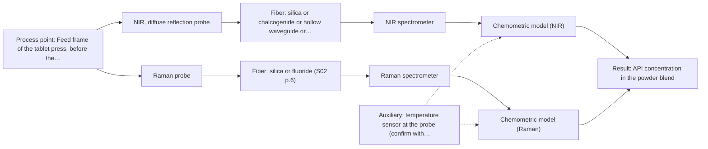
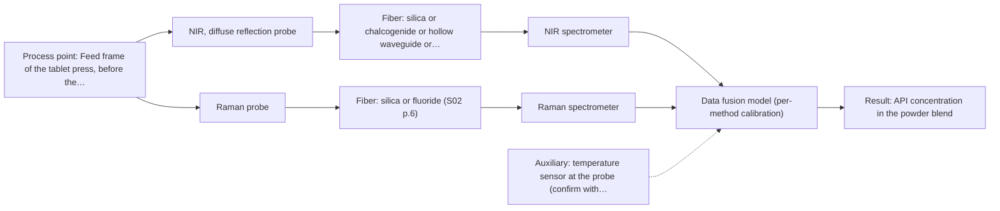

# First technical assessment: Blend potency in a tablet press feed frame

## Answer

**Customer request:** We manufacture tablets from a powder blend containing an active pharmaceutical ingredient and excipients. Laboratory checks tell us whether the blend is on target, but results arrive after the material has moved through the press. We want to assess whether a fiber based measurement in the feed frame could follow API concentration changes. Our first pilot should compare reasonable measurement options before we commit to production equipment.

### Brief answer

Test NIR diffuse reflection first: it suits an opaque scattering powder and is the geometry used with a NIR reflection probe in a published tablet-press feed-frame example. Raman is the second single method worth measuring, because it sees different molecular information. Whether either single method can follow your API concentration changes at your required precision is still open; the pilot needs representative blends, independent reference values and your own acceptance criteria.

### Proposal

- **Best current option:** O2 (recommended)
- **Basis:** supplied AFS sources
- **What would change it:** If the API has a strong, selective NIR response and the required precision is modest, the single-method NIR option (O1) is enough; if neither single method reaches the required precision, the fused option (O3) becomes the next test.
- **Next step:** Run the representative-sample pilot with NIR diffuse reflection and Raman probes against independent reference values, then decide the feed-frame trial.

**Secondary evidence (external, not AFS material):** G1: E01 ¶12; G2: E04 ¶1, E03 ¶16; G3: E04 ¶1; G4: no usable external source found. See Expert detail.

**Decision status:** Provisional feasibility assessment

### Solution options

| ID | Tier | Methods | Confidence | Cost class, S01 Table 1 (p.6) | Ease of use | Maintenance | Performance fit | Sources |
|---|---|---|---|---|---|---|---|---|
| O1 | Simple | M1 NIR, diffuse reflection probe | Medium: open question: Q1 (starts at Medium) | average cost (row 8) | One probe, one spectrometer, simple mounting | Single calibration block; window cleaning only | Lowest effort test of the main question | [1: REF §5] [2: S01 p.5] [3: S01 p.15] |
| O2 | Recommended | M1 NIR, diffuse reflection probe; M2 Raman probe | Medium: open question: Q1, Q2 (starts at Medium) | high cost (rows 8, 12) | Two probes or one port; two models | Two calibrations and two instrument checks | Compares both methods and picks the better | [4: S01 p.15] [1: REF §5] [2: S01 p.5] [3: S01 p.15] [5: S01 p.11] |
| O3 | Extended (multi-method) | M1 NIR, diffuse reflection probe; M2 Raman probe; M3 NIR, diffuse reflection probe + Raman (combination) | Low: open question: Q1, Q2 (starts at Medium); multi-method, fusion benefit not yet shown | high cost (rows 8, 12) | Two instruments to align and run | Per-block calibration; drift in either breaks fusion | Highest information, only if singles fall short | [6: S01 p.15] [7: S01 p.8] [1: REF §5] [2: S01 p.5] [3: S01 p.15] [4: S01 p.15] [5: S01 p.11] [8: S01 p.15] [9: REF §5] |

*Confidence rates the basis of the advice (how much is known and cited), not a predicted accuracy or probability of success. It starts at High, or at Medium when a key question on the method or the option is open, and drops one level per weakness listed (floor Low).*

*Cost class is the relative rating in S01 Table 1 (p.6) for the in-line method+technique rows named (the highest one for a multi-method option); it is not a price.*

### Setup sketch

*Recommended option O2; drawn by code from the option, a schematic, not a configuration.*

### Key questions

1. What is the API, over what concentration range does it vary in the blend, and what is the smallest concentration change the measurement must detect?
2. Does the blend fluoresce at the Raman excitation wavelength you would use, and is a Raman signal from the API or excipients expected?
3. Which reference laboratory method measures the API content, and what accuracy, precision and response time must the in-line result meet?

## Expert detail

**Customer enquiry**

> We manufacture tablets from a powder blend containing an active pharmaceutical ingredient and excipients. Laboratory checks tell us whether the blend is on target, but results arrive after the material has moved through the press. We want to assess whether a fiber based measurement in the feed frame could follow API concentration changes. Our first pilot should compare reasonable measurement options before we commit to production equipment.

**Decision status:** Provisional feasibility assessment. A shortlist can be justified from the sources: NIR diffuse reflection first, Raman as the second single method, and their combination only as a later hypothesis. The customer's expectation that an in-line fiber measurement can follow API concentration changes is supported by a published feed-frame example, not by proof for this blend, and the API, the required precision and the feed-frame installation are still unknown.

### Parameters

| ID | Parameter | Kind | Need | Measured by | Why | Sources |
|---|---|---|---|---|---|---|
| P1 | API concentration in the powder blend | quantitative | required | Spectroscopy: NIR | It is the target variable the customer wants to follow in-line. | *(no verified source: engineering judgement)* |
| P2 | Blend moisture content | quantitative | required | Reference lab method: loss on drying or Karl Fischer titration | Water gives -OH overtone bands in the same NIR region as the API signal, so it must be known as a reference variable. | [10: S01 p.10] |
| P3 | Blend particle size and bulk density | quantitative | optional | Reference lab method: particle size analysis and bulk density | They set the scattering background in diffuse reflection and can mimic a concentration change; they should be available for the reference samples. | [11: REF §5] |
| P4 | Powder temperature at the measurement point | quantitative | optional | Auxiliary sensor: temperature sensor at the probe (engineering judgement: confirm availability with AFS) | Temperature shifts hydrogen-bonded NIR bands and the probe baseline; it should be available and logged during the trial. | *(no verified source: engineering judgement)* |

### Solution option details

- **O1 cost drivers:** One spectrometer and probe, method development and pilot time
- **O2 cost drivers:** Two spectrometers and probes, two calibrations, pilot time
- **O3 cost drivers:** Two spectrometers, combined probe, fusion modelling and synchronisation
- **O3 combining methods:** Fusion level: one calibration per method first, then the synchronised NIR and Raman blocks concatenated into a single matrix with block scaling so that neither method dominates. Both probes must look at the same small powder volume in the feed frame; if they cannot share one window, the fused model is not meaningful. The fused model must beat the best single method on held-out batches, otherwise the second instrument is dropped.

*Extended (multi-method) option O3; drawn by code from the option, a schematic, not a configuration.*

### Premise check

- **Precedent only:** A fiber-based measurement in the feed frame can follow API concentration changes. A published example inserts NIR and Raman probes into a tablet-press feed frame and reports API potency prediction; this is a reason to test the method for this blend, not proof that it works here. [3: S01 p.15] [12: S01 p.15]
- **Supported:** A first pilot comparing reasonable measurement options is the right step before committing to production equipment. The source states that testing several optical approaches is the way to select the most suitable method or combination of methods when the sample composition is incompletely known. [13: S01 p.3]

### Requirements

**Stated by the customer**

- not in schema

**Key unknowns**

- API identity, its NIR/Raman spectral response, its concentration range and the smallest change that must be detected.
- Required accuracy, precision and response time, and the reference laboratory method that defines the target.
- Fluorescence background and usable Raman signal of the blend at the planned excitation wavelength.
- Feed-frame access and mounting: port or window, powder velocity, temperature, atmosphere, contact allowed.
- Blend particle size, flow and segregation behaviour at the measurement point.
- Blend moisture content and how much it varies.

### Clarification questions (most decision-relevant first)

Q1. What is the API, over what concentration range does it vary in the blend, and what is the smallest concentration change the measurement must detect? *Why it matters:* This decides whether NIR or Raman bands carry enough information and how sensitive the calibration must be. *(affects: method)*
Q2. Does the blend fluoresce at the Raman excitation wavelength you would use, and is a Raman signal from the API or excipients expected? *Why it matters:* A strong fluorescence background decides whether Raman (M2) is a usable second method at all. *(affects: technique, M2)*
Q3. Which reference laboratory method measures the API content, and what accuracy, precision and response time must the in-line result meet? *Why it matters:* These are the go/no-go numbers for the pilot, and they come from you, not from the sources. *(affects: status)*
Q4. How can a probe be mounted in the feed frame - is there a window or port, what are the powder velocity, temperature and atmosphere, and is contact with the moving powder acceptable? *Why it matters:* Mounting and contact conditions decide whether a diffuse-reflection probe can be used at all and where it sits. *(affects: installation)*
Q5. What are the cleaning, changeover and fouling constraints at the feed frame? *Why it matters:* They set the probe-window material, sealing and the maintenance interval for the pilot. *(affects: installation)*

### Recommendation

- **M1 · Primary candidate: NIR, diffuse reflection probe.** NIR diffuse reflection suits scattering powders and is the method used with a NIR reflection probe in the published tablet-press feed-frame example. Its bands are broad and overlapping, so a chemometric calibration is required. *Conditions:* Applies if the blend can be presented reproducibly to a probe window in the feed frame and the API has a measurable NIR response. [1: REF §5] [2: S01 p.5] [3: S01 p.15]
- **M2 · Comparison candidate: Raman probe.** Raman reports the molecular backbone and symmetric non-polar groups, information complementary to NIR, and the same published example used it beside NIR in a feed frame. The weak Raman signal and a possible fluorescence background are the main points to check on your blend. *Conditions:* Applies if the blend gives a Raman signal above the fluorescence background at the chosen excitation wavelength. [4: S01 p.15] [5: S01 p.11]
- **M3 · Comparison candidate: NIR, diffuse reflection probe + Raman (combination).** A fused NIR + Raman model is a hypothesis: the published example reports better API potency prediction than single-method models, but that gain has not been shown for this blend. It is a later test against the best single method, not a replacement for the single-method runs. *Conditions:* Only after the single-method tests, and only if neither single method reaches the required precision; both methods must sample the same small powder volume. [8: S01 p.15] [9: REF §5] Later hypothesis, after single-method tests.
- **M4 · Not recommended: MIR, ATR probe.** MIR-ATR is a common choice for pharmaceutical liquids and pastes, but ATR needs a tight contact with liquid or soft solid samples, which a flowing dry powder blend does not provide. [14: S04 p.4]

### Measurement concept

- **Probe and geometry:** A diffuse-reflection fiber probe looking at the powder through a window in the feed frame, flush-mounted so the flowing blend passes the measurement spot; a non-contact variant would keep a fixed standoff. For the fused option both methods must view the same small area.
- **Location:** Feed frame of the tablet press, before the dies, at a point where the blend is moving and mixed.
- **Fiber link:** Silica fibers cover the NIR and Raman ranges, which allows the spectrometers to sit away from the press; achievable link length and probe design are open questions for AFS. [15: S01 p.17] [16: S01 p.8] [17: S01 p.5]

### Spectral range

- **NIR:** Nominal NIR range 780-2500 nm; the usable range depends on the instrument, fiber and probe actually selected. [18: S01 p.10] [19: REF §5]
- **Raman:** Report Raman as Raman shift in cm-1, with the laser excitation wavelength stated separately; the published pharma example uses 785 nm excitation. Usable range again depends on the selected instrument, fiber and probe. [20: S01 p.11] [21: S01 p.15]

### Risks and uncertainty

- The API may have no distinctive NIR or Raman response at the concentrations of interest, and NIR may lack the sensitivity to detect trace compounds below 0.1 percent. *(rules: R-NIR-4)* [22: S01 p.16]
- Powder flow, segregation and surface scatter at the probe window can change the spectrum without any change in API content. *(rules: R-GEO-6, R-GEN-5)* [23: S01 p.7]
- The calibration is matrix-specific, so a model built on one blend, particle-size distribution or excipient source may not transfer. *(rules: R-CAL-1)* [24: REF §5]
- The Raman signal may be swamped by fluorescence from the API or the excipients. *(rules: R-RAM-1)* [5: S01 p.11]

### First feasibility experiment

1. **Assemble a representative sample set: several API levels around the target, the extremes of particle size and moisture expected in production, and at least two blend lots or batches.** Cover the chemical and physical variation the model must survive. [25: REF §3]
2. **Measure every sample independently with the customer's reference laboratory method for API content, plus moisture and particle size, so that each spectrum has a known value.** Independent reference data for calibration and validation. *(no verified source: engineering judgement)*
3. **Acquire NIR diffuse-reflection spectra and Raman spectra of the same samples separately, with repeated measurements per sample and a fixed presentation (packed powder, controlled probe distance).** Single methods first, on the same materials. *(no verified source: engineering judgement)*
4. **Build one calibration per method and validate on held-out batches or runs; only then concatenate the synchronised, block-scaled NIR and Raman data into a fused model and compare it with the best single method.** Test whether fusion adds anything before committing to two instruments. [26: S01 p.8] [27: REF §5]
5. **Transfer the winning method to the feed frame for an in-line trial: compare in-line predictions with reference samples taken at the probe, and apply the customer's own accuracy, precision and response-time criteria as the go/no-go basis.** Confirm the method works on the moving powder, not only on prepared samples. *(no verified source: engineering judgement)*

**Reference measurements:** API content, moisture and particle size by the customer's laboratory methods.

**Decision basis:** The customer's acceptance numbers applied to predictions on held-out batches and to the feed-frame trial; no source supplies a detection limit or accuracy figure for this application.

### Assumptions

- The powder blend can be presented reproducibly to a probe window in the feed frame.
- The API or excipients give a measurable NIR response and, if Raman is tested, a signal above the fluorescence background.
- The customer's laboratory method gives a reference value with an uncertainty small enough to build a model against.

### Not covered by the supplied sources

- Achievable detection limit and accuracy for API concentration in a powder blend - no source gives a figure for this kind of application.
- The geometry and mounting of a probe in the customer's specific feed frame; the sources show a probe designed for a tablet-press feed frame, not for this press.
- Regulatory or PAT qualification requirements for an in-line API measurement are not covered.

### Further notes

- **Chemometrics:** Quantitative calibration (for example PLS regression) of NIR and, if tested, Raman spectra against the reference API values; the model is matrix-specific and must be validated on held-out batches or runs before it is trusted.
- **Real-time tracking:** The in-line aim is continuous, time-resolved tracking of the blend at the feed frame, with spectra captured while the powder flows; if two methods are fused, their data must be brought to a common time step.
- **Future direction:** If the pilot identifies a small set of informative wavelengths, a compact LED-based or multisensor version of the measurement could be developed later for routine use.

### Secondary evidence (external, not AFS material)

*Found by a literature search for gaps the supplied AFS sources leave open. Not AFS material and not proof for this case; every quote below was verified verbatim against the fetched text.*

**G1 · auxiliary sensor:** In-line measurement of Powder temperature at the measurement point with temperature sensor at the probe

- **E01 ¶12** Temperature sensitivity of the OH bands in NIR and MIR can be a severe drawback for measuring aqueous solution, making tempered sample holders necessary. *How it applies:* This suggests that temperature control or measurement may be important for NIR/MIR measurements, so consider monitoring temperature at the probe. *Limits and transfer risks:* The quote concerns aqueous solution and tempered sample holders, not powder or an in-line probe; transfer to a powder feed frame is uncertain. *(supports O2)*
  > "Additionally, the temperature sensitivity of the OH bands is a severe drawback for measuring aqueous solution in NIR and MIR, which makes tempered sample holders necessary [29]."
  > A critical review of recent trends, and a future perspective of optical spectroscopy as PAT in biopharmaceutical downstream processing. (2020) · Analytical and bioanalytical chemistry · doi:10.1007/s00216-020-02407-z · https://europepmc.org/article/PMC/PMC7072065 · retrieved 2026-10-17, full text, licence: cc by, via curated library

**G2 · multi-method:** Combining several spectroscopy methods (data fusion) (Fusion level: one calibration per method first, then the synchronised NIR and Raman blocks concatenated into a single matrix with block scaling so that neither method dominates. Both probes must look at the same small powder volume in the feed frame; if they cannot share one window, the fused model is not meaningful. The fused model must beat the best single method on held-out batches, otherwise the second instrument is dropped.)

- **E04 ¶1** The source explored low-level data fusion by concatenating preprocessed NIR and Raman spectra, and also evaluated mid-level data fusion using extracted features. *How it applies:* This supports testing low-level and mid-level fusion for NIR and Raman in a feed-frame application, while checking whether fusion improves performance over single methods. *Limits and transfer risks:* Abstract only; the study used a specific formulation and instrument, and gives no geometry or mounting details for the customer's feed frame. *(supports O3)*
  > "For model development and validation, low-level data fusion was explored through concatenation of preprocessed NIR and Raman spectra. Mid-level data fusion was also evaluated, based on extracted features of the preprocessed data."
  > Evaluating the Improvement of Blend Potency Measurements in the Feed Frame of a Rotary Tablet Press Using Combined NIR and Raman Spectroscopy. (2024) · Analytical chemistry · doi:10.1021/acs.analchem.4c01134 · https://europepmc.org/article/MED/38887018 · retrieved 2026-10-17, abstract only, licence: unknown, via europepmc
- **E03 ¶16** Block scaling is often recommended for data fusion but can sometimes have a worse effect on results than other preprocessing methods. *How it applies:* When planning block scaling for NIR/Raman fusion, test alternative preprocessing and validate whether scaling helps or harms the fused model. *Limits and transfer risks:* The quote is from a review context and is not specific to powder blends or NIR/Raman; no scale or in-line details are given. *(supports O3)*
  > "While block scaling is often recommended for data fusion, sometimes it can have a worse effect on results than other pre-processing methods (17)."
  > Spectroscopic technologies and data fusion: Applications for the dairy industry. (2022) · Frontiers in nutrition · doi:10.3389/fnut.2022.1074688 · https://europepmc.org/article/PMC/PMC9875022 · retrieved 2026-10-17, full text, licence: cc by, via curated library

**G3 · not in the supplied sources:** Achievable detection limit and accuracy for API concentration in a powder blend - no source gives a figure for this kind of application.

- **E04 ¶1** Calibration models for 1 and 5% w/w label claim tablets were developed using NIR and Raman spectra of powder blends ranging from 0.75 to 1.25% w/w and 3.75 to 6.25% w/w API, respectively. *How it applies:* This gives concentration ranges studied for NIR and Raman in a feed frame, but it does not provide a detection limit or accuracy figure for the customer's application. *Limits and transfer risks:* Abstract only; the formulation and instrument are specific, and no accuracy or detection limit is reported. *(supports O2)*
  > "Calibration models for the determination of 1 and 5% w/w label claim tablets were developed using NIR and Raman spectra of powder blends ranging from 0.75 to 1.25% w/w and 3.75 to 6.25% w/w API, respectively."
  > Evaluating the Improvement of Blend Potency Measurements in the Feed Frame of a Rotary Tablet Press Using Combined NIR and Raman Spectroscopy. (2024) · Analytical chemistry · doi:10.1021/acs.analchem.4c01134 · https://europepmc.org/article/MED/38887018 · retrieved 2026-10-17, abstract only, licence: unknown, via europepmc

**G4 · not in the supplied sources:** The geometry and mounting of a probe in the customer's specific feed frame; the sources show a probe designed for a tablet-press feed frame, not for this press.

- No usable external source found.

### Evidence (verified quotes)

1. ✓ **REF §5** (general): "Powders, dairy. Diffuse reflection for scattering samples; transmission or transflection for clear liquids."
2. ✓ **S01 p.5** (general): "NIR spectroscopy, with its relatively large penetration depth (up to several millimetres) even into dense solid samples due to low absorption and strong scattering, allows the use of ordinary glass for optics"
3. ✓ **S01 p.15** (application precedent): "the probes are inserted directly into the process environment, such as the feed frame of a rotary tablet press."
4. ✓ **S01 p.15** (general): "NIR detects hydrogen bonds and asymmetric polar groups, while Raman provides information on the molecular backbone and symmetrical non-polar groups."
5. ✓ **S01 p.11** (general): "superposition of luminescence (fluorescence), which has a significantly higher intensity."
6. ✓ **S01 p.15** (general): "Data processing for pharmaceutical tasks relies on "low-level data fusion," where the synchronized NIR and Raman spectra are merged into a single augmented matrix."
7. ✓ **S01 p.8** (general): "data synchronization can be challenging, as the acquisition rates of different spectra can vary greatly-from milliseconds to minutes"
8. ✓ (precedent only) **S01 p.15** (method gain): "By combining Raman and NIR, these models can predict API potency or coating thickness with higher accuracy and robustness than single-method models."
9. ✓ (precedent only) **REF §5** (method gain): "Sampling location and timing must be aligned; a gain is a hypothesis to test."
10. ✓ **S01 p.10** (general): "NIR spectra (780-2500 nm) contain predominantly overtones and component bands of fundamental vibrations of molecules and atomic groups"
11. ✓ **REF §5** (general): "Overlapping bands, physical variation; calibration specific to the matrix."
12. ✓ **S01 p.15** (application precedent): "NIR spectrometer and light source coupled with a NIR reflection probe"
13. ✓ **S01 p.3** (general): "The ability to test various optical spectroscopy approaches is crucial for solving complex analytical problems, such as analyzing natural and industrial samples of incompletely known composition, in order to select the most suitable method or combination of methods."
14. ✓ **S04 p.4** (general): "suitability of analyzed samples for ATR measurements, which is true for liquid or soft solid samples and their components, allowing a tight contact with the probe head."
15. ✓ **S01 p.17** (application precedent): "the probe is flush-mounted into a pipe or vat to interact directly with the flowing medium."
16. ✓ **S01 p.8** (general): "It is crucial that the spectral information obtained by different methods-Mid-IR, NIR, Raman, and fluorescence spectra-is collected from the same small, even pinpoint, area of the sample."
17. ✓ **S01 p.5** (general): "making it ideal for online applications, including remote measurements via fiber optic probes."
18. ✓ **S01 p.10** (general): "NIR spectra (780-2500 nm)"
19. ✓ **REF §5** (general): "It is not a product specification: actual spectral coverage, fiber length, component ratings, detection limits and accuracy depend on the configuration and the sample."
20. ✓ **S01 p.11** (general): "The Raman shift is used as the horizontal (spectral) axis in Raman spectroscopy"
21. ✓ **S01 p.15** (application precedent): "Raman spectrometer and Raman fiber probe for contact measurements with 785 nm excitation wavelength"
22. ✓ (precedent only) **S01 p.16** (performance figure): "may lack the sensitivity to detect trace compounds below 0.1 percent."
23. ✓ **S01 p.7** (general): "Morphological factors, such as sample inhomogeneity (e.g., biological tissue) or process turbulence, must also be considered when selecting a measurement technique."
24. ✓ **REF §5** (general): "calibration specific to the matrix."
25. ✓ **REF §3** (general): "Representative samples or process states, independent reference measurements, what is compared, and the basis for the go / no-go decision."
26. ✓ **S01 p.8** (general): "If the variables have different units of measurement, the data should be normalized in some way, for example, using an autoscaling algorithm."
27. ✓ **REF §5** (general): "compare with the best single method."

### Verification

- Citations verified: 30 of 30 (exact or whitespace/hyphen-tolerant match on the cited page, scope checked).
- Hard check failures before deterministic corrections: 0; still open: 0; soft warnings: 3; repair rounds: 1.
- External evidence (live): 4 quote(s) verified verbatim (exact or whitespace/hyphen-tolerant, at most 400 characters and 2 sentences, against the cited paragraph); 0 item(s) dropped.
- External search: 6 query(ies), 45 hit(s), 5 source(s) (3 from the curated library).
- External step: 2 model call(s), 70.7 s extra (cost in the run JSON).

*Run D01-20261017T222314Z · models deepseek/deepseek-v4.1-flash*
