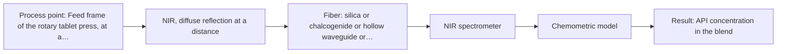
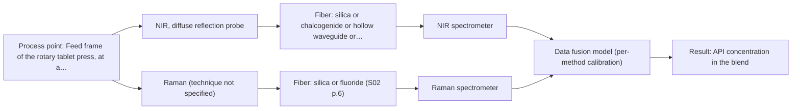

# First technical assessment: Blend potency in a tablet press feed frame

# Answer

**Customer request:** Customer manufactures tablets from a powder blend containing an active pharmaceutical ingredient and excipients. They want to assess whether a fiber based measurement in the feed frame could follow API concentration changes, with a first pilot comparing measurement options before production equipment.

## Brief answer

For a powder blend in a tablet-press feed frame, test NIR diffuse reflection first, with Raman measured on the same port as the comparison; a published pharmaceutical example used exactly this feed-frame setup. NIR and Raman can later be fused if neither single method reaches your accuracy target. What is still open is the API's spectral signature, your required accuracy and update rate, and the probe access in the feed frame.

## Proposal

- **Best current option:** O2 (recommended): M2 NIR, diffuse reflection at a distance
- **Basis:** supplied AFS sources
- **What would change it:** If the API or an excipient turns out to be strongly fluorescent, or the API has no usable NIR signature, Raman moves to the front and the combined option becomes necessary. If NIR alone meets your accuracy target in the pilot, the combined option is dropped.
- **Next step:** Confirm the API identity, the concentration range, the accuracy and update-rate targets and the reference method, then run NIR reflection and Raman on the same feed-frame port.

**Decision status:** Provisional feasibility assessment. A shortlist can be justified because a published pharmaceutical example measures blend potency directly in the feed frame of a rotary tablet press with fiber NIR and Raman probes, and for an opaque powder only NIR reflection is suitable in-line. The API's spectral signature, the required accuracy and the feed-frame access are still unknown, so the method choice stays provisional and must be confirmed in a pilot.

## Solution options

| ID | Tier | Methods | Confidence | Cost class, S01 Table 1 (p.6) | Ease of use | Maintenance | Performance fit | Sources |
|---|---|---|---|---|---|---|---|---|
| O1 | Simple | M1 NIR, diffuse reflection probe | High | average (row 8) | One spectrometer, one probe, one calibration model. | Clean the probe window and re-check the calibration periodically. | Least hardware that still answers the pilot question. | [1: S01 p.15] |
| O2 | Recommended | M2 NIR, diffuse reflection at a distance | High | average (row 10) | Single method, but a longer fiber link has to be routed. | Clean the probe window; check the fiber link and re-calibrate after a probe change. | Keeps the spectrometer off a dusty, vibrating press while measuring in the feed frame. | [2: S01 p.15] |
| O3 | Extended (multi-method) | M3 NIR, diffuse reflection probe + Raman (combination) | Medium: multi-method, fusion benefit not yet shown | average (row 8); not rated in S01 Table 1: Raman (technique not specified) | Two instruments to align, synchronise and run together. | Two calibrations and two sets of instrument diagnostics to keep current. | Adds Raman's molecular-backbone information where NIR alone is not enough. | [3: S01 p.15] |

*Confidence rates the basis of the advice (how much is known and cited), not a predicted accuracy or probability of success. It starts at High and drops one level per weakness listed.*

*Cost class is the relative rating in S01 Table 1 (p.6) for the in-line method+technique rows named (the highest one for a multi-method option); it is not a price.*

## Setup sketch

*Recommended option O2; drawn by code from the option, a schematic, not a configuration.*

*Extended (multi-method) option O3; drawn by code from the option, a schematic, not a configuration.*

# Expert detail

**Customer enquiry**

> We manufacture tablets from a powder blend containing an active pharmaceutical ingredient and excipients. Laboratory checks tell us whether the blend is on target, but results arrive after the material has moved through the press. We want to assess whether a fiber based measurement in the feed frame could follow API concentration changes. Our first pilot should compare reasonable measurement options before we commit to production equipment.

## Parameters

| ID | Parameter | Kind | Need | Measured by | Why | Sources |
|---|---|---|---|---|---|---|
| P1 | API concentration in the blend | quantitative | required | Spectroscopy: NIR | It is the target the customer wants to follow in-line. | [4: S01 p.14] |
| P2 | Blend moisture | quantitative | optional | Reference lab method: loss on drying | Water absorbs in the NIR region, so moisture variation can shift the reflection signal and be mistaken for an API change; it should be available alongside the API readings so the model can account for it. | *(no verified source: engineering judgement)* |
| P3 | Particle size and bulk density of the blend at the probe | quantitative | optional | Reference lab method: particle size distribution and bulk density by the site's standard laboratory methods | NIR diffuse reflection is sensitive to scattering, so a change in particle size or packing can look like a concentration change; it should be available so scatter effects can be separated from chemistry. | *(no verified source: engineering judgement)* |

## Solution option details

- **O1 cost drivers:** One NIR spectrometer, one feed-frame reflection probe, reference analyses for the calibration.
- **O2 cost drivers:** One NIR spectrometer, fiber link and feed-frame probe, reference analyses for the calibration.
- **O3 cost drivers:** Two spectrometers, two probes or one combined head, synchronisation effort and two calibrations.
- **O3 combining methods:** Low-level fusion: the synchronised NIR reflection and Raman spectra are merged into one augmented matrix with block scaling, so neither block dominates the model. Both probes must look at the same powder at the same feed-frame port, and the two acquisition rates have to be aligned to a common time step. Each instrument keeps its own calibration and diagnostics, and the fused model must beat the best single-method model on held-out runs before the extra instrument is kept.

## Premise check

- **Precedent only:** A fiber based measurement in the feed frame may be able to follow API concentration changes. A published example inserts NIR reflection and Raman probes into the feed frame of a rotary tablet press to follow blend potency. That is a reason to test the approach on your blend, not proof that it will work for your API, matrix and press. [5: S01 p.15]
- **Supported:** A first pilot should compare reasonable measurement options before production equipment is committed. The supplied material states that testing several optical approaches is the way to choose the most suitable method or combination of methods, which matches a comparison pilot before a purchase decision. [6: S01 p.3]

## Requirements

**Stated by the customer**

**Key unknowns**

- API identity, its concentration range, and the accuracy or detection limit the measurement must reach.
- Excipient composition, and whether the API or any excipient fluoresces (this decides whether Raman is usable).
- Feed-frame geometry and access: where a probe can be mounted, the distance to the powder, and flow, dust and vibration there.
- The reference laboratory method, and whether a reference sample can be taken at the same point and time as the spectral measurement.
- Normal variation of particle size, moisture, bulk density and temperature of the blend.
- The pilot's success criteria, the required update rate, and the budget or timeline.

## Clarification questions (most decision-relevant first)

## Recommendation

- **M1 · Primary candidate: NIR, diffuse reflection probe.** NIR diffuse reflection is the natural first method for an opaque powder: the fiber probe sits in the flowing blend without sampling, and NIR reflection is the technique used for in-line blend monitoring in a tablet-press feed frame. The broad, overlapping NIR bands mean the result comes from a chemometric calibration, not from a single peak. *Conditions:* Applies if the API has a usable NIR signature that is not buried under the excipient and moisture bands. [7: S01 p.15] [8: S01 p.10]
- **M2 · Comparison candidate: NIR, diffuse reflection at a distance.** The same NIR reflection method with a fiber link that keeps the spectrometer away from the press; on a tablet press this is the practical installation, and one instrument could later serve more than one measuring point. It is listed separately from M1 because the fiber link and the probe position are what differ, not the chemistry. *Conditions:* Applies if the feed frame cannot host a spectrometer at the press because of dust, vibration or lack of space. [9: S01 p.15]
- **M3 · Comparison candidate: NIR, diffuse reflection probe.** NIR and Raman carry complementary information, and a published feed-frame study merged synchronised NIR and Raman spectra into one matrix and reported better accuracy and robustness than single-method models. For your blend the gain is still a hypothesis and must be shown against the best single method. *Conditions:* Applies only if the single-method NIR and Raman tests do not reach your accuracy target. [10: S01 p.15] [11: S01 p.15] Later hypothesis, after single-method tests: combine with Raman.
- **M4 · Not recommended: MIR, ATR probe.** A dry powder blend cannot give the tight contact an ATR crystal needs, and mid-IR light cannot be carried by the silica fibers used for NIR or Raman. It is named here because in-line MIR-ATR is a common expectation in pharmaceutical process work, but it is not an option for this sample. [12: S04 p.4]

## Measurement concept

- **Probe and geometry:** A fiber probe looking into the flowing powder in the feed frame: NIR diffuse reflection first (contact or near-contact with the powder surface), Raman on the same port as the comparison.
- **Location:** Feed frame of the rotary tablet press, at a point where the blend passes the probe tip.
- **Fiber link:** Silica fibers carry both NIR and Raman; the spectrometer can sit away from the press. A longer link is a configuration question for AFS, not a value to assume. [13: S01 p.15]

## Spectral range

- **NIR:** NIR spectra (780-2500 nm) contain predominantly overtones and component bands of fundamental vibrations of molecules and atomic groups. The usable range depends on the instrument, fiber and probe actually selected. [14: S01 p.10]
- **Raman:** Raman is reported as Raman shift (cm-1) with the laser excitation wavelength stated separately; the feed-frame example uses 785 nm excitation. [15: S01 p.15]

## Risks and uncertainty

- Physical variation of the powder (particle size, packing, moisture) can change the NIR reflection signal and be read as an API change. *(rules: R-GEO-6, R-CAL-1)* [16: S01 p.17]
- Raman may be unusable if the API or an excipient fluoresces strongly and swamps the weak Raman signal. *(rules: R-RAM-1)* [17: S01 p.11]
- NIR may lack the sensitivity if the API sits at trace level in the blend. *(rules: R-NIR-4)* [18: S01 p.16]
- Fouling or dust on the feed-frame window changes the signal, and a calibration built on the pilot blend must be re-validated after any change of composition. *(rules: R-MIR-3, R-CAL-1)* [19: REF §5]

## First feasibility experiment

1. **Measure a representative set of blend states across the expected API concentration and physical variation with NIR reflection at the feed-frame port.** Cover the chemical and physical variation the model must survive. [20: REF §3]
2. **Give every spectrum an independent API value from your own laboratory method, taken at the same point and time.** Give every spectrum an independent API value from your own laboratory method, taken at the same point and time. *(no verified source: engineering judgement)*
3. **Test the single methods first, on the same feed-frame port, each with its own calibration.** Test the single methods first, on the same feed-frame port, each with its own calibration. [21: S01 p.15]
4. **Only if a single method misses the target, build the combined NIR and Raman model and compare it with the best single method on held-out runs.** Only if a single method misses the target, build the combined NIR and Raman model and compare it with the best single method on held-out runs. [22: S01 p.15]
5. **Decide go/no-go on your own numbers for API concentration accuracy and repeatability, update rate and covered concentration range.** Decide go/no-go on your own numbers for API concentration accuracy and repeatability, update rate and covered concentration range. [23: REF §3]

**Reference measurements:** The existing laboratory blend-potency assay, on samples taken at the same point and time as the spectral measurement.

**Decision basis:** The customer's own accuracy, repeatability, update-rate and range targets; these are not in the supplied material and must be stated before the pilot.

## Assumptions

- The blend is optically opaque and scattering, as a typical tablet powder blend is.
- The API and excipients are chemically compatible with a fiber probe in the feed frame (no aggressive or sticky behaviour assumed).
- The reference laboratory assay can be tied to a specific sampling time and point.

## Not covered by the supplied sources

- No supplied source states an accuracy, detection limit or response time for API concentration measured in a tablet-press feed frame; the pilot targets must come from your process requirements.

## Further notes

- **Chemometrics:** NIR and Raman give quantitative results only through a calibration built on your own blend and reference values, and such a calibration is specific to the matrix, so it must be re-validated after a change of API grade, excipient supplier or blend composition. A fused NIR and Raman model is built by merging the synchronised spectra into one augmented matrix (low-level fusion) and needs enough independent reference samples per concentration level to avoid overfitting.
- **Real-time tracking:** The feed-frame probe measures the flowing blend continuously, so each reading can be time-stamped against the press. The acquisition rate and averaging window of each method must be fixed, and aligned if two methods run together, because the blend composition changes as the powder moves through the feed frame.
- **Future direction:** Once one method is proven, the same fiber link could feed a compact multisensor or LED-based analyzer at the press, or one spectrometer could be multiplexed to several process points.

## Evidence (verified quotes)

1. ✓ **S01 p.15** (application precedent): "NIR spectrometer and light source coupled with a NIR reflection probe"
2. ✓ **S01 p.15** (general): "located safely away from the vibration and dust of the manufacturing floor."
3. ✓ **S01 p.15** (application precedent): "where the synchronized NIR and Raman spectra are merged into a single augmented matrix."
4. ✓ **S01 p.14** (application precedent): "the precise concentration and uniformity of the Active Pharmaceutical Ingredient (API)"
5. ✓ **S01 p.15** (application precedent): "the probes are inserted directly into the process environment, such as the feed frame of a rotary tablet press."
6. ✓ **S01 p.3** (general): "in order to select the most suitable method or combination of methods."
7. ✓ **S01 p.15** (application precedent): "NIR spectrometer and light source coupled with a NIR reflection probe"
8. ✓ **S01 p.10** (general): "The broad absorption bands observed in this region overlap, suggesting the use of chemometrics for quantitative and qualitative analysis of spectral data."
9. ✓ **S01 p.15** (general): "located safely away from the vibration and dust of the manufacturing floor."
10. ✓ **S01 p.15** (general): "The combination of these techniques is particularly effective because it captures complementary chemical information: NIR detects hydrogen bonds and asymmetric polar groups, while Raman provides information on the molecular backbone and symmetrical non-polar groups."
11. ✓ (precedent only) **S01 p.15** (method gain): "By combining Raman and NIR, these models can predict API potency or coating thickness with higher accuracy and robustness than single-method models."
12. ✓ **S04 p.4** (general): "suitability of analyzed samples for ATR measurements, which is true for liquid or soft solid samples and their components, allowing a tight contact with the probe head."
13. ✓ **S01 p.15** (application precedent): "the probes are inserted directly into the process environment, such as the feed frame of a rotary tablet press."
14. ✓ **S01 p.10** (general): "NIR spectra (780-2500 nm) contain predominantly overtones and component bands of fundamental vibrations"
15. ✓ **S01 p.15** (application precedent): "Raman spectrometer and Raman fiber probe for contact measurements with 785 nm excitation wavelength"
16. ✓ **S01 p.17** (general): "the method is sensitive to the surface characteristics and fat globule size."
17. ✓ **S01 p.11** (general): "superposition of luminescence (fluorescence), which has a significantly higher intensity."
18. ✓ **S01 p.16** (general): "may lack the sensitivity to detect trace compounds below 0.1 percent."
19. ✓ **REF §5** (general): "Usable range limited by fiber and crystal; contact, fouling, compatibility."
20. ✓ **REF §3** (general): "Representative samples or process states, independent reference measurements, what is compared, and the basis for the go / no-go decision."
21. ✓ **S01 p.15** (application precedent): "NIR spectrometer and light source coupled with a NIR reflection probe"
22. ✓ **S01 p.15** (application precedent): "where the synchronized NIR and Raman spectra are merged into a single augmented matrix."
23. ✓ **REF §3** (general): "Representative samples or process states, independent reference measurements, what is compared, and the basis for the go / no-go decision."

## Verification

- Citations verified: 23 of 23 (exact or whitespace/hyphen-tolerant match on the cited page, scope checked).
- Hard check failures before deterministic corrections: 0; still open: 0; soft warnings: 1; repair rounds: 1.
- Corrected deterministically after verification (1):
  - ⚠ recommendations[2].combined_with: combined_with normalised to ['Raman'] (duplicates and the entry's own method removed)

*Run D01-20261017T132214Z · models deepseek/deepseek-v4.1-flash*
