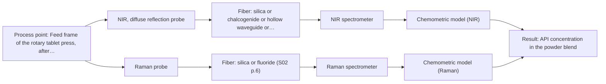

# First technical assessment: Blend potency in a tablet press feed frame

## Answer

**Customer request (our summary):** Customer wants to assess whether a fiber based measurement in the feed frame can follow API concentration changes in a powder blend during tablet manufacture.

### Brief answer

Test NIR diffuse reflection first: a fiber reflection probe in a tablet-press feed frame is a published example, and NIR is the most common in-line fiber method. Compare it with Raman, and keep a fused NIR+Raman probe as a later hypothesis. Still open: the API concentration range and required accuracy, the blend's fluorescence, and your reference assay.

### Proposal

- **Best current option:** O2 (recommended)
- **Basis:** engineering judgement
- **What would change it:** If a single method already meets the customer's accuracy and response-time criteria, O1 would be enough; if the API sits at very low concentration, if the blend fluoresces strongly, or if neither single method reaches the criteria, O3 becomes the better pilot.
- **Next step:** Answer Q1 to Q3 and Q4, then run the NIR-first measurements on reference-assayed blend samples before any production hardware is considered.

**Decision status:** Provisional feasibility assessment

### Solution options

| ID | Tier | Methods | Confidence | Cost class, S01 Table 1 (p.6) | Ease of use | Maintenance | Performance fit | Sources |
|---|---|---|---|---|---|---|---|---|
| O1 | Simple | M1 NIR, diffuse reflection probe | Medium: open question: Q1 (starts at Medium) | average cost (row 8) | One probe and one spectrometer | Probe cleaning and periodic recalibration | Least effort; answers the core API question | [1: S01 p.15] [2: S01 p.10] |
| O2 | Recommended | M1 NIR, diffuse reflection probe; M2 Raman probe | Medium: open question: Q1, Q2 (starts at Medium) | high cost (rows 8, 12) | Two standard probes, moderate setup | Two instruments and two calibrations | Compares both proven pharma methods in one pilot | [3: S01 p.15] [2: S01 p.10] [1: S01 p.15] [4: S01 p.11] |
| O3 | Extended (multi-method) | M3 NIR, diffuse reflection probe + Raman (combination) | Low: open question: Q1 (starts at Medium); multi-method, fusion benefit not yet shown | high cost (rows 8, 12) | Combined probe, more integration effort | Two calibrations, two instruments to service | Second chemical view if NIR alone falls short | [5: S01 p.15] [6: S01 p.8] [7: S01 p.9] [8: REF §5] [9: S01 p.15] |

*Confidence rates the basis of the advice (how much is known and cited), not a predicted accuracy or probability of success. It starts at High, or at Medium when a key question on the method or the option is open, and drops one level per weakness listed (floor Low).*

*Cost class is the relative rating in S01 Table 1 (p.6) for the in-line method+technique rows named (the highest one for a multi-method option); it is not a price.*

### Setup sketch

*Recommended option O2; drawn by code from the option, a schematic, not a configuration.*

### Key questions

1. What is the API, what concentration range does it cover in the blend, and what accuracy and response time must the in-line measurement reach?
2. Do the API, the excipients or the blend fluoresce under visible or near-infrared laser excitation?
3. How is the powder presented at the feed frame (flowing, packed, behind a window) and how much space and distance is available for a probe?

## Expert detail

**Customer enquiry**

> We manufacture tablets from a powder blend containing an active pharmaceutical ingredient and excipients. Laboratory checks tell us whether the blend is on target, but results arrive after the material has moved through the press. We want to assess whether a fiber based measurement in the feed frame could follow API concentration changes. Our first pilot should compare reasonable measurement options before we commit to production equipment.

**Decision status:** Provisional feasibility assessment. NIR diffuse reflection and Raman both fit a powder blend measured in a feed frame, and a published feed-frame example exists, but the API concentration range, the required accuracy, the fluorescence behaviour and the reference assay are still unknown, so the shortlist stays provisional.

### Parameters

| ID | Parameter | Kind | Need | Measured by | Why | Sources |
|---|---|---|---|---|---|---|
| P1 | API concentration in the powder blend | quantitative | required | Spectroscopy: NIR | It is the variable the customer wants to follow in-line instead of waiting for laboratory results. | [10: S01 p.14] |
| P2 | API content by the customer's laboratory assay | quantitative | required | Reference lab method: customer's existing laboratory assay for blend potency | An independent reference value is needed to calibrate the spectral model and to judge it on held-out runs. | [11: REF §3] |
| P3 | Moisture content of the blend | quantitative | optional | Spectroscopy: NIR | It should be available because water absorbs in the NIR region and a moisture shift could otherwise be read as a change in API concentration. | *(no verified source: engineering judgement)* |

### Solution option details

- **O1 cost drivers:** One NIR spectrometer, reflection probe, calibration work
- **O2 cost drivers:** Two spectrometers, two probes, two calibrations
- **O3 cost drivers:** Combined probe, two spectrometers, fusion modelling
- **O3 combining methods:** Fusion level: low-level data fusion, with the synchronised NIR and Raman spectra merged into a single augmented matrix and block scaling so that neither method dominates the model. Both signals must come from the same spot on the flowing powder through a combined probe, aligned to a common time step. Each method keeps its own calibration and diagnostics, and the fused model must beat the best single method on held-out runs before the second instrument is kept.

*Extended (multi-method) option O3; drawn by code from the option, a schematic, not a configuration.*

### Premise check

- **Precedent only:** A fiber based measurement in the feed frame could follow API concentration changes. A published pharmaceutical example inserts NIR reflection and Raman probes into the feed frame of a rotary tablet press and tracks blend potency, so this is a reason to test the approach, not proof that it works for this blend. [12: S01 p.15]
- **Supported:** A first pilot should compare reasonable measurement options before committing to production equipment. The concept paper states that testing several optical spectroscopy approaches is the way to choose a method when the sample composition is not fully known, which matches a comparative pilot before buying production equipment. [13: S01 p.3]
- **Not covered:** Laboratory checks tell them whether the blend is on target. The supplied material describes laboratory reference measurement in general terms only; it says nothing about this customer's assay, its accuracy, or whether it can serve as the independent reference for the pilot. *(no verified source: engineering judgement)*

### Requirements

**Stated by the customer**

- "We manufacture tablets from a powder blend"
- "containing an active pharmaceutical ingredient and excipients"
- "Laboratory checks tell us whether the blend is on target"
- "results arrive after the material has moved through the press"
- "fiber based measurement in the feed frame"
- "follow API concentration changes"
- "Our first pilot should compare reasonable measurement options before we commit to production equipment"
- "API concentration changes"

**Key unknowns**

- API identity and expected concentration range in the blend
- Required measurement accuracy and response time (the go/no-go criteria)
- Fluorescence behaviour of the blend under visible or near-infrared laser excitation
- Excipient composition and variation in moisture, particle size and bulk density
- How the powder is presented at the feed frame and the space available for a probe
- The customer's laboratory reference method and its accuracy

### Clarification questions (most decision-relevant first)

Q1. What is the API, what concentration range does it cover in the blend, and what accuracy and response time must the in-line measurement reach? *Why it matters:* The concentration range and required accuracy decide whether NIR reflection alone can meet the target or whether Raman or a combined measurement is needed. *(affects: method)*
Q2. Do the API, the excipients or the blend fluoresce under visible or near-infrared laser excitation? *Why it matters:* Strong fluorescence can swamp the Raman signal, which decides whether the Raman comparison is worth running at all. *(affects: M2)*
Q3. How is the powder presented at the feed frame (flowing, packed, behind a window) and how much space and distance is available for a probe? *Why it matters:* It fixes the measurement geometry and whether a flush-mounted, contact or remote probe can be fitted at the feed frame. *(affects: installation)*
Q4. What is your current laboratory reference method for blend potency, and what accuracy does it give? *Why it matters:* The reference method sets the calibration and validation basis, and therefore the go/no-go threshold for the pilot. *(affects: status)*
Q5. How much do moisture, particle size and bulk density vary within and between batches? *Why it matters:* These physical variations change NIR reflectance and can be mistaken for an API concentration change, so they must be covered by the calibration. *(affects: M1)*

### Recommendation

- **M1 · Primary candidate: NIR, diffuse reflection probe.** NIR is described as the most common online analysis method using fiber optic probes, and a NIR reflection probe in a tablet-press feed frame is a published example for blend potency. It is the single method to test first because it needs no fluorescent or laser-specific conditions. *Conditions:* Applies if the blend is a scattering powder that can be presented to a reflection probe in the feed frame. [2: S01 p.10] [1: S01 p.15]
- **M2 · Comparison candidate: Raman probe.** Raman is named with NIR as one of the most popular and widely implemented techniques in the pharmaceutical industry, so it is the natural second single method to compare in the same pilot. Its weak signal can be complicated by fluorescence, which has to be checked on the real blend. *Conditions:* Applies if the blend does not show a strong fluorescence background under the chosen laser excitation. [3: S01 p.15] [4: S01 p.11]
- **M3 · Comparison candidate: NIR, diffuse reflection probe + Raman (combination).** A combined NIR + Raman measurement is the published route to higher accuracy and robustness for API potency than single-method models, because the two methods see different chemical information. It is a later hypothesis to test against the best single method, not a first step. *Conditions:* Applies only if the single-method NIR and Raman tests do not reach the required accuracy. [9: S01 p.15] [6: S01 p.8] Later hypothesis, after single-method tests.
- **M4 · Not recommended: MIR, ATR probe.** ATR needs tight contact, which is true for liquid or soft solid samples, and a dry powder blend cannot be relied on to give that contact. MIR-ATR also samples only a very thin surface layer, so a representative bulk measurement of the blend is unlikely. [14: S04 p.4] [15: S01 p.5]

### Measurement concept

- **Probe and geometry:** Reflection probe in the feed frame, flush-mounted or in light contact with the flowing powder; a remote reflection variant if the probe cannot sit close to the process point.
- **Location:** Feed frame of the rotary tablet press, after the blender and before the dies.
- **Fiber link:** Silica Vis-NIR fibers carry the NIR light; a Raman fiber probe with its own laser carries the Raman signal. No source states an achievable link length for a Raman or MIR installation in this setting, so any length is an open question for AFS. [12: S01 p.15]

### Spectral range

- **NIR:** Nominal method range 780-2500 nm. The usable range depends on the spectrometer, fiber and probe actually selected: the fiber list shows that Vis-NIR silica fibers are available for this region, and their exact transmission limits have to be fixed with the chosen hardware. [16: S01 p.10] [17: S02 p.6]
- **Raman:** Raman is reported as Raman shift in cm-1, with the laser excitation wavelength stated separately; the pharmaceutical feed-frame example uses 785 nm excitation. The usable shift range depends on the spectrometer, laser and probe selected. [18: S01 p.11] [19: S01 p.15]

### Risks and uncertainty

- Powder flow, fill level and particle size can dominate the reflectance signal, so a change in the spectrum may come from the physical state rather than from API concentration. *(rules: R-GEO-6, R-GEN-5)* [20: S01 p.17]
- A calibration built on laboratory samples may not transfer to a production feed frame, because NIR and Raman calibrations are specific to the matrix and the physical state of the material. *(rules: R-CAL-1)* [21: REF §5]
- Fluorescence from the API or an excipient could swamp the Raman signal and rule out the Raman comparison at the chosen excitation wavelength. *(rules: R-RAM-1)* [4: S01 p.11]
- If the API sits at a low concentration, NIR may lack the sensitivity to follow the change, so the single-method result could be inconclusive. *(rules: R-NIR-4)* [22: S01 p.16]

### First feasibility experiment

1. **Collect representative blend samples that span the expected API concentration range and the expected excipient, moisture and particle-size variation, and have the customer's laboratory assay each one to give an independent reference value.** Representative samples plus independent reference values are the basis of the whole trial. [23: REF §3]
2. **Measure all samples by NIR diffuse reflection with a reflection probe at the feed-frame geometry (probe flush-mounted or in light contact with the powder), then build and validate an NIR calibration against the reference values.** Single method first, using the geometry that matches the intended installation point. [1: S01 p.15]
3. **Measure the same samples by Raman at the same spot, record the fluorescence background, and build a separate Raman calibration on the same reference values.** Second single method, measured on the same material so the two can be compared fairly. [19: S01 p.15]
4. **Compare both single-method models on held-out runs or batches; only if neither meets the agreed criteria, fuse the synchronised NIR and Raman data from a combined probe at the same spot and test whether the fused model beats the best single method.** A combination is a later hypothesis, and it has to earn its place against the best single method. [8: REF §5] [9: S01 p.15]
5. **Decide go/no-go from the held-out validation results against the numerical criteria (accuracy, response time) agreed with the customer before the trial.** The pass/fail numbers must come from the customer, not from the measurement team. *(no verified source: engineering judgement)*

**Reference measurements:** The independent reference for every sample is the customer's own laboratory assay for blend potency. Its accuracy is unknown and is asked in Q4.

**Decision basis:** A method shortlist can be justified from the sources, but no source proves that either method will work on this blend or in this feed frame. The shortlist rests on published precedent and on the screening of sample state and geometry.

### Assumptions

- The blend can be presented to a probe at the feed frame without changing the process.
- The customer's laboratory assay is accurate enough to serve as the calibration reference.
- The API concentration varies slowly enough within a batch to be tracked by repeated spectra.

### Not covered by the supplied sources

- No supplied source states a detection limit, accuracy or response time for API concentration in a tablet blend.
- No supplied source covers fitting, sealing, cleaning or fouling of a probe in a tablet-press feed frame.
- No supplied source gives an achievable fiber link length for a feed-frame installation.

### Further notes

- **Chemometrics:** Both methods need a chemometric calibration against reference values, and the model is specific to the matrix and physical state, so a pilot should keep batches or runs separate for validation.
- **Real-time tracking:** Yes, the aim is continuous in-line tracking of API concentration at the feed frame; the published feed-frame example captures spectra at high speed without interrupting production.
- **Future direction:** Once the informative bands are known, the measurement could be reduced to a few selected wavelengths in a compact sensor, as shown for a NIR LED sensor in another application.

### Evidence (verified quotes)

1. ✓ **S01 p.15** (application precedent): "NIR spectrometer and light source coupled with a NIR reflection probe"
2. ✓ **S01 p.10** (general): "Near-IR vibrational spectroscopy (NIR) is the most common online analysis method performed using fiber optic probes."
3. ✓ **S01 p.15** (general): "widely implemented spectral techniques are Near-Infrared (NIR) and Raman spectroscopy."
4. ✓ **S01 p.11** (general): "superposition of luminescence (fluorescence), which has a significantly higher intensity."
5. ✓ **S01 p.15** (general): "where the synchronized NIR and Raman spectra are merged into a single augmented matrix."
6. ✓ **S01 p.8** (general): "It is crucial that the spectral information obtained by different methods-Mid-IR, NIR, Raman, and fluorescence spectra-is collected from the same small, even pinpoint, area of the sample."
7. ✓ **S01 p.9** (general): "Furthermore, methods containing a larger number of variables have a greater impact on the model."
8. ✓ **REF §5** (general): "compare with the best single method."
9. ✓ (precedent only) **S01 p.15** (method gain): "By combining Raman and NIR, these models can predict API potency or coating thickness with higher accuracy and robustness than single-method models."
10. ✓ **S01 p.14** (application precedent): "the precise concentration and uniformity of the Active Pharmaceutical Ingredient (API) - directly within the production line"
11. ✓ **REF §3** (general): "independent reference measurements"
12. ✓ **S01 p.15** (application precedent): "the probes are inserted directly into the process environment, such as the feed frame of a rotary tablet press."
13. ✓ **S01 p.3** (general): "in order to select the most suitable method or combination of methods."
14. ✓ **S04 p.4** (general): "suitability of analyzed samples for ATR measurements, which is true for liquid or soft solid samples and their components, allowing a tight contact with the probe head."
15. ✓ **S01 p.5** (general): "strong absorption in the mid-IR region limits the corresponding spectral method to the analysis of very thin samples (usually less than 50 μm)"
16. ✓ **S01 p.10** (general): "NIR spectra (780-2500 nm) contain predominantly overtones and component bands of fundamental vibrations"
17. ✓ **S02 p.6** (general): "350 nm Standard VIS-NIR Silica Fibers Al/Cu-coated VIS-NIR Silica Fibers 2400 nm"
18. ✓ **S01 p.11** (general): "The Raman shift is used as the horizontal (spectral) axis in Raman spectroscopy"
19. ✓ **S01 p.15** (application precedent): "Raman spectrometer and Raman fiber probe for contact measurements with 785 nm excitation wavelength"
20. ✓ **S01 p.17** (general): "the method is sensitive to the surface characteristics and fat globule size."
21. ✓ **REF §5** (general): "physical variation; calibration specific to the matrix."
22. ✓ **S01 p.16** (general): "may lack the sensitivity to detect trace compounds below 0.1 percent."
23. ✓ **REF §3** (general): "Representative samples or process states, independent reference measurements, what is compared, and the basis for the go / no-go decision."

### Verification

- Citations verified: 32 of 32 (exact or whitespace/hyphen-tolerant match on the cited page, scope checked).
- Hard check failures before deterministic corrections: 0; still open: 0; soft warnings: 3; repair rounds: 2.

*Run D01-20261017T162601Z · models deepseek/deepseek-v4.1-flash*
