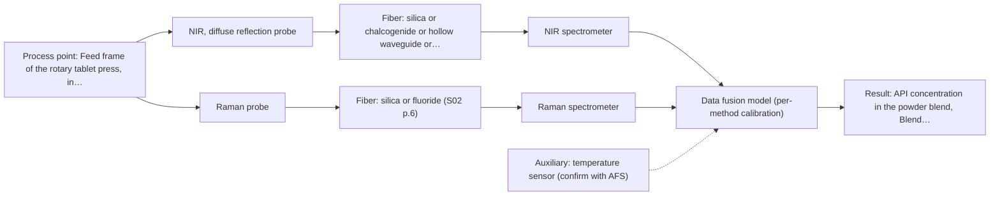
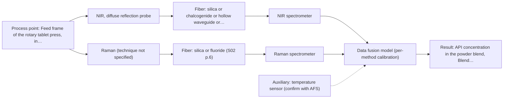

# First technical assessment: Blend potency in a tablet press feed frame

**Customer enquiry**

> We manufacture tablets from a powder blend containing an active pharmaceutical ingredient and excipients. Laboratory checks tell us whether the blend is on target, but results arrive after the material has moved through the press. We want to assess whether a fiber based measurement in the feed frame could follow API concentration changes. Our first pilot should compare reasonable measurement options before we commit to production equipment.

## Brief answer

Test NIR diffuse reflection first: it suits an opaque powder in the feed frame and there is a published feed-frame blend-potency precedent. Run Raman on the same samples as a second, separate method, and only consider fusing the two if neither single method meets your target. We still need your API, concentration range, required accuracy, reference assay and feed-frame conditions.

## Proposal

- **Best current option:** O2 (recommended): R1 NIR, diffuse reflection probe; R2 Raman probe
- **Basis:** supplied AFS sources
- **What would change it:** If NIR alone already tracks API changes to the required accuracy, O1 becomes sufficient and O3 is unnecessary. If the blend gives a usable Raman signal but a weak NIR response, Raman could lead. If neither single method meets the target, move to O3 (fusion). New facts on the API, loading range, reference assay or feed-frame conditions can also change the choice.
- **Next step:** Run the feasibility pilot on representative blend samples with the reference assay, testing NIR diffuse reflection first and Raman as a separate comparison, before committing to any production configuration.

**Decision status:** Provisional feasibility assessment. A defensible shortlist (NIR diffuse reflection first, Raman as a comparison, and a later NIR+Raman fusion hypothesis) can be justified from the supplied sources, but the specific API, concentration range, required accuracy and reference assay are still open. The method choice therefore rests on stated assumptions.

## Parameters

| ID | Parameter | Kind | Need | Measured by | Why | Sources |
|---|---|---|---|---|---|---|
| P1 | API concentration in the powder blend | quantitative | required | Spectroscopy: NIR | This is the target variable the pilot must follow in the feed frame. | [1: S01 p.14] |
| P2 | Reference API concentration (laboratory assay) | quantitative | required | Reference lab method: customer's existing laboratory assay (method and sampling error to be confirmed) | An independent reference is needed to build and validate any calibration; the customer's laboratory check is the stated reference. | *(no verified source: engineering judgement)* |
| P3 | Blend moisture content | quantitative | optional | Spectroscopy: NIR | Water O-H overtones fall in the NIR range and can overlap or mask API-related changes; the moisture level should be available to interpret the spectra. | [2: S01 p.10] |
| P4 | Blend / feed-frame temperature | quantitative | optional | Auxiliary sensor: temperature sensor (engineering judgement: confirm availability with AFS) | Temperature can shift NIR bands and should be recorded alongside the spectra. | *(no verified source: engineering judgement)* |
| P5 | Particle size distribution / bulk density of the blend | quantitative | optional | Not measurable in-line by spectroscopy; alternative: off-line particle size analysis and bulk density measurement | Physical variation changes NIR scattering and can look like a concentration change; these properties should be available for the pilot. | *(no verified source: engineering judgement)* |

## Solution options

| ID | Tier | Methods | Cost class, S01 Table 1 (p.6) | Ease of use | Maintenance | Performance fit | Sources |
|---|---|---|---|---|---|---|---|
| O1 | Simple | R1 NIR, diffuse reflection probe | average (row 8) | one probe, well-established method | probe window cleaning and routine NIR calibration upkeep | answers the main question with least effort; may miss information Raman would add | [3: S02 p.20] |
| O2 | Recommended | R1 NIR, diffuse reflection probe; R2 Raman probe | high (rows 8, 12) | two probes or one combined shaft; two spectra to handle, no fusion yet | two instruments to calibrate and keep in service | compares the two defensible single methods the customer asked for, side by side | [4: S02 p.20] |
| O3 | Extended (multi-method) | R3 NIR, diffuse reflection probe + Raman (combination) | average (row 8); not rated in S01 Table 1: Raman (technique not specified) | two methods to run and synchronise | each instrument needs its own calibration and diagnostics | strongest option; only worth it if neither single method meets the target | [5: S01 p.8] [6: S01 p.8] [7: S01 p.8] [8: S01 p.8] [9: S01 p.9] [10: S01 p.15] |

*Cost class is the relative rating in S01 Table 1 (p.6) for the in-line method+technique rows named (the highest one for a multi-method option); it is not a price.*

- **O1 cost drivers:** one NIR spectrometer, one reflection probe and its fiber link, a feed-frame interface, and a chemometric calibration built from reference samples
- **O2 cost drivers:** an NIR and a Raman spectrometer, their probes and fibers, plus separate calibrations and reference analyses
- **O3 cost drivers:** two spectrometers, a combined or paired probe, synchronized acquisition, and fused-model development
- **O3 combining methods:** Combined NIR + Raman, as a later hypothesis after the single-method tests. Fusion level: start from one model per method as the baseline, then join the spectra into a single matrix with block scaling or autoscaling so neither method dominates. Same sampling spot: the probes must look at the same small area of the powder; a combined NIR reflection + Raman shaft is described for the feed frame, and two alternating probes cannot guarantee the same spot. Synchronisation: acquisition rates differ and the data must be normalised to a common time step, with the dead time between ports accounted for. Per-method calibration: each instrument needs its own calibration and diagnostics, and a fused model breaks if any block drifts or a probe is changed. Must beat the best single method: validate on independent runs or batches against the reference assay and show the fused model is better than the best single method; otherwise drop the extra instrument. Fibers: one probe and fiber per method, or a combined probe; fiber families and any length limits depend on the configuration and are not stated for this blend.

## Setup sketch

*Recommended option O2; drawn by code from the option, a schematic, not a configuration.*

*Extended (multi-method) option O3; drawn by code from the option, a schematic, not a configuration.*

## Premise check

- **Precedent only:** A fiber based measurement in the feed frame can follow API concentration changes. The supplied material describes monitoring blend potency with fiber probes in the feed frame of a rotary tablet press. That is a published application and a reason to test the method here, not proof that it will work for this blend or that it reaches the accuracy the customer needs. [11: S01 p.14] [12: S01 p.15]
- **Supported:** A first pilot comparing reasonable measurement options is the right next step before committing to production equipment. The supplied material recommends multi-method laboratory trials to select the best method, which matches the customer's proposed first step. [13: S02 p.20] [14: S01 p.3]
- **Not covered:** Laboratory checks are a sufficient reference for whether the blend is on target. No supplied source addresses the suitability or sampling error of the customer's laboratory assay as a reference for an in-line method. Whether it is precise enough for calibration must be established with the customer. *(no verified source: engineering judgement)*

## Requirements

**Stated by the customer**

- Follow API concentration changes in the feed frame of a tablet press.
- The current laboratory check returns after the material has passed through the press.
- A first pilot should compare reasonable measurement options before production equipment is committed.

**Key unknowns**

- Identity of the API and excipients, API loading range, and the accuracy/resolution the method must reach.
- Details and sampling error of the laboratory reference assay.
- Matrix composition and spectral interferences (excipients, residual moisture, polymorph/form).
- Particle size distribution, bulk density and flow behaviour of the blend.
- Feed-frame installation (interface, temperature, cleaning, hazardous-area classification) and the fiber path to the instrument.
- Required response time and whether the use is monitoring only or closed-loop control.

## Clarification questions (most decision-relevant first)

Q1. What is the API, what loading range must be covered, and what smallest concentration change must the measurement resolve? *Why it matters:* This decides whether a single NIR method is realistic or whether a second method is needed. *(affects: method, technique, solution_option)*
Q2. What exactly is the laboratory reference assay (method, sample size, repeatability) that the pilot will use as the reference? *Why it matters:* The reference defines the calibration target and the achievable comparison; without it the go/no-go basis cannot be set. *(affects: method, feasibility, parameters)*
Q3. Is the blend dry or does it carry residual moisture, and what is the particle size range and flow behaviour? *Why it matters:* Moisture and particle size change NIR scattering and can mimic a concentration change. *(affects: technique, parameters, risks)*
Q4. Will the measurement be for monitoring only or for closed-loop control, and what response time / update rate is required? *Why it matters:* This affects acquisition rate, fiber link and whether a fused model is justified. *(affects: installation, solution_option)*
Q5. What are the feed-frame installation conditions (window or interface, temperature, cleaning, hazardous-area classification) and the fiber length to the instrument? *Why it matters:* This decides the probe design, fiber family and instrument placement. *(affects: installation, technique, solution_option)*

## Recommendation

- **R1 · Primary candidate: NIR, diffuse reflection probe.** NIR diffuse reflection fits an opaque, scattering powder and can be carried by fiber to the feed frame. The supplied method table lists diffuse reflection for scattering media and powders, and NIR is described as ideal for online fiber measurement. A published pharmaceutical example monitors blend potency in the feed frame of a rotary tablet press; that is a reason to test this method here, not proof for this blend. *Conditions:* Assumes the blend is opaque and scattering; the usable spectral range depends on the instrument, fiber and probe actually selected. [15: S01 p.5] [16: S01 p.5] [17: S01 p.17] [18: S01 p.14] [19: S01 p.10]
- **R2 · Comparison candidate: Raman probe.** Raman is also feasible for a powder and was used alongside NIR in the published feed-frame example, providing complementary molecular information. Its weak signal and possible fluorescence background from the blend must be checked on real samples before it can be relied on. *Conditions:* State the laser excitation wavelength separately from the Raman shift; check the fluorescence background of the actual blend. [20: S01 p.15] [21: S01 p.11] [22: S01 p.11]
- **R3 · Comparison candidate: NIR, diffuse reflection probe.** A later hypothesis only: combining NIR and Raman can add complementary chemical information and, in the published example, higher accuracy for API potency than single-method models. The combination must be tested against the best single method after the single-method tests, and any gain is a hypothesis, not an assumption. *Conditions:* Applies only if neither single method alone meets the customer's target on the pilot data. [23: S01 p.15] [24: S01 p.15] [25: S01 p.15] Later hypothesis, after single-method tests: combine with Raman.
- **R4 · Not recommended: MIR, ATR probe.** MIR-ATR is a common expectation for pharmaceutical measurement, but ATR needs tight contact and suits liquids, pastes and soft solids. A dry powder blend is not a contact liquid, so MIR-ATR is not the route to test for this feed frame. [26: S04 p.4] [27: S01 p.10]

## Measurement concept

- **Probe and geometry:** NIR diffuse reflection probe mounted at the feed frame so the powder flows past the window; Raman probe (or a combined NIR reflection + Raman shaft) looking at the same area if the comparison is run.
- **Location:** Feed frame of the rotary tablet press, in contact with the moving powder blend.
- **Fiber link:** Vis-NIR silica fibers carry the NIR range; the usable range depends on the instrument, fiber and probe actually selected. The fiber length and the path to the instrument are open questions. [28: S01 p.15] [29: REF §3]

## Spectral range

- **NIR:** Nominal NIR range 780-2500 nm; the usable range depends on the instrument, fiber and probe actually selected. [30: S01 p.10]
- **Raman:** Report the Raman shift (cm-1) and the laser excitation wavelength separately; the excitation wavelength used in a given setup is an open question for the configuration. [31: S01 p.11]

## Risks and uncertainty

- NIR and Raman calibrations are specific to the matrix. If the excipient mix, API form or supplier changes, the calibration may not transfer and must be re-validated on the new material. *(rules: R-CAL-1)* [32: REF §5]
- Fluorescence background from the excipients or API could swamp the Raman signal on the real blend, so Raman must be checked on representative samples. *(rules: R-RAM-1)* [33: S01 p.11]
- Physical variation (particle size, density, flow) changes NIR scattering and can look like a concentration change; scatter correction and enough reference samples are needed. *(rules: R-GEO-6)* [34: S01 p.17]
- The published feed-frame results are a precedent, not proof for this blend, and a gain from combining NIR and Raman remains a hypothesis until it is validated on independent runs. *(rules: R-EVI-2, R-CMB-1)* [35: REF §3]

## First feasibility experiment

1. **Collect representative samples across the expected variation in API loading and blend physical state.** Collect representative samples. [36: REF §3]
2. **Measure the samples with NIR diffuse reflection first, then add Raman on the same samples as a separate single-method comparison; keep the sampling spot and timing aligned.** Single methods first, on the same samples. [37: REF §5]
3. **Build one calibration per method against the reference assay and compare single-method performance.** Compare the single methods against the independent reference. *(no verified source: engineering judgement)*
4. **Only if neither single method meets the target, build a fused NIR+Raman model and compare it with the best single method.** Test the combination only after the single-method tests. [38: REF §5]
5. **Validate on held-out runs or batches and apply a go/no-go basis whose numerical criteria (target accuracy, response time) come from the customer.** Validate on held-out runs or batches. [39: REF §3]

**Reference measurements:** The customer's existing laboratory assay, run on the same samples, as the independent reference.

**Decision basis:** The go/no-go numerical criteria (required accuracy and response time) must be supplied by the customer; they are not in the sources.

## Assumptions

- The blend is an opaque, scattering powder in the feed frame.
- The customer's laboratory assay is precise enough to serve as the calibration reference (to be confirmed).
- NIR diffuse reflection can be installed at the feed frame with a fiber link to the instrument (length to be confirmed).

## Not covered by the supplied sources

- No supplied source gives accuracy, detection limit or response time for feed-frame API monitoring; these must come from the customer's targets and the pilot.

## Further notes

- **Chemometrics:** NIR and Raman bands overlap and require a chemometric calibration; for the feed-frame example, synchronized NIR and Raman spectra are merged and PLS regression is applied. The calibration is specific to the blend matrix and must be re-validated if the material changes.
- **Real-time tracking:** The intent is in-line, continuous tracking of API concentration at the feed frame. Fiber optics let the spectrometers sit away from the vibration and dust of the manufacturing floor. Required update rate and response time are still open.
- **Future direction:** If the pilot succeeds, a customized multisensor system or compact spectral fiber sensor could be developed later for a fixed process-control configuration.

## Evidence (verified quotes)

1. ✓ **S01 p.14** (application precedent): "determine "blend potency" - the precise concentration and uniformity of the Active Pharmaceutical Ingredient (API) - directly within the production line, specifically in the feed frame of a rotary tablet press."
2. ✓ **S01 p.10** (general): "contain predominantly overtones and component bands of fundamental vibrations of molecules and atomic groups, such as -OH"
3. ✓ **S02 p.20** (general): "2. Identify Key Spectral Features We pinpoint the most information-rich data for monitoring your specific reaction."
4. ✓ **S02 p.20** (general): "1. Multi-Method Lab Trials AFS tests your process using all key fiber optic spectroscopy methods."
5. ✓ **S01 p.8** (general): "collected from the same small, even pinpoint, area of the sample."
6. ✓ **S01 p.8** (general): "two or more probes, belonging to different methods, can be used for measurements, but the data from each method must be obtained simultaneously."
7. ✓ **S01 p.8** (general): "Ultimately, the measurement data must be normalized to a common time step."
8. ✓ **S01 p.8** (general): "Variables obtained from different spectral methods are not equivalent."
9. ✓ **S01 p.9** (general): "One of the challenges of multispectral analysis is the need to simultaneously connect at least two independently operating measuring instruments."
10. ✓ **S01 p.15** (application precedent): "A multispectral NIRaman fiber probe has industrial grade design that combines NIR reflection and Raman optical techniques in a compact shaft that fits in a tablet press feed frame."
11. ✓ **S01 p.14** (application precedent): "determine "blend potency" - the precise concentration and uniformity of the Active Pharmaceutical Ingredient (API) - directly within the production line, specifically in the feed frame of a rotary tablet press."
12. ✓ **S01 p.15** (application precedent): "the probes are inserted directly into the process environment, such as the feed frame of a rotary tablet press."
13. ✓ **S02 p.20** (general): "1. Multi-Method Lab Trials AFS tests your process using all key fiber optic spectroscopy methods."
14. ✓ **S01 p.3** (general): "samples of incompletely known composition, in order to select the most suitable method or combination of methods."
15. ✓ **S01 p.5** (general): "NIR spectroscopy, with its relatively large penetration depth (up to several millimetres) even into dense solid samples due to low absorption and strong scattering, allows the use of ordinary glass for optics"
16. ✓ **S01 p.5** (general): "making it ideal for online applications, including remote measurements via fiber optic probes."
17. ✓ **S01 p.17** (general): "NIR Reflection is primarily used for opaque or highly concentrated dairy products, such as yogurt, butter, or whole milk concentrates."
18. ✓ **S01 p.14** (application precedent): "determine "blend potency" - the precise concentration and uniformity of the Active Pharmaceutical Ingredient (API) - directly within the production line, specifically in the feed frame of a rotary tablet press."
19. ✓ **S01 p.10** (general): "The broad absorption bands observed in this region overlap, suggesting the use of chemometrics for quantitative and qualitative analysis of spectral data."
20. ✓ **S01 p.15** (application precedent): "Raman spectrometer and Raman fiber probe for contact measurements with 785 nm excitation wavelength"
21. ✓ **S01 p.11** (general): "Raman signals, which are several orders of magnitude weaker than IR absorption peaks"
22. ✓ **S01 p.11** (general): "superposition of luminescence (fluorescence), which has a significantly higher intensity."
23. ✓ **S01 p.15** (general): "The combination of these techniques is particularly effective because it captures complementary chemical information: NIR detects hydrogen bonds and asymmetric polar groups, while Raman provides information on the molecular backbone and symmetrical non-polar groups."
24. ✓ (precedent only) **S01 p.15** (method gain): "By combining Raman and NIR, these models can predict API potency or coating thickness with higher accuracy and robustness than single-method models."
25. ✓ **S01 p.15** (application precedent): "A multispectral NIRaman fiber probe has industrial grade design that combines NIR reflection and Raman optical techniques in a compact shaft that fits in a tablet press feed frame."
26. ✓ **S04 p.4** (general): "suitability of analyzed samples for ATR measurements, which is true for liquid or soft solid samples and their components, allowing a tight contact with the probe head."
27. ✓ **S01 p.10** (general): "ATR fiber probes (Fig.1) enable the analysis of liquids and solid elastic samples"
28. ✓ **S01 p.15** (general): "The use of fiber optics is critical here, as it allows the sensitive spectrometers to be located safely away from the vibration and dust of the manufacturing floor."
29. ✓ **REF §3** (general): "A nominal method range is not the range of a specific instrument, fiber or probe."
30. ✓ **S01 p.10** (general): "NIR spectra (780-2500 nm) contain predominantly overtones and component bands of fundamental vibrations"
31. ✓ **S01 p.11** (general): "The Raman shift is used as the horizontal (spectral) axis in Raman spectroscopy"
32. ✓ **REF §5** (general): "physical variation; calibration specific to the matrix."
33. ✓ **S01 p.11** (general): "superposition of luminescence (fluorescence), which has a significantly higher intensity."
34. ✓ **S01 p.17** (general): "the method is sensitive to the surface characteristics and fat globule size."
35. ✓ **REF §3** (general): "a published application is a reason to test a method, not proof that it will work for a new customer."
36. ✓ **REF §3** (general): "Representative samples or process states, independent reference measurements, what is compared, and the basis for the go / no-go decision."
37. ✓ **REF §5** (general): "Sampling location and timing must be aligned; a gain is a hypothesis to test."
38. ✓ **REF §5** (general): "compare with the best single method."
39. ✓ **REF §3** (general): "the basis for the go / no-go decision."

## Verification

- Citations verified: 39 of 39 (exact or whitespace/hyphen-tolerant match on the cited page, scope checked).
- Hard check failures before deterministic corrections: 0; still open: 0; soft warnings: 2; repair rounds: 1.
- Corrected deterministically after verification (1):
  - ⚠ recommendations[2].combined_with: combined_with normalised to ['Raman'] (duplicates and the entry's own method removed)

*Run D01-20261017T115051Z · models deepseek/deepseek-v4.1-flash · cost $0.0236*
