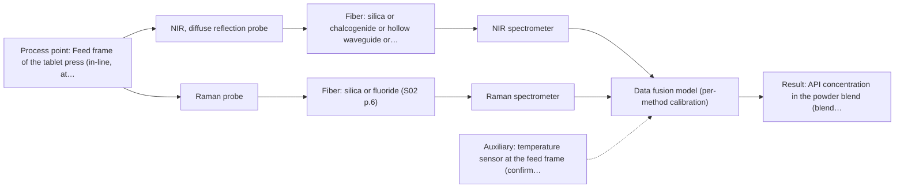
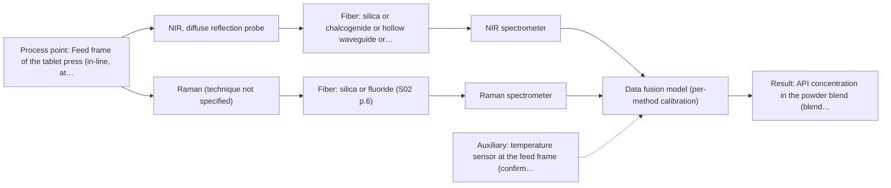

# First technical assessment: Blend potency in a tablet press feed frame

## Answer

**Customer request (our summary):** Customer manufactures tablets from a powder blend containing an API and excipients. They want to assess whether a fiber-based measurement in the feed frame could follow API concentration changes, and plan a first pilot to compare reasonable measurement options before committing to production equipment.

### Brief answer

Test NIR diffuse reflection first: a probe looking at the powder in the feed frame, calibrated against your existing laboratory assay. Add Raman as a second, separately calibrated arm, because NIR and Raman are the two techniques usually paired for blend potency. Still open: the required accuracy and API range, whether the powder's physical variation or fluorescence interferes, and whether a probe can be mounted and kept clean in the feed frame.

### Proposal

- **Best current option:** O2 (recommended): M1 NIR, diffuse reflection probe; M2 Raman probe
- **Basis:** supplied AFS sources
- **What would change it:** A modest accuracy target with a comfortably detectable API level would make the single-method NIR option (O1) sufficient; strong fluorescence, a low API level or a failed single-method calibration would move the choice to Raman or to the fused option (O3).
- **Next step:** Run the multi-method trial on representative blend samples, NIR first and Raman second, with the customer's laboratory assay as the reference.

**Decision status:** Provisional feasibility assessment. The known facts support a shortlist — NIR diffuse reflection first, Raman as a comparison arm — but the accuracy target, the API level and the feed-frame installation are unknown, so this is a provisional assessment and not a configuration.

### Solution options

| ID | Tier | Methods | Confidence | Cost class, S01 Table 1 (p.6) | Ease of use | Maintenance | Performance fit | Sources |
|---|---|---|---|---|---|---|---|---|
| O1 | Simple | M1 NIR, diffuse reflection probe | Medium: uncited auxiliary sensor | average cost (row 8) | One probe and one instrument, simple to run. | Clean probe window and routine reference checks. | Least effort that shows whether NIR can track the API at all. | [1: S01 p.10] [2: S01 p.15] |
| O2 | Recommended | M1 NIR, diffuse reflection probe; M2 Raman probe | Low: uncited auxiliary sensor; multi-method, fusion benefit not yet shown | high cost (rows 8, 12) | Two instruments to operate and keep aligned. | Two probes and two calibrations, separate diagnostics. | Compares the two realistic in-line methods before any hardware commitment. | [3: S01 p.15] [4: REF §5] [5: S01 p.10] [6: S01 p.15] [7: S01 p.11] |
| O3 | Extended (multi-method) | M3 NIR, diffuse reflection probe + Raman (combination) | Low: uncited auxiliary sensor; multi-method, fusion benefit not yet shown | average cost (row 8); not rated in S01 Table 1: Raman (technique not specified) | Highest effort: two instruments and fused data handling. | Each spectral block needs its own calibration and drift checks. | Only justified if no single method reaches the required accuracy. | [8: S01 p.8] [9: S01 p.8] [10: S01 p.9] [11: S01 p.15] |

*Confidence rates the basis of the advice (how much is known and cited), not a predicted accuracy or probability of success. It starts at High and drops one level per weakness listed.*

*Cost class is the relative rating in S01 Table 1 (p.6) for the in-line method+technique rows named (the highest one for a multi-method option); it is not a price.*

### Setup sketch

*Recommended option O2; drawn by code from the option, a schematic, not a configuration.*

*Extended (multi-method) option O3; drawn by code from the option, a schematic, not a configuration.*

### Key questions

1. What API concentration range must the measurement cover, and what accuracy, detection limit and response time are required?
2. What is your laboratory reference method for blend potency, and how can its samples be paired in time with the in-line readings?
3. Where in the feed frame could a probe or window be mounted, and what are the temperature, dust and cleaning conditions there?

## Expert detail

**Customer enquiry**

> We manufacture tablets from a powder blend containing an active pharmaceutical ingredient and excipients. Laboratory checks tell us whether the blend is on target, but results arrive after the material has moved through the press. We want to assess whether a fiber based measurement in the feed frame could follow API concentration changes. Our first pilot should compare reasonable measurement options before we commit to production equipment.

### Parameters

| ID | Parameter | Kind | Need | Measured by | Why | Sources |
|---|---|---|---|---|---|---|
| P1 | API concentration in the powder blend (blend potency) | quantitative | required | Spectroscopy: NIR | It is the quantity the pilot must follow in the feed frame and the basis for every calibration and go/no-go decision. | [12: S01 p.14] |
| P2 | Powder physical state in the feed frame (particle size, moisture, bulk density) | quantitative | optional | Reference lab method: off-line particle-size / bulk-density characterisation (method to be confirmed with the customer) | It should be available because NIR reflection signals depend on scatter, so physical variation can be mistaken for a concentration change. | *(no verified source: engineering judgement)* |
| P3 | Temperature at the feed frame | quantitative | optional | Auxiliary sensor: temperature sensor at the feed frame (engineering judgement: confirm availability with AFS) | It should be available as a simple auxiliary record, because the feed-frame temperature is one of the process conditions that can shift the spectra and is not yet known. | *(no verified source: engineering judgement)* |

### Solution option details

- **O1 cost drivers:** One spectrometer and probe, calibration and reference analyses.
- **O2 cost drivers:** Two spectrometers and probes, more reference measurements, two calibrations.
- **O3 cost drivers:** Two spectrometers, combined probe, synchronisation and fusion modelling.
- **O3 combining methods:** Level: low-level fusion of synchronised NIR and Raman spectra into one matrix with block scaling, one calibration per block and one joint model. Both probes must look at the same small volume of powder at the same time, so a combined probe or a shared window is needed, with both data streams normalised to a common time step. The fused model must beat the best single-method model on held-out batches, otherwise the second instrument is not worth keeping.

### Premise check

- **Precedent only:** A fiber-based measurement in the feed frame could follow API concentration changes. A published example reports NIR and Raman probes inserted in the feed frame of a rotary tablet press to follow blend potency. That is a reason to test the approach, not proof that it works for this blend. [13: S01 p.15]
- **Supported:** A first pilot can compare reasonable measurement options before committing to production equipment. The laboratory concept states that testing several optical approaches on real samples is the way to select the most suitable method or combination, which matches the proposed first pilot. [14: S01 p.3]

### Requirements

**Stated by the customer**

**Key unknowns**

- API concentration range, and the accuracy, detection limit and response time required in-line
- Whether the API or any excipient fluoresces under visible or near-infrared excitation
- Powder particle size, moisture and segregation behaviour in the feed frame
- Feed-frame temperature, dust, cleaning regime and an available probe or window position
- The laboratory reference method and how its samples are paired in time with the in-line readings
- Whether the blend composition or API grade changes between products

### Clarification questions (most decision-relevant first)

Q1. What API concentration range must the measurement cover, and what accuracy, detection limit and response time are required? *Why it matters:* These numbers decide whether NIR alone can follow the changes or whether Raman, or a fused NIR + Raman model, is needed. *(affects: method, technique)*
Q2. What is your laboratory reference method for blend potency, and how can its samples be paired in time with the in-line readings? *Why it matters:* The calibration and the go/no-go decision rest entirely on this independent reference data. *(affects: status)*
Q3. Where in the feed frame could a probe or window be mounted, and what are the temperature, dust and cleaning conditions there? *Why it matters:* This decides the probe geometry, the interface to the press and the maintenance concept. *(affects: installation)*
Q4. Do the API or any excipients fluoresce under visible or near-infrared excitation? *Why it matters:* Strong fluorescence can swamp the weak Raman signal and would change which method is worth comparing. *(affects: technique)*
Q5. Does the blend composition or API grade change between products? *Why it matters:* NIR and Raman calibrations are specific to the matrix, so each additional blend would need its own validation. *(affects: method, status)*

### Recommendation

- **M1 · Primary candidate: NIR, diffuse reflection probe.** NIR diffuse reflection is the usual in-line route for powders, needs no tight contact and works with standard optics and silica fibers. The closest published example puts NIR and Raman probes directly in a tablet-press feed frame to follow blend potency. *Conditions:* Applies while the blend stays free-flowing and the API is present at a level NIR can detect. [15: S01 p.10] [16: S01 p.15]
- **M2 · Comparison candidate: Raman probe.** Raman is the second technique most used for blend potency and reports the molecular backbone and symmetrical non-polar groups that NIR sees only weakly. Its signal is weak and can be swamped by fluorescence, so it is tested as a comparison rather than first. *Conditions:* Applies if the API and excipients do not fluoresce strongly under the chosen excitation wavelength. [17: S01 p.15] [18: S01 p.11]
- **M3 · Conditional candidate: NIR, diffuse reflection probe.** A published feed-frame example reports that fusing NIR and Raman spectra predicts API potency or coating thickness with higher accuracy and robustness than single-method models; for this blend that remains a hypothesis to test, not a result. It is worth the second instrument only if the single-method arms fall short. *Conditions:* Applies only if the single-method NIR and Raman models do not meet the required accuracy on held-out batches. [19: S01 p.15] [20: S01 p.8] Later hypothesis, after single-method tests: combine with Raman.
- **M4 · Not recommended: MIR, ATR probe.** MIR-ATR is the classic fingerprint method and a reader may expect it, but ATR needs a tight contact with a liquid or soft solid and probes only a few micrometres into the sample. A dry, flowing powder blend does not provide that contact in a feed frame. [21: S04 p.4]

### Measurement concept

- **Probe and geometry:** A probe looking at the powder in the feed frame; NIR diffuse reflection needs no tight contact, Raman would use a contact Raman probe at the same spot if it is compared.
- **Location:** Feed frame of the tablet press (in-line, at the powder stream).
- **Fiber link:** Silica fibers cover NIR and Raman; any link length for the feed-frame installation is not stated in the supplied material and must be confirmed with AFS. [22: S01 p.10] [23: REF §3]

### Spectral range

- **NIR:** Nominal NIR range 780-2500 nm; the usable range depends on the instrument, fiber and probe actually selected. [24: S01 p.10] [25: REF §5]
- **Raman:** Raman is reported on the Raman shift axis (cm-1); the laser excitation wavelength must be stated separately and is not fixed by the method. [26: S01 p.11]

### Risks and uncertainty

- NIR reflection is sensitive to particle size and surface scatter, so a change in the powder's physical state can look like a concentration change. *(rules: R-GEO-6)* [27: S01 p.17]
- If the API sits at a low level in the blend, NIR may lack the sensitivity to follow it. *(rules: R-NIR-4)* [28: S01 p.16]
- Fluorescence from the API or the excipients can swamp the weak Raman signal and make the Raman arm unusable. *(rules: R-RAM-1)* [29: S01 p.11]
- No feed-frame port, window or cleaning concept is confirmed, so powder build-up or a changed measurement distance could invalidate the calibration. *(rules: R-MIR-3)* *(no verified source: engineering judgement)*

### First feasibility experiment

1. **Collect representative blend samples across the expected API concentration range and the expected physical variation (particle size, moisture, segregation), including off-target and out-of-spec material.** Cover the variation the model must survive, not only on-target blend. [30: REF §3]
2. **Measure all samples off-line or at-line with NIR diffuse reflection first, then with Raman, using the probe geometry intended for the feed frame; record signal-to-noise and the Raman fluorescence background.** Single methods first, with the real sample matrix. *(no verified source: engineering judgement)*
3. **Assay every sample with the customer's laboratory reference method and build one calibration per method; validate on held-out batches, never on the calibration samples.** Independent reference data and honest validation. *(no verified source: engineering judgement)*
4. **Only if a single method misses the target, fuse the NIR and Raman data taken from the same spot and compare the fused model with the best single-method model.** Test the combination as a hypothesis after the single methods. [31: S01 p.8]
5. **Go/no-go: the accuracy and detection-limit criteria agreed with the customer must be met on held-out batches before any feed-frame installation is planned; the customer sets those numbers.** Clear decision basis. [32: REF §3]

**Reference measurements:** Customer's existing laboratory blend-potency assay, to be specified (Q2).

**Decision basis:** Customer-defined accuracy and detection limit on held-out batches.

### Assumptions

- The blend can be sampled representatively off-line and at-line with the probe geometry planned for the feed frame.
- The feed frame offers a position where a probe or window can look at the powder without blocking flow.
- The customer's laboratory assay is fit to serve as the reference for calibration and validation.

### Not covered by the supplied sources

- No supplied source states the accuracy or detection limit achievable for API concentration in a powder blend.
- No supplied source covers probe fouling or cleaning requirements inside a tablet-press feed frame.

### Further notes

- **Chemometrics:** Both methods need a matrix-specific chemometric calibration built on reference-assayed blend samples; the reported route for blend potency is regression modelling validated on independent batches.
- **Real-time tracking:** The feed frame is an in-line point, so results are wanted continuously; if both methods run, their different acquisition rates must be aligned to a common time step before any fusion.
- **Future direction:** Once one method is fixed, a compact multisensor or spectral fiber sensor for the feed frame is a possible later step.

### Evidence (verified quotes)

1. ✓ **S01 p.10** (general): "which enables measurements using diffuse reflectance, including measurements without direct contact with the sample, at a distance."
2. ✓ **S01 p.15** (application precedent): "During the experimental action, the probes are inserted directly into the process environment, such as the feed frame of a rotary tablet press."
3. ✓ **S01 p.15** (general): "The combination of these techniques is particularly effective because it captures complementary chemical information: NIR detects hydrogen bonds and asymmetric polar groups, while Raman provides information on the molecular backbone and symmetrical non-polar groups."
4. ✓ **REF §5** (general): "Sampling location and timing must be aligned; a gain is a hypothesis to test."
5. ✓ **S01 p.10** (general): "which enables measurements using diffuse reflectance, including measurements without direct contact with the sample, at a distance."
6. ✓ **S01 p.15** (application precedent): "During the experimental action, the probes are inserted directly into the process environment, such as the feed frame of a rotary tablet press."
7. ✓ **S01 p.11** (general): "signals, which are several orders of magnitude weaker than IR absorption peaks"
8. ✓ **S01 p.8** (general): "It is crucial that the spectral information obtained by different methods-Mid-IR, NIR, Raman, and fluorescence spectra-is collected from the same small, even pinpoint, area of the sample."
9. ✓ **S01 p.8** (general): "Ultimately, the measurement data must be normalized to a common time step."
10. ✓ **S01 p.9** (general): "One of the challenges of multispectral analysis is the need to simultaneously connect at least two independently operating measuring instruments."
11. ✓ (precedent only) **S01 p.15** (method gain): "By combining Raman and NIR, these models can predict API potency or coating thickness with higher accuracy and robustness than single-method models."
12. ✓ **S01 p.14** (application precedent): "the precise concentration and uniformity of the Active Pharmaceutical Ingredient (API) - directly within the production line, specifically in the feed frame of a rotary tablet press."
13. ✓ **S01 p.15** (application precedent): "During the experimental action, the probes are inserted directly into the process environment, such as the feed frame of a rotary tablet press."
14. ✓ **S01 p.3** (general): "The ability to test various optical spectroscopy approaches is crucial for solving complex analytical problems, such as analyzing natural and industrial samples of incompletely known composition, in order to select the most suitable method or combination of methods."
15. ✓ **S01 p.10** (general): "which enables measurements using diffuse reflectance, including measurements without direct contact with the sample, at a distance."
16. ✓ **S01 p.15** (application precedent): "During the experimental action, the probes are inserted directly into the process environment, such as the feed frame of a rotary tablet press."
17. ✓ **S01 p.15** (general): "The combination of these techniques is particularly effective because it captures complementary chemical information: NIR detects hydrogen bonds and asymmetric polar groups, while Raman provides information on the molecular backbone and symmetrical non-polar groups."
18. ✓ **S01 p.11** (general): "signals, which are several orders of magnitude weaker than IR absorption peaks"
19. ✓ (precedent only) **S01 p.15** (method gain): "By combining Raman and NIR, these models can predict API potency or coating thickness with higher accuracy and robustness than single-method models."
20. ✓ **S01 p.8** (general): "It is crucial that the spectral information obtained by different methods-Mid-IR, NIR, Raman, and fluorescence spectra-is collected from the same small, even pinpoint, area of the sample."
21. ✓ **S04 p.4** (general): "the suitability of analyzed samples for ATR measurements, which is true for liquid or soft solid samples and their components, allowing a tight contact with the probe head."
22. ✓ **S01 p.10** (general): "which enables measurements using diffuse reflectance, including measurements without direct contact with the sample, at a distance."
23. ✓ **REF §3** (general): "A nominal method range is not the range of a specific instrument, fiber or probe."
24. ✓ **S01 p.10** (general): "NIR spectra (780-2500 nm) contain predominantly overtones and component bands of fundamental vibrations"
25. ✓ **REF §5** (general): "It is not a product specification: actual spectral coverage, fiber length, component ratings, detection limits and accuracy depend on the configuration and the sample."
26. ✓ **S01 p.11** (general): "The Raman shift is used as the horizontal (spectral) axis in Raman spectroscopy"
27. ✓ **S01 p.17** (general): "the method is sensitive to the surface characteristics and fat globule size."
28. ✓ **S01 p.16** (general): "may lack the sensitivity to detect trace compounds below 0.1 percent."
29. ✓ **S01 p.11** (general): "superposition of luminescence (fluorescence), which has a significantly higher intensity."
30. ✓ **REF §3** (general): "Representative samples or process states, independent reference measurements, what is compared, and the basis for the go / no-go decision."
31. ✓ **S01 p.8** (general): "It is crucial that the spectral information obtained by different methods-Mid-IR, NIR, Raman, and fluorescence spectra-is collected from the same small, even pinpoint, area of the sample."
32. ✓ **REF §3** (general): "Representative samples or process states, independent reference measurements, what is compared, and the basis for the go / no-go decision."

### Verification

- Citations verified: 27 of 27 (exact or whitespace/hyphen-tolerant match on the cited page, scope checked).
- Hard check failures before deterministic corrections: 0; still open: 0; soft warnings: 1; repair rounds: 0.

*Run D01-20261017T142813Z · models deepseek/deepseek-v4.1-flash*
