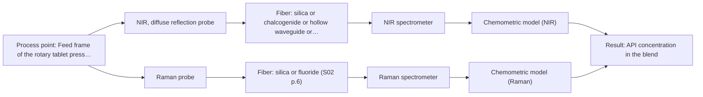
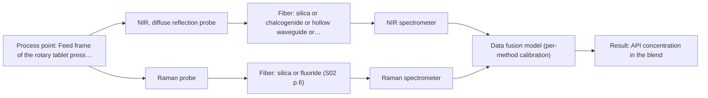

# First technical assessment: Blend potency in a tablet press feed frame

## Answer

**Customer request (our summary):** The customer wants to assess if a fiber-based measurement in the feed frame can track API concentration changes in a powder blend.

### Brief answer

Test NIR diffuse reflection first: it is the standard fiber-probe route for opaque powders and has published feed-frame precedent for blend potency. Compare it with a Raman fiber probe on the same blend; combine the two only if a single method misses your accuracy target. Open points: your API range and accuracy needs, excipient interferences, and the reference lab method for calibration.

### Proposal

- **Best current option:** O2 (recommended)
- **Basis:** supplied AFS sources
- **What would change it:** If the required accuracy is modest and NIR reflection alone meets it on held-out batches, O1 suffices; if neither single method meets the target, the fused option O3 becomes the route.
- **Next step:** Run the multi-method lab pilot on representative blend samples with independent reference assays, then a short feed-frame trial against customer-agreed go/no-go criteria.

**Secondary evidence (external, not AFS material):** G1: E04 ¶1; G2: no usable external source found; G3: no usable external source found; G4: no usable external source found. See Expert detail.

**Decision status:** Provisional feasibility assessment

### Solution options

| ID | Tier | Methods | Confidence | Cost class, S01 Table 1 (p.6) | Ease of use | Maintenance | Performance fit | Sources |
|---|---|---|---|---|---|---|---|---|
| O1 | Simple | M1 NIR, diffuse reflection probe | Medium: open question: Q1, Q2, Q3 (starts at Medium) | average cost (row 8) | Standard NIR probe and spectrometer, straightforward operation | Low; probe window cleaning and periodic recalibration | Fits the pilot goal of comparing options with minimal hardware | [1: S01 p.17] [2: S01 p.10] [3: S01 p.15] [4: S01 p.10] |
| O2 | Recommended | M1 NIR, diffuse reflection probe; M2 Raman probe | Medium: open question: Q1, Q2, Q3 (starts at Medium) | high cost (rows 8, 12) | Two probes at one spot, moderate setup effort | Moderate; two instruments with separate diagnostics | Fits the stated pilot aim of comparing options before committing | [1: S01 p.17] [2: S01 p.10] [3: S01 p.15] [4: S01 p.10] [5: S01 p.15] [6: S01 p.11] |
| O3 | Extended (multi-method) | M3 NIR, diffuse reflection probe + Raman (combination) | Low: open question: Q1 (starts at Medium); multi-method, fusion benefit not yet shown | high cost (rows 8, 12) | More complex; fused data handling and two instruments | Higher; each block needs its own calibration and drift checks | Fits only if a single method misses the accuracy target | [7: S01 p.15] [8: S01 p.8] [9: S01 p.15] [10: S01 p.8] |

*Confidence rates the basis of the advice (how much is known and cited), not a predicted accuracy or probability of success. It starts at High, or at Medium when a key question on the method or the option is open, and drops one level per weakness listed (floor Low).*

*Cost class is the relative rating in S01 Table 1 (p.6) for the in-line method+technique rows named (the highest one for a multi-method option); it is not a price.*

### Setup sketch

*Recommended option O2; drawn by code from the option, a schematic, not a configuration.*

### Key questions

1. What API concentration range must be tracked, and what accuracy and response time do you need in the feed frame?
2. Which excipients are in the blend, and do any have strong NIR or Raman bands overlapping the API?
3. What reference laboratory method (e.g. HPLC) and sampling rate can you provide for calibration samples taken during the pilot?

## Expert detail

**Customer enquiry**

> We manufacture tablets from a powder blend containing an active pharmaceutical ingredient and excipients. Laboratory checks tell us whether the blend is on target, but results arrive after the material has moved through the press. We want to assess whether a fiber based measurement in the feed frame could follow API concentration changes. Our first pilot should compare reasonable measurement options before we commit to production equipment.

**Decision status:** Provisional feasibility assessment. A method shortlist can be justified from the published feed-frame precedent, but the API level range, excipient composition and required accuracy are unknown, so the assessment stays provisional.

### Parameters

| ID | Parameter | Kind | Need | Measured by | Why | Sources |
|---|---|---|---|---|---|---|
| P1 | API concentration in the blend | quantitative | required | Spectroscopy: NIR | It is the target variable the in-line measurement must track. | *(no verified source: engineering judgement)* |
| P2 | Excipient composition of the blend | qualitative | required | Reference lab method: supplier formulation data / lab compositional analysis | Excipient bands can overlap the API signal and define the calibration matrix. | *(no verified source: engineering judgement)* |
| P3 | Powder flow and particle size behaviour in the feed frame | qualitative | optional | Not measurable in-line by spectroscopy; alternative: lab particle-size analysis and visual observation of powder flow at the probe spot | Physical variation affects reflection signals and should be characterised to separate it from composition change; it should be available from process knowledge or simple lab tests. | *(no verified source: engineering judgement)* |

### Solution option details

- **O1 cost drivers:** One NIR spectrometer, one diffuse-reflection probe, calibration samples and reference assays
- **O2 cost drivers:** NIR and Raman spectrometers, two probes, larger calibration set, reference assays
- **O3 cost drivers:** Two spectrometers, synchronised acquisition, fused model development and validation
- **O3 combining methods:** Low-level fusion: synchronised NIR reflection and Raman spectra merged into one augmented matrix, as in the published feed-frame work. Both probes must sample the same powder spot, and data must be normalised to a common time step with block scaling so neither method dominates. Each method keeps its own calibration, and the fused model must beat the best single method on independent runs or the extra instrument is dropped.

*Extended (multi-method) option O3; drawn by code from the option, a schematic, not a configuration.*

### Premise check

- **Precedent only:** A fiber-based measurement in the feed frame can follow API concentration changes in a powder blend. A published feed-frame application with NIR and Raman probes exists, but it is a reason to test, not proof for this customer's blend. [3: S01 p.15]
- **Precedent only:** Combining NIR and Raman gives better blend potency results than a single method. The published feed-frame study reports higher accuracy for the combination, but the gain must be verified on this customer's own blend. [9: S01 p.15]

### Requirements

**Stated by the customer**

- Track API concentration changes in the feed frame of a rotary tablet press.
- Compare reasonable measurement options in a first pilot before committing to production equipment.

**Key unknowns**

- API concentration range and the accuracy/response time the customer needs
- Excipient composition and possible spectral interferences with the API
- Powder flow behaviour and particle size in the feed frame
- Available reference laboratory method and sampling frequency for calibration
- Physical space and insertion constraints in the feed frame

### Clarification questions (most decision-relevant first)

Q1. What API concentration range must be tracked, and what accuracy and response time do you need in the feed frame? *Why it matters:* It decides whether NIR reflection alone is sensitive enough or whether Raman or a combination is needed. *(affects: method, M1, M2)*
Q2. Which excipients are in the blend, and do any have strong NIR or Raman bands overlapping the API? *Why it matters:* Overlapping excipient bands determine whether a single method can separate the API signal. *(affects: technique, M1, M2)*
Q3. What reference laboratory method (e.g. HPLC) and sampling rate can you provide for calibration samples taken during the pilot? *Why it matters:* The calibration and the go/no-go criteria depend on independent reference values. *(affects: status, M1)*
Q4. How is the feed frame physically accessible for probe insertion, and how homogeneous is the powder flow at that point? *Why it matters:* It determines the probe geometry and whether the measured spot represents the blend. *(affects: installation, M1, M2)*

### Recommendation

- **M1 · Primary candidate: NIR, diffuse reflection probe.** NIR diffuse reflection suits opaque, scattering powders and is the standard fiber-probe route for in-line blend monitoring, with published feed-frame precedent. It needs a matrix-specific chemometric calibration against lab reference values. [1: S01 p.17] [2: S01 p.10] [3: S01 p.15] [4: S01 p.10]
- **M2 · Comparison candidate: Raman probe.** Raman gives complementary molecular information on the API backbone and is used for contact powder measurements in the published feed-frame work. Its weak signal and possible fluorescence background must be checked on the real blend. *Conditions:* Test after or alongside M1 on the same blend to see which single method separates the API better. [5: S01 p.15] [6: S01 p.11]
- **M3 · Conditional candidate: NIR, diffuse reflection probe + Raman (combination).** If neither single method meets the accuracy target, fused NIR and Raman spectra are the published route to higher blend-potency accuracy. The gain is a hypothesis that must beat the best single method on independent runs. *Conditions:* Only if M1 or M2 alone does not meet the customer's accuracy criteria in the pilot. [9: S01 p.15] [10: S01 p.8] Later hypothesis, after single-method tests.
- **M4 · Not recommended: MIR, ATR probe.** ATR requires tight contact and suits liquids, pastes and soft solids, not a flowing powder blend in a feed frame. It would also sample only a surface layer a few micrometres deep. [11: S01 p.10] [12: S01 p.13]
- **M5 · Not recommended: NIR, transmission/transflection probe.** Transmission fails when the sample is too thick or opaque because light cannot penetrate a powder bed; it is listed for liquids, not powders. A transflection variant could be revisited only if the pilot shows the local powder presents a controlled surface. [13: S01 p.18]

### Measurement concept

- **Probe and geometry:** NIR diffuse-reflection fiber probe with the tip in contact with or a few millimetres above the moving powder bed in the feed frame; Raman fiber probe at the same spot for the comparison test.
- **Location:** Feed frame of the rotary tablet press, before die filling.
- **Fiber link:** Vis-NIR silica fibers; for Raman, metal-coated low-OH silica fibers free of polymer-jacket fluorescence. Actual cable length depends on the selected configuration and is not stated in the sources. [14: S01 p.15] [15: S02 p.7]

### Spectral range

- **NIR:** Nominal NIR range 780-2500 nm; the usable range depends on the spectrometer, fiber and probe actually selected. [16: S01 p.10]
- **Raman:** Raman shift in cm-1 with laser excitation stated separately; the published feed-frame example used 785 nm excitation. Actual usable shift range depends on the selected spectrometer and probe. [5: S01 p.15]

### Risks and uncertainty

- The published feed-frame results are for other blends; this customer's API and excipients may give weaker or overlapping signals. *(rules: R-EVI-2, R-CAL-1)* *(no verified source: engineering judgement)*
- NIR reflection signals depend on surface characteristics and particle size, so physical variation in the feed frame can mimic composition change. *(rules: R-GEO-6)* [17: S01 p.17]
- Raman signals may be swamped by fluorescence from excipients or the API on the real blend. *(rules: R-RAM-1)* [18: S01 p.11]
- Inhomogeneous or turbulent powder flow at the probe spot can make the sampled volume unrepresentative of the blend. *(rules: R-GEN-5)* [19: S01 p.7]

### First feasibility experiment

1. **Collect representative blend samples spanning the expected API concentration range and excipient variation, including off-target batches.** Cover the chemical and physical variation the in-line model must handle. *(no verified source: engineering judgement)*
2. **Measure each sample with the NIR diffuse-reflection probe and the Raman probe as single methods, without combining the data yet.** Compare the two single methods before any fusion. *(no verified source: engineering judgement)*
3. **Take independent reference laboratory measurements (e.g. HPLC) on the same samples for calibration and validation.** Provide the ground truth for the chemometric models. *(no verified source: engineering judgement)*
4. **Build and validate calibration models per method on held-out batches, then test the fused NIR+Raman model only if a single method misses the target.** Establish whether the combination beats the best single method. *(no verified source: engineering judgement)*
5. **Run a short feed-frame trial with the winning single method and agree go/no-go criteria (accuracy and response time) with the customer beforehand.** Confirm performance under real process conditions before committing to production equipment. *(no verified source: engineering judgement)*

**Reference measurements:** Independent laboratory API assay on pilot samples, taken at a frequency agreed with the customer.

**Decision basis:** Go/no-go on whether the in-line prediction meets the customer's stated accuracy and response-time targets on held-out runs; the numerical criteria come from the customer.

### Assumptions

- The blend is a flowing powder in the feed frame, so only reflection-type or contact probe geometries were considered.
- A laboratory reference method for API concentration exists or can be set up for the pilot.

### Not covered by the supplied sources

- Required accuracy, detection limits and response time for this customer's API tracking
- Excipient composition and spectral interferences in this specific blend
- Achievable fiber cable length for the selected configuration in the feed frame

### Further notes

- **Chemometrics:** A PLS calibration or classification model per method is needed because NIR and Raman bands overlap in real blends; reference assay data from representative batches is the limiting resource, and validation on held-out batches is essential before any production claim.
- **Real-time tracking:** The goal is time-resolved tracking of API concentration in the feed frame; acquisition rate and data synchronisation to a common time step should be fixed during the pilot so concentration changes are not blurred by averaging.
- **Future direction:** If the pilot succeeds, a compact customized spectral fiber sensor or IoT-style sensor for the feed frame could be considered as a later step, as suggested in the AFS pathway material.

### Secondary evidence (external, not AFS material)

*Found by a literature search for gaps the supplied AFS sources leave open. Not AFS material and not proof for this case; every quote below was verified verbatim against the fetched text.*

**G1 · multi-method:** Combining several spectroscopy methods (data fusion) (Low-level fusion: synchronised NIR reflection and Raman spectra merged into one augmented matrix, as in the published feed-frame work. Both probes must sample the same powder spot, and data must be normalised to a common time step with block scaling so neither method dominates. Each method keeps its own calibration, and the fused model must beat the best single method on independent runs or the extra instrument is dropped.)

- **E04 ¶1** Combining near-infrared and Raman spectroscopy via low-level data fusion can improve step-change sensitivity and reduce root mean squared error when predicting certain blend potency levels, though noisy near-infrared spectra may provide no added benefit for lower concentration ranges. *How it applies:* When testing the combined fiber probe setup in the feed frame, evaluate whether low-level data fusion improves the model for the target API concentration range or if the individual method performs adequately. *Limits and transfer risks:* The published findings are based on a specific five-component platform formulation and specific concentration ranges, so transfer to the customer's powder blend and equipment scale must be verified experimentally. *(supports O3)*
  > "For model development and validation, low-level data fusion was explored through concatenation of preprocessed NIR and Raman spectra. Mid-level data fusion was also evaluated, based on extracted features of the preprocessed data."
  > Evaluating the Improvement of Blend Potency Measurements in the Feed Frame of a Rotary Tablet Press Using Combined NIR and Raman Spectroscopy (2024) · Analytical Chemistry · doi:10.1021/acs.analchem.4c01134 · https://doi.org/10.1021/acs.analchem.4c01134 · retrieved 2026-10-18, abstract only, licence: other-oa, via openalex

**G2 · not in the supplied sources:** Required accuracy, detection limits and response time for this customer's API tracking

- No usable external source found.

**G3 · not in the supplied sources:** Excipient composition and spectral interferences in this specific blend

- No usable external source found.

**G4 · not in the supplied sources:** Achievable fiber cable length for the selected configuration in the feed frame

- No usable external source found.

### Evidence (verified quotes)

1. ✓ **S01 p.17** (general): "NIR Reflection is primarily used for opaque or highly concentrated dairy products, such as yogurt, butter, or whole milk concentrates."
2. ✓ **S01 p.10** (general): "Near-IR vibrational spectroscopy (NIR) is the most common online analysis method performed using fiber optic probes."
3. ✓ **S01 p.15** (application precedent): "the probes are inserted directly into the process environment, such as the feed frame of a rotary tablet press"
4. ✓ **S01 p.10** (general): "The broad absorption bands observed in this region overlap, suggesting the use of chemometrics for quantitative and qualitative analysis of spectral data."
5. ✓ **S01 p.15** (application precedent): "Raman spectrometer and Raman fiber probe for contact measurements with 785 nm excitation wavelength"
6. ✓ **S01 p.11** (general): "signals, which are several orders of magnitude weaker than IR absorption peaks"
7. ✓ **S01 p.15** (general): "Data processing for pharmaceutical tasks relies on "low-level data fusion," where the synchronized NIR and Raman spectra are merged into a single augmented matrix."
8. ✓ **S01 p.8** (general): "the measurement data must be normalized to a common time step."
9. ✓ (precedent only) **S01 p.15** (method gain): "By combining Raman and NIR, these models can predict API potency or coating thickness with higher accuracy and robustness than single-method models."
10. ✓ **S01 p.8** (general): "the data from each method must be obtained simultaneously."
11. ✓ **S01 p.10** (general): "ATR fiber probes (Fig.1) enable the analysis of liquids and solid elastic samples"
12. ✓ **S01 p.13** (general): "typically at a depth of few microns"
13. ✓ **S01 p.18** (general): "it fails when the milk becomes too "thick" or fat-rich, as the light cannot penetrate the sample."
14. ✓ **S01 p.15** (general): "The use of fiber optics is critical here, as it allows the sensitive spectrometers to be located safely away from the vibration and dust of the manufacturing floor."
15. ✓ **S02 p.7** (general): "Free of Polymer jacket fluorescence for Raman and Fluo- Spectroscopy"
16. ✓ **S01 p.10** (general): "NIR spectra (780-2500 nm) contain predominantly overtones and component bands of fundamental vibrations"
17. ✓ **S01 p.17** (general): "the method is sensitive to the surface characteristics and fat globule size."
18. ✓ **S01 p.11** (general): "superposition of luminescence (fluorescence), which has a significantly higher intensity."
19. ✓ **S01 p.7** (general): "Morphological factors, such as sample inhomogeneity (e.g., biological tissue) or process turbulence, must also be considered when selecting a measurement technique."

### Verification

- Citations verified: 22 of 22 (exact or whitespace/hyphen-tolerant match on the cited page, scope checked).
- Hard check failures before deterministic corrections: 0; still open: 0; soft warnings: 2; repair rounds: 0.
- External evidence (live): 1 quote(s) verified verbatim (exact or whitespace/hyphen-tolerant, at most 400 characters and 2 sentences, against the cited paragraph); 0 item(s) dropped.
- External search: 2 query(ies), 20 hit(s), 5 source(s) (3 from the curated library).
- External step: 2 model call(s), 6.3 s extra (cost in the run JSON).

*Run D01-20261018T094733Z-40eb · models google/gemini-3.5-flash-lite, z-ai/glm-5.3-flash*
