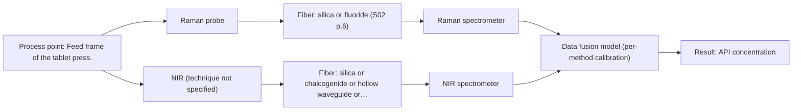

# First technical assessment: Blend potency in a tablet press feed frame

## Answer

**Customer request (our summary):** Customer manufactures tablets from a powder blend containing an API and excipients. They want to assess whether a fiber-based measurement in the feed frame could follow API concentration changes, with a first pilot comparing reasonable measurement options before committing to production equipment.

### Brief answer

Test NIR diffuse reflection first, as it is the most common method for blend potency in tablet press feed frames. Compare it with Raman and a combined NIR+Raman option in the pilot. Key open points are the API identity, concentration range, required accuracy, and feed frame geometry.

### Proposal

- **Best current option:** O2 (recommended)
- **Basis:** supplied AFS sources
- **What would change it:** If the feed frame cannot accommodate a remote probe, O1 may be preferred. If NIR alone does not meet accuracy, O3 may be needed.
- **Next step:** Run the feasibility experiment with representative powder samples and reference API concentrations.

**Secondary evidence (external, not AFS material):** G1: E01 ¶31, E01 ¶36. See Expert detail.

**Decision status:** Provisional feasibility assessment

### Solution options

| ID | Tier | Methods | Confidence | Cost class, S01 Table 1 (p.6) | Ease of use | Maintenance | Performance fit | Sources |
|---|---|---|---|---|---|---|---|---|
| O1 | Simple | M1 NIR, diffuse reflection probe | Medium: open question: Q1, Q2 (starts at Medium) | average cost (row 8) | Standard NIR probe, simple interface. | Regular cleaning, calibration checks. | NIR suits opaque powder; used for blend potency. | [1: S01 p.14] [2: S01 p.10] |
| O2 | Recommended | M2 NIR, diffuse reflection at a distance | Low: open question: Q1, Q2 (starts at Medium); precedent only | average cost (row 10) | Remote probe, keeps analyzer away. | Probe cleaning, fiber care. | Remote NIR fits feed frame environment, keeps analyzer safe. | [3: S01 p.15] |
| O3 | Extended (multi-method) | M3 Raman probe + NIR (combination) | Low: open question: Q1, Q2 (starts at Medium); multi-method, fusion benefit not yet shown | high cost (rows 8, 12) | Two methods, more complex. | Two calibrations, more hardware. | NIR+Raman may improve accuracy and robustness. | [4: S01 p.15] [5: S01 p.8] [6: S01 p.8] [7: S01 p.9] |

*Confidence rates the basis of the advice (how much is known and cited), not a predicted accuracy or probability of success. It starts at High, or at Medium when a key question on the method or the option is open, and drops one level per weakness listed (floor Low).*

*Cost class is the relative rating in S01 Table 1 (p.6) for the in-line method+technique rows named (the highest one for a multi-method option); it is not a price.*

### Setup sketch

*Recommended option O2; drawn by code from the option, a schematic, not a configuration.*

### Key questions

1. What is the API and its typical concentration range and required accuracy?
2. What is the reference laboratory method and its sampling procedure?
3. What are the feed frame geometry, powder flow rate, and press speed?

## Expert detail

**Customer enquiry**

> We manufacture tablets from a powder blend containing an active pharmaceutical ingredient and excipients. Laboratory checks tell us whether the blend is on target, but results arrive after the material has moved through the press. We want to assess whether a fiber based measurement in the feed frame could follow API concentration changes. Our first pilot should compare reasonable measurement options before we commit to production equipment.

**Decision status:** Provisional feasibility assessment. NIR diffuse reflection is a reasonable first method for following API concentration in a powder blend, supported by precedent in tablet press feed frames; Raman and a combined NIR+Raman option are worth comparing if NIR alone does not meet accuracy. Key unknowns are API identity, concentration range and feed frame geometry.

### Parameters

| ID | Parameter | Kind | Need | Measured by | Why | Sources |
|---|---|---|---|---|---|---|
| P1 | API concentration | quantitative | required | Spectroscopy: NIR | The target variable to follow in the feed frame. | [8: S01 p.14] |
| P2 | Reference API concentration | quantitative | required | Reference lab method: customer's laboratory method | Independent reference needed for calibration and validation. | [9: REF §3] |

### Solution option details

- **O1 cost drivers:** NIR spectrometer, diffuse reflection probe, chemometrics.
- **O2 cost drivers:** NIR spectrometer, remote fiber probe, chemometrics.
- **O3 cost drivers:** NIR and Raman spectrometers, combined probe, fusion software.
- **O3 combining methods:** Fusion level: low-level data fusion of synchronized NIR and Raman spectra. Probes must sample the same spot; data normalized to a common time step. Each method needs its own calibration; fused model must beat the best single method.

*Extended (multi-method) option O3; drawn by code from the option, a schematic, not a configuration.*

### Premise check

- **Precedent only:** A fiber based measurement in the feed frame could follow API concentration changes. Sources show NIR and Raman used for blend potency in a tablet press feed frame, which is a similar application, but not proof for this customer. [1: S01 p.14]
- **Supported:** A first pilot comparing reasonable measurement options is sufficient before committing to production equipment. Sources recommend multi-method lab trials to select the most suitable method before committing. [10: S02 p.20]

### Requirements

**Stated by the customer**

- "We manufacture tablets from a powder blend containing an active pharmaceutical ingredient and excipients"
- "Laboratory checks tell us whether the blend is on target"
- "results arrive after the material has moved through the press"
- "We want to assess whether a fiber based measurement in the feed frame could follow API concentration changes"
- "Our first pilot should compare reasonable measurement options before we commit to production equipment"
- "follow API concentration changes"

**Key unknowns**

- API identity and concentration range.
- Required accuracy and response time.
- Excipient composition and potential spectral interferences.
- Feed frame geometry and measurement interface.
- Powder flow and particle size variation.
- Cleaning and fouling requirements.

### Clarification questions (most decision-relevant first)

Q1. What is the API and its typical concentration range and required accuracy? *Why it matters:* This determines whether NIR or Raman is suitable and what calibration performance is needed. *(affects: method, technique, status)*
Q2. What is the reference laboratory method and its sampling procedure? *Why it matters:* It defines the reference data for calibration and validation. *(affects: method, status)*
Q3. What are the feed frame geometry, powder flow rate, and press speed? *Why it matters:* It affects probe installation, measurement spot, and response time requirements. *(affects: installation, technique)*
Q4. Does the powder blend or API exhibit fluorescence? *Why it matters:* It determines whether Raman can be used without overwhelming fluorescence background. *(affects: technique)*
Q5. What are the cleaning and fouling requirements? *Why it matters:* It affects probe design and maintenance for the feed frame. *(affects: installation)*

### Recommendation

- **M1 · Primary candidate: NIR, diffuse reflection probe.** NIR diffuse reflection is suited to opaque powders and is the most common online method for blend potency in tablet press feed frames. It can follow API concentration changes with chemometric calibration. [1: S01 p.14] [2: S01 p.10]
- **M2 · Comparison candidate: NIR, diffuse reflection at a distance.** Remote NIR diffuse reflection allows the spectrometer to be located away from the feed frame, reducing exposure to dust and vibration. It is a variant of the primary NIR method. *Conditions:* if the feed frame environment is harsh or access is limited. [3: S01 p.15]
- **M3 · Conditional candidate: Raman probe + NIR (combination).** Combining NIR and Raman can provide complementary chemical information and improve accuracy and robustness for API potency prediction. This is a hypothesis to test after single-method trials. *Conditions:* if NIR alone does not meet the required accuracy or robustness. [4: S01 p.15] Later hypothesis, after single-method tests.
- **M4 · Not recommended: MIR, ATR probe.** ATR requires tight contact with liquids or soft solids, and the powder sample does not provide the necessary contact. Table 1 lists ATR for liquid, paste, soft samples. [11: S04 p.4]

### Measurement concept

- **Probe and geometry:** NIR diffuse reflection fiber probe, either local or remote; for the extended option, a combined NIR+Raman probe.
- **Location:** Feed frame of the tablet press.
- **Fiber link:** Fiber link length not specified in sources; must be selected for the installation. *(no verified source: engineering judgement)*

### Spectral range

- **NIR:** Nominal NIR range is 780-2500 nm; the usable range depends on the instrument, fiber and probe actually selected. [12: S01 p.10]
- **Raman:** Raman shift is reported in cm-1; the laser excitation wavelength must be stated separately. The source example uses 785 nm excitation. [13: S01 p.11] [14: S01 p.15]

### Risks and uncertainty

- API identity and concentration range are unknown, so NIR calibration feasibility is not yet established. *(no verified source: engineering judgement)*
- Powder flow and particle size variation can cause scatter changes that mimic concentration changes, requiring scatter correction. *(rules: R-GEO-6)* *(no verified source: engineering judgement)*
- Fluorescence background could interfere with Raman if that option is tested. *(rules: R-RAM-1)* *(no verified source: engineering judgement)*
- Feed frame geometry and cleaning requirements are unknown, so probe fouling and installation are open risks. *(no verified source: engineering judgement)*

### First feasibility experiment

1. **Collect representative powder blend samples spanning the expected API concentration range and excipient variation.** Representative samples are needed to build a calibration that covers the process variation. [9: REF §3]
2. **Measure NIR diffuse reflection spectra with a fiber probe on these samples, and Raman spectra for the comparison option.** To obtain spectral data for the primary and comparison methods. *(no verified source: engineering judgement)*
3. **Obtain independent reference API concentrations using the customer's laboratory method.** Independent reference values are required for calibration and validation. *(no verified source: engineering judgement)*
4. **Build and validate chemometric models (e.g., PLS) for API concentration from NIR alone, and compare with Raman or combined NIR+Raman data.** To test whether NIR alone is sufficient or whether Raman or a combination improves accuracy and robustness. [4: S01 p.15]
5. **Go/no-go: the model must meet customer-defined accuracy and robustness criteria on held-out batches or runs.** The go/no-go decision is based on the customer's requirements. [9: REF §3]

**Reference measurements:** Customer's laboratory checks for blend potency.

**Decision basis:** Customer-defined accuracy and robustness criteria on held-out batches.

### Assumptions

- The powder blend is sufficiently homogeneous at the measurement spot.
- The customer can provide representative samples and reference API concentrations.
- The feed frame can accommodate a fiber probe.

### Further notes

- **Chemometrics:** Quantitative API concentration from NIR or Raman requires chemometric calibration models (e.g., PLS) built on representative samples and validated on independent batches. Reference API concentrations from the customer's laboratory method are needed.
- **Real-time tracking:** In-line measurement in the feed frame can track API concentration changes in real time, but response time and synchronization with process flow need definition.
- **Future direction:** After the pilot, a customized multispectral system or IoT spectral sensor could be considered for production, based on the best-performing method.

### Secondary evidence (external, not AFS material)

*Found by a literature search for gaps the supplied AFS sources leave open. Not AFS material and not proof for this case; every quote below was verified verbatim against the fetched text.*

*Live search unavailable (library only: network error (ReadTimeout) (europepmc)); curated library only.*

**G1 · multi-method:** Combining several spectroscopy methods (data fusion) (Fusion level: low-level data fusion of synchronized NIR and Raman spectra. Probes must sample the same spot; data normalized to a common time step. Each method needs its own calibration; fused model must beat the best single method.)

- **E01 ¶31** Low-level data fusion is described as the simplest way to combine inputs by rearranging variables from different sources into a new data matrix. *How it applies:* This supports considering O3 low-level fusion of NIR and Raman; in a pilot, check that synchronized same-spot spectra can be arranged into a common data matrix before calibration. *Limits and transfer risks:* The source is a general PAT data-fusion review, not a tablet feed-frame or NIR/Raman synchronized-probe study, so it does not show that such fusion improves API concentration tracking. *(supports O3)*
  > "Low-level data fusion (LLDF) is considered the simplest method to achieve a combination of inputs. In this case, the data is rearranged into a new data matrix, where the variables coming from different sources are placed one after the other."
  > Challenges and Opportunities of Implementing Data Fusion in Process Analytical Technology-A Review. (2022) · Molecules (Basel, Switzerland) · doi:10.3390/molecules27154846 · https://europepmc.org/article/PMC/PMC9369811 · retrieved 2026-10-17, full text, licence: cc by, via curated library
- **E01 ¶36** In some cases, instrument complementarity alone was not enough to improve predictive performance for several CQAs, as shown in a Raman and FT-IR food study. *How it applies:* For O3, treat fusion as a hypothesis to test; compare the fused model against the best single NIR or Raman model rather than assuming improvement. *Limits and transfer risks:* The cited study used Raman and FT-IR on food, not NIR and Raman in a tablet feed frame, and the review does not establish transfer to this process or sample. *(supports O3)*
  > "In some situations, instrument complementarity (not data complementarity) was not sufficient to improve the performance of predictive several CQAs, as shown by a Raman and FT-IR data based food analytical study [73]."
  > Challenges and Opportunities of Implementing Data Fusion in Process Analytical Technology-A Review. (2022) · Molecules (Basel, Switzerland) · doi:10.3390/molecules27154846 · https://europepmc.org/article/PMC/PMC9369811 · retrieved 2026-10-17, full text, licence: cc by, via curated library

### Evidence (verified quotes)

1. ✓ **S01 p.14** (application precedent): "The primary objective is to determine "blend potency" - the precise concentration and uniformity of the Active Pharmaceutical Ingredient (API) - directly within the production line, specifically in the feed frame of a rotary tablet press."
2. ✓ **S01 p.10** (general): "high light scattering by solid and dispersed samples, which enables measurements using diffuse reflectance, including measurements without direct contact with the sample, at a distance."
3. ✓ **S01 p.15** (general): "The use of fiber optics is critical here, as it allows the sensitive spectrometers to be located safely away from the vibration and dust of the manufacturing floor."
4. ✓ (precedent only) **S01 p.15** (method gain): "By combining Raman and NIR, these models can predict API potency or coating thickness with higher accuracy and robustness than single-method models."
5. ✓ **S01 p.8** (general): "It is crucial that the spectral information obtained by different methods-Mid-IR, NIR, Raman, and fluorescence spectra-is collected from the same small, even pinpoint, area of the sample."
6. ✓ **S01 p.8** (general): "Ultimately, the measurement data must be normalized to a common time step."
7. ✓ **S01 p.9** (general): "One of the challenges of multispectral analysis is the need to simultaneously connect at least two independently operating measuring instruments."
8. ✓ **S01 p.14** (application precedent): "The primary objective is to determine "blend potency" - the precise concentration and uniformity of the Active Pharmaceutical Ingredient (API)"
9. ✓ **REF §3** (general): "Representative samples or process states, independent reference measurements, what is compared, and the basis for the go / no-go decision."
10. ✓ **S02 p.20** (general): "1. Multi-Method Lab Trials AFS tests your process using all key fiber optic spectroscopy methods."
11. ✓ **S04 p.4** (general): "suitability of analyzed samples for ATR measurements, which is true for liquid or soft solid samples and their components, allowing a tight contact with the probe head."
12. ✓ **S01 p.10** (general): "NIR spectra (780-2500 nm) contain predominantly overtones and component bands of fundamental vibrations"
13. ✓ **S01 p.11** (general): "The Raman shift is used as the horizontal (spectral) axis in Raman spectroscopy"
14. ✓ **S01 p.15** (general): "Raman spectrometer and Raman fiber probe for contact measurements with 785 nm excitation wavelength"

### Verification

- Citations verified: 21 of 21 (exact or whitespace/hyphen-tolerant match on the cited page, scope checked).
- Hard check failures before deterministic corrections: 0; still open: 0; soft warnings: 3; repair rounds: 1.
- External evidence (live): 2 quote(s) verified verbatim (exact or whitespace/hyphen-tolerant, at most 400 characters and 2 sentences, against the cited paragraph); 0 item(s) dropped.
- External search: 3 query(ies), 0 hit(s), 3 source(s) (3 from the curated library); ⚠ library only: network error (ReadTimeout) (europepmc).
- External step: 2 model call(s), 54.1 s extra (cost in the run JSON).

*Run D01-20261017T184031Z · models deepseek/deepseek-v4.1-flash*
