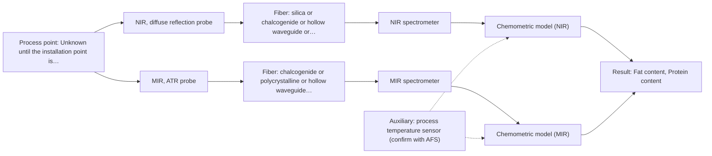
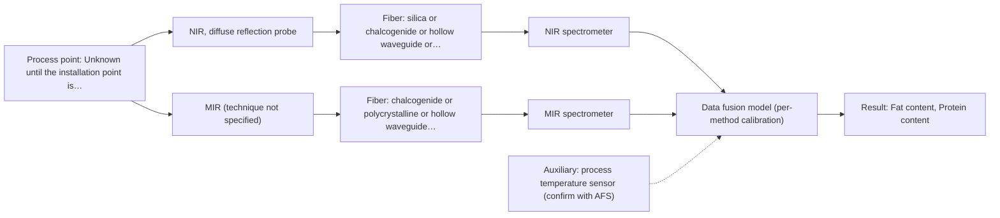

# First technical assessment: Fat and protein monitoring in opaque dairy product

## Answer

**Customer request (our summary):** Customer produces an opaque, concentrated milk product flowing through a processing line. They currently sample for fat and protein analysis and want earlier information about composition changes. They request an initial spectroscopy concept and a practical comparison experiment while retaining laboratory checks.

### Brief answer

Test NIR diffuse reflection first: it is the established in-line route for opaque, concentrated dairy and targets fat and protein. Run MIR-ATR alongside it as a comparison, with your laboratory fat and protein values as the reference. Still open are the accuracy you need, the product's temperature range, and where and how the probe can be installed; a combined NIR plus MIR-ATR model is a later step only if neither single method is accurate enough.

### Proposal

- **Best current option:** O2 (recommended)
- **Basis:** supplied AFS sources
- **What would change it:** If the product turns out thin enough for a transmission or transflection path, that geometry should be tested beside reflection; if NIR reflection alone reaches the accuracy the customer states, the MIR-ATR arm and the fused option become unnecessary.
- **Next step:** Agree the accuracy target, the temperature range and the installation point, then run the comparison trial on representative samples with the customer's laboratory values as reference.

**Decision status:** Provisional feasibility assessment

### Solution options

| ID | Tier | Methods | Confidence | Cost class, S01 Table 1 (p.6) | Ease of use | Maintenance | Performance fit | Sources |
|---|---|---|---|---|---|---|---|---|
| O1 | Simple | M1 NIR, diffuse reflection probe | Medium: uncited auxiliary sensor | average cost (row 8) | one probe, simple in-line installation | probe cleaning and periodic recalibration | fits opaque concentrated streams, established dairy route | [1: S01 p.17] [2: S01 p.18] |
| O2 | Recommended | M1 NIR, diffuse reflection probe; M2 MIR, ATR probe | Medium: uncited auxiliary sensor and a parameter is not measurable in-line | high cost (rows 2, 8) | two instruments, more setup and alignment | two probes, two calibration schedules | adds fingerprint selectivity beside the reflection signal | [3: REF §5] [1: S01 p.17] [2: S01 p.18] [4: S01 p.18] [5: S01 p.5] [6: S04 p.4] |
| O3 | Extended (multi-method) | M3 NIR, diffuse reflection probe + MIR (combination) | Low: uncited auxiliary sensor and a parameter is not measurable in-line; multi-method, fusion benefit not yet shown | high cost (rows 2, 8) | most complex, needs synchronised dual-method operation | two instruments and a fused model to maintain | only route if one method cannot meet target | [7: S01 p.8] [8: S01 p.8] [9: S01 p.8] [10: S01 p.9] [11: S01 p.7] |

*Confidence rates the basis of the advice (how much is known and cited), not a predicted accuracy or probability of success. It starts at High, or at Medium when a key question on the method or the option is open, and drops one level per weakness listed (floor Low).*

*Cost class is the relative rating in S01 Table 1 (p.6) for the in-line method+technique rows named (the highest one for a multi-method option); it is not a price.*

### Setup sketch

*Recommended option O2; drawn by code from the option, a schematic, not a configuration.*

## Expert detail

**Customer enquiry**

> We produce an opaque, concentrated milk product that flows through a processing line. We currently sample it for fat and protein analysis and would like earlier information about composition changes. Product temperature and texture vary during production. We want an initial spectroscopy concept and a practical comparison experiment, while retaining our laboratory checks.

**Decision status:** Provisional feasibility assessment. A shortlist can be justified: NIR diffuse reflection is a stated in-line route for opaque, concentrated dairy, and MIR-ATR is a named addition for dairy information NIR may miss. The target accuracy, temperature range and installation point are still open, so the choice stays provisional.

### Parameters

| ID | Parameter | Kind | Need | Measured by | Why | Sources |
|---|---|---|---|---|---|---|
| P1 | Fat content | quantitative | required | Spectroscopy: NIR | Fat is one of the two composition targets the customer currently analyses by sampling. | [12: S01 p.17] |
| P2 | Protein content | quantitative | required | Spectroscopy: NIR | Protein is the second composition target the customer currently analyses by sampling. | [12: S01 p.17] |
| P3 | Product temperature | quantitative | required | Auxiliary sensor: process temperature sensor (engineering judgement: confirm availability with AFS) | Product temperature varies during production and shifts the spectra, so it must be recorded with every measurement for compensation. | *(no verified source: engineering judgement)* |
| P4 | Reference fat and protein values | quantitative | required | Reference lab method: customer's existing laboratory fat and protein method (method not stated) | Calibration and the go/no-go comparison need independent reference values from the retained laboratory checks. | *(no verified source: engineering judgement)* |
| P5 | Product texture / physical state of the stream | qualitative | required | Not measurable in-line by spectroscopy; alternative: record the process state with each sample and, if needed, an offline texture or viscosity check | Texture varies during production and changes the reflection signal, so it must be recorded to avoid mistaking scatter for a composition change. | [13: S01 p.17] |

### Solution option details

- **O1 cost drivers:** one NIR spectrometer, reflection probe and port, calibration samples and reference analyses
- **O2 cost drivers:** two spectrometers and probes, more reference analyses, method-comparison effort
- **O3 cost drivers:** two instruments, combined or dual probes, synchronisation, fused-model development
- **O3 combining methods:** Fusion level: one calibration per method first, then fuse the preprocessed blocks (autoscaling) or their scores into a single model. Both methods must look at the same small volume of the stream, with the two data streams aligned to a common time step, and each instrument keeps its own calibration and diagnostics. The fused model must beat the best single method on held-out runs, otherwise the second instrument is not justified.

*Extended (multi-method) option O3; drawn by code from the option, a schematic, not a configuration.*

### Premise check

- **Precedent only:** Earlier information about composition changes can be obtained from spectroscopy for this product. A published dairy example shows in-line NIR reflection on opaque, concentrated products and PLS quantification of fat and protein, but it is a reason to test, not proof for this product. [1: S01 p.17]
- **Supported:** An initial spectroscopy concept and a practical comparison experiment can be defined before the key measurement details are known. The guidance explicitly allows a provisional, assumption-based plan when facts are missing. [14: REF §3]

### Requirements

**Stated by the customer**

- "We produce an opaque, concentrated milk product"
- "flows through a processing line"
- "We currently sample it for fat and protein analysis"
- "Product temperature and texture vary during production."
- "while retaining our laboratory checks"
- "fat and protein analysis"
- "composition changes"

**Key unknowns**

- Required accuracy, measurement range and response time for fat and protein.
- Whether any stage of the product is thin or transparent enough for a transmission or transflection path.
- The actual product temperature range during production.
- The measurement point in the line and the distance from it to the spectrometer.
- Cleaning regime, pressure and expected fouling at the measurement interface.
- The existing laboratory reference method and how many reference samples can be taken.

### Clarification questions (most decision-relevant first)

### Recommendation

- **M1 · Primary candidate: NIR, diffuse reflection probe.** NIR reflection is the stated in-line route for opaque, concentrated dairy and is used there to quantify fat and protein. An opaque, concentrated stream with varying texture points to a scatter-based geometry rather than transmission. *Conditions:* A calibration built on this product (with scatter correction) is available or can be built from the customer's reference data. [1: S01 p.17] [2: S01 p.18]
- **M2 · Comparison candidate: MIR, ATR probe.** MIR-ATR gives well-defined fingerprint bands with high selectivity and is named as an advanced dairy technique that captures information NIR may miss. ATR suits liquids and soft pastes that make tight contact with the crystal. *Conditions:* The product contacts the ATR crystal reliably and cleaning/fouling at that interface is managed. [4: S01 p.18] [5: S01 p.5] [6: S04 p.4]
- **M3 · Conditional candidate: NIR, diffuse reflection probe + MIR (combination).** Milk is named as a complex natural mixture for which one spectral method may be insufficient, and reflection and ATR carry different information (bulk scatter versus the fingerprint region). The fused model is a hypothesis to test only after the single-method trials. *Conditions:* Applies only if neither M1 nor M2 reaches the agreed accuracy on held-out runs. [11: S01 p.7] Later hypothesis, after single-method tests.

### Measurement concept

- **Probe and geometry:** Contact-free NIR diffuse-reflection probe (backscatter) at the process point, compared against a MIR ATR probe contacting the stream; spectrometers remote from the line.
- **Location:** Unknown until the installation point is named; the fiber link carries the light between the process port and the instrument.
- **Fiber link:** NIR light can be carried in silica fibers; MIR needs chalcogenide or polycrystalline fibers, whose achievable link length is not stated in the sources. [15: S01 p.5]

### Spectral range

- **NIR:** NIR nominal range 780-2500 nm. [16: S01 p.10]
- **MIR:** MIR nominal range 4000-400 cm-1. [17: S01 p.9]
- **NIR:** These are nominal method ranges only; the usable range depends on the instrument, fiber and probe actually selected. [18: REF §5]

### Risks and uncertainty

- Texture and fat-globule-size variation changes the reflection signal and can be mistaken for a composition change. *(rules: R-GEO-6)* [13: S01 p.17]
- NIR bands are broad and overlap, so a calibration built on one product state may not transfer to another state or temperature. *(rules: R-NIR-2, R-CAL-1)* [19: S01 p.10]
- An ATR crystal samples only a surface layer a few micrometres deep, so deposits or poor contact would make the MIR result unrepresentative. *(rules: R-MIR-3)* [20: S01 p.13]
- If the varying product temperature is not recorded with each measurement, spectral shifts will be attributed to composition. *(no verified source: engineering judgement)*

### First feasibility experiment

1. **Collect representative samples or in-line grabs across the expected range of fat and protein, product temperature and texture, covering start-of-run, transitions and end-of-run, and record the process state for each.**  [21: REF §3]
2. **Measure every sample with NIR diffuse reflection and with MIR-ATR, at the same point and time wherever possible, and record product temperature for each measurement.**  *(no verified source: engineering judgement)*
3. **Measure independent reference values for fat and protein with the existing laboratory method on every sample.**  *(no verified source: engineering judgement)*
4. **Build one calibration per method and validate it on held-out runs or batches, not on held-out spectra from the same run.**  *(no verified source: engineering judgement)*
5. **Go/no-go: does either single method reach the accuracy the customer states, on held-out runs? Only if neither does, test the fused NIR plus MIR-ATR model (M3) and require it to beat the best single method.**  *(no verified source: engineering judgement)*

**Reference measurements:** The customer's existing laboratory fat and protein analysis, retained as the reference for calibration and for the go/no-go comparison.

**Decision basis:** 

### Not covered by the supplied sources

- Accuracy, detection limits and response time for fat and protein in a concentrated milk product: no supplied source states figures for this.
- An achievable link length for a MIR (chalcogenide or polycrystalline) fiber run to the process point: the supplied sources show only short laboratory fiber lengths for these fibers.

### Further notes

- **Chemometrics:** Both methods need a calibration built on this product: reflection data are usually converted to absorbance and scatter-corrected (MSC or SNV) before PLS regression, and the calibration is specific to the matrix and the states it was built on. The customer's laboratory fat and protein values supply the reference data.
- **Real-time tracking:** In-line fiber probes are integrated into production lines so that analysis happens in the stream without sampling and results are available in near real time, which is the earlier information the customer asks for.
- **Future direction:** If reflection proves useful, the informative wavelengths could later be reduced to a compact, task-specific sensor; that development starts from in-depth laboratory studies of the product.

### Evidence (verified quotes)

1. ✓ **S01 p.17** (application precedent): "Inline NIR Reflection is primarily used for opaque or highly concentrated dairy products, such as yogurt, butter, or whole milk concentrates."
2. ✓ **S01 p.18** (general): "it fails when the milk becomes too "thick" or fat-rich, as the light cannot penetrate the sample."
3. ✓ **REF §5** (general): "compare with the best single method."
4. ✓ (precedent only) **S01 p.18** (method gain): "While NIR is the workhorse of the dairy industry, advanced labs often incorporate Fluorescence, Raman, and Mid-Infrared (MIR) ATR fiber optic techniques to capture specific chemical or structural information that NIR might miss."
5. ✓ **S01 p.5** (general): "Mid-IR band spectra contain well-defined peaks (absorption bands), while NIR, UV, and fluorescence spectra contain broad, highly overlapping signals"
6. ✓ **S04 p.4** (general): "suitability of analyzed samples for ATR measurements, which is true for liquid or soft solid samples and their components, allowing a tight contact with the probe head."
7. ✓ **S01 p.8** (general): "It is crucial that the spectral information obtained by different methods-Mid-IR, NIR, Raman, and fluorescence spectra-is collected from the same small, even pinpoint, area of the sample."
8. ✓ **S01 p.8** (general): "the data from each method must be obtained simultaneously."
9. ✓ **S01 p.8** (general): "the data should be normalized in some way, for example, using an autoscaling algorithm."
10. ✓ **S01 p.9** (general): "One of the challenges of multispectral analysis is the need to simultaneously connect at least two independently operating measuring instruments."
11. ✓ (precedent only) **S01 p.7** (method gain): "The analysis of such systems may require a combination of two or even more spectral methods."
12. ✓ **S01 p.17** (general): "before using Partial Least Squares (PLS) regression to quantify fat and protein."
13. ✓ **S01 p.17** (general): "the method is sensitive to the surface characteristics and fat globule size."
14. ✓ **REF §3** (general): "An honest provisional plan is more useful than a final configuration built on missing facts."
15. ✓ **S01 p.5** (general): "making it ideal for online applications, including remote measurements via fiber optic probes."
16. ✓ **S01 p.10** (general): "NIR spectra (780-2500 nm) contain predominantly overtones and component bands of fundamental vibrations"
17. ✓ **S01 p.9** (general): "Vibrational spectroscopy in the mid-IR range (4000-400 cm-1) is one of the most informative methods of chemical analysis."
18. ✓ **REF §5** (general): "It is not a product specification: actual spectral coverage, fiber length, component ratings, detection limits and accuracy depend on the configuration and the sample."
19. ✓ **S01 p.10** (general): "The broad absorption bands observed in this region overlap, suggesting the use of chemometrics for quantitative and qualitative analysis of spectral data."
20. ✓ **S01 p.13** (general): "typically at a depth of few microns"
21. ✓ **REF §3** (general): "Representative samples or process states, independent reference measurements, what is compared, and the basis for the go / no-go decision."

### Verification

- Citations verified: 24 of 24 (exact or whitespace/hyphen-tolerant match on the cited page, scope checked).
- Hard check failures before deterministic corrections: 0; still open: 0; soft warnings: 2; repair rounds: 1.
- Corrected deterministically after verification (1):
  - ⚠ recommendations[2].combined_with: combined_with normalised to ['MIR'] (duplicates and the entry's own method removed)

*Run D02-20261017T163243Z · models deepseek/deepseek-v4.1-flash*
