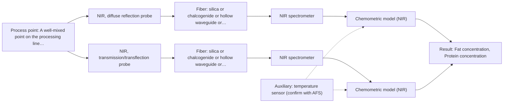

# First technical assessment: Fat and protein monitoring in opaque dairy product

## Answer

**Customer request (our summary):** The customer wants an initial spectroscopy concept and a practical comparison experiment to monitor fat and protein composition changes in a flowing, opaque concentrated milk product with varying temperature and texture.

### Brief answer

Start with inline NIR diffuse reflection, the described approach for opaque, concentrated dairy streams, and test an NIR transflection probe against it on your actual product in a bench comparison with your laboratory fat and protein results as reference. Pure NIR transmission is not a sensible first choice for an opaque stream. Open points: your temperature range, required accuracy, probe mounting and cleaning constraints.

### Proposal

- **Best current option:** O2 (recommended)
- **Basis:** supplied AFS sources
- **What would change it:** A temperature range beyond typical dairy conditions, accuracy targets NIR reflection cannot meet, or an installation point that rules out a flush-mounted probe would change the technique or push toward the MIR-ATR comparison.
- **Next step:** Run the bench comparison of NIR reflection and transflection probes on representative samples with laboratory reference values, after confirming temperature range, accuracy targets and mounting constraints.

**Secondary evidence (external, not AFS material):** G1: E03 ¶12; G2: no usable external source found; G3: no usable external source found. See Expert detail.

**Decision status:** Provisional feasibility assessment

### Solution options

| ID | Tier | Methods | Confidence | Cost class, S01 Table 1 (p.6) | Ease of use | Maintenance | Performance fit | Sources |
|---|---|---|---|---|---|---|---|---|
| O1 | Simple | M1 NIR, diffuse reflection probe | Low: open question: Q1, Q2 (starts at Medium); uncited auxiliary sensor | average cost (row 8) | Simple flush-mounted probe, standard NIR hardware | Probe window cleaning; periodic calibration checks | Directly matches the described inline dairy reflection precedent | [1: S01 p.17] [2: S01 p.5] [3: S01 p.17] |
| O2 | Recommended | M1 NIR, diffuse reflection probe; M2 NIR, transmission/transflection probe | Low: open question: Q1, Q2 (starts at Medium); suitability for this sample not confirmed; uncited auxiliary sensor | average cost (rows 7, 8) | Two probes in one bench comparison trial | Same as O1 once one technique is selected | Resolves the transflection-versus-reflection question on the real product before installation | [4: S01 p.18] [1: S01 p.17] [2: S01 p.5] [3: S01 p.17] [5: S01 p.18] |

*Confidence rates the basis of the advice (how much is known and cited), not a predicted accuracy or probability of success. It starts at High, or at Medium when a key question on the method or the option is open, and drops one level per weakness listed (floor Low).*

*Cost class is the relative rating in S01 Table 1 (p.6) for the in-line method+technique rows named (the highest one for a multi-method option); it is not a price.*

### Setup sketch

*Recommended option O2; drawn by code from the option, a schematic, not a configuration.*

### Key questions

1. What temperature range does the product cover on the line, and how fast does it change?
2. What accuracy and detection limits do you need for fat and protein, and over what concentration ranges?
3. Where could a probe be mounted on the line (pipe diameter, access, flow conditions), and what cleaning requirements (CIP/SIP) apply?

## Expert detail

**Customer enquiry**

> We produce an opaque, concentrated milk product that flows through a processing line. We currently sample it for fat and protein analysis and would like earlier information about composition changes. Product temperature and texture vary during production. We want an initial spectroscopy concept and a practical comparison experiment, while retaining our laboratory checks.

**Decision status:** Provisional feasibility assessment. A method shortlist can be justified from the dairy precedents in the supplied material, but the temperature range, accuracy targets and installation constraints are unknown, so the assessment is provisional.

### Parameters

| ID | Parameter | Kind | Need | Measured by | Why | Sources |
|---|---|---|---|---|---|---|
| P1 | Fat concentration | quantitative | required | Spectroscopy: NIR | Fat is one of the two composition targets the inline measurement must track. | [6: S01 p.17] |
| P2 | Protein concentration | quantitative | required | Spectroscopy: NIR | Protein is the second composition target the inline measurement must track. | [6: S01 p.17] |
| P3 | Product temperature | quantitative | required | Auxiliary sensor: temperature sensor (engineering judgement: confirm availability with AFS) | Temperature varies during production and shifts the spectra, so it must be recorded for compensation and calibration. | *(no verified source: engineering judgement)* |
| P4 | Texture / consistency state | qualitative | optional | Not measurable in-line by spectroscopy; alternative: laboratory texture or rheology assessment and process records | Texture variation changes scattering and should be represented in the calibration samples; it should be available as a process descriptor for each sample. | *(no verified source: engineering judgement)* |

### Solution option details

- **O1 cost drivers:** One NIR spectrometer, one reflection probe, calibration samples and reference lab analyses
- **O2 cost drivers:** Additional transflection probe and trial time; otherwise as O1

### Premise check

- **Precedent only:** Inline spectroscopy can give earlier fat/protein information on an opaque, concentrated dairy stream despite varying temperature and texture. Inline NIR reflection for opaque dairy products is a described application, but it is a precedent to test, not proof for this customer's product. [1: S01 p.17]
- **Supported:** NIR reflection can work on this opaque product despite texture variation. The source describes reflection for opaque dairy but warns that the signal is sensitive to surface characteristics and globule size, which matches the customer's texture variation. [3: S01 p.17]

### Requirements

**Stated by the customer**

- Earlier information on fat and protein composition changes in a flowing, opaque, concentrated milk product
- An initial spectroscopy concept
- A practical comparison experiment
- Retention of existing laboratory checks

**Key unknowns**

- Product temperature range during production
- Required accuracy and detection limits for fat and protein
- Pipe geometry and where a probe could be mounted
- Cleaning and fouling requirements (CIP/SIP)
- Details of the reference laboratory method used for fat and protein

### Clarification questions (most decision-relevant first)

Q1. What temperature range does the product cover on the line, and how fast does it change? *Why it matters:* Temperature shifts NIR spectra, so it decides whether temperature compensation or a sensor input is needed in the calibration. *(affects: technique, M1)*
Q2. What accuracy and detection limits do you need for fat and protein, and over what concentration ranges? *Why it matters:* This decides whether NIR reflection alone is sufficient or a second method must be considered. *(affects: method, status)*
Q3. Where could a probe be mounted on the line (pipe diameter, access, flow conditions), and what cleaning requirements (CIP/SIP) apply? *Why it matters:* Probe geometry, flush mounting and cleanability determine which technique is practically installable. *(affects: installation)*
Q4. Which laboratory method do you use for fat and protein reference analysis, and what is its typical turnaround? *Why it matters:* The reference method defines the calibration targets and how the earlier inline information is validated against your lab checks. *(affects: status, M1)*

### Recommendation

- **M1 · Primary candidate: NIR, diffuse reflection probe.** Inline NIR reflection is the described approach for opaque, concentrated dairy products, and NIR suits remote fiber-probe measurement on a line. Its scatter sensitivity must be handled with correction and calibration, which the comparison experiment addresses. [1: S01 p.17] [2: S01 p.5] [3: S01 p.17]
- **M2 · Comparison candidate: NIR, transmission/transflection probe.** Transmission is expected to fail on this opaque product, but a transflection probe is reported in some cases to work for both low-fat and high-fat dairy, so it is worth testing against reflection on real samples. *Conditions:* Only if the transflection probe still returns usable signal on the concentrated, opaque product in the bench test. [4: S01 p.18] [5: S01 p.18]
- **M3 · Comparison candidate: MIR, ATR probe.** MIR-ATR fiber probes are used for in-line liquid analysis and give well-defined bands with high selectivity, including a published water-in-petroleum example; ATR suits liquids in contact with the crystal. It is a candidate if NIR reflection cannot meet the accuracy targets. *Conditions:* Only if the bench test shows NIR reflection accuracy is insufficient, and if fouling of the ATR crystal on this product is manageable. [7: S01 p.10] [8: S01 p.5] [9: S02 p.13]

### Measurement concept

- **Probe and geometry:** Flush-mounted NIR diffuse-reflection fiber probe in the process pipe, light delivered and backscattered light collected through the probe; a transflection probe tested in parallel at the same sampling point.
- **Location:** A well-mixed point on the processing line, downstream of composition changes the customer wants to detect early.
- **Fiber link:** Vis-NIR silica fibers (nominal transmission to about 2400 nm per S02 p.6); the usable range depends on the spectrometer, fiber and probe actually selected. [10: S01 p.17] [11: S02 p.6]

### Spectral range

- **NIR:** Nominal NIR method range 780-2500 nm; the usable range depends on the spectrometer, fiber and probe actually selected. [12: S01 p.10]

### Risks and uncertainty

- Texture and fat-globule variation can mimic composition change in reflection spectra, so scatter correction (e.g. MSC/SNV) and a texture-representative calibration are essential. *(rules: R-GEO-6)* [3: S01 p.17]
- Temperature variation shifts the spectra and can bias the fat and protein predictions if not covered in the calibration. *(rules: R-CAL-1)* *(no verified source: engineering judgement)*
- NIR calibrations are specific to the product matrix, so any recipe or process change requires re-validation of the model. *(rules: R-CAL-1)* [13: REF §5]
- If MIR-ATR is pursued, deposits on the ATR crystal and its few-micron sampling depth could bias the reading on a fouling-prone stream. *(rules: R-MIR-3)* [14: S01 p.13]

### First feasibility experiment

1. **Collect representative samples across the expected variation in fat, protein, temperature and texture, covering normal production and changeover states.** Make the calibration data reflect the real process variation. *(no verified source: engineering judgement)*
2. **Measure each sample with the NIR reflection probe and, in parallel, the transflection probe at the same laboratory bench setup, recording sample temperature.** Compare the two techniques on identical material under controlled conditions. *(no verified source: engineering judgement)*
3. **Run the existing laboratory fat and protein analysis on all samples as the independent reference.** Provide the reference values the spectral models are calibrated against. *(no verified source: engineering judgement)*
4. **Build separate PLS calibration models per technique with scatter correction, and validate them on held-out samples or a separate production run.** Show which technique predicts fat and protein reliably despite texture and temperature variation. *(no verified source: engineering judgement)*
5. **Apply the customer's required accuracy for fat and protein as the go/no-go criterion; if reflection alone misses it, test the MIR-ATR probe on the same sample set before considering any combination.** Decide the technique on numerical criteria agreed with the customer. *(no verified source: engineering judgement)*

**Reference measurements:** Existing laboratory fat and protein analysis on every calibration and validation sample.

**Decision basis:** Prediction error on held-out runs must meet the customer's stated accuracy targets for fat and protein; those targets are to be confirmed (Q2).

### Assumptions

- The product remains a flowing liquid throughout, so a contact probe can be mounted in the line.
- The existing laboratory method can serve as the reference for calibration samples.

### Not covered by the supplied sources

- Achievable accuracy for fat and protein on this specific concentrated product
- Whether the product contains fluorescent species suitable for fluorescence monitoring

### Further notes

- **Chemometrics:** A PLS calibration per technique is needed because NIR bands are broad and overlapping; scatter correction (MSC or SNV) is standard for dairy reflection data, and temperature should be included as a variation factor in the calibration set. Reference values come from the retained laboratory checks.
- **Real-time tracking:** Once calibrated, the inline probe tracks fat and protein changes continuously in the flowing product, giving earlier information than periodic sampling; the laboratory checks remain the reference for validation.
- **Future direction:** If NIR reflection alone cannot meet the accuracy targets, an MIR-ATR probe (M3) can be tested on the same samples, and only then a combined NIR+MIR evaluation considered as a later hypothesis.

### Secondary evidence (external, not AFS material)

*Found by a literature search for gaps the supplied AFS sources leave open. Not AFS material and not proof for this case; every quote below was verified verbatim against the fetched text.*

**G1 · auxiliary sensor:** In-line measurement of Product temperature with temperature sensor

- **E03 ¶12** Additionally, the temperature sensitivity of the OH bands is a severe drawback for measuring aqueous solution in NIR and MIR, which makes tempered sample holders necessary. *How it applies:* Since temperature strongly affects water absorption bands in aqueous dairy streams, monitoring product temperature closely or using temperature-controlled flow cells should be tested to maintain calibration stability. *Limits and transfer risks:* The source discusses general aqueous solutions and MIR/NIR instrument configurations, which may differ from the specific concentrated milk product matrix and flow cell design used here. *(supports O2)*
  > "Additionally, the temperature sensitivity of the OH bands is a severe drawback for measuring aqueous solution in NIR and MIR, which makes tempered sample holders necessary [29]."
  > A critical review of recent trends, and a future perspective of optical spectroscopy as PAT in biopharmaceutical downstream processing. (2020) · Analytical and bioanalytical chemistry · doi:10.1007/s00216-020-02407-z · https://europepmc.org/article/PMC/PMC7072065 · retrieved 2026-10-17, full text, licence: cc by, via curated library

**G2 · not in the supplied sources:** Achievable accuracy for fat and protein on this specific concentrated product

- No usable external source found.

**G3 · not in the supplied sources:** Whether the product contains fluorescent species suitable for fluorescence monitoring

- No usable external source found.

### Evidence (verified quotes)

1. ✓ **S01 p.17** (application precedent): "Inline NIR Reflection is primarily used for opaque or highly concentrated dairy products, such as yogurt, butter, or whole milk concentrates."
2. ✓ **S01 p.5** (general): "making it ideal for online applications, including remote measurements via fiber optic probes."
3. ✓ **S01 p.17** (general): "the method is sensitive to the surface characteristics and fat globule size."
4. ✓ **S01 p.18** (application precedent): "In some cases, a Transflection probe can already be a combined solution working well for low-fat and high-fat containing milk products."
5. ✓ **S01 p.18** (general): "it fails when the milk becomes too "thick" or fat-rich, as the light cannot penetrate the sample."
6. ✓ **S01 p.17** (general): "(PLS) regression to quantify fat and protein."
7. ✓ **S01 p.10** (general): "Probe-based analysis is gaining widespread use in online analysis, such as in-line, in-process (chemical, biotechnological, natural) environments"
8. ✓ **S01 p.5** (general): "Mid-IR band spectra contain well-defined peaks (absorption bands)"
9. ✓ **S02 p.13** (application precedent): "Application: measurement of water content in petroleum"
10. ✓ **S01 p.17** (general): "the probe is flush-mounted into a pipe or vat to interact directly with the flowing medium."
11. ✓ **S02 p.6** (general): "350 nm Standard VIS-NIR Silica Fibers Al/Cu-coated VIS-NIR Silica Fibers 2400 nm"
12. ✓ **S01 p.10** (general): "NIR spectra (780-2500 nm) contain predominantly overtones and component bands of fundamental vibrations"
13. ✓ **REF §5** (general): "physical variation; calibration specific to the matrix."
14. ✓ **S01 p.13** (general): "typically at a depth of few microns"

### Verification

- Citations verified: 21 of 21 (exact or whitespace/hyphen-tolerant match on the cited page, scope checked).
- Hard check failures before deterministic corrections: 0; still open: 0; soft warnings: 1; repair rounds: 1.
- Removed 1 intake item(s) not quoted verbatim from the enquiry:
  - intake.process[1]: enquiry_quote not found verbatim in the enquiry
- External evidence (live): 1 quote(s) verified verbatim (exact or whitespace/hyphen-tolerant, at most 400 characters and 2 sentences, against the cited paragraph); 0 item(s) dropped.
- External search: 3 query(ies), 30 hit(s), 5 source(s) (3 from the curated library).
- External step: 2 model call(s), 6.8 s extra (cost in the run JSON).

*Run D02-20261018T094733Z-1848 · models google/gemini-3.5-flash-lite, google/gemini-3.8-flash, z-ai/glm-5.3-flash*
