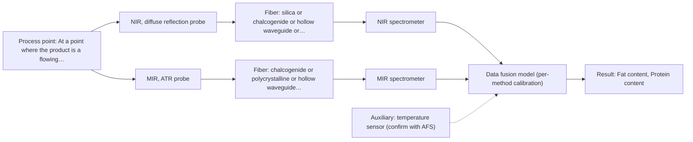
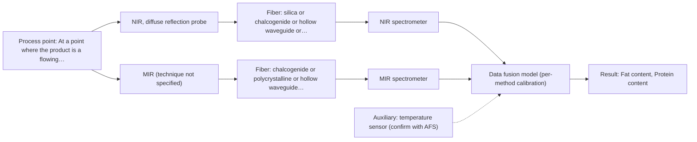

# First technical assessment: Fat and protein monitoring in opaque dairy product

# Answer

**Customer request:** Customer produces an opaque, concentrated milk product flowing through a processing line; currently samples for fat and protein analysis and wants earlier information about composition changes; requests an initial spectroscopy concept and a practical comparison experiment while retaining laboratory checks.

## Brief answer

Test NIR diffuse reflection first: it is the established fiber-probe method for opaque, concentrated dairy and covers both fat and protein. Run a comparison on representative samples between NIR reflection and MIR ATR, using your existing fat and protein analyses as the reference, and keep the better single method. Still open: the accuracy and response time you need, the temperature and texture range at the probe, and the installation and cleaning constraints.

## Proposal

- **Best current option:** O2 (recommended): M1 NIR, diffuse reflection probe; M2 MIR, ATR probe
- **Basis:** supplied AFS sources
- **What would change it:** If NIR reflection alone meets the required accuracy and response time, the choice moves to O1; if MIR ATR cannot hold contact or fouls on this product, it is dropped and O3 is not pursued. If the product proves semi-transparent at the measurement point, a transmission or transflection geometry would be tested instead of reflection.
- **Next step:** Run the laboratory comparison of NIR diffuse reflection and MIR ATR on representative samples against the customer's fat and protein reference values, then fix the in-line configuration.

**Decision status:** Provisional feasibility assessment. A method shortlist can be justified: NIR diffuse reflection is the established fiber-probe route for opaque, concentrated dairy and has a published dairy example for fat and protein, with MIR ATR as a reasonable second technique. The customer's required accuracy, response time and installation point are unknown, so the shortlist rests on stated assumptions and the deciding questions are listed.

## Solution options

| ID | Tier | Methods | Confidence | Cost class, S01 Table 1 (p.6) | Ease of use | Maintenance | Performance fit | Sources |
|---|---|---|---|---|---|---|---|---|
| O1 | Simple | M1 NIR, diffuse reflection probe | Medium: uncited auxiliary sensor | average (row 8) | high: one probe, one spectrometer, no synchronisation | one probe window to clean, one instrument to service | least effort that answers whether NIR tracks fat and protein | [1: S01 p.17] [2: S01 p.10] |
| O2 | Recommended | M1 NIR, diffuse reflection probe; M2 MIR, ATR probe | Low: physical state unknown; uncited auxiliary sensor and a required parameter is not measurable in-line; multi-method, fusion benefit not yet shown | high (rows 2, 8) | moderate: two instruments and probes, run and read separately | two probes and two instruments; the ATR crystal needs regular cleaning | adds MIR molecular specificity NIR may miss and compares methods directly | [3: S01 p.18] [4: S02 p.14] |
| O3 | Extended (multi-method) | M3 NIR, diffuse reflection probe + MIR (combination) | Low: physical state unknown; uncited auxiliary sensor and a required parameter is not measurable in-line; multi-method, fusion benefit not yet shown | average (row 8); not rated in S01 Table 1: MIR (technique not specified) | lower: fused model needs synchronised acquisition and joint upkeep | two instruments plus fusion model; breaks if either block drifts | only if neither single method reaches the required accuracy | [5: S01 p.8] [6: S01 p.8] [7: S01 p.7] [8: REF §5] |

*Confidence rates the basis of the advice (how much is known and cited), not a predicted accuracy or probability of success. It starts at High and drops one level per weakness listed.*

*Cost class is the relative rating in S01 Table 1 (p.6) for the in-line method+technique rows named (the highest one for a multi-method option); it is not a price.*

## Setup sketch

*Recommended option O2; drawn by code from the option, a schematic, not a configuration.*

*Extended (multi-method) option O3; drawn by code from the option, a schematic, not a configuration.*

## Key questions

1. What accuracy and precision do you need for fat and protein, and how quickly must a composition change be visible (measurement interval or response time)?
2. Which laboratory method do you use today for fat and protein, and what is its repeatability?
3. What is the product temperature range and how fast does it change at the planned measurement point?

# Expert detail

**Customer enquiry**

> We produce an opaque, concentrated milk product that flows through a processing line. We currently sample it for fat and protein analysis and would like earlier information about composition changes. Product temperature and texture vary during production. We want an initial spectroscopy concept and a practical comparison experiment, while retaining our laboratory checks.

## Parameters

| ID | Parameter | Kind | Need | Measured by | Why | Sources |
|---|---|---|---|---|---|---|
| P1 | Fat content | quantitative | required | Spectroscopy: NIR | Fat is one of the two composition targets the customer wants earlier information about. | [9: S01 p.17] |
| P2 | Protein content | quantitative | required | Spectroscopy: NIR | Protein is the second composition target named by the customer. | [10: S01 p.17] |
| P3 | Product temperature at the measurement point | quantitative | required | Auxiliary sensor: temperature sensor (engineering judgement: confirm availability with AFS) | Temperature varies during production and shifts the water-related bands and the physical state, so it must be recorded alongside every spectrum. | *(no verified source: engineering judgement)* |
| P4 | Texture / physical state of the product at the probe | qualitative | required | Not measurable in-line by spectroscopy; alternative: periodic laboratory viscosity or texture check, recorded together with the process state | Physical variation affects the spectrum and the calibration, so the state of the product at each measurement must be known. | [11: REF §5] |

## Solution option details

- **O1 cost drivers:** one NIR spectrometer, one reflection probe, one line port, calibration and reference analyses
- **O2 cost drivers:** one NIR and one MIR spectrometer, two probes, two calibrations, reference analyses
- **O3 cost drivers:** as O2 plus synchronisation, a block-scaled fusion model and two calibration and maintenance routines
- **O3 combining methods:** Fusion is low-level: the NIR and MIR ATR spectra are joined into one matrix and block-scaled so neither block dominates. Both probes must view the same small volume at the same time, with the data normalised to a common time step, and each block keeps its own calibration and diagnostics. The fused model must beat the best single method on held-out batches, otherwise the second instrument is dropped.

## Premise check

- **Precedent only:** An in-line optical measurement can give earlier information about composition changes in this opaque, concentrated milk product. The sources show a similar demonstrated dairy case and a published quantification of fat and protein by NIR reflection, which is a reason to test, not proof for this line. [12: S01 p.17] [13: S01 p.17]
- **Not covered:** Laboratory checks can be retained alongside the proposed spectroscopy concept. No supplied source describes how routine laboratory checks and an in-line measurement coexist in production; the sources only require independent reference measurements inside a feasibility comparison. [14: REF §3]
- **Supported:** A spectroscopy concept and a comparison experiment can be defined before all the deciding facts are known. The organizer guidance explicitly allows a conditional shortlist with stated assumptions instead of a final configuration. [15: REF §3]

## Requirements

**Stated by the customer**

**Key unknowns**

- Required accuracy and precision for fat and protein, and the allowed measurement interval.
- Which composition changes must be seen early, and over what concentration range.
- The laboratory reference method used today for fat and protein, and its uncertainty.
- Temperature range and rate of change at the planned measurement point.
- Texture/viscosity range and whether the product is homogeneous at the probe.
- Installation point and port, distance to the spectrometer, and cleaning/fouling constraints.

## Clarification questions (most decision-relevant first)

Q1. What accuracy and precision do you need for fat and protein, and how quickly must a composition change be visible (measurement interval or response time)? *Why it matters:* This decides whether one method is sufficient or whether a second method and data fusion are needed. *(affects: method, status)*
Q2. Which laboratory method do you use today for fat and protein, and what is its repeatability? *Why it matters:* It is the independent reference for calibration and for the go/no-go decision, and its uncertainty sets the floor for any comparison. *(affects: method)*
Q3. What is the product temperature range and how fast does it change at the planned measurement point? *Why it matters:* Temperature shifts the water-related bands and the physical state, so it decides whether temperature compensation is required and which interface is practical. *(affects: technique, installation)*
Q4. How does the texture or viscosity vary, and is the product at the probe always a pumpable, homogeneous stream? *Why it matters:* An ATR probe needs tight contact and a representative spot, and inhomogeneity can be mistaken for a composition change. *(affects: technique, installation)*
Q5. What cleaning-in-place, pressure and fouling constraints apply at the measurement point, and how far is it from where the spectrometer could stand? *Why it matters:* This decides between a contact ATR probe and a window or non-contact reflection probe, and whether the required fiber link is available at all. *(affects: installation)*

## Recommendation

- **M1 · Primary candidate: NIR, diffuse reflection probe.** NIR diffuse reflection is the established fiber-probe route for opaque, concentrated dairy, and the dairy example uses it with PLS regression to quantify fat and protein. It is also described as the most common online method performed with fiber probes. *Conditions:* Applies while the product at the probe stays a pumpable, homogeneous stream and the required accuracy can be reached with scatter correction. [16: S01 p.17] [17: S01 p.17] [18: S01 p.10]
- **M2 · Comparison candidate: MIR, ATR probe.** MIR ATR gives well-defined absorption bands with high selectivity, and in the dairy context it is the technique added when NIR may miss chemical or structural information. A NIR-reflection plus MIR-ATR set-up is also shown in-line in a process example. *Conditions:* Worth testing if the product makes tight contact with an ATR crystal and fouling at the crystal can be controlled. [19: S01 p.18] [20: S01 p.9] [21: S02 p.14]
- **M3 · Conditional candidate: NIR, diffuse reflection probe.** If no single method reaches the required accuracy, joining NIR and MIR ATR adds heterogeneous information from the same sample; any gain from combining is a hypothesis to be tested, not an established result. This entry is a later step, after the single-method tests. *Conditions:* Only after the single-method comparison, and only if the fused model beats the best single method on held-out batches. [22: S01 p.7] [23: REF §5] Later hypothesis, after single-method tests: combine with MIR.

## Measurement concept

- **Probe and geometry:** In-line probe at one point on the line: NIR diffuse-reflection window or probe first, compared with a MIR ATR probe; both must see the same product volume.
- **Location:** At a point where the product is a flowing, homogeneous stream, chosen with the customer after Q4 and Q5.
- **Fiber link:** The fiber must transmit the method's range; long (100-300 m) links are stated only for low-OH silica fibers, and no source states an achievable length for a mid-IR link, so the MIR link length is an open question for AFS. [24: S02 p.7] [25: S01 p.10]

## Spectral range

- **NIR:** Nominal NIR range 780-2500 nm; the usable range depends on the instrument, fiber and probe actually selected. [26: S01 p.10] [27: REF §3]
- **MIR:** Nominal MIR range 4000-400 cm-1 (2.5-25 um); the usable range depends on the fiber, crystal and instrument actually selected. [28: S01 p.9]

## Risks and uncertainty

- Physical variation (temperature, texture, scattering) can dominate the NIR signal and be mistaken for a composition change, so scatter correction and temperature recording are needed. *(rules: R-GEO-6, R-CAL-1)* [29: S01 p.17]
- If the product is less opaque at the probe than stated, a transmission or transflection geometry could fit better than reflection. *(rules: R-GEO-1, R-GEO-5)* [30: S01 p.18]
- A MIR ATR probe sees only a few micrometres at the crystal, so deposits or fouling on a milk line can bias it and require cleaning. *(rules: R-MIR-3)* [31: S01 p.13]
- No source states an achievable link length for a mid-IR fiber, so the in-line distance for a MIR probe may not be feasible and must be checked with AFS. *(rules: R-FIB-2)* [32: S02 p.7]

## First feasibility experiment

1. **Select representative samples or process states across the expected variation: low, mid and high fat and protein, the full temperature range, and the texture extremes seen in production.** Representative coverage of the chemical and physical variation. [33: REF §3]
2. **Measure each sample by NIR diffuse reflection first and, separately, by MIR ATR on the same sample spot, recording the sample temperature at each measurement.** Single methods first, on the same material and spot. [34: S01 p.8]
3. **Have the customer's laboratory measure fat and protein on the same samples as the independent reference, and build one chemometric calibration per method against those values.** Independent reference data for each method. [35: REF §5]
4. **Compare the two single-method models on held-out runs or batches and keep the method whose prediction error meets the customer's stated numerical criteria; if neither meets them, go to the next step.** Go/no-go basis with criteria set by the customer. *(no verified source: engineering judgement)*
5. **Only then test the fused NIR + MIR ATR model on the same held-out runs and require it to beat the best single method before a second instrument is added.** Combination only after the single methods, and only if it adds accuracy. [36: REF §5]

**Reference measurements:** The customer's existing laboratory fat and protein analyses, on the same samples, are the independent reference; the numerical go/no-go thresholds come from the customer.

**Decision basis:** Customer-stated accuracy and response-time criteria on held-out runs or batches.

## Assumptions

- The product at the measurement point is a pumpable, reasonably homogeneous stream suitable for contact or window mounting.
- Fat and protein are the composition targets; no trace-level component is required.
- The customer's existing laboratory method can supply reference values on the trial samples.
- A fiber link of the required length can be provided for the selected method; this is unverified for mid-IR.

## Not covered by the supplied sources

- No accuracy, precision or detection-limit figure for fat or protein in concentrated milk is given in the supplied material; these must come from the customer's requirements and the trial.
- No source states an achievable fiber link length for a mid-IR probe, so the in-line distance for a MIR ATR installation is not covered.

## Further notes

- **Chemometrics:** Fat and protein are quantified from broad, overlapping NIR bands, so a chemometric calibration (for example PLS) built against the customer's reference values is needed, with scatter correction such as MSC or SNV. The calibration is specific to the matrix and to the physical state, so it must be re-validated if the product or its texture changes.
- **Real-time tracking:** In-line measurement gives continuous or time-resolved tracking without sampling, which is what the customer wants for earlier warning of composition changes. If two methods are run together, their acquisition rates differ and the data must be normalised to a common time step before they are fused.
- **Future direction:** Once the information-rich spectral features for fat and protein are identified, a reduced sensor using a few selected wavelengths could be considered as a later, lower-cost in-line option; the LED-based study is a precedent for that path, not a proven route for this product.

## Evidence (verified quotes)

1. ✓ **S01 p.17** (application precedent): "NIR Reflection is primarily used for opaque or highly concentrated dairy products, such as yogurt, butter, or whole milk concentrates."
2. ✓ **S01 p.10** (general): "Near-IR vibrational spectroscopy (NIR) is the most common online analysis method performed using fiber optic probes."
3. ✓ **S01 p.18** (application precedent): "advanced labs often incorporate Fluorescence, Raman, and Mid-Infrared (MIR) ATR fiber optic techniques to capture specific chemical or structural information that NIR might miss."
4. ✓ **S02 p.14** (application precedent): "NIR-Reflex & MIR-ATR-spectroscopy to control polymer extrusion in-line"
5. ✓ **S01 p.8** (general): "It is crucial that the spectral information obtained by different methods-Mid-IR, NIR, Raman, and fluorescence spectra-is collected from the same small, even pinpoint, area of the sample."
6. ✓ **S01 p.8** (general): "Ultimately, the measurement data must be normalized to a common time step."
7. ✓ (precedent only) **S01 p.7** (method gain): "The analysis of such systems may require a combination of two or even more spectral methods."
8. ✓ (precedent only) **REF §5** (method gain): "compare with the best single method."
9. ✓ **S01 p.17** (application precedent): "before using Partial Least Squares (PLS) regression to quantify fat and protein."
10. ✓ **S01 p.17** (application precedent): "before using Partial Least Squares (PLS) regression to quantify fat and protein."
11. ✓ **REF §5** (general): "physical variation; calibration specific to the matrix."
12. ✓ **S01 p.17** (application precedent): "NIR Reflection is primarily used for opaque or highly concentrated dairy products, such as yogurt, butter, or whole milk concentrates."
13. ✓ **S01 p.17** (application precedent): "before using Partial Least Squares (PLS) regression to quantify fat and protein."
14. ✓ **REF §3** (general): "Representative samples or process states, independent reference measurements, what is compared, and the basis for the go / no-go decision."
15. ✓ **REF §3** (general): "A conditional shortlist with explicit assumptions is also fine."
16. ✓ **S01 p.17** (application precedent): "NIR Reflection is primarily used for opaque or highly concentrated dairy products, such as yogurt, butter, or whole milk concentrates."
17. ✓ **S01 p.17** (application precedent): "before using Partial Least Squares (PLS) regression to quantify fat and protein."
18. ✓ **S01 p.10** (general): "Near-IR vibrational spectroscopy (NIR) is the most common online analysis method performed using fiber optic probes."
19. ✓ **S01 p.18** (application precedent): "advanced labs often incorporate Fluorescence, Raman, and Mid-Infrared (MIR) ATR fiber optic techniques to capture specific chemical or structural information that NIR might miss."
20. ✓ **S01 p.9** (general): "Vibrational spectroscopy in the mid-IR range (4000-400 cm-1) is one of the most informative methods of chemical analysis."
21. ✓ **S02 p.14** (application precedent): "NIR-Reflex & MIR-ATR-spectroscopy to control polymer extrusion in-line"
22. ✓ (precedent only) **S01 p.7** (method gain): "The analysis of such systems may require a combination of two or even more spectral methods."
23. ✓ (precedent only) **REF §5** (method gain): "compare with the best single method."
24. ✓ **S02 p.7** (performance figure): "Robust 100-300m cables made with Silica fibers of low OH-content (<0.1ppm OH) enable remote industrial process-control"
25. ✓ **S01 p.10** (general): "ATR fiber probes (Fig.1) enable the analysis of liquids and solid elastic samples"
26. ✓ **S01 p.10** (general): "NIR spectra (780-2500 nm) contain predominantly overtones and component bands of fundamental vibrations"
27. ✓ **REF §3** (general): "A nominal method range is not the range of a specific instrument, fiber or probe."
28. ✓ **S01 p.9** (general): "Vibrational spectroscopy in the mid-IR range (4000-400 cm-1) is one of the most informative methods of chemical analysis."
29. ✓ **S01 p.17** (general): "the method is sensitive to the surface characteristics and fat globule size."
30. ✓ **S01 p.18** (general): "Transmission is the preferred method for transparent or semi-transparent liquids, such as skim milk, whey, or permeate."
31. ✓ **S01 p.13** (general): "typically at a depth of few microns"
32. ✓ **S02 p.7** (performance figure): "Robust 100-300m cables made with Silica fibers of low OH-content (<0.1ppm OH) enable remote industrial process-control"
33. ✓ **REF §3** (general): "Representative samples or process states, independent reference measurements, what is compared, and the basis for the go / no-go decision."
34. ✓ **S01 p.8** (general): "It is crucial that the spectral information obtained by different methods-Mid-IR, NIR, Raman, and fluorescence spectra-is collected from the same small, even pinpoint, area of the sample."
35. ✓ **REF §5** (general): "calibration specific to the matrix."
36. ✓ (precedent only) **REF §5** (method gain): "compare with the best single method."

## Verification

- Citations verified: 36 of 36 (exact or whitespace/hyphen-tolerant match on the cited page, scope checked).
- Hard check failures before deterministic corrections: 0; still open: 0; soft warnings: 5; repair rounds: 0.
- Corrected deterministically after verification (1):
  - ⚠ recommendations[2].combined_with: combined_with normalised to ['MIR'] (duplicates and the entry's own method removed)

*Run D02-20261017T132828Z · models deepseek/deepseek-v4.1-flash*
