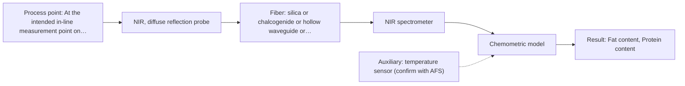

# First technical assessment: Fat and protein monitoring in opaque dairy product

## Answer

**Customer request (our summary):** Customer wants an initial in-line spectroscopy concept and a practical comparison experiment for an opaque, concentrated milk product flowing through a processing line, to get earlier information about composition changes while retaining laboratory checks.

### Brief answer

Test in-line NIR diffuse reflection first on your flowing, opaque concentrated product, with your existing laboratory fat and protein results as the reference; a mid-IR ATR probe is worth comparing against it. The NIR-plus-MIR combination is a later hypothesis, only if one method cannot separate composition change from the varying texture. What is still open: the accuracy you need, the temperature range, and how a probe can be installed and cleaned.

### Proposal

- **Best current option:** O2 (recommended)
- **Basis:** supplied AFS sources
- **What would change it:** If the trial shows that texture or temperature variation swamps the NIR reflection signal, the MIR ATR comparison or the combined option would move ahead. Answers on the required accuracy, the temperature range and the installation point could also change the choice.
- **Next step:** Run the comparison experiment on representative product samples at the stated extremes, with the existing laboratory fat and protein results as the reference.

**Secondary evidence (external, not AFS material):** G1: E02 ¶12; G2: E04 ¶1, E05 ¶1; G3: no usable external source found; G4: E03 ¶27. See Expert detail.

**Decision status:** Provisional feasibility assessment

### Solution options

| ID | Tier | Methods | Confidence | Cost class, S01 Table 1 (p.6) | Ease of use | Maintenance | Performance fit | Sources |
|---|---|---|---|---|---|---|---|---|
| O1 | Simple | M2 MIR, ATR probe | Low: open question: Q1 (starts at Medium); uncited auxiliary sensor | high cost (row 2) | one contact probe, direct in-line | crystal cleaning and fouling control | specific fat and protein bands, contact measurement | [1: S01 p.10] [2: S04 p.3] [3: S04 p.3] [4: S01 p.10] |
| O2 | Recommended | M1 NIR, diffuse reflection probe | Low: open question: Q1 (starts at Medium); uncited auxiliary sensor | average cost (row 8) | flush-mounted probe, standard silica fiber | window cleaning, periodic recalibration | established for opaque, concentrated dairy composition | [5: S01 p.17] [6: S01 p.17] [7: S01 p.5] |
| O3 | Extended (multi-method) | M3 NIR, diffuse reflection probe + MIR (combination) | Low: open question: Q1 (starts at Medium); uncited auxiliary sensor; multi-method, fusion benefit not yet shown | high cost (rows 2, 8) | two instruments and probes to align | two calibrations, two probe checks | adds MIR specificity where texture confounds NIR | [8: S01 p.8] [9: S01 p.9] [10: S02 p.14] [11: S01 p.7] [12: REF §5] |

*Confidence rates the basis of the advice (how much is known and cited), not a predicted accuracy or probability of success. It starts at High, or at Medium when a key question on the method or the option is open, and drops one level per weakness listed (floor Low).*

*Cost class is the relative rating in S01 Table 1 (p.6) for the in-line method+technique rows named (the highest one for a multi-method option); it is not a price.*

### Setup sketch

*Recommended option O2; drawn by code from the option, a schematic, not a configuration.*

### Key questions

1. What concentration ranges and what accuracy or detection limits do you need for fat and protein?
2. What is the process temperature range at the measurement point, and how quickly does it change?
3. Can the product be presented as a thin, controlled layer or through a bypass, so that a transmission or transflection measurement can be tested?

## Expert detail

**Customer enquiry**

> We produce an opaque, concentrated milk product that flows through a processing line. We currently sample it for fat and protein analysis and would like earlier information about composition changes. Product temperature and texture vary during production. We want an initial spectroscopy concept and a practical comparison experiment, while retaining our laboratory checks.

**Decision status:** Provisional feasibility assessment. A shortlist can be justified from the dairy precedent for opaque, concentrated products, but the accuracy, temperature and installation facts needed to fix a configuration are still open. The combined option stays a later hypothesis, not the starting point.

### Parameters

| ID | Parameter | Kind | Need | Measured by | Why | Sources |
|---|---|---|---|---|---|---|
| P1 | Fat content | quantitative | required | Spectroscopy: NIR | Fat is one of the two composition parameters the customer already measures and wants earlier. | [6: S01 p.17] |
| P2 | Protein content | quantitative | required | Spectroscopy: NIR | Protein is the second composition parameter the customer already measures and wants earlier. | [6: S01 p.17] |
| P3 | Product temperature | quantitative | required | Auxiliary sensor: temperature sensor (engineering judgement: confirm availability with AFS) | Temperature is stated to vary and shifts and broadens the spectra, so it must be known to interpret and compensate the measurement. | *(no verified source: engineering judgement)* |
| P4 | Texture or viscosity | quantitative | optional | Not measurable in-line by spectroscopy; alternative: Existing plant or laboratory viscosity or texture measurement | It is stated to vary and it affects the scatter-based signal, so it should be available to separate physical from chemical change. | [13: S01 p.17] |

### Solution option details

- **O1 cost drivers:** MIR fiber link, ATR probe, FTIR spectrometer
- **O2 cost drivers:** NIR spectrometer, silica reflection probe, chemometric calibration
- **O3 cost drivers:** two spectrometers, two fiber links, fused calibration
- **O3 combining methods:** NIR and MIR must look at the same product volume, so a combined or co-located probe head is needed; alternating probes cannot guarantee the same spot. The two methods acquire at different rates, so their data must be aligned to a common time step, and each method keeps its own calibration and diagnostics. Start with one model per method, then test a concatenated fusion with block scaling, and keep it only if it beats the best single method on held-out runs.

*Extended (multi-method) option O3; drawn by code from the option, a schematic, not a configuration.*

### Premise check

- **Precedent only:** Earlier in-line information about composition changes is achievable for this product. A published dairy process example supports testing in-line NIR reflection, but it is not proof for this line. [5: S01 p.17]
- **Precedent only:** Fat and protein are the relevant composition parameters. The source shows fat and protein quantified from milk reflection spectra; it does not set targets for this product. [6: S01 p.17]
- **Not covered:** Laboratory checks can be retained alongside an in-line method. No supplied page addresses keeping laboratory checks alongside an in-line method. *(no verified source: engineering judgement)*

### Requirements

**Stated by the customer**

- "opaque, concentrated milk product"
- "flows through a processing line"
- "currently sample it for fat and protein analysis"
- "earlier information about composition changes"
- "Product temperature and texture vary during production"
- "initial spectroscopy concept"
- "practical comparison experiment"
- "retaining our laboratory checks"
- "protein"
- "composition changes"

**Key unknowns**

- Target concentration ranges and the required accuracy or detection limits for fat and protein
- Process temperature range at the measurement point and how fast it changes
- Texture or viscosity range and whether the product is homogeneous at the probe
- Installation point on the line and distance from the instrument to the probe
- Cleaning, fouling and sanitation requirements at the probe
- Whether a thin, controlled path or a bypass can be provided for a transmission or transflection test

### Clarification questions (most decision-relevant first)

Q1. What concentration ranges and what accuracy or detection limits do you need for fat and protein? *Why it matters:* These values decide whether one method is enough and what the go/no-go criteria are. *(affects: method)*
Q2. What is the process temperature range at the measurement point, and how quickly does it change? *Why it matters:* Temperature changes shift and broaden the spectra and drive the need for compensation or a temperature-stable installation. *(affects: technique)*
Q3. Can the product be presented as a thin, controlled layer or through a bypass, so that a transmission or transflection measurement can be tested? *Why it matters:* It decides whether a transflection measurement is even possible on this opaque product. *(affects: technique)*
Q4. Where on the line can a probe be installed, and how far is that point from where the spectrometer would stand? *Why it matters:* The available port and the link length decide the probe type and the fiber family. *(affects: installation)*
Q5. How much does texture or viscosity vary, and is the product well mixed at the proposed probe point? *Why it matters:* Physical variation can mimic a composition change in a scatter-based signal, so it decides whether NIR reflection alone is enough. *(affects: M1)*
Q6. What cleaning, fouling and sanitation requirements apply at the probe? *Why it matters:* These decide whether a contact ATR crystal or a flush reflection window can be kept clean enough for a stable signal. *(affects: installation)*

### Recommendation

- **M1 · Primary candidate: NIR, diffuse reflection probe.** NIR reflection is the method described for opaque or highly concentrated dairy products, and fat and protein are quantified from milk reflection spectra with scatter correction and PLS regression. Its penetration of several millimetres and its compatibility with standard fibers and lamps suit a flush-mounted in-line probe. *Conditions:* Applies if a reflection probe can be flush-mounted at a point where the product wets the window. [5: S01 p.17] [6: S01 p.17] [7: S01 p.5]
- **M2 · Comparison candidate: MIR, ATR probe.** MIR ATR gives well-defined, selective bands, including the ester carbonyl C=O band near 1740 cm-1 that is characteristic of triglycerides and the amide I and II protein bands. ATR probes are used in-line and suit liquids that make tight contact with the crystal. *Conditions:* Applies if the product makes tight contact with the crystal and crystal fouling can be managed. [2: S04 p.3] [3: S04 p.3] [4: S01 p.10]
- **M3 · Comparison candidate: NIR, diffuse reflection probe + MIR (combination).** The two methods carry different information: NIR the scatter and overtone signal, MIR the well-defined fundamental bands. Where the stated texture variation confounds the NIR reflection signal, combining them is a hypothesis to test against the best single method. *Conditions:* Only after the single-method tests, and only if NIR reflection alone cannot separate composition change from texture change. [11: S01 p.7] [8: S01 p.8] [12: REF §5] Later hypothesis, after single-method tests.

### Measurement concept

- **Probe and geometry:** Flush-mounted NIR diffuse-reflection probe for the primary option; ATR contact probe as the comparison; no stand-off or pathlength to control for either.
- **Location:** At the intended in-line measurement point on the processing line (open: exact point, link length, cleaning conditions).
- **Fiber link:** Standard silica fibers are stated for Vis-NIR process control; the achievable link length is an open question for a mid-infrared probe. [14: S02 p.7]

### Spectral range

- **NIR:** NIR is quoted nominally as 780-2500 nm; the usable range depends on the instrument, fiber and probe actually selected. [15: S01 p.10] [16: REF §5]
- **MIR:** MIR is quoted nominally as 4000-400 cm-1; the usable range depends on the instrument, fiber and crystal actually selected. [17: S01 p.9]

### Risks and uncertainty

- The stated texture or viscosity variation may dominate the NIR reflection signal, so a composition change could be read as a physical change. *(rules: R-GEO-6)* [13: S01 p.17]
- A contact ATR crystal may foul or not stay wetted in a concentrated, flowing product, so its signal may not represent the bulk. *(rules: R-MIR-3)* *(no verified source: engineering judgement)*
- The required accuracy or detection limits for fat and protein are unknown, so it is not yet possible to say whether any option will meet them. *(no verified source: engineering judgement)*
- The achievable fiber link length for a mid-infrared probe on this line is unknown, so the installation may not be feasible as drawn. *(rules: R-FIB-2)* [14: S02 p.7]

### First feasibility experiment

1. **Collect representative samples or process states across the expected variation and pair them with the existing laboratory results.** Give the comparison a sample set that covers the expected chemical and physical variation rather than a single grab sample. [18: REF §3]
2. **Measure the single methods first on the same material: NIR diffuse reflection (M1) and MIR ATR (M2), each against the laboratory fat and protein reference.** Establish whether a single method already answers the fat and protein question before any combination is considered. [6: S01 p.17]
3. **Repeat at the process extremes of temperature and texture and on separate runs, to check that a composition change is separated from physical variation.** The stated temperature and texture variation is the main confounder, so it must be spanned in the test set. [13: S01 p.17]
4. **Only after the single-method tests, test the combined NIR reflection and MIR ATR measurement at the same spot and a common time step, and compare the fused result with the best single method.** Check whether adding the second method adds information, which is a hypothesis rather than a given. [19: S01 p.8] [12: REF §5]
5. **Set the go/no-go on the customer's own numerical criteria: the required accuracy and detection limits for fat and protein, checked against the laboratory reference on held-out runs or batches.** The pass threshold must come from the customer, not from the sources. *(no verified source: engineering judgement)*

**Reference measurements:** Existing laboratory fat and protein analysis, used as the independent reference for every comparison.

**Decision basis:** The customer's required accuracy and detection limits for fat and protein on held-out runs; these numbers must come from the customer.

### Assumptions

- The product can be brought into contact with a flush-mounted or immersed probe at the measurement point.
- The existing laboratory fat and protein results are available per sample or per run as reference values.
- No fluorescent target or indicator is required for this concept.

### Not covered by the supplied sources

- No supplied source states an achievable fiber-optic link length for a mid-infrared probe, so the distance from instrument to probe for an MIR ATR option is an open question.
- No supplied source covers dairy cleaning, fouling or sanitation requirements at an in-line probe.
- No supplied source gives accuracy or detection-limit figures for fat and protein in this product.

### Further notes

- **Chemometrics:** A fat and protein calibration must be built on this product's own reference data; such calibrations are specific to the matrix and need re-validation after a matrix or composition change.
- **Real-time tracking:** The aim is earlier information on composition change during production; high-speed diode-array NIR instruments allow instantaneous recording of light intensity at all wavelengths simultaneously.
- **Future direction:** If the reflection signal is confounded by physical variation, the combined NIR reflection and MIR ATR probe is the next step to test; a compact multisensor version could follow once the useful spectral regions are known.

### Secondary evidence (external, not AFS material)

*Found by a literature search for gaps the supplied AFS sources leave open. Not AFS material and not proof for this case; every quote below was verified verbatim against the fetched text.*

**G1 · auxiliary sensor:** In-line measurement of Product temperature with temperature sensor

- **E02 ¶12** Temperature sensitivity of OH bands in aqueous solutions is a severe drawback for NIR and MIR, making tempered sample holders necessary. *How it applies:* For an in-line NIR concept on milk, product temperature may affect spectra, so include temperature measurement or control and test temperature variation. *Limits and transfer risks:* The source is a review of biopharmaceutical downstream processing, not dairy; tempered sample holders are not the same as an in-line product temperature sensor. *(supports O2)*
  > "Additionally, the temperature sensitivity of the OH bands is a severe drawback for measuring aqueous solution in NIR and MIR, which makes tempered sample holders necessary [29]."
  > A critical review of recent trends, and a future perspective of optical spectroscopy as PAT in biopharmaceutical downstream processing. (2020) · Analytical and bioanalytical chemistry · doi:10.1007/s00216-020-02407-z · https://europepmc.org/article/PMC/PMC7072065 · retrieved 2026-10-17, full text, licence: cc by, via curated library

**G2 · multi-method:** Combining several spectroscopy methods (data fusion) (NIR and MIR must look at the same product volume, so a combined or co-located probe head is needed; alternating probes cannot guarantee the same spot. The two methods acquire at different rates, so their data must be aligned to a common time step, and each method keeps its own calibration and diagnostics. Start with one model per method, then test a concatenated fusion with block scaling, and keep it only if it beats the best single method on held-out runs.)

- **E04 ¶1** In rice authentication, MIR alone gave better classification accuracy than NIR, while a SPORT-based multiblock fusion of MIR and NIR improved use of spectral variability and robustness. *How it applies:* This supports starting with one model per method and then testing a concatenated fusion with block scaling, keeping it only if it beats the best single method on held-out runs. *Limits and transfer risks:* The study is on rice authentication, abstract only, and likely laboratory-based; the matrix, application, and classification task differ from an opaque dairy stream. *(supports O3)*
  > "When analysed individually, MIR showed better predictive performance than NIR in terms of classification accuracy. The SPORT-based multiblock approach, integrating complementary MIR and NIR information, improved the exploitation of spectral variability and provided a more robust framework for modelling complex authenticity patterns."
  > A comprehensive analysis of NIR and MIR data fusion for rice authentication (2026) · Journal of Food Composition and Analysis · doi:10.1016/j.jfca.2026.109547 · https://doi.org/10.1016/j.jfca.2026.109547 · retrieved 2026-10-17, abstract only, licence: cc-by, via openalex
- **E05 ¶1** PAT integration addresses challenges including compatibility of PAT tools with data fusion. *How it applies:* This suggests data fusion is a recognized area, but compatibility and data-treatment challenges should be tested for the chosen NIR/MIR setup. *Limits and transfer risks:* The source is a pharmaceutical PAT abstract, not dairy-specific, and does not address co-located NIR/MIR probes or time alignment. *(supports O3)*
  > "The integration of PAT in pharmaceutical processes not only ensures product quality, consistency, and regulatory compliance but also addresses challenges related to process implementation, data treatment algorithms, and the compatibility of PAT tools with data fusion [ 51 , 83 ]."
  > Process NIR (2026) · doi:10.1201/9781042002115-7 · https://doi.org/10.1201/9781042002115-7 · retrieved 2026-10-17, abstract only, licence: unknown, via openalex

**G3 · not in the supplied sources:** No supplied source states an achievable fiber-optic link length for a mid-infrared probe, so the distance from instrument to probe for an MIR ATR option is an open question.

- No usable external source found.

**G4 · not in the supplied sources:** No supplied source covers dairy cleaning, fouling or sanitation requirements at an in-line probe.

- **E03 ¶27** Contamination of the probe window during processing may make accurate measurement not possible. *How it applies:* For an in-line probe, fouling or contamination of the optical window is a risk to monitor and include in cleaning and validation planning. *Limits and transfer risks:* The source describes a pharmaceutical process with a binder, not dairy; it does not cover dairy cleaning or sanitation requirements.
  > "However, an accurate measurement may not be possible because of contamination of the probe window due to the addition of a binder during the process, which is a disadvantage."
  > Process Analytical Technology Tools for Monitoring Pharmaceutical Unit Operations: A Control Strategy for Continuous Process Verification. (2021) · Pharmaceutics · doi:10.3390/pharmaceutics13060919 · https://europepmc.org/article/PMC/PMC8234957 · retrieved 2026-10-17, full text, licence: cc by, via curated library

### Evidence (verified quotes)

1. ✓ **S01 p.10** (general): "ATR fiber probes (Fig.1) enable the analysis of liquids and solid elastic samples"
2. ✓ **S04 p.3** (general): "The discriminative power of mid-IR spectroscopy (Figure 2a and Figure S-4) toward rich in lipids fat samples is related to the stretching vibration band of the ester carbonyl C=O at about 1740 cm-1, which is characteristic of saturated triglycerides."
3. ✓ **S04 p.3** (general): "These are, respectively, the amide I and II bands, two major absorption peaks of the protein peptide group in the infrared region."
4. ✓ **S01 p.10** (general): "Probe-based analysis is gaining widespread use in online analysis, such as in-line, in-process (chemical, biotechnological, natural) environments"
5. ✓ **S01 p.17** (application precedent): "Inline NIR Reflection is primarily used for opaque or highly concentrated dairy products, such as yogurt, butter, or whole milk concentrates."
6. ✓ **S01 p.17** (application precedent): "before using Partial Least Squares (PLS) regression to quantify fat and protein."
7. ✓ **S01 p.5** (general): "NIR spectroscopy, with its relatively large penetration depth (up to several millimetres) even into dense solid samples due to low absorption and strong scattering, allows the use of ordinary glass for optics"
8. ✓ **S01 p.8** (general): "It is crucial that the spectral information obtained by different methods-Mid-IR, NIR, Raman, and fluorescence spectra-is collected from the same small, even pinpoint, area of the sample."
9. ✓ **S01 p.9** (general): "Furthermore, methods containing a larger number of variables have a greater impact on the model."
10. ✓ **S02 p.14** (application precedent): "NIR-Reflex & MIR-ATR-spectroscopy to control polymer extrusion in-line"
11. ✓ (precedent only) **S01 p.7** (method gain): "The analysis of such systems may require a combination of two or even more spectral methods."
12. ✓ (precedent only) **REF §5** (method gain): "compare with the best single method."
13. ✓ **S01 p.17** (general): "the method is sensitive to the surface characteristics and fat globule size."
14. ✓ **S02 p.7** (general): "Robust 100-300m cables made with Silica fibers of low OH-content (<0.1ppm OH) enable remote industrial process-control"
15. ✓ **S01 p.10** (general): "NIR spectra (780-2500 nm) contain predominantly overtones and component bands of fundamental vibrations"
16. ✓ **REF §5** (general): "It is not a product specification: actual spectral coverage, fiber length, component ratings, detection limits and accuracy depend on the configuration and the sample."
17. ✓ **S01 p.9** (general): "Vibrational spectroscopy in the mid-IR range (4000-400 cm-1) is one of the most informative methods of chemical analysis."
18. ✓ **REF §3** (general): "Representative samples or process states, independent reference measurements, what is compared, and the basis for the go / no-go decision."
19. ✓ **S01 p.8** (general): "Ultimately, the measurement data must be normalized to a common time step."

### Verification

- Citations verified: 30 of 30 (exact or whitespace/hyphen-tolerant match on the cited page, scope checked).
- Hard check failures before deterministic corrections: 0; still open: 0; soft warnings: 4; repair rounds: 1.
- Corrected deterministically after verification (1):
  - ⚠ recommendations[2].combined_with: combined_with normalised to ['MIR'] (duplicates and the entry's own method removed)
- Removed 1 intake item(s) not quoted verbatim from the enquiry:
  - intake.targets[0]: enquiry_quote not found verbatim in the enquiry
- External evidence (live): 4 quote(s) verified verbatim (exact or whitespace/hyphen-tolerant, at most 400 characters and 2 sentences, against the cited paragraph); 0 item(s) dropped.
- External search: 6 query(ies), 45 hit(s), 5 source(s) (3 from the curated library).
- External step: 2 model call(s), 53.8 s extra (cost in the run JSON).

*Run D02-20261017T184633Z · models deepseek/deepseek-v4.1-flash*
