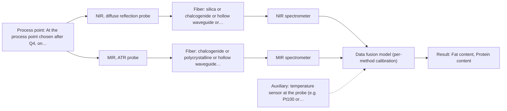

# First technical assessment: Fat and protein monitoring in opaque dairy product

## Answer

**Customer request (our summary):** Customer runs an opaque, concentrated milk product through a processing line, currently samples it for fat and protein, and wants an initial in-line spectroscopy concept plus a practical comparison experiment to get earlier composition-change information, while keeping laboratory checks.

### Brief answer

Test NIR diffuse reflection first: it is the documented in-line method for opaque, concentrated dairy products and can quantify fat and protein against your laboratory checks. Add MIR-ATR as a second single-method comparison in the same laboratory trial. Still open: which composition changes beyond fat and protein matter, the required accuracy and response time, and the temperature, texture and installation conditions.

### Proposal

- **Best current option:** O2 (recommended): M1 NIR, diffuse reflection probe; M2 MIR, ATR probe
- **Basis:** supplied AFS sources
- **What would change it:** If the answers show the product stays opaque and only fat and protein matter, O1 with NIR reflection alone becomes sufficient. If a target species turns out to be invisible to both NIR and MIR, the shortlist changes towards Raman or fluorescence and a combined probe may be needed.
- **Next step:** Answer Q1-Q3 so the laboratory comparison in O2 can be designed with the right samples and the go/no-go numbers.

**Decision status:** Provisional feasibility assessment. The product is opaque and concentrated, and NIR reflection is documented for opaque, highly concentrated dairy products, so a shortlist of methods worth testing can be justified. Which composition changes beyond fat and protein matter, and the required accuracy, response time, temperature, texture and installation conditions, are still open, so the choice stays provisional.

### Solution options

| ID | Tier | Methods | Confidence | Cost class, S01 Table 1 (p.6) | Ease of use | Maintenance | Performance fit | Sources |
|---|---|---|---|---|---|---|---|---|
| O1 | Simple | M1 NIR, diffuse reflection probe | Medium: uncited auxiliary sensor | average cost (row 8) | Flush-mounted reflection probe; no contact crystal, simple optics | Window cleaning and probe inspection during normal production stops | Documented for opaque, concentrated dairy; covers fat and protein first | [1: S01 p.17] [2: S01 p.10] [3: S01 p.10] [4: REF §5] |
| O2 | Recommended | M1 NIR, diffuse reflection probe; M2 MIR, ATR probe | Low: uncited auxiliary sensor and a parameter is not measurable in-line; multi-method, fusion benefit not yet shown | high cost (rows 2, 8) | Two probes and two spectrometers; more setup than NIR alone | Two interfaces; ATR crystal cleaning and inspection as well as the window | Tests the two strongest candidates and answers the requested comparison | [5: S01 p.18] [6: S02 p.20] [7: S01 p.17] [8: S01 p.10] [9: S01 p.10] [10: REF §5] [11: S01 p.9] [12: S01 p.5] [13: S04 p.4] [14: S01 p.13] |

*Confidence rates the basis of the advice (how much is known and cited), not a predicted accuracy or probability of success. It starts at High and drops one level per weakness listed.*

*Cost class is the relative rating in S01 Table 1 (p.6) for the in-line method+technique rows named (the highest one for a multi-method option); it is not a price.*

### Setup sketch

*Recommended option O2; drawn by code from the option, a schematic, not a configuration.*

### Key questions

1. Which composition changes, besides fat and protein, do you want to see earlier, and over what concentration range?
2. What accuracy and what response time must the in-line result meet relative to your laboratory fat and protein values?
3. What are the temperature and texture/viscosity ranges at the intended measurement point, and how fast do they change?

## Expert detail

**Customer enquiry**

> We produce an opaque, concentrated milk product that flows through a processing line. We currently sample it for fat and protein analysis and would like earlier information about composition changes. Product temperature and texture vary during production. We want an initial spectroscopy concept and a practical comparison experiment, while retaining our laboratory checks.

### Parameters

| ID | Parameter | Kind | Need | Measured by | Why | Sources |
|---|---|---|---|---|---|---|
| P1 | Fat content | quantitative | required | Spectroscopy: NIR | Fat is one of the two composition values the customer already measures and wants earlier. | [15: S01 p.17] |
| P2 | Protein content | quantitative | required | Spectroscopy: NIR | Protein is the second composition value the customer already measures and wants earlier. | [16: S01 p.17] |
| P3 | Product temperature | quantitative | required | Auxiliary sensor: temperature sensor at the probe (e.g. Pt100 or thermocouple) (engineering judgement: confirm availability with AFS) | Temperature varies during production and changes both the spectra and the physical state of the product, so it is needed to correct or interpret the measurement. | *(no verified source: engineering judgement)* |
| P4 | Texture / viscosity (product structure) | qualitative | required | Not measurable in-line by spectroscopy; alternative: the customer's existing laboratory texture or viscosity check, recorded per sample | Texture varies during production and drives scattering and flow past the probe, so it must be recorded as a variation factor of the model. | [17: S01 p.17] |

### Solution option details

- **O1 cost drivers:** One NIR spectrometer, one reflection probe, sample set and chemometric model development
- **O2 cost drivers:** Two spectrometers and probes, larger sample set, two models and a comparison study

### Premise check

- **Precedent only:** In-line spectroscopy can give earlier information about composition changes than the current sampling. In-process measurement without sampling is described as removing delays, and in-line NIR milk monitoring is described as established practice; that is a reason to test it on this product, not proof that it will work here. [18: S01 p.17] [19: S01 p.3]
- **Supported:** An initial spectroscopy concept and a practical comparison experiment can be defined before the deciding facts (targets, ranges, accuracy, response time, installation) are known. The guidance explicitly allows a conditional shortlist with stated assumptions when the known facts cannot yet justify a final method choice. [20: REF §3]
- **Supported:** The existing laboratory checks remain the appropriate reference for judging any in-line result. Independent reference measurements are a required part of a feasibility plan, which is what the retained laboratory fat and protein values provide. [21: REF §3]

### Requirements

**Stated by the customer**

**Key unknowns**

- Which composition changes, besides fat and protein, the customer wants to see earlier, and in what concentration range.
- Required accuracy and response time of the in-line result relative to the laboratory fat and protein values.
- Temperature range and rate of change, and texture/viscosity range, at the intended measurement point.
- Installation point on the line, pressure there, and the cleaning regime for an in-line interface.
- Identity and uncertainty of the laboratory reference method for fat and protein.
- Whether the product contains any fluorescent or Raman-active species that a second method could add information on.

### Clarification questions (most decision-relevant first)

Q1. Which composition changes, besides fat and protein, do you want to see earlier, and over what concentration range? *Why it matters:* It decides the method and the spectral range: a target that NIR cannot see would change the shortlist towards Raman or fluorescence. *(affects: method, technique)*
Q2. What accuracy and what response time must the in-line result meet relative to your laboratory fat and protein values? *Why it matters:* These are the go/no-go numbers for the comparison experiment and they set the model quality that has to be reached. *(affects: status, method)*
Q3. What are the temperature and texture/viscosity ranges at the intended measurement point, and how fast do they change? *Why it matters:* They decide whether reflection or a transmission-type geometry is viable and how much scatter and temperature correction the model needs. *(affects: technique, installation)*
Q4. Where on the line should the measurement sit, what is the pressure there, and what cleaning regime applies? *Why it matters:* It fixes the probe geometry and material and the maintenance interval for an in-line interface. *(affects: installation)*
Q5. What is your laboratory reference method for fat and protein, and what is its uncertainty? *Why it matters:* The reference defines the calibration and limits the agreement any in-line result can reach. *(affects: status)*

### Recommendation

- **M1 · Primary candidate: NIR, diffuse reflection probe.** NIR reflection is the documented route for opaque, highly concentrated dairy products, and NIR is the most common in-line method using fiber probes. The nominal NIR range is 780-2500 nm; the usable range depends on the instrument, fiber and probe actually selected. *Conditions:* Applies while the product stays opaque and in contact with the probe window, with a chemometric model built on laboratory fat and protein values. [22: S01 p.17] [23: S01 p.10] [24: S01 p.10] [25: REF §5]
- **M2 · Comparison candidate: MIR, ATR probe.** MIR gives well-defined absorption bands with high selectivity, and ATR suits liquids and soft solids that make tight contact with the crystal. The nominal MIR range is 4000-400 cm-1; the usable range depends on the fiber and crystal selected, and the sampled depth is only a few micrometres. *Conditions:* Applies when the product makes tight contact with the ATR crystal and the sampled surface layer is representative of the bulk. [26: S01 p.9] [27: S01 p.5] [28: S04 p.4] [29: S01 p.13]
- **M3 · Conditional candidate: NIR, transmission/transflection probe.** Transmission is preferred for transparent or semi-transparent liquids, and a transflection probe is described as covering low-fat and high-fat milk products in some cases. It only applies if the stream at the measurement point becomes thin enough for light to pass with a controlled pathlength. *Conditions:* Only if Q3 shows a semi-transparent, low-scattering stage at the measurement point where the optical pathlength can be controlled. [30: S01 p.18] [31: S01 p.18] [32: S01 p.18]

### Measurement concept

- **Probe and geometry:** Flush-mounted NIR diffuse-reflection probe as the first in-line interface; a contact ATR probe as the second, laboratory-side comparison. Both look at the same product stream and, in the trial, at the same contact point.
- **Location:** At the process point chosen after Q4, on flowing product in the line.
- **Fiber link:** Fiber family and link length follow the method and must be confirmed for the selected configuration; no length is assumed here. [33: S01 p.17] [34: S01 p.15]

### Spectral range

- **NIR:** Nominal range 780-2500 nm; the usable range depends on the instrument, fiber and probe actually selected. [35: S01 p.10]
- **MIR:** Nominal range 4000-400 cm-1; the usable range depends on the fiber and ATR crystal selected. [36: S01 p.9]

### Risks and uncertainty

- Temperature and texture vary during production, and the reflection signal is sensitive to surface characteristics and fat globule size, so scatter and temperature effects could be read as a composition change. *(rules: R-GEO-6)* [37: S01 p.17]
- The composition changes of interest beyond fat and protein are unknown, so the chosen range and model could miss the customer's real target. *(no verified source: engineering judgement)*
- A concentrated dairy stream can foul a probe window or ATR crystal, and ATR samples only a surface layer a few micrometres deep, so agreement with the laboratory checks could drift between cleaning cycles. *(rules: R-MIR-3)* [38: REF §5]
- Fat and protein quantification in this matrix needs its own calibration, and a model built on one production state may not transfer to another. *(rules: R-CAL-1)* [39: REF §5]

### First feasibility experiment

1. **Collect representative samples across the expected variation: fat and protein levels, temperature and texture/viscosity, plus normal production states, and record temperature and texture for each sample.** Cover the chemical and physical variation the model must handle. [40: REF §3]
2. **Measure every sample with the NIR reflection probe, and separately with the MIR-ATR probe, keeping the two single-method data sets apart.** Single methods first; no fusion at this stage. [41: S02 p.20]
3. **Have fat and protein determined independently for every sample by the existing laboratory method.** Independent reference values for calibration and comparison. *(no verified source: engineering judgement)*
4. **Build one chemometric model per method (for example PLS) on the reference values, and test scatter and temperature correction.** Handle overlapping bands and physical (scatter) variation. [42: S01 p.10] [43: S01 p.17]
5. **Validate on held-out production runs or batches, keeping repeated measurements from the same run together, and judge go/no-go against the accuracy and response-time numbers from Q2.** Show that the model works on material it was not built on. [44: S03 p.13]

**Reference measurements:** The customer's retained laboratory fat and protein values, with their uncertainty (Q5).

**Decision basis:** Customer-supplied accuracy and response-time criteria from Q2; no performance figures are assumed from the sources.

### Assumptions

- The product stays optically opaque and in contact with the probe at the chosen point.
- The laboratory fat and protein values are accurate enough to serve as reference.
- The line allows a flush-mounted probe at a point with a cleaning regime that keeps the window usable.

### Not covered by the supplied sources

- No supplied source gives accuracy, detection limits or response times for fat and protein in a concentrated milk matrix.
- No supplied source states an achievable fiber link length for a mid-infrared process link; the mid-IR fiber examples shown are short laboratory lengths only.

### Further notes

- **Chemometrics:** Each method needs its own calibration: PLS regression on the laboratory fat and protein values, with scatter correction (MSC or SNV) to remove the physical effect of the milk particles. Temperature and texture are recorded as variation factors, and the calibration is matrix-specific, so it must be re-validated after a product or process change.
- **Real-time tracking:** In-line measurement removes the sampling step and its delay, which is what gives earlier composition information; fiber probes also let the spectrometer sit away from the process point.
- **Future direction:** If one method cannot cover the targets, a combined probe (for example NIR reflection plus MIR-ATR, or fluorescence) is a later hypothesis to test against the best single method; it must then be shown to sample the same spot and the same time step.

### Evidence (verified quotes)

1. ✓ **S01 p.17** (application precedent): "NIR Reflection is primarily used for opaque or highly concentrated dairy products, such as yogurt, butter, or whole milk concentrates."
2. ✓ **S01 p.10** (general): "Near-IR vibrational spectroscopy (NIR) is the most common online analysis method performed using fiber optic probes."
3. ✓ **S01 p.10** (general): "NIR spectra (780-2500 nm) contain predominantly overtones and component bands of fundamental vibrations"
4. ✓ **REF §5** (general): "It is not a product specification: actual spectral coverage, fiber length, component ratings, detection limits and accuracy depend on the configuration and the sample."
5. ✓ **S01 p.18** (application precedent): "advanced labs often incorporate Fluorescence, Raman, and Mid-Infrared (MIR) ATR fiber optic techniques to capture specific chemical or structural information that NIR might miss."
6. ✓ **S02 p.20** (general): "1. Multi-Method Lab Trials AFS tests your process using all key fiber optic spectroscopy methods."
7. ✓ **S01 p.17** (application precedent): "NIR Reflection is primarily used for opaque or highly concentrated dairy products, such as yogurt, butter, or whole milk concentrates."
8. ✓ **S01 p.10** (general): "Near-IR vibrational spectroscopy (NIR) is the most common online analysis method performed using fiber optic probes."
9. ✓ **S01 p.10** (general): "NIR spectra (780-2500 nm) contain predominantly overtones and component bands of fundamental vibrations"
10. ✓ **REF §5** (general): "It is not a product specification: actual spectral coverage, fiber length, component ratings, detection limits and accuracy depend on the configuration and the sample."
11. ✓ **S01 p.9** (general): "Vibrational spectroscopy in the mid-IR range (4000-400 cm-1) is one of the most informative methods of chemical analysis."
12. ✓ **S01 p.5** (general): "strong absorption in the mid-IR region limits the corresponding spectral method to the analysis of very thin samples (usually less than 50 μm), but it opens up the possibility of using attenuated total reflectance (ATR)"
13. ✓ **S04 p.4** (general): "suitability of analyzed samples for ATR measurements, which is true for liquid or soft solid samples and their components, allowing a tight contact with the probe head."
14. ✓ **S01 p.13** (general): "typically at a depth of few microns"
15. ✓ **S01 p.17** (general): "applying Multiplicative Scatter Correction (MSC) or Standard Normal Variate (SNV) transformations to remove physical interference caused by the scattering nature of the milk particles before using Partial Least Squares (PLS) regression to quantify fat and protein."
16. ✓ **S01 p.17** (general): "applying Multiplicative Scatter Correction (MSC) or Standard Normal Variate (SNV) transformations to remove physical interference caused by the scattering nature of the milk particles before using Partial Least Squares (PLS) regression to quantify fat and protein."
17. ✓ **S01 p.17** (general): "the method is sensitive to the surface characteristics and fat globule size."
18. ✓ **S01 p.17** (application precedent): "The use of Near-Infrared (NIR) spectroscopy for the inline monitoring of milk is a cornerstone of modern dairy "Process Analytical Technology" (PAT)."
19. ✓ **S01 p.3** (general): "It allows for in-process analysis, i.e., directly in the process flow or reactor without sampling, eliminating delays and the risk of sample contamination."
20. ✓ **REF §3** (general): "A conditional shortlist with explicit assumptions is also fine."
21. ✓ **REF §3** (general): "Representative samples or process states, independent reference measurements, what is compared, and the basis for the go / no-go decision."
22. ✓ **S01 p.17** (application precedent): "NIR Reflection is primarily used for opaque or highly concentrated dairy products, such as yogurt, butter, or whole milk concentrates."
23. ✓ **S01 p.10** (general): "Near-IR vibrational spectroscopy (NIR) is the most common online analysis method performed using fiber optic probes."
24. ✓ **S01 p.10** (general): "NIR spectra (780-2500 nm) contain predominantly overtones and component bands of fundamental vibrations"
25. ✓ **REF §5** (general): "It is not a product specification: actual spectral coverage, fiber length, component ratings, detection limits and accuracy depend on the configuration and the sample."
26. ✓ **S01 p.9** (general): "Vibrational spectroscopy in the mid-IR range (4000-400 cm-1) is one of the most informative methods of chemical analysis."
27. ✓ **S01 p.5** (general): "strong absorption in the mid-IR region limits the corresponding spectral method to the analysis of very thin samples (usually less than 50 μm), but it opens up the possibility of using attenuated total reflectance (ATR)"
28. ✓ **S04 p.4** (general): "suitability of analyzed samples for ATR measurements, which is true for liquid or soft solid samples and their components, allowing a tight contact with the probe head."
29. ✓ **S01 p.13** (general): "typically at a depth of few microns"
30. ✓ **S01 p.18** (general): "Transmission is the preferred method for transparent or semi-transparent liquids, such as skim milk, whey, or permeate."
31. ✓ **S01 p.18** (application precedent): "In some cases, a Transflection probe can already be a combined solution working well for low-fat and high-fat containing milk products."
32. ✓ **S01 p.18** (general): "it fails when the milk becomes too "thick" or fat-rich, as the light cannot penetrate the sample."
33. ✓ **S01 p.17** (application precedent): "the probe is flush-mounted into a pipe or vat to interact directly with the flowing medium."
34. ✓ **S01 p.15** (general): "located safely away from the vibration and dust of the manufacturing floor."
35. ✓ **S01 p.10** (general): "NIR spectra (780-2500 nm) contain predominantly overtones and component bands of fundamental vibrations"
36. ✓ **S01 p.9** (general): "Vibrational spectroscopy in the mid-IR range (4000-400 cm-1) is one of the most informative methods of chemical analysis."
37. ✓ **S01 p.17** (general): "the method is sensitive to the surface characteristics and fat globule size."
38. ✓ **REF §5** (general): "Usable range limited by fiber and crystal; contact, fouling, compatibility."
39. ✓ **REF §5** (general): "physical variation; calibration specific to the matrix."
40. ✓ **REF §3** (general): "Representative samples or process states, independent reference measurements, what is compared, and the basis for the go / no-go decision."
41. ✓ **S02 p.20** (general): "1. Multi-Method Lab Trials AFS tests your process using all key fiber optic spectroscopy methods."
42. ✓ **S01 p.10** (general): "The broad absorption bands observed in this region overlap, suggesting the use of chemometrics for quantitative and qualitative analysis of spectral data."
43. ✓ **S01 p.17** (general): "applying Multiplicative Scatter Correction (MSC) or Standard Normal Variate (SNV) transformations to remove physical interference caused by the scattering nature of the milk particles before using Partial Least Squares (PLS) regression to quantify fat and protein."
44. ✓ **S03 p.13** (general): "Repeated measurements in the same sample position produced similar spectra or sensor data; therefore, these should always be simultaneously excluded for every CV iteration."

### Verification

- Citations verified: 33 of 33 (exact or whitespace/hyphen-tolerant match on the cited page, scope checked).
- Hard check failures before deterministic corrections: 0; still open: 0; soft warnings: 0; repair rounds: 1.

*Run D02-20261017T143343Z · models deepseek/deepseek-v4.1-flash*
