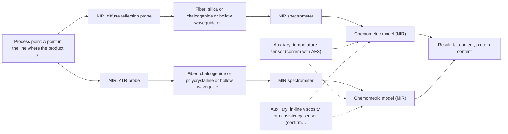
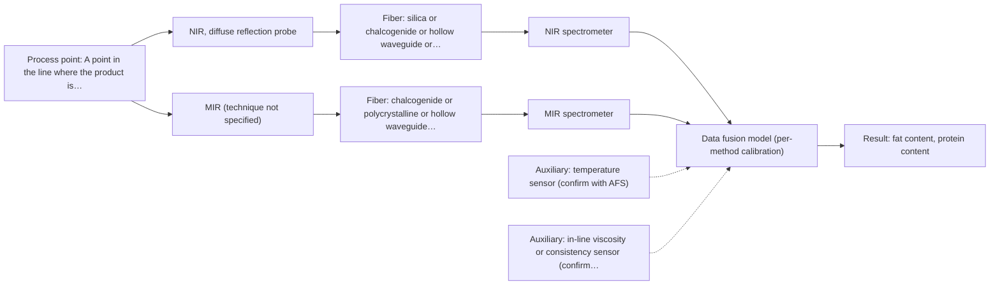

# First technical assessment: Fat and protein monitoring in opaque dairy product

## Answer

**Customer request (our summary):** Customer produces an opaque, concentrated milk product flowing through a processing line, currently samples it for fat and protein, and wants an initial spectroscopy concept plus a practical comparison experiment to obtain earlier information about composition changes, while keeping laboratory checks. Temperature and texture vary during production.

### Brief answer

Test NIR diffuse reflection in-line first: it is the documented route for opaque, concentrated dairy, and reflection spectra with scatter correction and PLS regression are used for fat and protein. MIR ATR is the natural comparison in the same trial. Still open: the required accuracy, repeatability and response time and the laboratory method to compare against; the fat and protein ranges; and where in the line a contact probe can be installed.

### Proposal

- **Best current option:** O2 (recommended)
- **Basis:** supplied AFS sources
- **What would change it:** A stated accuracy target that one method clearly meets would reduce the trial to O1; a target that neither single method reaches would move the choice to O3. An installation point that cannot take a contact probe would remove both ATR and reflection from the first trial.
- **Next step:** Run the single-method comparison on representative product samples against the retained laboratory values and use the measured performance, not the sources, to choose between O1, O2 and O3.

**Secondary evidence (external, not AFS material):** G1: E02 ¶12; G2: no usable external source found; G3: E03 ¶31, E03 ¶82; G4: E04 ¶62. See Expert detail.

**Decision status:** Provisional feasibility assessment

### Solution options

| ID | Tier | Methods | Confidence | Cost class, S01 Table 1 (p.6) | Ease of use | Maintenance | Performance fit | Sources |
|---|---|---|---|---|---|---|---|---|
| O1 | Simple | M1 NIR, diffuse reflection probe | Low: open question: Q2 (starts at Medium); uncited auxiliary sensor | average cost (row 8) | one probe, one spectrometer, simple mount | single probe to clean and calibrate | fastest answer on fat and protein | [1: S01 p.17] [2: S01 p.17] [3: S01 p.10] |
| O2 | Recommended | M1 NIR, diffuse reflection probe; M2 MIR, ATR probe | Low: open question: Q2 (starts at Medium); uncited auxiliary sensor | high cost (rows 2, 8) | two probes at the same measurement point | two probes and two calibrations to keep | shows which method fits this product | [1: S01 p.17] [4: S01 p.10] [2: S01 p.17] [3: S01 p.10] [5: S01 p.5] [6: S04 p.4] |
| O3 | Extended (multi-method) | M3 NIR, diffuse reflection probe + MIR (combination) | Low: open question: Q1, Q2 (starts at Medium); uncited auxiliary sensor; multi-method, fusion benefit not yet shown | high cost (rows 2, 8) | two synchronised instruments at one point | two calibrations and two probe diagnostics | only if no single method suffices | [7: S01 p.8] [8: S01 p.8] [9: S01 p.9] [10: S01 p.7] [11: S01 p.7] [12: S02 p.14] [13: S01 p.8] |

*Confidence rates the basis of the advice (how much is known and cited), not a predicted accuracy or probability of success. It starts at High, or at Medium when a key question on the method or the option is open, and drops one level per weakness listed (floor Low).*

*Cost class is the relative rating in S01 Table 1 (p.6) for the in-line method+technique rows named (the highest one for a multi-method option); it is not a price.*

### Setup sketch

*Recommended option O2; drawn by code from the option, a schematic, not a configuration.*

### Key questions

1. What accuracy, repeatability and response time are required for fat and protein, and against which retained laboratory method and uncertainty will the in-line results be compared?
2. What are the fat and protein concentration ranges in this product, and how fast do they change during a run?
3. Where in the line should the measurement sit, and what are the line pressure, product temperature and cleaning regime at that point?

## Expert detail

**Customer enquiry**

> We produce an opaque, concentrated milk product that flows through a processing line. We currently sample it for fat and protein analysis and would like earlier information about composition changes. Product temperature and texture vary during production. We want an initial spectroscopy concept and a practical comparison experiment, while retaining our laboratory checks.

**Decision status:** Provisional feasibility assessment. A method shortlist can be justified, but the ranking between NIR reflection and MIR ATR rests on the assumption that this product behaves like the dairy examples in the sources. The facts that would settle the ranking are not yet in hand.

### Parameters

| ID | Parameter | Kind | Need | Measured by | Why | Sources |
|---|---|---|---|---|---|---|
| P1 | fat content | quantitative | required | Spectroscopy: NIR | It is one of the two composition targets the customer currently obtains by sampling and wants earlier. | [2: S01 p.17] |
| P2 | protein content | quantitative | required | Spectroscopy: NIR | It is the second composition target the customer currently obtains by sampling and wants earlier. | [2: S01 p.17] |
| P3 | product temperature | quantitative | required | Auxiliary sensor: temperature sensor (engineering judgement: confirm availability with AFS) | The customer states temperature varies during production and the spectra depend on it, so it has to be recorded to keep it out of the fat and protein signal. | *(no verified source: engineering judgement)* |
| P4 | product texture / scattering state | qualitative | optional | Auxiliary sensor: in-line viscosity or consistency sensor (cited; confirm availability with AFS) | Texture should be available alongside the spectra because it changes the scattering the reflection probe sees; it is optional here because no source or stated fact shows that the line already provides a texture or consistency value. | [14: S01 p.17] |

### Solution option details

- **O1 cost drivers:** one NIR spectrometer, reflection probe, interface and calibration work
- **O2 cost drivers:** two spectrometer channels, two probes and two calibrations
- **O3 cost drivers:** two instruments, a paired or combined probe, synchronisation, fusion modelling
- **O3 combining methods:** Low-level fusion: the two scaled spectral blocks are joined into one matrix so that neither method dominates the model. Both probes have to look at the same product volume at the same time, and the two data streams must be brought to one common time step. Each method keeps its own calibration and diagnostics, and the fused model is only worth keeping if it beats the better single method on independent runs.

*Extended (multi-method) option O3; drawn by code from the option, a schematic, not a configuration.*

### Premise check

- **Precedent only:** Optical spectroscopy can measure this opaque, concentrated product. Opaque, concentrated dairy is a documented NIR reflection application, which is a reason to test it here, not proof for this product or line. [1: S01 p.17]
- **Precedent only:** A spectroscopy method will provide earlier information about composition changes than the current sampling. In-line NIR monitoring of milk is a published application and a reason to test the approach; no supplied page gives a response time for this product. [15: S01 p.17]
- **Not covered:** A single measurement concept can tolerate varying product temperature and texture. No supplied page addresses sample-temperature variation or its range; the sources describe scatter correction for physical variation in milk but say nothing about whether one concept tolerates both drifts together. *(no verified source: engineering judgement)*

### Requirements

**Stated by the customer**

- "an opaque, concentrated milk product"
- "flows through a processing line"
- "We currently sample it for fat and protein analysis"
- "would like earlier information about composition changes"
- "Product temperature and texture vary during production"
- "We want an initial spectroscopy concept and a practical comparison experiment"
- "while retaining our laboratory checks"
- "fat and protein analysis"

**Key unknowns**

- Required accuracy, repeatability and detection limits for fat and protein.
- Required response time for the desired 'earlier' information, and whether the result is for monitoring or for control.
- Fat and protein concentration ranges and how fast they change during a run.
- Range and rate of product temperature and texture variation.
- Installation point in the line, line pressure, cleaning and fouling regime, and whether a contact probe is acceptable.
- The retained laboratory reference method and its uncertainty.

### Clarification questions (most decision-relevant first)

Q1. What accuracy, repeatability and response time are required for fat and protein, and against which retained laboratory method and uncertainty will the in-line results be compared? *Why it matters:* These are the pass criteria that decide whether one method is enough or whether the combined option (M3) has to be tested. *(affects: status, M3)*
Q2. What are the fat and protein concentration ranges in this product, and how fast do they change during a run? *Why it matters:* The range and the size of the change set which method and which spectral region can resolve them. *(affects: method)*
Q3. Where in the line should the measurement sit, and what are the line pressure, product temperature and cleaning regime at that point? *Why it matters:* These decide whether a contact reflection probe or an ATR interface can be installed and kept clean. *(affects: installation)*
Q4. How much and how fast do product temperature and texture vary, and can both be recorded alongside the spectra? *Why it matters:* Both change the optical signal and may have to enter the calibration or be controlled at the measurement point. *(affects: technique)*
Q5. Is the result needed only for monitoring, or for closed-loop control of the line? *Why it matters:* Control sets a much tighter response-time and repeatability requirement on the measurement than monitoring. *(affects: status)*

### Recommendation

- **M1 · Primary candidate: NIR, diffuse reflection probe.** Opaque, concentrated dairy is the documented case for NIR reflection, and reflection spectra with scatter correction are used with PLS regression to quantify fat and protein. NIR is also the most common in-line method performed with fiber probes. *Conditions:* Applies if a reflection probe can be mounted in contact with the product stream and a matrix-specific calibration is built on the customer's own samples. [1: S01 p.17] [2: S01 p.17] [3: S01 p.10]
- **M2 · Comparison candidate: MIR, ATR probe.** ATR suits liquids and soft solids held in tight contact with the crystal, and mid-IR band spectra are well defined, so this gives a second and physically different read of the fat and protein bands. It is the natural method to compare against NIR reflection in the same trial. *Conditions:* Requires a contact ATR interface at a point where the product wets the crystal and the crystal can be cleaned. [5: S01 p.5] [4: S01 p.10] [6: S04 p.4]
- **M3 · Conditional candidate: NIR, diffuse reflection probe + MIR (combination).** Complex multicomponent mixtures such as milk may need a combination of spectral methods, and NIR reflection with MIR ATR has an in-line precedent. Any gain from joining them is a hypothesis to be tested against the better single method. *Conditions:* Only if the single-method comparison shows that neither NIR reflection nor MIR ATR alone reaches the required accuracy for both fat and protein. [10: S01 p.7] [11: S01 p.7] [12: S02 p.14] [13: S01 p.8] Later hypothesis, after single-method tests.
- **M4 · Not recommended: NIR, transmission/transflection probe.** A reader expects NIR transmission for a liquid dairy stream, and it is the preferred geometry for clear liquids such as skim milk, whey or permeate. It fails when the product is thick, opaque or fat-rich, which is the stated product here. *Conditions:* Could be revisited if a less concentrated or thinner line point exists, since a transflection probe can work in some cases. [16: S01 p.18] [17: S01 p.18] [18: S01 p.18]

### Measurement concept

- **Probe and geometry:** Contact measurement in the flowing product: NIR diffuse reflection as the primary geometry, with MIR ATR as the comparison. Transmission or transflection is not proposed first because the product is stated to be opaque and concentrated.
- **Location:** A point in the line where the product is well mixed and a flush-mounted probe can be cleaned; this point is not yet known and has to be chosen with the customer.
- **Fiber link:** NIR light can be carried to the probe in silica fibers; the source lists standard and Al/Cu-coated VIS-NIR silica fibers among the fiber families. MIR light needs chalcogenide (As-S) or polycrystalline infrared fibers. No achievable MIR link length for an in-line installation is stated in the sources. [19: S01 p.17] [20: S02 p.6] [21: S02 p.6]

### Spectral range

- **NIR:** Nominal NIR range 780-2500 nm; the usable range depends on the instrument, fiber and probe actually selected. [22: S01 p.10] [23: REF §5]
- **MIR:** Nominal mid-IR range 4000-400 cm-1 (2.5-25 µm); the usable range depends on the instrument, fiber and crystal actually selected. [24: S01 p.9]

### Risks and uncertainty

- Varying texture changes the scattering the reflection probe sees and can mimic a composition change, so texture may have to enter the calibration or be held steady at the measurement point. *(rules: R-GEO-6)* [14: S01 p.17]
- The calibration is specific to this matrix, so a change of product grade, recipe or process state would require re-validation on the new material. *(rules: R-CAL-1)* [25: REF §5]
- The MIR ATR route needs tight contact with the crystal and the crystal can foul or be damaged in a concentrated, flowing stream; the cleaning regime is not yet known. *(rules: R-MIR-2, R-MIR-3)* [26: REF §5]
- The required accuracy, the fat and protein ranges and the response time are unknown, so it cannot be judged whether NIR reflection alone can reach them or whether the combined option is needed. *(no verified source: engineering judgement)*

### First feasibility experiment

1. **Collect representative samples or process states that cover the expected fat and protein range and the temperature and texture variation seen in production, and record temperature and texture for each one.** Cover the real chemical and physical variation. [27: REF §3]
2. **Measure every sample with the single methods first - NIR diffuse reflection and MIR ATR - at the same point on the line or on a bypass loop, and record the acquisition conditions.** Single-method comparison before any combination. [28: REF §5]
3. **Have the same samples analysed by the retained laboratory method for fat and protein and record its uncertainty; these values are the independent reference.** Independent reference values for the models. [29: REF §3]
4. **Build a calibration per method on the reference values and validate it on held-out runs or batches, not on the samples used to build it.** Avoid an over-optimistic model on limited data. [30: S03 p.14]
5. **Go/no-go: the customer's required accuracy and response time are the pass criteria; if neither single method reaches them for both fat and protein, test the NIR reflection + MIR ATR fusion on independent runs and keep it only if it beats the better single method.** Decide between O1, O2 and O3 on measured performance. [31: REF §3]

**Reference measurements:** The retained laboratory fat and protein values, with their stated uncertainty, are the reference for every step above; no accuracy figure for the in-line methods is available from the sources.

**Decision basis:** Go/no-go is set by the customer's own accuracy and response-time targets (Q1), not by any figure in the supplied material.

### Assumptions

- The product behaves like the opaque, concentrated dairy products described in S01 p.17.
- A contact measurement point exists where the probe can be mounted and cleaned.
- The retained laboratory method gives fat and protein values with a known uncertainty.

### Not covered by the supplied sources

- The enquiry asks for earlier composition information; the supplied pages give no accuracy, repeatability, detection-limit or response-time figure for fat or protein in milk or a concentrated milk product.
- The enquiry implies an in-line installation; the supplied pages give no achievable fiber-link length for a mid-IR in-line link (only short laboratory examples) and no installation or cleaning specification for a dairy line.

### Further notes

- **Chemometrics:** Fat and protein would be predicted from the spectra by a regression model built on the retained laboratory values, with scatter correction for the physical variation; the model is specific to this matrix and has to be re-validated when the product or the process changes.
- **Real-time tracking:** The trial should log spectra continuously while the line runs, so that composition changes are seen between laboratory samples; the usable time resolution depends on the instrument, probe and integration time selected.
- **Future direction:** If the trial identifies the informative bands, a compact sensor working at a few selected wavelengths could be a later step for this line.

### Secondary evidence (external, not AFS material)

*Found by a literature search for gaps the supplied AFS sources leave open. Not AFS material and not proof for this case; every quote below was verified verbatim against the fetched text.*

**G1 · auxiliary sensor:** In-line measurement of product temperature with temperature sensor

- **E02 ¶12** The source states that temperature sensitivity of the OH bands is a severe drawback for measuring aqueous solution in NIR and MIR, so tempered sample holders are necessary. *How it applies:* This could inform the assessment by supporting temperature measurement or control alongside NIR and MIR, and by suggesting tests under the temperature variation seen in production. *Limits and transfer risks:* The source is a review about biopharmaceutical downstream processing and aqueous solutions, not concentrated milk or an in-line milk line; transfer to a food matrix and in-line probe needs testing. *(supports O2)*
  > "Additionally, the temperature sensitivity of the OH bands is a severe drawback for measuring aqueous solution in NIR and MIR, which makes tempered sample holders necessary [29]."
  > A critical review of recent trends, and a future perspective of optical spectroscopy as PAT in biopharmaceutical downstream processing. (2020) · Analytical and bioanalytical chemistry · doi:10.1007/s00216-020-02407-z · https://europepmc.org/article/PMC/PMC7072065 · retrieved 2026-10-17, full text, licence: cc by, via curated library

**G2 · auxiliary sensor:** In-line measurement of product texture / scattering state with in-line viscosity or consistency sensor

- No usable external source found.

**G3 · multi-method:** Combining several spectroscopy methods (data fusion) (Low-level fusion: the two scaled spectral blocks are joined into one matrix so that neither method dominates the model. Both probes have to look at the same product volume at the same time, and the two data streams must be brought to one common time step. Each method keeps its own calibration and diagnostics, and the fused model is only worth keeping if it beats the better single method on independent runs.)

- **E03 ¶31** The source describes low-level data fusion as the simplest way to combine inputs by rearranging data into a new matrix with variables from different sources placed one after the other. *How it applies:* This supports the O3 low-level fusion concept, but the assessment should verify that the two spectral blocks are aligned and that the fused model is compared with the better single method. *Limits and transfer risks:* The source is a PAT data-fusion review, not a milk or concentrated-milk study, and it does not establish performance for NIR and MIR on this product. *(supports O3)*
  > "Low-level data fusion (LLDF) is considered the simplest method to achieve a combination of inputs. In this case, the data is rearranged into a new data matrix, where the variables coming from different sources are placed one after the other."
  > Challenges and Opportunities of Implementing Data Fusion in Process Analytical Technology-A Review. (2022) · Molecules (Basel, Switzerland) · doi:10.3390/molecules27154846 · https://europepmc.org/article/PMC/PMC9369811 · retrieved 2026-10-17, full text, licence: cc by, via curated library
- **E03 ¶82** The source says that before fusing data from multiple sources, it is essential to evaluate each dataset's contribution to the model and its complementarity. *How it applies:* This could inform the comparison experiment by requiring independent runs that test whether adding the second method improves the model over the better single method. *Limits and transfer risks:* The source is a review and does not provide milk-specific or in-line validation; complementarity must be demonstrated on the customer's product. *(supports O3)*
  > "Before fusing data from multiple sources, it is essential to evaluate the contribution of each dataset to the model and its complementarity."
  > Challenges and Opportunities of Implementing Data Fusion in Process Analytical Technology-A Review. (2022) · Molecules (Basel, Switzerland) · doi:10.3390/molecules27154846 · https://europepmc.org/article/PMC/PMC9369811 · retrieved 2026-10-17, full text, licence: cc by, via curated library

**G4 · not in the supplied sources:** The enquiry asks for earlier composition information; the supplied pages give no accuracy, repeatability, detection-limit or response-time figure for fat or protein in milk or a concentrated milk product.

- **E04 ¶62** The source states that AOAC International guidelines specify performance parameters including LOD, LOQ, recovery, repeatability, reproducibility, and probability of detection for screening methods. *How it applies:* This could inform the assessment by indicating which performance figures should be requested or measured for fat and protein, though the source gives no such figures for milk. *Limits and transfer risks:* The source concerns HSI for mycotoxin monitoring in food, not milk fat or protein or an in-line milk process; the validation framework may not transfer directly.
  > "The AOAC International provides standardized guidelines for method validation through its Official Methods of Analysis program, which specifies performance parameters including limit of detection (LOD), limit of quantification (LOQ), recovery, repeatability, reproducibility, and probability of detection for screening methods [67]."
  > Hyperspectral Imaging for Mycotoxin Monitoring in Food: A Comprehensive Review of Technologies, Algorithms, and Applications. (2026) · Toxins · doi:10.3390/toxins18090396 · https://europepmc.org/article/PMC/PMC13611728 · retrieved 2026-10-18, full text, licence: cc by, via europepmc

### Evidence (verified quotes)

1. ✓ **S01 p.17** (application precedent): "NIR Reflection is primarily used for opaque or highly concentrated dairy products, such as yogurt, butter, or whole milk concentrates."
2. ✓ **S01 p.17** (application precedent): "using Partial Least Squares (PLS) regression to quantify fat and protein"
3. ✓ **S01 p.10** (general): "Near-IR vibrational spectroscopy (NIR) is the most common online analysis method performed using fiber optic probes."
4. ✓ **S01 p.10** (general): "ATR fiber probes (Fig.1) enable the analysis of liquids and solid elastic samples"
5. ✓ **S01 p.5** (general): "strong absorption in the mid-IR region limits the corresponding spectral method to the analysis of very thin samples (usually less than 50 μm), but it opens up the possibility of using attenuated total reflectance (ATR)"
6. ✓ **S04 p.4** (general): "suitability of analyzed samples for ATR measurements, which is true for liquid or soft solid samples and their components, allowing a tight contact with the probe head."
7. ✓ **S01 p.8** (general): "If the variables have different units of measurement, the data should be normalized in some way, for example, using an autoscaling algorithm."
8. ✓ **S01 p.8** (general): "Ultimately, the measurement data must be normalized to a common time step."
9. ✓ **S01 p.9** (general): "One of the challenges of multispectral analysis is the need to simultaneously connect at least two independently operating measuring instruments."
10. ✓ (precedent only) **S01 p.7** (method gain): "The analysis of such systems may require a combination of two or even more spectral methods."
11. ✓ **S01 p.7** (general): "These include complex multicomponent mixtures, most often of natural origin, such as oil, milk, process media, fermentation media, and biological tissue."
12. ✓ **S02 p.14** (application precedent): "NIR-Reflex & MIR-ATR-spectroscopy to control polymer extrusion in-line"
13. ✓ **S01 p.8** (general): "It is crucial that the spectral information obtained by different methods-Mid-IR, NIR, Raman, and fluorescence spectra-is collected from the same small, even pinpoint, area of the sample."
14. ✓ **S01 p.17** (general): "the method is sensitive to the surface characteristics and fat globule size."
15. ✓ **S01 p.17** (application precedent): "The use of Near-Infrared (NIR) spectroscopy for the inline monitoring of milk is a cornerstone of modern dairy "Process Analytical Technology" (PAT)."
16. ✓ **S01 p.18** (general): "Transmission is the preferred method for transparent or semi-transparent liquids, such as skim milk, whey, or permeate."
17. ✓ **S01 p.18** (general): "it fails when the milk becomes too "thick" or fat-rich, as the light cannot penetrate the sample."
18. ✓ **S01 p.18** (general): "In some cases, a Transflection probe can already be a combined solution working well for low-fat and high-fat containing milk products."
19. ✓ **S01 p.17** (application precedent): "the probe is flush-mounted into a pipe or vat to interact directly with the flowing medium."
20. ✓ **S02 p.6** (general): "350 nm Standard VIS-NIR Silica Fibers Al/Cu-coated VIS-NIR Silica Fibers 2400 nm"
21. ✓ **S02 p.6** (general): "1100 nm Chalcogenide As-S IR Fibers 6500 nm"
22. ✓ **S01 p.10** (general): "NIR spectra (780-2500 nm) contain predominantly overtones and component bands of fundamental vibrations"
23. ✓ **REF §5** (general): "It is not a product specification: actual spectral coverage, fiber length, component ratings, detection limits and accuracy depend on the configuration and the sample."
24. ✓ **S01 p.9** (general): "Vibrational spectroscopy in the mid-IR range (4000-400 cm-1) is one of the most informative methods of chemical analysis."
25. ✓ **REF §5** (general): "calibration specific to the matrix."
26. ✓ **REF §5** (general): "Usable range limited by fiber and crystal; contact, fouling, compatibility."
27. ✓ **REF §3** (general): "Representative samples or process states, independent reference measurements, what is compared, and the basis for the go / no-go decision."
28. ✓ **REF §5** (general): "compare with the best single method."
29. ✓ **REF §3** (general): "independent reference measurements"
30. ✓ **S03 p.14** (general): "A thorough validation, including full, segmented and random-subset CVs, as well as randomization tests, are recommended in any cases for which important conclusions depend on calibration or discrimination models built on limited experimental material."
31. ✓ **REF §3** (general): "the basis for the go / no-go decision"

### Verification

- Citations verified: 38 of 38 (exact or whitespace/hyphen-tolerant match on the cited page, scope checked).
- Hard check failures before deterministic corrections: 0; still open: 0; soft warnings: 4; repair rounds: 1.
- Corrected deterministically after verification (1):
  - ⚠ recommendations[2].combined_with: combined_with normalised to ['MIR'] (duplicates and the entry's own method removed)
- Removed 2 intake item(s) not quoted verbatim from the enquiry:
  - intake.process[2]: enquiry_quote not found verbatim in the enquiry
  - intake.process[4]: enquiry_quote not found verbatim in the enquiry
- External evidence (live): 4 quote(s) verified verbatim (exact or whitespace/hyphen-tolerant, at most 400 characters and 2 sentences, against the cited paragraph); 0 item(s) dropped.
- External search: 6 query(ies), 45 hit(s), 5 source(s) (3 from the curated library).
- External step: 2 model call(s), 71.7 s extra (cost in the run JSON).

*Run D02-20261018T003738Z · models deepseek/deepseek-v4.1-flash*
