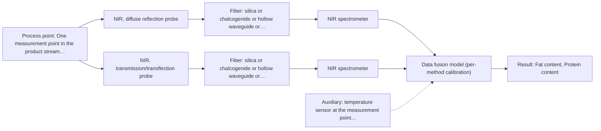

# First technical assessment: Fat and protein monitoring in opaque dairy product

**Customer enquiry**

> We produce an opaque, concentrated milk product that flows through a processing line. We currently sample it for fat and protein analysis and would like earlier information about composition changes. Product temperature and texture vary during production. We want an initial spectroscopy concept and a practical comparison experiment, while retaining our laboratory checks.

## Brief answer

For an opaque, concentrated milk stream, test NIR diffuse reflection first: it is the stated approach for opaque, concentrated dairy products and is used with PLS regression for fat and protein. Compare it against a transflection geometry on the same samples, using your laboratory fat and protein results as reference. MIR-ATR is a later option only if the product gives tight contact. Your target changes and required accuracy remain open.

## Proposal

- **Best current option:** O2 (recommended): R1 NIR, diffuse reflection probe; R2 NIR, transmission/transflection probe
- **Basis:** supplied AFS sources
- **What would change it:** Answers to Q1-Q5: a target that is not fat or protein, or that includes a trace component, would change the method; a product that is not a pumpable liquid giving a stable optical surface would shift the choice towards the contact MIR-ATR option; acceptance numbers that the NIR geometries do not reach would bring the combined NIR + MIR-ATR option into play; and a different line point or cleaning regime would change the installation.
- **Next step:** Run the comparison trial on representative samples across the fat, protein, temperature and texture range, with the laboratory fat and protein results as reference, and fix the numerical go/no-go criteria with the customer before it starts.

**Decision status:** Provisional feasibility assessment. A method shortlist can be justified from the supplied sources for an opaque, concentrated dairy stream, but the inline target definition, the physical state at the measurement point and the acceptance numbers are still open. The recommendation therefore rests on stated assumptions and is to be confirmed in a comparison trial.

## Parameters

| ID | Parameter | Kind | Need | Measured by | Why | Sources |
|---|---|---|---|---|---|---|
| P1 | Fat content | quantitative | required | Spectroscopy: NIR | Fat is one of the two composition variables the customer currently analyses and the composition change the inline measurement is meant to follow. | [1: S01 p.17] |
| P2 | Protein content | quantitative | required | Spectroscopy: NIR | Protein is the second composition variable the customer currently analyses and the second composition change the inline measurement is meant to follow. | [2: S01 p.17] |
| P3 | Product temperature at the measurement point | quantitative | required | Auxiliary sensor: temperature sensor at the measurement point (engineering judgement: confirm availability with AFS) | Temperature varies during production and affects the spectra and the scattering of the sample; without it, a temperature-driven spectral change can be mistaken for a composition change. | *(no verified source: engineering judgement)* |
| P4 | Product texture / physical state | qualitative | required | Reference lab method: laboratory texture or viscosity determination (customer's own method) | Texture varies during production and the reflection signal is sensitive to surface characteristics and to the size of the fat globules; the value is also needed to judge whether a contact ATR option is possible at all. | [3: S01 p.17] |

## Solution options

| ID | Tier | Methods | Cost class, S01 Table 1 (p.6) | Ease of use | Maintenance | Performance fit | Sources |
|---|---|---|---|---|---|---|---|
| O1 | Simple | R1 NIR, diffuse reflection probe | average (row 8) | one probe, one measurement point | clean the probe window at the line point | answers whether inline NIR follows fat and protein changes | *(no verified source: engineering judgement)* |
| O2 | Recommended | R1 NIR, diffuse reflection probe; R2 NIR, transmission/transflection probe | average (rows 7, 8) | moderate: two geometries compared during the trial | probe windows cleaned at one line point | selects the geometry that stays valid as texture and temperature vary | *(no verified source: engineering judgement)* |
| O3 | Extended (multi-method) | R1 NIR, diffuse reflection probe; R3 MIR, ATR probe | high (rows 2, 8) | highest of the three: two instruments and two probes | two calibrations and two instrument diagnostics; ATR crystal cleaning and compatibility to watch | adds MIR information where NIR alone does not meet the criteria | [4: S01 p.7] [5: S01 p.8] [6: S01 p.8] [7: S01 p.9] |

*Cost class is the relative rating in S01 Table 1 (p.6) for the in-line method+technique rows named (the highest one for a multi-method option); it is not a price.*

- **O1 cost drivers:** one NIR spectrometer and reflection probe, a line mounting, chemometric model development, and laboratory reference analyses
- **O2 cost drivers:** two NIR probe geometries (or one switchable probe), longer trial time on representative samples, laboratory reference analyses, and one calibration per geometry
- **O3 cost drivers:** a second (MIR) spectrometer, MIR fibers and an ATR probe head, synchronised acquisition, separate calibrations per method, and more maintenance effort
- **O3 combining methods:** Tested only after the single-method tests. Single method first: this option is taken up only if neither NIR geometry meets the customer's criteria. Fusion level: one model per method first, then fused spectra with block scaling (autoscaling) so that the method with more variables does not dominate. Same sampling spot: the probes must look at the same small area of the product; a combined probe head is the way to achieve this on a flowing stream. Synchronisation: acquisition rates differ and the data must be brought to a common time step before fusion. Calibration per block: each instrument needs its own calibration and diagnostics. Acceptance: the fused model must beat the best single method on held-out runs or batches, otherwise the extra instrument is dropped.

## Setup sketch

*Recommended option O2; drawn by code from the option, a schematic, not a configuration.*

*Extended (multi-method) option O3; drawn by code from the option, a schematic, not a configuration.*

## Premise check

- **Supported:** Inline spectroscopy can give earlier information about composition changes than the current sampling. The source states that fiber optic probes are integrated into production lines and give results in near real time. This supports the general capability; it is not a statement about this product or this line. [8: S01 p.2]
- **Supported:** An initial spectroscopy concept and a practical comparison experiment can be defined before the target species, ranges and process conditions are fully known. The source treats testing several optical approaches on samples of incompletely known composition as the normal route to selecting a method. This is a general statement, not evidence that a particular method fits this line. [9: S01 p.3]
- **Not covered:** Our current fat and protein laboratory analysis captures the composition changes of interest. No supplied source addresses what the fat and protein laboratory analysis of this product does or does not capture. This has to be confirmed by the customer before the inline target is fixed. *(no verified source: engineering judgement)*

## Requirements

**Stated by the customer**

- The product is opaque and concentrated and flows through a processing line.
- Fat and protein are currently determined by sampling and laboratory analysis.
- Earlier information about composition changes is wanted.
- Product temperature and texture vary during production.
- An initial spectroscopy concept and a practical comparison experiment are requested; laboratory checks are to be kept.

**Key unknowns**

- Which composition changes must be seen inline, and whether fat and protein are the inline targets or only the current laboratory reference.
- The physical state at the measurement point (pumpable liquid, viscous paste or soft solid) and whether it gives a stable, tight contact surface.
- Temperature range and rate of change, and texture/viscosity range at the measurement point.
- Required accuracy, precision, detection limit and response time, and the reference method used for fat and protein.
- Installation point on the line (pipe diameter, distance to a possible analyzer location) and the cleaning/CIP regime.

## Clarification questions (most decision-relevant first)

Q1. Which composition changes must be detected inline, over what concentration range, and are fat and protein the inline targets or only the current laboratory reference? *Why it matters:* This decides the method and the parameter set; a trace component would not be served by the same choice as fat and protein. *(affects: method, parameters)*
Q2. What is the physical state of the product at the intended measurement point - a pumpable liquid, a viscous paste or a soft solid - and does it contact a probe with a stable, tight surface? *Why it matters:* This decides whether a non-contact reflection geometry is representative or whether a contact (ATR) option is even possible. *(affects: technique, installation)*
Q3. What are the temperature range and rate of change, and the texture or viscosity range, at the measurement point? *Why it matters:* Both drive scatter and can mimic a composition change, so they decide the geometry and the calibration design. *(affects: technique, parameters, calibration)*
Q4. What accuracy, precision, detection limit and response time must the inline result meet, and which reference method do you use for fat and protein? *Why it matters:* These are the go/no-go numbers for the comparison trial and the reference values for the calibration; they cannot be supplied from the sources. *(affects: status, experiment, calibration)*
Q5. Where on the line should the measurement sit (pipe diameter, distance from a possible analyzer location), and what is the cleaning/CIP regime? *Why it matters:* This decides the probe and fiber link, and how often the optical interface would need cleaning. *(affects: installation, maintenance)*

## Recommendation

- **R1 · Primary candidate: NIR, diffuse reflection probe.** Single method, tested first. The product is opaque and concentrated, which is exactly the case the source gives for inline NIR reflection in dairy, and NIR with PLS regression is described for quantifying fat and protein. The reflection probe is flush-mounted into a pipe, so it can sit in the flowing stream. Nominal NIR range is 780-2500 nm; the usable range depends on the instrument, fiber and probe actually selected. The screening status of this candidate is pass. *Conditions:* Applies if the product at the line can present a stable optical surface to the probe window and if fat and protein are indeed the inline targets. [10: S01 p.17] [11: S01 p.17] [12: S01 p.17] [13: S01 p.10] [14: REF §5]
- **R2 · Comparison candidate: NIR, transmission/transflection probe.** Same method, second geometry, worth comparing on the same samples before the geometry is fixed. Texture and fat content vary in this product, and the source notes that a transflection probe can in some cases cover both low-fat and high-fat milk products. Plain through-transmission is not the first choice for an opaque, concentrated stream because the light cannot penetrate it. This candidate is unknown in screening, so it is a hypothesis to test rather than a recommendation. *Conditions:* Applies as a side-by-side geometry test against R1 on identical samples; transflection is preferred only if it stays valid across the texture range. [15: S01 p.18] [16: S01 p.18]
- **R3 · Conditional candidate: MIR, ATR probe.** Second method, only if the single-method NIR tests do not separate the composition changes of interest. MIR-ATR is described as an additional technique in dairy laboratories to capture information NIR might miss, and MIR band spectra are well defined. ATR requires a tight contact between sample and crystal, which suits liquids, pastes and soft solids. MIR light cannot travel in silica fibers, and no source states an achievable MIR link length, so the fiber link is an open question for AFS. *Conditions:* Applies only if the product at the measurement point gives a stable tight contact with an ATR crystal and NIR alone does not meet the acceptance criteria. [17: S01 p.18] [18: S04 p.4] [19: S02 p.6]

## Measurement concept

- **Probe and geometry:** NIR diffuse reflection probe flush-mounted at one point of the line as the starting geometry; a transflection geometry on the same samples in the comparison trial. A contact MIR-ATR probe head is a later, conditional variant. The nominal NIR range is stated in the spectral ranges below; the usable range depends on the instrument, fiber and probe actually selected.
- **Location:** One measurement point in the product stream, chosen so the product presents a stable, representative optical surface. The exact point is still open (Q5).
- **Fiber link:** Silica Vis-NIR fibers for the NIR options; chalcogenide or polycrystalline fibers for the MIR variant, whose achievable link length is not stated in the supplied material and must be confirmed by AFS. [20: S01 p.17] [21: REF §3]

## Spectral range

- **NIR:** Nominal range 780-2500 nm. The usable range depends on the instrument, fiber and probe selected; it is not fixed by this assessment. [22: S01 p.10]
- **MIR:** Nominal range 4000-400 cm-1 (2.5-25 um). Usable range limited by the fiber and crystal actually chosen; not fixed by this assessment. [23: S01 p.9]

## Risks and uncertainty

- The inline target is not yet defined. If the composition change of interest is a trace component rather than fat or protein, NIR reflection may not be sensitive enough for it. *(rules: R-NIR-4)* [24: S01 p.16]
- Texture and temperature vary in production and change the scattering of the sample; this can mimic a composition change and shift the reflection signal even when fat and protein are unchanged. *(rules: R-GEO-6, R-CAL-1)* [25: S01 p.17]
- The physical state of the product at the line is unknown. If it is a firm or sticky solid rather than a liquid or paste, a non-contact reflection geometry may not be representative and a tight ATR contact may not be achievable. *(rules: R-MIR-2)* [26: S04 p.4]
- A calibration built during the trial is specific to the product matrix and its physical variation; it may not hold when the product recipe or its texture changes, and would then need re-validation or rebuilding. *(rules: R-CAL-1)* [27: REF §5]

## First feasibility experiment

1. **Sample selection: collect representative samples or process states across the expected variation - the fat and protein range, the temperature range and the texture range seen in production, including the extremes - taken at the point where the probe would later sit.** Representativeness of the trial material [28: REF §3]
2. **Single-method measurements first: measure every sample by NIR diffuse reflection (R1) and, on the same sample at the same temperature, by the NIR transflection geometry (R2). Record the product temperature with each measurement.** Compare the two geometries on identical material before any combination is considered *(no verified source: engineering judgement)*
3. **Independent reference: determine fat and protein on the same samples with your existing laboratory analysis, plus your texture or viscosity determination, so that every spectrum has a reference value.** Reference data for calibration and for the comparison *(no verified source: engineering judgement)*
4. **Calibration and validation: build one chemometric calibration per geometry for fat and protein, then validate it on held-out runs or batches that were not used for calibration.** Test whether the model generalises beyond the calibration material [29: REF §5]
5. **Go/no-go: compare each geometry's validation error and response time against the numerical criteria you set (accuracy, precision, detection limit, response time). If neither NIR geometry meets them, test the MIR-ATR option (R3); consider a combined NIR + MIR-ATR measurement only after the single-method tests.** Decision basis; the numbers come from the customer *(no verified source: engineering judgement)*

**Reference measurements:** The customer's retained laboratory fat and protein analysis, and the customer's texture or viscosity determination, on the same samples and, where possible, the same runs.

**Decision basis:** Customer-defined accuracy, precision, detection limit and response time; the numbers are not in the supplied sources and must be supplied by the customer (Q4).

## Assumptions

- The inline targets are fat and protein, or a composition change that fat and protein represent.
- The product can present a stable optical surface to a probe at the line.
- The retained laboratory fat and protein analysis is fit to serve as the calibration reference.
- A single measurement point is representative of the stream at that point.

## Not covered by the supplied sources

- Whether the customer's current fat and protein laboratory analysis captures the composition changes of interest - the supplied material does not address this.
- How inline results would be reconciled with the retained laboratory checks in routine operation - the supplied material does not cover this.
- An achievable fiber link length for a mid-IR probe on this line - no supplied source states one.

## Further notes

- **Chemometrics:** NIR bands are broad and overlap, so a chemometric calibration is needed (S01 p.10). In the dairy example the reflectance values are converted to absorbance and scatter correction (MSC or SNV) is applied before PLS regression for fat and protein (S01 p.17). The reference data come from the retained laboratory analyses. The calibration is specific to the matrix and must be re-validated when the product or its physical state changes (REF §5).
- **Real-time tracking:** The enquiry asks for earlier information than the current sampling. Fiber probes in production lines are described as enabling on-site online analysis with results in near real time (S01 p.2). The required response time is not yet stated and has to be defined before the trial (Q4).
- **Future direction:** If the comparison trial succeeds, the same data set can support a compact sensor for this product. The source describes multisensor development as starting with in-depth laboratory studies of the object using standard laboratory spectrometers (S01 p.9).

## Evidence (verified quotes)

1. ✓ **S01 p.17** (application precedent): "using Partial Least Squares (PLS) regression to quantify fat and protein."
2. ✓ **S01 p.17** (application precedent): "using Partial Least Squares (PLS) regression to quantify fat and protein."
3. ✓ **S01 p.17** (general): "the method is sensitive to the surface characteristics and fat globule size."
4. ✓ (precedent only) **S01 p.7** (method gain): "The analysis of such systems may require a combination of two or even more spectral methods."
5. ✓ **S01 p.8** (general): "It is crucial that the spectral information obtained by different methods-Mid-IR, NIR, Raman, and fluorescence spectra-is collected from the same small, even pinpoint, area of the sample."
6. ✓ **S01 p.8** (general): "Ultimately, the measurement data must be normalized to a common time step."
7. ✓ **S01 p.9** (general): "One of the challenges of multispectral analysis is the need to simultaneously connect at least two independently operating measuring instruments."
8. ✓ **S01 p.2** (general): "Fiber optic probes and cells are being integrated into reactors and production lines of ongoing technological processes, enabling on-site online analysis and obtaining results in near real time."
9. ✓ **S01 p.3** (general): "The ability to test various optical spectroscopy approaches is crucial for solving complex analytical problems, such as analyzing natural and industrial samples of incompletely known composition, in order to select the most suitable method or combination of methods."
10. ✓ **S01 p.17** (application precedent): "Inline NIR Reflection is primarily used for opaque or highly concentrated dairy products, such as yogurt, butter, or whole milk concentrates."
11. ✓ **S01 p.17** (application precedent): "using Partial Least Squares (PLS) regression to quantify fat and protein."
12. ✓ **S01 p.17** (application precedent): "the probe is flush-mounted into a pipe or vat to interact directly with the flowing medium."
13. ✓ **S01 p.10** (general): "NIR spectra (780-2500 nm) contain predominantly overtones and component bands of fundamental vibrations"
14. ✓ **REF §5** (general): "It is not a product specification: actual spectral coverage, fiber length, component ratings, detection limits and accuracy depend on the configuration and the sample."
15. ✓ **S01 p.18** (application precedent): "In some cases, a Transflection probe can already be a combined solution working well for low-fat and high-fat containing milk products."
16. ✓ **S01 p.18** (general): "it fails when the milk becomes too "thick" or fat-rich, as the light cannot penetrate the sample."
17. ✓ **S01 p.18** (application precedent): "advanced labs often incorporate Fluorescence, Raman, and Mid-Infrared (MIR) ATR fiber optic techniques to capture specific chemical or structural information that NIR might miss."
18. ✓ **S04 p.4** (general): "suitability of analyzed samples for ATR measurements, which is true for liquid or soft solid samples and their components, allowing a tight contact with the probe head."
19. ✓ **S02 p.6** (general): "350 nm Standard VIS-NIR Silica Fibers Al/Cu-coated VIS-NIR Silica Fibers 2400 nm"
20. ✓ **S01 p.17** (application precedent): "the probe is flush-mounted into a pipe or vat to interact directly with the flowing medium."
21. ✓ **REF §3** (general): "A nominal method range is not the range of a specific instrument, fiber or probe."
22. ✓ **S01 p.10** (general): "NIR spectra (780-2500 nm) contain predominantly overtones and component bands of fundamental vibrations"
23. ✓ **S01 p.9** (general): "Vibrational spectroscopy in the mid-IR range (4000-400 cm-1) is one of the most informative methods of chemical analysis."
24. ✓ (precedent only) **S01 p.16** (performance figure): "may lack the sensitivity to detect trace compounds below 0.1 percent."
25. ✓ **S01 p.17** (general): "the method is sensitive to the surface characteristics and fat globule size."
26. ✓ **S04 p.4** (general): "suitability of analyzed samples for ATR measurements, which is true for liquid or soft solid samples and their components, allowing a tight contact with the probe head."
27. ✓ **REF §5** (general): "physical variation; calibration specific to the matrix."
28. ✓ **REF §3** (general): "Representative samples or process states, independent reference measurements, what is compared, and the basis for the go / no-go decision."
29. ✓ **REF §5** (general): "physical variation; calibration specific to the matrix."

## Verification

- Citations verified: 29 of 29 (exact or whitespace/hyphen-tolerant match on the cited page, scope checked).
- Hard check failures before deterministic corrections: 0; still open: 0; soft warnings: 3; repair rounds: 1.

*Run D02-20261017T115556Z · models deepseek/deepseek-v4.1-flash · cost $0.0198*
