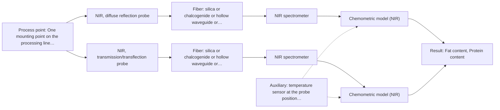
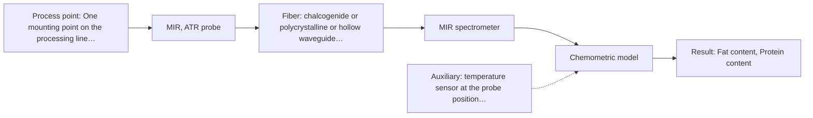

# First technical assessment: Fat and protein monitoring in opaque dairy product

## Answer

**Customer request (our summary):** Customer produces an opaque, concentrated milk product flowing through a processing line, currently samples for fat and protein analysis, and wants earlier information about composition changes. They request an initial spectroscopy concept and a practical comparison experiment while retaining laboratory checks.

### Brief answer

Test NIR diffuse reflection first: the sources describe it for opaque, concentrated dairy products and it can carry fat and protein information. The practical comparison is between NIR reflection and a transflection measurement where the line allows a thin path, both checked against your laboratory values. Still open are the accuracy and response time you need, the mounting point and the product's state there, and the temperature range.

### Proposal

- **Best current option:** O2 (recommended)
- **Basis:** supplied AFS sources
- **What would change it:** If the product is too opaque for any transmission-type measurement at the available mounting point, O2 collapses to O1; if NIR reflection cannot separate composition changes from texture and temperature effects, the MIR-ATR combination in O3 becomes the next test.
- **Next step:** Fix the reference samples, the reference values and the go/no-go numbers, then run the reflection and transflection measurements on those samples.

**Secondary evidence (external, not AFS material):** G1: E03 ¶12, E02 ¶19; G2: no usable external source found; G3: E04 ¶35. See Expert detail.

**Decision status:** Provisional feasibility assessment

### Solution options

| ID | Tier | Methods | Confidence | Cost class, S01 Table 1 (p.6) | Ease of use | Maintenance | Performance fit | Sources |
|---|---|---|---|---|---|---|---|---|
| O1 | Simple | M1 NIR, diffuse reflection probe | Low: open question: Q1, Q3 (starts at Medium); uncited auxiliary sensor | average cost (row 8) | single probe, simplest to operate | one probe window to clean | answers the main question with least effort | [1: S01 p.17] [2: S01 p.17] [3: S01 p.5] |
| O2 | Recommended | M1 NIR, diffuse reflection probe; M3 NIR, transmission/transflection probe | Low: open question: Q1, Q3 (starts at Medium); suitability for this sample not confirmed; uncited auxiliary sensor | average cost (rows 7, 8) | two NIR geometries, moderate setup effort | two probe windows to clean | covers opaque and thinner product states | [1: S01 p.17] [2: S01 p.17] [3: S01 p.5] [4: S01 p.18] [5: S01 p.18] |
| O3 | Extended (multi-method) | M2 MIR, ATR probe | Low: open question: Q1 (starts at Medium); uncited auxiliary sensor | high cost (row 2) | two instruments and probes, more complex | two instruments, plus ATR crystal cleaning | adds MIR selectivity only if NIR falls short | [6: S01 p.18] [7: S01 p.10] [8: S01 p.8] [9: REF §5] |

*Confidence rates the basis of the advice (how much is known and cited), not a predicted accuracy or probability of success. It starts at High, or at Medium when a key question on the method or the option is open, and drops one level per weakness listed (floor Low).*

*Cost class is the relative rating in S01 Table 1 (p.6) for the in-line method+technique rows named (the highest one for a multi-method option); it is not a price.*

### Setup sketch

*Recommended option O2; drawn by code from the option, a schematic, not a configuration.*

### Key questions

1. What accuracy and response time does the in-line information need (the acceptable difference from your laboratory fat and protein values, and how quickly a change must be seen)?
2. Where on the line can a probe be mounted, and what are the product's opacity and texture at that point during normal production, start-up and cleaning?
3. What is the product temperature range and how fast does it change at the measurement point?

## Expert detail

**Customer enquiry**

> We produce an opaque, concentrated milk product that flows through a processing line. We currently sample it for fat and protein analysis and would like earlier information about composition changes. Product temperature and texture vary during production. We want an initial spectroscopy concept and a practical comparison experiment, while retaining our laboratory checks.

**Decision status:** Provisional feasibility assessment. A shortlist can be justified: NIR diffuse reflection is the route described for opaque, concentrated dairy products, with MIR-ATR as a second vibrational method and NIR transflection as a conditional option. What is still missing are the customer's numbers (accuracy, response time, concentration and temperature ranges) and the mounting point, so the plan stays conditional and the laboratory checks remain the reference.

### Parameters

| ID | Parameter | Kind | Need | Measured by | Why | Sources |
|---|---|---|---|---|---|---|
| P1 | Fat content | quantitative | required | Spectroscopy: NIR | Fat is one of the two composition targets and is part of the current laboratory analysis. | [2: S01 p.17] |
| P2 | Protein content | quantitative | required | Spectroscopy: NIR | Protein is the second composition target and is part of the current laboratory analysis. | [2: S01 p.17] |
| P3 | Product temperature at the measurement point | quantitative | required | Auxiliary sensor: temperature sensor at the probe position (engineering judgement: confirm availability with AFS) | Temperature shifts the NIR signal and the product's physical state, so it must be logged to interpret and compensate the spectra. | *(no verified source: engineering judgement)* |
| P4 | Reference fat and protein values (laboratory) | quantitative | required | Reference lab method: the customer's current laboratory fat and protein method | The in-line models must be built and checked against independent reference values from the retained laboratory checks. | [10: REF §3] |

### Solution option details

- **O1 cost drivers:** one spectrometer, one probe, calibration samples and reference analyses
- **O2 cost drivers:** second probe and mounting, path-length hardware, larger calibration set
- **O3 cost drivers:** second spectrometer, MIR fibers and probe, data fusion effort
- **O3 combining methods:** NIR reflection and MIR-ATR must look at the same measurement point, through a combined probe or two probes at one port, with the data normalised to a common time step. Start from one calibration per method, then fuse block-scaled spectra or per-method scores, and keep a separate calibration and diagnostics for each instrument. The combined model has to beat the best single method on independent runs, otherwise the extra instrument is not worth keeping.

*Extended (multi-method) option O3; drawn by code from the option, a schematic, not a configuration.*

### Premise check

- **Precedent only:** In-line spectroscopy can give earlier information about composition changes than the current laboratory sampling. The sources show inline NIR monitoring of milk as an established dairy application; this is a reason to test the method on this product, not proof that it will meet the customer's needs. [11: S01 p.17]
- **Precedent only:** Temperature and texture variation during production will not prevent the measurement. A dairy example keeps monitoring accurate across changes in the physical state of the milk, but only by maintaining both NIR geometries and calibrating per production stage; product temperature is not addressed in that example. [12: S01 p.18]
- **Supported:** The current laboratory checks can be retained alongside the in-line measurement. Independent reference measurements are part of a feasibility plan, so the existing laboratory fat and protein values stay in place as the calibration and validation reference. [10: REF §3]

### Requirements

**Stated by the customer**

- "opaque, concentrated milk product"
- "flows through a processing line"
- "We currently sample it for fat and protein analysis"
- "would like earlier information about composition changes"
- "Product temperature and texture vary during production"
- "We want an initial spectroscopy concept and a practical comparison experiment"
- "while retaining our laboratory checks"
- "earlier information about composition changes"
- "fat and protein analysis"

**Key unknowns**

- Required accuracy and response time for the in-line fat and protein information.
- Mounting point on the line and the product's optical state (opacity, texture) there.
- Product temperature range and rate of change at the measurement point.
- Fat and protein concentration ranges and the size of composition change that must be seen earlier.
- Reference laboratory method and sampling frequency used today.
- Cleaning, fouling and sanitation requirements at the probe position.

### Clarification questions (most decision-relevant first)

Q1. What accuracy and response time does the in-line information need (the acceptable difference from your laboratory fat and protein values, and how quickly a change must be seen)? *Why it matters:* These numbers are the go/no-go basis and decide whether one NIR measurement is enough or a second method is needed. *(affects: method)*
Q2. Where on the line can a probe be mounted, and what are the product's opacity and texture at that point during normal production, start-up and cleaning? *Why it matters:* The optical state at the point decides whether diffuse reflection or a thin-path transflection measurement is feasible. *(affects: technique)*
Q3. What is the product temperature range and how fast does it change at the measurement point? *Why it matters:* Temperature shifts the NIR signal and the product's physical state, so it must be logged and accounted for in the calibration. *(affects: M1)*
Q4. What are the fat and protein concentration ranges, and how large is the composition change you want to detect earlier? *Why it matters:* The size of the change to be detected sets the required sensitivity and the number of reference samples needed. *(affects: method)*
Q5. Which laboratory method and sampling frequency do you use today for fat and protein? *Why it matters:* These values are the reference for building and checking the in-line calibration. *(affects: M1)*

### Recommendation

- **M1 · Primary candidate: NIR, diffuse reflection probe.** NIR diffuse reflection is the route described for opaque, highly concentrated dairy products, and fiber probes let the spectrometer sit away from the process point. Fat and protein are quantified from such spectra with PLS regression against laboratory reference values. *Conditions:* Applies if the probe can view or contact the flowing product at the chosen point and a calibration is built on this product's own reference data. [1: S01 p.17] [2: S01 p.17] [3: S01 p.5]
- **M2 · Comparison candidate: MIR, ATR probe.** MIR-ATR is the contact route for liquids and soft solids and adds a second vibrational method; in dairy, MIR-ATR is named among the techniques used for information NIR might miss. Combining it with M1 is a later hypothesis: the two methods must look at the same small spot and the combined model has to beat the best single method on independent runs. *Conditions:* Applies only after the single-method tests, if NIR reflection cannot separate composition changes from texture and temperature effects. [6: S01 p.18] [7: S01 p.10] [8: S01 p.8] [9: REF §5]
- **M3 · Conditional candidate: NIR, transmission/transflection probe.** A transflection probe can work for both low-fat and high-fat milk products in some cases, but a transmission-type measurement fails once the product is thick or fat-rich. It is worth testing only where the line offers a thin, controlled path or a less opaque stream. *Conditions:* Applies only if the measurement point gives a defined short path or a less opaque product state. [4: S01 p.18] [5: S01 p.18]

### Measurement concept

- **Probe and geometry:** NIR diffuse reflection with a fiber-optic probe mounted at the process point, with an optional transflection measurement where a defined short path is possible; MIR-ATR only as a later comparison.
- **Location:** One mounting point on the processing line, chosen where the probe can view or contact the flowing product; the exact point is still open.
- **Fiber link:** Fiber link length is not stated in the sources and depends on the configuration; no length is assumed here. [13: S01 p.15] [14: S01 p.10]

### Spectral range

- **NIR:** Nominal NIR method range: 780-2500 nm. This is the nominal method range, not the range of a specific instrument, fiber or probe; the usable range of the chosen configuration must be confirmed. [14: S01 p.10] [15: REF §3] [16: S02 p.6]
- **MIR:** Nominal MIR method range: 4000-400 cm-1. The usable range depends on the instrument, fiber and ATR crystal actually selected, and silica fibers do not transmit this region; chalcogenide (CIR) or polycrystalline (PIR) fibers are needed. [17: S01 p.9] [18: S02 p.6] [19: REF §5]

### Risks and uncertainty

- Texture and temperature change the scattering and the band positions, so a physical change can be read as a composition change. *(rules: R-GEO-6, R-GEN-5)* [20: S01 p.17]
- The calibration is specific to this product matrix, so a recipe, product or process change needs re-validation on new reference data. *(rules: R-CAL-1)* [21: REF §5]
- A transmission-type measurement may not be usable at all on this opaque, fat-rich product, so the transflection arm of the comparison can fall away. *(rules: R-GEO-2)* [22: S01 p.18]
- Probe contact and fouling at the process point, and cleaning requirements that are not yet known, can degrade the signal or block the measurement. *(rules: R-MIR-2, R-MIR-3)* [23: REF §5]

### First feasibility experiment

1. **Collect representative samples or process states across the expected variation in fat and protein level, temperature and texture, each with an independent laboratory reference value for fat and protein.** Covers the variation the method must survive and provides the reference data. [10: REF §3]
2. **Measure each sample and state with an NIR diffuse-reflection probe in the intended mounting geometry, log the product temperature, and repeat measurements at the same position to estimate repeatability.** Gives the raw spectra and a first repeatability estimate under the real variation. *(no verified source: engineering judgement)*
3. **Build one calibration per technique (for example PLS regression on scatter-corrected spectra) against the reference values, and validate on held-out runs or batches, not on repeated scans of the same sample.** Shows whether the technique tracks fat and protein rather than the sampling. [2: S01 p.17]
4. **Compare the techniques against the best single method on the held-out runs; only if NIR reflection cannot meet the target, add MIR-ATR and test whether the combined model beats the best single method.** Keeps single methods first and makes the combination a tested hypothesis. [9: REF §5]
5. **Decide go/no-go on the customer's own numerical criteria for accuracy and response time; a technique that does not meet them is dropped.** Ties the decision to customer-provided numbers rather than to a vendor claim. [24: REF §3]

**Reference measurements:** Retained laboratory fat and protein analysis, at a sampling frequency high enough to cover the expected rate of change.

**Decision basis:** Customer-defined accuracy and response-time criteria; unknown until Q1 is answered.

### Assumptions

- The product is liquid and pumpable at the measurement point and can be presented to a probe.
- The retained laboratory checks can deliver enough reference values to cover the expected variation.
- The mounting point can host a probe with acceptable cleaning and fouling behaviour.

### Not covered by the supplied sources

- Any accuracy, detection limit or response-time figure for fat or protein in this product: the enquiry asks for earlier composition information, but no supplied source states such figures for an opaque, concentrated milk product.

### Further notes

- **Chemometrics:** NIR bands of this product overlap and the signal carries scattering as well as absorption, so a product-specific calibration model is needed; dairy examples use scatter correction before PLS regression. The retained laboratory fat and protein values are the reference data for building and checking that model.
- **Real-time tracking:** The aim is continuous information from the line instead of laboratory sampling: fiber probes integrated into production lines enable on-site analysis with results in near real time, and online measurement needs high-speed spectral acquisition.
- **Future direction:** If the comparison identifies a few informative wavelengths, a compact dedicated sensor is a possible later step: the sources describe a move away from full spectrometers towards optical multisensor systems focused on one analytical task.

### Secondary evidence (external, not AFS material)

*Found by a literature search for gaps the supplied AFS sources leave open. Not AFS material and not proof for this case; every quote below was verified verbatim against the fetched text.*

**G1 · auxiliary sensor:** In-line measurement of Product temperature at the measurement point with temperature sensor at the probe position

- **E03 ¶12** Temperature sensitivity of OH bands in aqueous solutions in NIR and MIR is a severe drawback, making tempered sample holders necessary. *How it applies:* For an opaque concentrated milk product, temperature at the measurement point may affect NIR/MIR spectra, so measuring or controlling temperature at the probe could be important for O2. *Limits and transfer risks:* This is a review statement about aqueous solutions and tempered sample holders, not an in-line milk trial; transfer to a concentrated, opaque product and a process probe is uncertain. *(supports O2)*
  > "Additionally, the temperature sensitivity of the OH bands is a severe drawback for measuring aqueous solution in NIR and MIR, which makes tempered sample holders necessary [29]."
  > A critical review of recent trends, and a future perspective of optical spectroscopy as PAT in biopharmaceutical downstream processing. (2020) · Analytical and bioanalytical chemistry · doi:10.1007/s00216-020-02407-z · https://europepmc.org/article/PMC/PMC7072065 · retrieved 2026-10-17, full text, licence: cc by, via curated library
- **E02 ¶19** Temperature was varied along with acid concentrations and ionic strength to obtain a robust model. *How it applies:* This suggests including temperature as a varied factor and possibly measuring it at the probe when building calibrations for O2. *Limits and transfer risks:* The study is on reactive liquid-liquid extraction in lithium recycling, not milk, and does not describe an in-line temperature sensor at the probe. *(supports O2)*
  > "The concentrations of nitric acid and hydrochloric acid as well as the ionic strength and temperature were varied to obtain a robust model."
  > Process Analytical Technology-Integrated FT-IR and Raman Spectroscopies for Efficient Reactive Liquid-Liquid Extraction Processing in Lithium Recycling. (2025) · ACS omega · doi:10.1021/acsomega.5c05705 · https://europepmc.org/article/PMC/PMC12573149 · retrieved 2026-10-17, full text, licence: cc by, via curated library

**G2 · multi-method:** Combining several spectroscopy methods (data fusion) (NIR reflection and MIR-ATR must look at the same measurement point, through a combined probe or two probes at one port, with the data normalised to a common time step. Start from one calibration per method, then fuse block-scaled spectra or per-method scores, and keep a separate calibration and diagnostics for each instrument. The combined model has to beat the best single method on independent runs, otherwise the extra instrument is not worth keeping.)

- No usable external source found.

**G3 · not in the supplied sources:** Any accuracy, detection limit or response-time figure for fat or protein in this product: the enquiry asks for earlier composition information, but no supplied source states such figures for an opaque, concentrated milk product.

- **E04 ¶35** The Gerber method for fat in liquid milk has a rapid analysis time of approximately 5-10 min per sample. *How it applies:* This gives a lab reference time for fat, which could inform the practical comparison experiment while retaining laboratory checks, but it is not an in-line figure for the customer's product. *Limits and transfer risks:* The figure is for liquid milk and a manual butyrometric lab method, not an opaque concentrated milk product or a spectroscopy method.
  > "The Gerber method offers several practical advantages for liquid milk analysis: (1) rapid analysis time (approximately 5-10 min per sample), (2) no requirement for drying or pre-extraction of the sample-directly applicable to liquid milk, (3) simple equipment and low cost, and (4) suitable for routine quality control in processing plants."
  > Analytical Technologies for Milk Component Analysis: A Review of Progress and Challenges. (2026) · Foods (Basel, Switzerland) · doi:10.3390/foods15152752 · https://europepmc.org/article/PMC/PMC13465885 · retrieved 2026-10-17, full text, licence: cc by, via europepmc

### Evidence (verified quotes)

1. ✓ **S01 p.17** (application precedent): "Inline NIR Reflection is primarily used for opaque or highly concentrated dairy products, such as yogurt, butter, or whole milk concentrates."
2. ✓ **S01 p.17** (application precedent): "before using Partial Least Squares (PLS) regression to quantify fat and protein"
3. ✓ **S01 p.5** (general): "making it ideal for online applications, including remote measurements via fiber optic probes."
4. ✓ **S01 p.18** (application precedent): "In some cases, a Transflection probe can already be a combined solution working well for low-fat and high-fat containing milk products."
5. ✓ **S01 p.18** (general): "it fails when the milk becomes too "thick" or fat-rich, as the light cannot penetrate the sample."
6. ✓ **S01 p.18** (application precedent): "advanced labs often incorporate Fluorescence, Raman, and Mid-Infrared (MIR) ATR fiber optic techniques to capture specific chemical or structural information that NIR might miss."
7. ✓ **S01 p.10** (general): "ATR fiber probes (Fig.1) enable the analysis of liquids and solid elastic samples"
8. ✓ **S01 p.8** (general): "collected from the same small, even pinpoint, area of the sample. This is difficult to achieve by using two probes alternately for measurements."
9. ✓ (precedent only) **REF §5** (method gain): "compare with the best single method."
10. ✓ **REF §3** (general): "Representative samples or process states, independent reference measurements, what is compared, and the basis for the go / no-go decision."
11. ✓ **S01 p.17** (application precedent): "The use of Near-Infrared (NIR) spectroscopy for the inline monitoring of milk is a cornerstone of modern dairy "Process Analytical Technology" (PAT)."
12. ✓ **S01 p.18** (application precedent): "ensuring that no matter how the physical state of the milk changes during processing, the inline monitoring remains accurate and robust."
13. ✓ **S01 p.15** (general): "located safely away from the vibration and dust of the manufacturing floor."
14. ✓ **S01 p.10** (general): "NIR spectra (780-2500 nm) contain predominantly overtones and component bands of fundamental vibrations"
15. ✓ **REF §3** (general): "A nominal method range is not the range of a specific instrument, fiber or probe."
16. ✓ **S02 p.6** (general): "350 nm Standard VIS-NIR Silica Fibers Al/Cu-coated VIS-NIR Silica Fibers 2400 nm"
17. ✓ **S01 p.9** (general): "Vibrational spectroscopy in the mid-IR range (4000-400 cm-1) is one of the most informative methods of chemical analysis."
18. ✓ **S02 p.6** (general): "3000 nm Polycrystalline Infrared Fibers 17 µm"
19. ✓ **REF §5** (general): "It is not a product specification: actual spectral coverage, fiber length, component ratings, detection limits and accuracy depend on the configuration and the sample."
20. ✓ **S01 p.17** (general): "the method is sensitive to the surface characteristics and fat globule size."
21. ✓ **REF §5** (general): "calibration specific to the matrix."
22. ✓ **S01 p.18** (general): "While transmission is superior for the high-precision analysis of dilute process streams (like whey filtration), it fails when the milk becomes too "thick" or fat-rich, as the light cannot penetrate the sample."
23. ✓ **REF §5** (general): "Usable range limited by fiber and crystal; contact, fouling, compatibility."
24. ✓ **REF §3** (general): "the basis for the go / no-go decision."

### Verification

- Citations verified: 31 of 31 (exact or whitespace/hyphen-tolerant match on the cited page, scope checked).
- Hard check failures before deterministic corrections: 0; still open: 0; soft warnings: 3; repair rounds: 1.
- Corrected deterministically after verification (1):
  - ⚠ recommendations[1].combined_with: combined_with normalised to [] (duplicates and the entry's own method removed)
- External evidence (live): 3 quote(s) verified verbatim (exact or whitespace/hyphen-tolerant, at most 400 characters and 2 sentences, against the cited paragraph); 0 item(s) dropped.
- External search: 6 query(ies), 45 hit(s), 5 source(s) (3 from the curated library).
- External step: 3 model call(s), 271.2 s extra (cost in the run JSON).

*Run D02-20261017T222314Z · models deepseek/deepseek-v4.1-flash*
