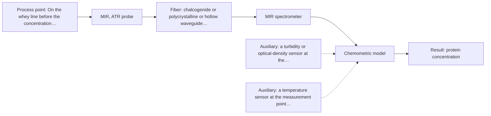
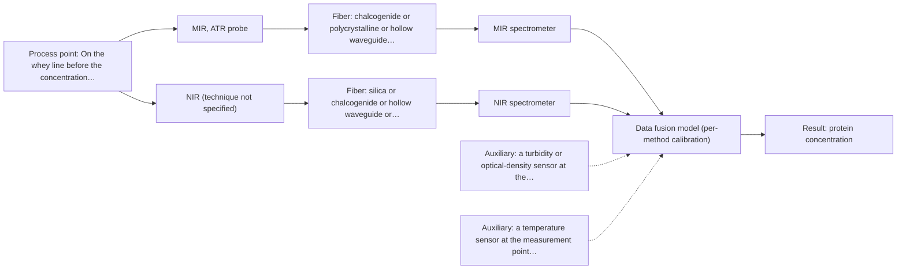

# First technical assessment: A clear whey stream before concentration

## Answer

**Customer request (our summary):** Customer enquiry about in-line spectroscopy for tracking protein concentration in a dairy whey stream before a concentration stage, with changing turbidity and laboratory reference.

### Brief answer

Test MIR-ATR first on representative whey samples across the clear and turbid states, with an independent laboratory protein reference for the calibration. NIR transmission/transflection is the cheaper dairy-standard comparison and is worth measuring alongside. Combining the two is a later hypothesis, not a first step. Protein range, required accuracy, turbidity range and the installation point are still open.

### Proposal

- **Best current option:** O2 (recommended)
- **Basis:** engineering judgement, with secondary external support E01 ¶12 (not AFS material)
- **What would change it:** A confirmed low and stable turbidity would move the choice to the cheaper NIR option (O1); trial results showing that neither single method reaches the required protein accuracy would move it to the fused option (O3), if the fused model beats the best single method.
- **Next step:** Run the feasibility trial: representative clear and turbid whey samples measured by MIR-ATR and by NIR transmission/transflection, each with an independent laboratory protein reference.

**Secondary evidence (external, not AFS material):** G1: no usable external source found; G2: E01 ¶12; G3: E03 ¶82, E04 ¶1; G4: no usable external source found. See Expert detail.

**Decision status:** Provisional feasibility assessment

### Solution options

| ID | Tier | Methods | Confidence | Cost class, S01 Table 1 (p.6) | Ease of use | Maintenance | Performance fit | Sources |
|---|---|---|---|---|---|---|---|---|
| O1 | Simple | M2 NIR, transmission/transflection probe | Medium: open question: Q1 (starts at Medium) | average cost (row 7) | Standard silica probe, simple optics | Window cleaning and periodic model revalidation | Cheapest dairy-proven route for clear whey | [1: S01 p.18] [2: S01 p.10] [3: S01 p.18] [4: S02 p.7] |
| O2 | Recommended | M1 MIR, ATR probe | Medium: open question: Q1 (starts at Medium) | high cost (row 2) | Immersion ATR probe, contact required | Crystal cleaning and fouling checks | Fits the turbidity change; sharp protein bands | [5: S01 p.16] [6: S04 p.4] [7: S01 p.9] [8: S04 p.3] [9: S01 p.10] |
| O3 | Extended (multi-method) | M3 MIR, ATR probe + NIR (combination) | Low: open question: Q1 (starts at Medium); multi-method, fusion benefit not yet shown | high cost (rows 2, 7) | Two instruments, one sampling point | Two calibrations, two sets of diagnostics | Covers clear and turbid states if fusion wins | [10: S01 p.8] [11: S01 p.8] [12: S01 p.9] [13: S01 p.7] [14: S01 p.7] [15: REF §5] [16: S01 p.8] |

*Confidence rates the basis of the advice (how much is known and cited), not a predicted accuracy or probability of success. It starts at High, or at Medium when a key question on the method or the option is open, and drops one level per weakness listed (floor Low).*

*Cost class is the relative rating in S01 Table 1 (p.6) for the in-line method+technique rows named (the highest one for a multi-method option); it is not a price.*

### Setup sketch

*Recommended option O2; drawn by code from the option, a schematic, not a configuration.*

### Key questions

1. What protein concentration range must be tracked, and with what accuracy and response time?
2. How turbid does the stream become, how often and for how long?
3. Where is the measurement point, what are the line or flow-cell dimensions and flow rate, and how far is the analyzer from the probe?

## Expert detail

**Customer enquiry**

> Our dairy process includes a relatively clear whey stream before a concentration stage. We want to investigate whether spectroscopy can track protein concentration as the stream changes, with laboratory results used as the reference. The stream can become more turbid under some operating conditions. We need a first measurement concept that handles this change rather than assuming the liquid always remains clear.

**Decision status:** Provisional feasibility assessment. The choice of MIR-ATR rests on the stated turbidity change and on ATR's thin sampling layer, not on a published whey measurement; the dairy precedent in the sources is for NIR transmission. The protein range, accuracy target and turbidity range must be confirmed before the choice is more than provisional.

### Parameters

| ID | Parameter | Kind | Need | Measured by | Why | Sources |
|---|---|---|---|---|---|---|
| P1 | protein concentration | quantitative | required | Spectroscopy: MIR | It is the variable the customer wants to track and the target of the primary method. | [8: S04 p.3] |
| P2 | turbidity (optical state of the stream) | quantitative | required | Auxiliary sensor: a turbidity or optical-density sensor at the measurement point (cited; confirm availability with AFS) | It marks which optical state a spectrum was taken in, so spectra and models can be matched to the state. | [17: S01 p.18] |
| P3 | temperature | quantitative | optional | Auxiliary sensor: a temperature sensor at the measurement point (engineering judgement: confirm availability with AFS) | It should be available from the plant; it corrects spectral drift with process temperature. | *(no verified source: engineering judgement)* |
| P4 | fat content | quantitative | optional | Reference lab method: the plant's laboratory fat determination | Fat scatters light and is a known interferent in dairy spectra, so it should be available from the reference laboratory to explain signal changes. | [18: S01 p.17] |

### Solution option details

- **O1 cost drivers:** NIR spectrometer, fiber probe, flow cell, reference analyses
- **O2 cost drivers:** MIR spectrometer, ATR probe, MIR fiber link, reference analyses
- **O3 cost drivers:** Two spectrometers, two probes, synchronisation and fusion work
- **O3 combining methods:** Fusion level: one model per method first, then joined variables scaled so that neither block dominates, because variables from different methods are not equivalent. The two probes must look at the same small whey volume and the data must be normalised to a common time step, which is harder for an ATR surface layer plus a bulk transmission path. The fused model must beat the best single method on independent runs, otherwise the second instrument is dropped.

*Extended (multi-method) option O3; drawn by code from the option, a schematic, not a configuration.*

### Premise check

- **Precedent only:** Spectroscopy can track protein concentration as the stream changes. Published dairy work quantifies fat and protein in milk from NIR spectra with a PLS model, which is a reason to test NIR here, not proof for this whey stream. [19: S01 p.17] [20: REF §3]
- **Precedent only:** A first measurement concept can handle the turbidity change. The sources show keeping transmission and reflection/transflection techniques available, and a transflection probe that in some cases serves both low-fat and high-fat products; a single transmission setting is stated to fail once the sample becomes too thick. [21: S01 p.18] [22: S01 p.18] [17: S01 p.18]
- **Supported:** Laboratory results are a suitable reference. The guidance requires independent reference measurements in a feasibility plan; it does not name a specific laboratory protein method, so that method itself stays open. [23: REF §3]

### Requirements

**Stated by the customer**

- "Our dairy process"
- "includes a relatively clear whey stream"
- "before a concentration stage"
- "The stream can become more turbid under some operating conditions"
- "with laboratory results used as the reference"
- "track protein concentration as the stream changes"

**Key unknowns**

- Protein concentration range, required accuracy and response time.
- How turbid the stream becomes, how often and for how long.
- Installation point, line or flow-cell dimensions, flow rate and distance to the analyzer.
- The laboratory protein reference method, sampling frequency and uncertainty.
- Process temperature and its variation at the measurement point.
- Fouling, cleaning agents and CIP compatibility at the measurement point.

### Clarification questions (most decision-relevant first)

Q1. What protein concentration range must be tracked, and with what accuracy and response time? *Why it matters:* These targets set the go/no-go criteria and decide whether a single method can reach them. *(affects: method)*
Q2. How turbid does the stream become, how often and for how long? *Why it matters:* The turbidity level decides whether a transmission path survives or a thin ATR sampling layer is needed. *(affects: technique)*
Q3. Where is the measurement point, what are the line or flow-cell dimensions and flow rate, and how far is the analyzer from the probe? *Why it matters:* It fixes the probe geometry and the fiber type and length, and no source gives an MIR link length. *(affects: installation)*
Q4. Which laboratory method and sampling frequency will provide the protein reference, and what is its uncertainty? *Why it matters:* The calibration and its validation depend on the quality of the reference data. *(affects: status)*
Q5. Which operating conditions cause the turbidity change, and do cleaning agents or CIP cycles contact the probe? *Why it matters:* Cleaning and fouling decide probe material and maintenance, and the turbid periods define the test samples. *(affects: installation)*

### Recommendation

- **M1 · Primary candidate: MIR, ATR probe.** ATR samples only a thin layer at the crystal, so the stated turbidity change affects the signal much less than it affects a transmission path, and the mid-IR protein amide bands are well defined. In-line ATR probes are made for liquids, so this is the single method to test first. *Conditions:* Applies while the whey stays in reliable contact with the crystal and the MIR fiber link and probe materials are confirmed for the installation. [5: S01 p.16] [7: S01 p.9] [8: S04 p.3] [9: S01 p.10]
- **M2 · Comparison candidate: NIR, transmission/transflection probe.** NIR transmission is the dairy precedent for dilute streams such as whey and is the most common online method with fiber probes, so it is the cheaper method to test against M1. It loses the signal once the stream becomes too thick for the light path. *Conditions:* Applies while the stream is clear to semi-transparent and a controlled pathlength (1-10 mm in the dairy example) can be held. [1: S01 p.18] [2: S01 p.10] [3: S01 p.18] [4: S02 p.7]
- **M3 · Comparison candidate: MIR, ATR probe + NIR (combination).** Combining MIR-ATR with NIR transmission/transflection is a hypothesis: the two techniques carry different parts of the protein information and a combination is reported to help where one method alone cannot cover a complex sample. It is a later test, to be compared with the best single method. *Conditions:* Test only after the single-method trials, and only if neither M1 nor M2 alone covers both the clear and the turbid states. [13: S01 p.7] [14: S01 p.7] [15: REF §5] [16: S01 p.8] Later hypothesis, after single-method tests.
- **M4 · Not recommended: UV-Vis, transmission/transflection probe.** A reader may expect UV-Vis, but the sources use it here for turbidity-based biomass tracking, not for protein, and its mixture spectra overlap strongly enough to require chemometrics. *Conditions:* Not proposed as an option unless a specific UV-absorbing protein signal is identified. [24: S01 p.16] [25: S01 p.5]

### Measurement concept

- **Probe and geometry:** An in-line probe in contact with the whey: an ATR crystal head for MIR, or a transmission/transflection flow cell for NIR at a controlled pathlength. The turbidity and temperature channels are read at the same point.
- **Location:** On the whey line before the concentration stage, at a point that sees both the clear and the turbid states.
- **Fiber link:** Silica fibers are stated for remote industrial runs of 100-300 m; no source states an achievable link length for MIR fibers, so the MIR distance stays an open question. [4: S02 p.7]

### Spectral range

- **MIR:** Nominal MIR range 4000-400 cm-1 (2.5-25 um); the usable range depends on the crystal, fiber and probe selected. [7: S01 p.9] [26: REF §5]
- **NIR:** Nominal NIR range 780-2500 nm; the usable range depends on the instrument, fiber and probe selected. [27: S01 p.10]

### Risks and uncertainty

- The turbidity range and its duration are unknown; if the stream becomes opaque, even the thin ATR layer can be affected by deposits and the NIR transmission signal is lost. *(rules: R-MIR-3, R-GEN-5)* *(no verified source: engineering judgement)*
- Both calibrations are matrix-specific, so a model built on one whey composition may not transfer to a changed composition, temperature or the concentrated stream. *(rules: R-CAL-1)* [28: REF §5]
- No supplied source states an achievable MIR fiber length for a process installation, so the distance from the analyzer to the probe may rule the MIR-ATR option out. *(rules: R-FIB-2)* *(no verified source: engineering judgement)*
- The required protein accuracy, response time and cleaning conditions are unknown, so the go/no-go limits and the maintenance effort cannot yet be fixed. *(rules: R-MIR-3)* *(no verified source: engineering judgement)*

### First feasibility experiment

1. **Collect representative whey samples across the expected variation: clear and turbid states, the whole protein range, the normal temperature range, and start and end of run, with the process conditions recorded for each sample.** Cover the chemical and physical variation rather than only the nominal state. [23: REF §3]
2. **Measure every sample with the two single methods at the same sampling point where possible: MIR-ATR and NIR transmission/transflection at a controlled pathlength.** Single methods first, so each can be judged on its own before any fusion. [3: S01 p.18]
3. **Measure the protein reference independently for each sample with the customer's laboratory method, with replicates and a stated uncertainty.** The calibration and its validation rest on the reference data. *(no verified source: engineering judgement)*
4. **Build one chemometric model per method and compare each with the best single method; test the fused MIR plus NIR model only afterwards, on the same samples.** A fusion gain is a hypothesis and must be shown against the best single method. [15: REF §5]
5. **Validate on held-out runs or batches, not held-out points of the same run, and judge the results against go/no-go limits taken from the customer's accuracy and response-time targets.** Gives an honest basis for the go / no-go decision. *(no verified source: engineering judgement)*

**Reference measurements:** The customer's laboratory protein result is the independent reference for every sample, with replicates and a stated uncertainty.

**Decision basis:** Go/no-go limits for protein accuracy and response time are set by the customer before the trial; the trial is judged per single method first, then on whether a fused model beats the best single method.

### Assumptions

- The whey is a liquid that can wet an ATR crystal or fill a transmission cell, and no gas pockets or particles block the probe.
- The stream composition and temperature stay within the range covered by the trial samples.
- The laboratory protein reference is available at a frequency that allows a calibration and a held-out validation set.
- The turbidity change is reversible and does not leave a permanent film on the probe.

### Not covered by the supplied sources

- No supplied source reports protein quantification in whey by MIR-ATR or by NIR transmission; the dairy examples cover milk fat and protein and name whey filtration for NIR transmission.
- No source gives an achievable fiber link length for an MIR probe in a process installation.
- Cleaning-agent compatibility and fouling rates for probes in dairy streams are not covered.

### Further notes

- **Chemometrics:** Protein in whey is read from overlapping bands, so a calibration model is needed and it is specific to the matrix; it must be built on the trial's reference data and re-checked after a composition or process change.
- **Real-time tracking:** The enquiry is about tracking the stream as it changes in-line, so the acquisition rate, the averaging step and the alignment of the turbidity and temperature channels with the spectra must be set for the required response time.
- **Future direction:** A compact dedicated analyzer or an IoT-style spectral sensor for this stream is a later step once the method and its calibration are settled.

### Secondary evidence (external, not AFS material)

*Found by a literature search for gaps the supplied AFS sources leave open. Not AFS material and not proof for this case; every quote below was verified verbatim against the fetched text.*

**G1 · auxiliary sensor:** In-line measurement of turbidity (optical state of the stream) with a turbidity or optical-density sensor at the measurement point

- No usable external source found.

**G2 · auxiliary sensor:** In-line measurement of temperature with a temperature sensor at the measurement point

- **E01 ¶12** The source says temperature sensitivity of OH bands is a severe drawback for measuring aqueous solution in NIR and MIR, making tempered sample holders necessary. *How it applies:* This could inform the assessment by supporting temperature control or monitoring at the MIR ATR measurement point and by testing how temperature variation affects the aqueous whey spectra. *Limits and transfer risks:* The statement is from a review and concerns aqueous solutions generally, not dairy whey or a specific in-line temperature sensor; transfer to a whey stream and probe configuration would need testing. *(supports O2)*
  > "Additionally, the temperature sensitivity of the OH bands is a severe drawback for measuring aqueous solution in NIR and MIR, which makes tempered sample holders necessary [29]."
  > A critical review of recent trends, and a future perspective of optical spectroscopy as PAT in biopharmaceutical downstream processing. (2020) · Analytical and bioanalytical chemistry · doi:10.1007/s00216-020-02407-z · https://europepmc.org/article/PMC/PMC7072065 · retrieved 2026-10-17, full text, licence: cc by, via curated library

**G3 · multi-method:** Combining several spectroscopy methods (data fusion) (Fusion level: one model per method first, then joined variables scaled so that neither block dominates, because variables from different methods are not equivalent. The two probes must look at the same small whey volume and the data must be normalised to a common time step, which is harder for an ATR surface layer plus a bulk transmission path. The fused model must beat the best single method on independent runs, otherwise the second instrument is dropped.)

- **E03 ¶82** The source says that before fusing data from multiple sources, it is essential to evaluate the contribution of each dataset to the model and its complementarity. *How it applies:* This supports a staged fusion approach: first build one model per method, then check whether the second method adds complementary information before joining variables. *Limits and transfer risks:* This is a review statement about data fusion generally, not a whey protein application, and it does not address scaling, common time steps, or ATR surface versus transmission path differences. *(supports O3)*
  > "Before fusing data from multiple sources, it is essential to evaluate the contribution of each dataset to the model and its complementarity."
  > Challenges and Opportunities of Implementing Data Fusion in Process Analytical Technology-A Review. (2022) · Molecules (Basel, Switzerland) · doi:10.3390/molecules27154846 · https://europepmc.org/article/PMC/PMC9369811 · retrieved 2026-10-17, full text, licence: cc by, via curated library
- **E04 ¶1** In a rice authentication study, MIR alone gave better classification accuracy than NIR, while a SPORT-based multiblock fusion of MIR and NIR improved robustness. *How it applies:* This could inform the assessment by supporting a test of MIR first and then MIR-NIR fusion, with the fused model compared against the best single method on independent runs. *Limits and transfer risks:* The study is on rice authentication, not whey protein quantification, is available only as an abstract, and uses laboratory classification rather than in-line concentration measurement. *(supports O3)*
  > "When analysed individually, MIR showed better predictive performance than NIR in terms of classification accuracy. The SPORT-based multiblock approach, integrating complementary MIR and NIR information, improved the exploitation of spectral variability and provided a more robust framework for modelling complex authenticity patterns."
  > A comprehensive analysis of NIR and MIR data fusion for rice authentication (2026) · Journal of Food Composition and Analysis · doi:10.1016/j.jfca.2026.109547 · https://doi.org/10.1016/j.jfca.2026.109547 · retrieved 2026-10-17, abstract only, licence: cc-by, via openalex

**G4 · not in the supplied sources:** No supplied source reports protein quantification in whey by MIR-ATR or by NIR transmission; the dairy examples cover milk fat and protein and name whey filtration for NIR transmission.

- No usable external source found.

### Evidence (verified quotes)

1. ✓ **S01 p.18** (general): "Transmission is the preferred method for transparent or semi-transparent liquids, such as skim milk, whey, or permeate."
2. ✓ **S01 p.10** (general): "Near-IR vibrational spectroscopy (NIR) is the most common online analysis method performed using fiber optic probes."
3. ✓ **S01 p.18** (general): "the precise control of the optical pathlength (usually 1 - 10 mm); if the pathlength is too wide, the signal is lost to absorption; if too narrow, the sample represents a negligible volume."
4. ✓ **S02 p.7** (general): "Robust 100-300m cables made with Silica fibers of low OH-content (<0.1ppm OH) enable remote industrial process-control"
5. ✓ **S01 p.16** (general): "ATR relies on the evanescent wave that penetrates only a few micrometers into the medium at the crystal interface"
6. ✓ **S04 p.4** (general): "suitability of analyzed samples for ATR measurements, which is true for liquid or soft solid samples and their components, allowing a tight contact with the probe head."
7. ✓ **S01 p.9** (general): "Vibrational spectroscopy in the mid-IR range (4000-400 cm-1) is one of the most informative methods of chemical analysis."
8. ✓ **S04 p.3** (general): "These are, respectively, the amide I and II bands, two major absorption peaks of the protein peptide group in the infrared region."
9. ✓ **S01 p.10** (general): "ATR fiber probes (Fig.1) enable the analysis of liquids and solid elastic samples"
10. ✓ **S01 p.8** (general): "Variables obtained from different spectral methods are not equivalent."
11. ✓ **S01 p.8** (general): "Ultimately, the measurement data must be normalized to a common time step."
12. ✓ **S01 p.9** (general): "One of the challenges of multispectral analysis is the need to simultaneously connect at least two independently operating measuring instruments."
13. ✓ (precedent only) **S01 p.7** (method gain): "The analysis of such systems may require a combination of two or even more spectral methods."
14. ✓ **S01 p.7** (application precedent): "The combination of NIR and IR spectroscopy showed benefits in determining tumor boundaries in medical diagnostics."
15. ✓ (precedent only) **REF §5** (method gain): "compare with the best single method."
16. ✓ **S01 p.8** (general): "It is crucial that the spectral information obtained by different methods-Mid-IR, NIR, Raman, and fluorescence spectra-is collected from the same small, even pinpoint, area of the sample."
17. ✓ **S01 p.18** (general): "as the light cannot penetrate the sample."
18. ✓ **S01 p.17** (general): "the method is sensitive to the surface characteristics and fat globule size."
19. ✓ **S01 p.17** (application precedent): "before using Partial Least Squares (PLS) regression to quantify fat and protein."
20. ✓ **REF §3** (general): "a published application is a reason to test a method, not proof that it will work for a new customer."
21. ✓ **S01 p.18** (application precedent): "In some cases, a Transflection probe can already be a combined solution working well for low-fat and high-fat containing milk products."
22. ✓ **S01 p.18** (general): "having both fiber optic techniques available in a lab rather than relying on one provides the flexibility needed to monitor the entire production chain."
23. ✓ **REF §3** (general): "Representative samples or process states, independent reference measurements, what is compared, and the basis for the go / no-go decision."
24. ✓ **S01 p.16** (general): "cell suspension turbidity correlates well with cell density."
25. ✓ **S01 p.5** (general): "the strong overlap of spectral signals in UV spectra complicates the analysis of real samples"
26. ✓ **REF §5** (general): "It is not a product specification: actual spectral coverage, fiber length, component ratings, detection limits and accuracy depend on the configuration and the sample."
27. ✓ **S01 p.10** (general): "NIR spectra (780-2500 nm) contain predominantly overtones and component bands of fundamental vibrations"
28. ✓ **REF §5** (general): "physical variation; calibration specific to the matrix."

### Verification

- Citations verified: 37 of 37 (exact or whitespace/hyphen-tolerant match on the cited page, scope checked).
- Hard check failures before deterministic corrections: 0; still open: 0; soft warnings: 4; repair rounds: 1.
- External evidence (live): 3 quote(s) verified verbatim (exact or whitespace/hyphen-tolerant, at most 400 characters and 2 sentences, against the cited paragraph); 0 item(s) dropped.
- External search: 6 query(ies), 45 hit(s), 5 source(s) (3 from the curated library).
- External step: 2 model call(s), 46.0 s extra (cost in the run JSON).

*Run D03-20261017T193856Z · models deepseek/deepseek-v4.1-flash*
