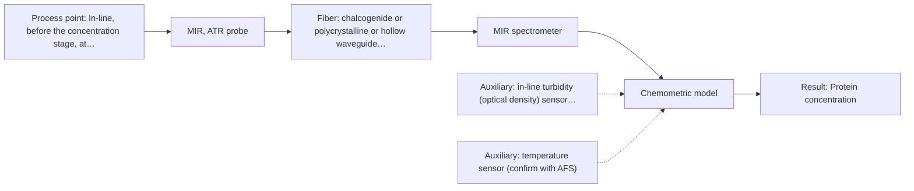
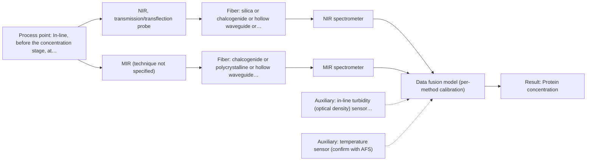

# First technical assessment: A clear whey stream before concentration

## Answer

**Customer request (our summary):** Customer wants to investigate spectroscopy for tracking protein concentration in a dairy whey stream before a concentration stage, using laboratory results as reference, and needs a first measurement concept that handles possible turbidity changes rather than assuming the liquid always remains clear.

### Brief answer

Test NIR transmission (or transflection) first for tracking protein in the whey stream while it stays clear, with your laboratory protein results as the reference. If the turbid states degrade that signal, test MIR ATR on the same samples. A fused NIR+MIR model is only worth testing if neither single method meets your targets. Protein range, turbidity range, required accuracy and installation conditions are still open.

### Proposal

- **Best current option:** O2 (recommended)
- **Basis:** engineering judgement
- **What would change it:** If the single-method trials show that NIR transmission or transflection holds its calibration across the turbid states, O1 becomes sufficient; if protein is not separable by either single method, the fused option O3 is the next test. Answers on the protein range and the required accuracy would also change the choice.
- **Next step:** Agree the sample set, the reference protein method and the go / no-go thresholds with the customer, then run the NIR and MIR ATR single-method trials on the same samples.

**Decision status:** Provisional feasibility assessment

### Solution options

| ID | Tier | Methods | Confidence | Cost class, S01 Table 1 (p.6) | Ease of use | Maintenance | Performance fit | Sources |
|---|---|---|---|---|---|---|---|---|
| O1 | Simple | M1 NIR, transmission/transflection probe | Medium: open question: Q1 (starts at Medium) | average cost (row 7) | Standard silica probe, no contact crystal | Routine flow-cell or window cleaning | Source-preferred geometry for clear whey streams | [1: S01 p.18] [2: S01 p.5] [3: S01 p.10] |
| O2 | Recommended | M2 MIR, ATR probe | Medium: open question: Q1 (starts at Medium) | high cost (row 2) | Contact ATR probe needs stable mounting | Crystal cleaning; fouling checks on whey | Thin ATR layer tolerates turbid stream states | [4: S01 p.10] [5: S01 p.10] [6: S01 p.5] [7: S04 p.3] |
| O3 | Extended (multi-method) | M3 NIR, transmission/transflection probe + MIR (combination) | Low: open question: Q1 (starts at Medium); multi-method, fusion benefit not yet shown | high cost (rows 2, 7) | Two instruments and probes to align | Two calibrations; two probe service routines | Covers clear and turbid states, if fusion wins | [8: S01 p.8] [9: S01 p.8] [10: S01 p.7] [11: S01 p.7] [12: S01 p.8] |

*Confidence rates the basis of the advice (how much is known and cited), not a predicted accuracy or probability of success. It starts at High, or at Medium when a key question on the method or the option is open, and drops one level per weakness listed (floor Low).*

*Cost class is the relative rating in S01 Table 1 (p.6) for the in-line method+technique rows named (the highest one for a multi-method option); it is not a price.*

### Setup sketch

*Recommended option O2; drawn by code from the option, a schematic, not a configuration.*

### Key questions

1. What is the protein concentration range in the stream, and which protein measure do you want (total protein or a specific whey protein)?
2. How far does the turbidity change, under which operating conditions, and is the change gradual or stepwise?
3. What accuracy, precision and response time are required, and how should they be judged against the laboratory reference?

## Expert detail

**Customer enquiry**

> Our dairy process includes a relatively clear whey stream before a concentration stage. We want to investigate whether spectroscopy can track protein concentration as the stream changes, with laboratory results used as the reference. The stream can become more turbid under some operating conditions. We need a first measurement concept that handles this change rather than assuming the liquid always remains clear.

**Decision status:** Provisional feasibility assessment. A shortlist can be justified: NIR transmission is the source-preferred geometry for clear dairy streams, and ATR probes measure liquids in contact in-line. The protein range, the turbidity range and the required accuracy are not yet known, so the choice between NIR and MIR ATR, and any combination, stays conditional.

### Parameters

| ID | Parameter | Kind | Need | Measured by | Why | Sources |
|---|---|---|---|---|---|---|
| P1 | Protein concentration | quantitative | required | Spectroscopy: NIR | This is the target analyte the customer wants to track as the stream changes, and it sets the calibration range. | [13: S01 p.17] |
| P2 | Turbidity or suspended-solids level of the stream | quantitative | required | Auxiliary sensor: in-line turbidity (optical density) sensor (cited; confirm availability with AFS) | The stream's scattering changes with operating conditions and shifts the spectra, so it must be recorded with each spectrum to interpret the protein signal. | [14: S01 p.7] |
| P3 | Stream temperature | quantitative | optional | Auxiliary sensor: temperature sensor (engineering judgement: confirm availability with AFS) | Should be available: water and protein bands shift with temperature, and a temperature signal is normally already present at the process point. | *(no verified source: engineering judgement)* |

### Solution option details

- **O1 cost drivers:** One NIR spectrometer, silica fiber probe, flow cell, calibration effort
- **O2 cost drivers:** MIR spectrometer, mid-IR fibers, ATR probe, crystal care
- **O3 cost drivers:** Two spectrometers, two probes, fusion software, larger sample set
- **O3 combining methods:** Fuse the NIR and MIR blocks at low level after block scaling, with one model per method as the baseline, because variables from different methods are not equivalent and must be normalised. Both probes must view the same small volume of the flowing stream, and the two data streams must be normalised to a common time step. Each instrument keeps its own calibration and diagnostics, and the fused model must beat the best single method on held-out runs before it is adopted.

*Extended (multi-method) option O3; drawn by code from the option, a schematic, not a configuration.*

### Premise check

- **Precedent only:** Spectroscopy can track protein concentration as the stream changes. NIR transmission is the source-preferred geometry for whey-like streams and NIR is used to quantify fat and protein in dairy, but this is a reason to test the method on this stream, not proof for it. [1: S01 p.18] [13: S01 p.17]
- **Supported:** Laboratory results are suitable as the reference. The supplied guidance expects independent reference measurements as part of a feasibility plan; which laboratory protein method is used and its uncertainty is not stated in the enquiry. [15: REF §3]
- **Precedent only:** A first measurement concept can handle the turbidity change. A dairy example states that a transflection probe can in some cases serve both low-fat and high-fat products, while transmission loses signal once the stream becomes thick or fat-rich; handling this stream's turbidity change is a hypothesis to test. [16: S01 p.18] [17: S01 p.18]

### Requirements

**Stated by the customer**

- "dairy process"
- "whey stream"
- "before a concentration stage"
- "relatively clear whey stream"
- "track protein concentration as the stream changes"
- "laboratory results used as the reference"
- "can become more turbid under some operating conditions"
- "first measurement concept that handles this change rather than assuming the liquid always remains clear"

**Key unknowns**

- Protein concentration range and which protein measure is meant (total protein or a specific whey protein).
- Turbidity or optical-density range and the operating conditions that cause it.
- Required accuracy, precision and response time, and how they are judged against the laboratory reference.
- Installation point, line size, temperature, pressure and cleaning regime.
- Reference laboratory protein method, its uncertainty and sampling frequency.
- Other whey matrix components (fat, lactose, minerals) that may interfere.

### Clarification questions (most decision-relevant first)

Q1. What is the protein concentration range in the stream, and which protein measure do you want (total protein or a specific whey protein)? *Why it matters:* The range and the analyte set the calibration range and show whether NIR or MIR has enough sensitivity for this stream. *(affects: method)*
Q2. How far does the turbidity change, under which operating conditions, and is the change gradual or stepwise? *Why it matters:* It decides whether a transmission or transflection geometry can cover the operating range or whether an ATR measurement is needed. *(affects: technique)*
Q3. What accuracy, precision and response time are required, and how should they be judged against the laboratory reference? *Why it matters:* These are the go / no-go numbers the trials must meet, and they come from your side, not from the sources. *(affects: status)*
Q4. Where will the probe sit (pipe, vat or bypass), and what are the temperature, pressure and cleaning regime at that point? *Why it matters:* It decides probe type and materials, and whether a contact (ATR) or a through-window measurement is practical. *(affects: installation)*
Q5. Which laboratory method gives the reference protein values, with what uncertainty and sampling frequency? *Why it matters:* Reference quality and sampling alignment limit what any calibration can demonstrate. *(affects: status)*

### Recommendation

- **M1 · Primary candidate: NIR, transmission/transflection probe.** Whey is named as a stream for which NIR transmission is preferred, and NIR fiber probes are used for online dairy analysis. NIR bands are broad and overlapping, so a chemometric calibration against the laboratory reference is needed. *Conditions:* Applies while the stream stays transparent enough for transmission; the optical pathlength must be set for the expected protein range, and the calibration is matrix-specific. [1: S01 p.18] [2: S01 p.5] [3: S01 p.10]
- **M2 · Comparison candidate: MIR, ATR probe.** ATR probes measure liquids and soft samples in contact and are used for in-line process measurement, and the mid-IR sampling layer is very thin, so bulk turbidity of the stream is less likely to dominate the signal. MIR also shows sharp protein bands (amide I and II). *Conditions:* Test when the stream turns turbid or when the NIR transmission signal degrades; ATR needs tight contact and a clean crystal. [4: S01 p.10] [5: S01 p.10] [6: S01 p.5] [7: S04 p.3]
- **M3 · Conditional candidate: NIR, transmission/transflection probe + MIR (combination).** If neither single method covers both the clear and the turbid states, combining the two vibrational methods is a hypothesis to test against the best single method; NIR plus IR combinations have been reported in other applications. Any gain must be demonstrated, not assumed. *Conditions:* Only after the single-method tests, and only if the turbidity change degrades either single method; both probes must view the same small volume of the stream. [10: S01 p.7] [11: S01 p.7] [12: S01 p.8] Later hypothesis, after single-method tests.
- **M4 · Not recommended: NIR, diffuse reflection probe.** Reflection can work in highly scattering media but is less representative for clear liquids, and this stream is normally clear; it is listed for powders and scattering solids rather than for a clear process liquid. [18: S01 p.18]

### Measurement concept

- **Probe and geometry:** Start with a transmission or transflection fiber probe through a flow cell or pipe window for the normally clear stream; keep an ATR fiber probe as the contact alternative for turbid states.
- **Location:** In-line, before the concentration stage, at a point where the stream can be sampled continuously.
- **Fiber link:** Fiber type and achievable link length depend on the method and probe selected and are not stated in the sources; this is an open point. [19: S01 p.18] [4: S01 p.10]

### Spectral range

- **NIR:** Nominal NIR range is 780-2500 nm; the usable range depends on the instrument, fiber and probe actually selected. [20: S01 p.10] [21: REF §5]
- **MIR:** Nominal MIR range is 4000-400 cm-1 (2.5-25 µm); the usable range depends on the fiber, crystal and spectrometer selected. [22: S01 p.9]

### Risks and uncertainty

- Protein may not dominate the spectral variation: fat, lactose, minerals and temperature can confound the calibration, and NIR and MIR calibrations are specific to the sample matrix. *(rules: R-CAL-1, R-NIR-2)* [23: REF §5]
- A turbidity change can shift the spectra and mimic a composition change, so a model built on clear-stream samples may not transfer to the turbid states. *(rules: R-GEO-6, R-GEN-5)* [14: S01 p.7]
- On a protein-rich whey stream the ATR crystal can foul or build deposits, which changes the signal and needs cleaning and checks. *(rules: R-MIR-3)* *(no verified source: engineering judgement)*
- The laboratory reference carries its own uncertainty and sampling mismatch, which limits what any calibration can demonstrate. *(no verified source: engineering judgement)*

### First feasibility experiment

1. **Collect representative samples across the expected chemical and physical variation.** Cover the range of protein concentrations, turbidity states and temperatures the stream actually shows, each with a laboratory protein value. [15: REF §3]
2. **Measure every sample with the single NIR transmission or transflection setup first.** Set the optical pathlength for the expected protein range and correct for scatter, so the single NIR method is tested on its own before any combination. [19: S01 p.18]
3. **Measure the same samples with the single MIR ATR setup at the same sample points.** Compare the two single methods on identical material. *(no verified source: engineering judgement)*
4. **Obtain independent reference protein values, turbidity and temperature for all samples, and hold out whole runs or batches.** Provide the independent reference the calibration is judged against, and keep held-out runs for validation. *(no verified source: engineering judgement)*
5. **Only if neither single method meets the turbidity requirement, fuse the NIR and MIR blocks measured at the same spot.** Check whether the fused model beats the best single method on held-out runs; the go / no-go thresholds (accuracy, response time) must come from the customer. [12: S01 p.8] [24: REF §5]

**Reference measurements:** Independent laboratory protein values on all samples, plus turbidity and temperature, with whole runs or batches held out for validation.

**Decision basis:** Customer-provided accuracy, precision and response-time targets, judged against the best single method on held-out runs.

### Assumptions

- The stream is a liquid process stream that can be measured in contact or through a window before the concentration stage.
- The customer's laboratory results are available for all trial samples and can be paired to spectra in time.

### Not covered by the supplied sources

- The supplied material gives no accuracy, detection-limit or response-time figures for protein in a whey stream.
- No whey-specific in-line protein example is supplied; the dairy examples given are milk fat and protein and whey as a transmission stream.

### Further notes

- **Chemometrics:** Both candidate methods need a chemometric calibration against the laboratory reference: the bands overlap and the calibration is specific to the sample matrix. Build one model per method, keep the reference data with the spectra, and validate on held-out runs or batches.
- **Real-time tracking:** The enquiry is about tracking a changing stream, so the concept should give continuous spectra at the line with results in near real time; fiber probes let the spectrometer sit away from the process point.
- **Future direction:** Once the informative wavelengths for this stream are known, a compact LED-based sensor could be considered as a later step.

### Evidence (verified quotes)

1. ✓ **S01 p.18** (general): "Transmission is the preferred method for transparent or semi-transparent liquids, such as skim milk, whey, or permeate."
2. ✓ **S01 p.5** (general): "making it ideal for online applications, including remote measurements via fiber optic probes."
3. ✓ **S01 p.10** (general): "The broad absorption bands observed in this region overlap, suggesting the use of chemometrics for quantitative and qualitative analysis of spectral data."
4. ✓ **S01 p.10** (general): "ATR fiber probes (Fig.1) enable the analysis of liquids and solid elastic samples"
5. ✓ **S01 p.10** (general): "Probe-based analysis is gaining widespread use in online analysis, such as in-line, in-process (chemical, biotechnological, natural) environments"
6. ✓ **S01 p.5** (general): "strong absorption in the mid-IR region limits the corresponding spectral method to the analysis of very thin samples (usually less than 50 μm), but it opens up the possibility of using attenuated total reflectance (ATR)"
7. ✓ **S04 p.3** (general): "the amide I and II bands, two major absorption peaks of the protein peptide group in the infrared region."
8. ✓ **S01 p.8** (general): "Variables obtained from different spectral methods are not equivalent."
9. ✓ **S01 p.8** (general): "Ultimately, the measurement data must be normalized to a common time step."
10. ✓ (precedent only) **S01 p.7** (method gain): "The analysis of such systems may require a combination of two or even more spectral methods."
11. ✓ **S01 p.7** (application precedent): "The combination of NIR and IR spectroscopy showed benefits in determining tumor boundaries in medical diagnostics."
12. ✓ **S01 p.8** (general): "It is crucial that the spectral information obtained by different methods-Mid-IR, NIR, Raman, and fluorescence spectra-is collected from the same small, even pinpoint, area of the sample."
13. ✓ **S01 p.17** (application precedent): "before using Partial Least Squares (PLS) regression to quantify fat and protein."
14. ✓ **S01 p.7** (general): "Morphological factors, such as sample inhomogeneity (e.g., biological tissue) or process turbulence, must also be considered when selecting a measurement technique."
15. ✓ **REF §3** (general): "Representative samples or process states, independent reference measurements, what is compared, and the basis for the go / no-go decision."
16. ✓ **S01 p.18** (application precedent): "In some cases, a Transflection probe can already be a combined solution working well for low-fat and high-fat containing milk products."
17. ✓ **S01 p.18** (general): "it fails when the milk becomes too "thick" or fat-rich, as the light cannot penetrate the sample."
18. ✓ **S01 p.18** (general): "reflection can work well in highly scattering environments but can be less representative for clear liquids."
19. ✓ **S01 p.18** (general): "the precise control of the optical pathlength (usually 1 - 10 mm)"
20. ✓ **S01 p.10** (general): "NIR spectra (780-2500 nm) contain predominantly overtones and component bands of fundamental vibrations"
21. ✓ **REF §5** (general): "It is not a product specification: actual spectral coverage, fiber length, component ratings, detection limits and accuracy depend on the configuration and the sample."
22. ✓ **S01 p.9** (general): "Vibrational spectroscopy in the mid-IR range (4000-400 cm-1) is one of the most informative methods of chemical analysis."
23. ✓ **REF §5** (general): "calibration specific to the matrix."
24. ✓ **REF §5** (general): "compare with the best single method."

### Verification

- Citations verified: 32 of 32 (exact or whitespace/hyphen-tolerant match on the cited page, scope checked).
- Hard check failures before deterministic corrections: 0; still open: 0; soft warnings: 1; repair rounds: 1.
- Corrected deterministically after verification (1):
  - ⚠ recommendations[2].combined_with: combined_with normalised to ['MIR'] (duplicates and the entry's own method removed)

*Run D03-20261017T163735Z · models deepseek/deepseek-v4.1-flash*
