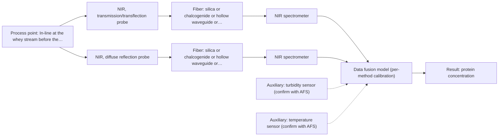
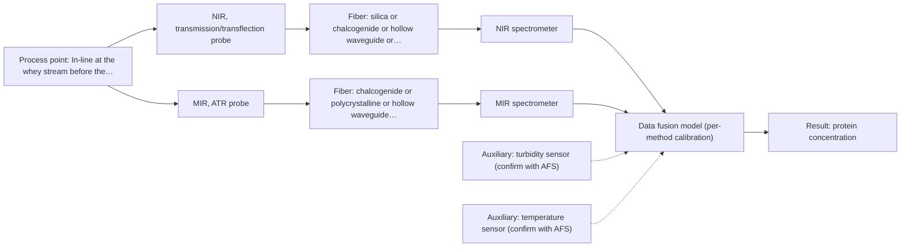

# First technical assessment: A clear whey stream before concentration

# Answer

**Customer request:** The customer wants to investigate whether optical spectroscopy can track protein concentration in a dairy whey stream before a concentration stage, using laboratory results as reference, while handling turbidity changes.

## Brief answer

Test NIR first, using a transmission/transflection geometry for the clear state and a diffuse-reflection geometry for the more turbid state, with laboratory protein values as the reference. A single transflection probe may already cover both states, so it is the least-effort first test. A MIR-ATR add-on is only a later option if NIR cannot reach the required protein accuracy. The turbidity range, accuracy target and reference method are still open.

## Proposal

- **Best current option:** O2 (recommended): M1 NIR, transmission/transflection probe; M2 NIR, diffuse reflection probe
- **Basis:** supplied AFS sources
- **What would change it:** If the measured turbidity stays low in all operating states, the single-probe option O1 becomes sufficient; if NIR cannot reach the required protein accuracy, the combined option O3 becomes the candidate.
- **Next step:** Run the feasibility experiment on clear and turbid whey samples with laboratory protein references, then review the results with AFS.

**Decision status:** Provisional feasibility assessment. The sources support NIR transmission/transflection for clear liquids and NIR reflection for opaque or concentrated dairy streams, so a shortlist of methods worth testing can be justified. The required protein accuracy, the turbidity range and the reference method are not yet known, so the choice between the options stays provisional.

## Solution options

| ID | Tier | Methods | Confidence | Cost class, S01 Table 1 (p.6) | Ease of use | Maintenance | Performance fit | Sources |
|---|---|---|---|---|---|---|---|---|
| O1 | Simple | M1 NIR, transmission/transflection probe | Medium: uncited auxiliary sensor | average (row 7) | Single probe, single spectrometer, established dairy geometry. | One probe window to clean; one calibration to maintain. | Least effort; a transflection probe may cover both the clear and the turbid state. | [1: S01 p.18] |
| O2 | Recommended | M1 NIR, transmission/transflection probe; M2 NIR, diffuse reflection probe | Medium: uncited auxiliary sensor | average (rows 7, 8) | Two probes on one NIR spectrometer and one shared light source. | Two windows to clean; separate calibration per technique. | Transmission for the clear state, reflection for the turbid state, without assuming the stream stays clear. | [2: S01 p.18] [3: S01 p.18] |
| O3 | Extended (multi-method) | M1 NIR, transmission/transflection probe; M3 MIR, ATR probe + NIR (combination) | Low: uncited auxiliary sensor; multi-method, fusion benefit not yet shown | high (rows 2, 7) | Two instruments with synchronised sampling; more demanding to run. | Two calibrations and diagnostics; a probe change breaks the fused model. | Adds MIR fundamental bands if NIR alone lacks protein selectivity. | [4: S01 p.8] [5: S01 p.8] [6: S01 p.8] [7: S01 p.9] |

*Confidence rates the basis of the advice (how much is known and cited), not a predicted accuracy or probability of success. It starts at High and drops one level per weakness listed.*

*Cost class is the relative rating in S01 Table 1 (p.6) for the in-line method+technique rows named (the highest one for a multi-method option); it is not a price.*

## Setup sketch

*Recommended option O2; drawn by code from the option, a schematic, not a configuration.*

*Extended (multi-method) option O3; drawn by code from the option, a schematic, not a configuration.*

## Key questions

1. What protein accuracy, precision and response time must the measurement meet?
2. How far and how quickly does the turbidity change, and what is the highest optical density the stream reaches?
3. Which laboratory method and sampling frequency will provide the reference protein values?

# Expert detail

**Customer enquiry**

> Our dairy process includes a relatively clear whey stream before a concentration stage. We want to investigate whether spectroscopy can track protein concentration as the stream changes, with laboratory results used as the reference. The stream can become more turbid under some operating conditions. We need a first measurement concept that handles this change rather than assuming the liquid always remains clear.

## Parameters

| ID | Parameter | Kind | Need | Measured by | Why | Sources |
|---|---|---|---|---|---|---|
| P1 | protein concentration | quantitative | required | Spectroscopy: NIR | It is the target the customer wants to track as the stream changes. | [8: S01 p.17] |
| P2 | turbidity / optical density | quantitative | required | Auxiliary sensor: turbidity sensor (cited; confirm availability with AFS) | It defines which optical regime the stream is in and therefore which geometry can be used. | [9: S01 p.18] |
| P3 | stream temperature | quantitative | required | Auxiliary sensor: temperature sensor (engineering judgement: confirm availability with AFS) | NIR water and protein bands shift with temperature, so the calibration needs the temperature to separate thermal from compositional change. | *(no verified source: engineering judgement)* |

## Solution option details

- **O1 cost drivers:** One NIR spectrometer, one probe, one calibration and installation.
- **O2 cost drivers:** One NIR spectrometer, two probes, two calibrations, switching hardware.
- **O3 cost drivers:** Second spectrometer, MIR fiber probe, synchronisation and fusion work.
- **O3 combining methods:** Level: one calibration per method first, then low-level fusion of the joined spectra with block scaling so neither block dominates the model. Both probes must look at the same small area of the flowing stream, their data must be aligned to a common time step, and each block needs its own calibration and diagnostics. The second instrument is only worth keeping if the fused model beats the best single NIR model on independent batches.

## Premise check

- **Supported:** Laboratory results can serve as the reference for the protein measurement. Independent reference measurements are part of a feasibility plan, so a laboratory protein value is the expected reference. [10: REF §3]
- **Precedent only:** One first measurement concept can handle the turbidity change without assuming the liquid always stays clear. A dairy example shows a single transflection probe working for both low-fat and high-fat products, and shows value in having both transmission and reflection available; this is a reason to test, not proof for this whey stream. [11: S01 p.18] [12: S01 p.18]

## Requirements

**Stated by the customer**

**Key unknowns**

- Required protein accuracy, precision, detection limit and response time
- Range and dynamics of turbidity (optical density) across operating states
- Laboratory reference method and its sampling frequency
- Target protein species and concentration range in the stream
- Installation point, flow, distance to the analyzer, cleaning and fouling
- Process temperature and pressure at the measurement point

## Clarification questions (most decision-relevant first)

Q1. What protein accuracy, precision and response time must the measurement meet? *Why it matters:* It decides whether a NIR-only model can be the answer or whether a second method is needed. *(affects: method, status)*
Q2. How far and how quickly does the turbidity change, and what is the highest optical density the stream reaches? *Why it matters:* It decides between transmission, diffuse reflection, or both. *(affects: technique, installation)*
Q3. Which laboratory method and sampling frequency will provide the reference protein values? *Why it matters:* It defines the reference data the chemometric model is built and validated against. *(affects: method, status)*
Q4. What is the stream temperature at the measurement point, and is a temperature sensor available there? *Why it matters:* It decides whether temperature must be an input to the model. *(affects: installation, status)*
Q5. Where will the probe be installed: pipe size and flow, distance to the analyzer, cleaning and hygiene requirements? *Why it matters:* It decides the probe, the fiber link and the installation concept. *(affects: installation)*

## Recommendation

- **M1 · Primary candidate: NIR, transmission/transflection probe.** Transmission is the preferred geometry for clear, semi-transparent liquids such as whey, and NIR is the most common in-line method with fiber probes. A transflection probe can in some cases serve both low-fat and high-fat streams, which is exactly the variation here. *Conditions:* Applies while the stream stays within the pathlength the probe can handle; if it becomes too opaque for the light to penetrate, a reflection geometry is needed. [13: S01 p.18] [14: S01 p.18] [15: S01 p.10]
- **M2 · Comparison candidate: NIR, diffuse reflection probe.** Diffuse reflection is used for opaque or highly concentrated dairy products, so it is the counterpart to test for the turbid operating state. Reflection is sensitive to surface characteristics and particle size, so scatter correction and its own calibration are needed. *Conditions:* Applies mainly to the more turbid state; for clear liquid it is less representative than transmission. [16: S01 p.17] [17: S01 p.18] [18: S01 p.17]
- **M3 · Conditional candidate: MIR, ATR probe.** MIR ATR gives well-defined fundamental bands with high selectivity and is not limited by pathlength, so it is the fallback if the NIR models do not resolve the protein signal in the turbid state. Combining NIR with MIR is a hypothesis to test against the best single method, not a demonstrated gain for this stream. *Conditions:* Applies only if the single-method NIR tests do not reach the required protein accuracy and the MIR probe contact, fouling and fiber link prove workable. [19: S01 p.9] [20: S01 p.5] [21: S01 p.7] [22: S01 p.14] Later hypothesis, after single-method tests: combine with NIR.

## Measurement concept

- **Probe and geometry:** NIR fiber probe in transmission/transflection for the clear state and a NIR reflection probe for the turbid state; MIR ATR only as a later add-on.
- **Location:** In-line at the whey stream before the concentration stage.
- **Fiber link:** Silica fibers cover the NIR range; any MIR link length is an open question for AFS. [23: S01 p.18]

## Spectral range

- **NIR:** Nominal NIR range 780-2500 nm; the usable range depends on the instrument, fiber and probe actually selected. [24: S01 p.10]
- **MIR:** Nominal MIR range 4000-400 cm-1; the usable range depends on the fiber, ATR crystal and spectrometer actually selected. [25: S01 p.9]

## Risks and uncertainty

- Turbidity may rise past the point where NIR light penetrates the stream, so the clear-state transmission geometry may not carry the turbid state. *(rules: R-GEO-2)* [26: S01 p.18]
- The required protein accuracy is unknown, and NIR bands are broad and overlapping, so a NIR-only model may not reach it. *(rules: R-NIR-2)* [27: S01 p.10]
- The dairy NIR results in the sources are precedents from other products and other streams, not proof for this whey stream. *(rules: R-EVI-2)* [28: REF §3]
- A MIR-ATR add-on brings contact, fouling and fiber-link limits that may not suit this in-line dairy point. *(rules: R-MIR-3, R-FIB-2)* [29: S01 p.13]

## First feasibility experiment

1. **Collect representative whey samples and process states across the expected clear-to-turbid variation, covering the stream before the concentration stage.** Cover the expected variation [30: REF §3]
2. **Measure the single methods first, NIR transmission/transflection and NIR diffuse reflection, and keep MIR ATR and any combination for a later stage.** Measure single methods first (NIR transmission/transflection, NIR diffuse reflection); keep MIR ATR and any combination for a later stage. [31: S01 p.3]
3. **Obtain independent laboratory protein values for every sample, with replicates and a defined sampling frequency.** Obtain independent laboratory protein values for every sample, with replicates and a defined sampling frequency. [32: REF §3]
4. **Build and validate one chemometric model per technique on held-out runs or batches, then test whether a combined NIR + MIR model beats the best single method on the same independent batches.** Build and validate one chemometric model per technique on held-out runs or batches; only then test whether a combined NIR + MIR model beats the best single method on the same independent batches. [33: S01 p.8]
5. **Compare the model error in the clear state and in the turbid state against the protein accuracy the customer requires as the go/no-go basis; the numerical thresholds come from the customer.** Go/no-go: compare the model error in the clear state and in the turbid state against the protein accuracy the customer requires; the numerical thresholds come from the customer. *(no verified source: engineering judgement)*

**Reference measurements:** Laboratory protein values for every sample, with replicates and a defined sampling frequency.

**Decision basis:** Customer-supplied protein accuracy target, assessed separately for the clear and the turbid state.

## Assumptions

- The whey stream is a flowing aqueous liquid with a protein content that can be measured by a laboratory reference method.
- The probe can be installed in-line at one point before the concentration stage.
- The stream temperature varies little enough that it can be recorded rather than controlled.

## Not covered by the supplied sources

- No source gives an achievable protein accuracy, detection limit or response time for whey, and no source states an achievable in-line MIR fiber link length; both are open questions for AFS.

## Further notes

- **Chemometrics:** NIR bands overlap, so a chemometric calibration is required, and it is specific to the matrix: a model built on one whey composition must be re-validated when the stream or product changes. The laboratory protein values are the reference data for building and validating that model.
- **Real-time tracking:** The measurement point is in-line and continuous, and fiber probes allow on-site analysis with results in near real time, which suits a stream that changes during operation rather than grab sampling.
- **Future direction:** Once the informative wavelengths are known, a compact LED-based optical multisensor system could be a later step for this measuring point.

## Evidence (verified quotes)

1. ✓ **S01 p.18** (application precedent): "In some cases, a Transflection probe can already be a combined solution working well for low-fat and high-fat containing milk products."
2. ✓ **S01 p.18** (general): "NIR Spectrometer and NIR light source remain the same for both reflection and transmission techniques."
3. ✓ **S01 p.18** (general): "By maintaining both, a lab can calibrate models for every stage of production"
4. ✓ (precedent only) **S01 p.8** (method gain): "It is crucial that the spectral information obtained by different methods-Mid-IR, NIR, Raman, and fluorescence spectra-is collected from the same small, even pinpoint, area of the sample."
5. ✓ (precedent only) **S01 p.8** (method gain): "Variables obtained from different spectral methods are not equivalent."
6. ✓ (precedent only) **S01 p.8** (method gain): "Ultimately, the measurement data must be normalized to a common time step."
7. ✓ (precedent only) **S01 p.9** (method gain): "One of the challenges of multispectral analysis is the need to simultaneously connect at least two independently operating measuring instruments."
8. ✓ **S01 p.17** (application precedent): "using Partial Least Squares (PLS) regression to quantify fat and protein"
9. ✓ **S01 p.18** (general): "as the light cannot penetrate the sample."
10. ✓ **REF §3** (general): "Representative samples or process states, independent reference measurements, what is compared, and the basis for the go / no-go decision."
11. ✓ **S01 p.18** (application precedent): "In some cases, a Transflection probe can already be a combined solution working well for low-fat and high-fat containing milk products."
12. ✓ **S01 p.18** (general): "By maintaining both, a lab can calibrate models for every stage of production"
13. ✓ **S01 p.18** (general): "Transmission is the preferred method for transparent or semi-transparent liquids, such as skim milk, whey, or permeate."
14. ✓ **S01 p.18** (application precedent): "In some cases, a Transflection probe can already be a combined solution working well for low-fat and high-fat containing milk products."
15. ✓ **S01 p.10** (general): "Near-IR vibrational spectroscopy (NIR) is the most common online analysis method performed using fiber optic probes."
16. ✓ **S01 p.17** (general): "NIR Reflection is primarily used for opaque or highly concentrated dairy products, such as yogurt, butter, or whole milk concentrates."
17. ✓ **S01 p.18** (general): "reflection can work well in highly scattering environments but can be less representative for clear liquids."
18. ✓ **S01 p.17** (general): "the method is sensitive to the surface characteristics and fat globule size."
19. ✓ **S01 p.9** (general): "Vibrational spectroscopy in the mid-IR range (4000-400 cm-1) is one of the most informative methods of chemical analysis."
20. ✓ **S01 p.5** (general): "Mid-IR band spectra contain well-defined peaks (absorption bands), while NIR, UV, and fluorescence spectra contain broad, highly overlapping signals"
21. ✓ (precedent only) **S01 p.7** (method gain): "The analysis of such systems may require a combination of two or even more spectral methods."
22. ✓ **S01 p.14** (application precedent): "Synergy effect of combined near and mid-infrared fibre spectroscopy for diagnostics of abdominal cancer."
23. ✓ **S01 p.18** (general): "NIR Spectrometer and NIR light source remain the same for both reflection and transmission techniques."
24. ✓ **S01 p.10** (general): "NIR spectra (780-2500 nm) contain predominantly overtones and component bands of fundamental vibrations"
25. ✓ **S01 p.9** (general): "Vibrational spectroscopy in the mid-IR range (4000-400 cm-1) is one of the most informative methods of chemical analysis."
26. ✓ **S01 p.18** (general): "as the light cannot penetrate the sample."
27. ✓ **S01 p.10** (general): "The broad absorption bands observed in this region overlap, suggesting the use of chemometrics for quantitative and qualitative analysis of spectral data."
28. ✓ **REF §3** (general): "a published application is a reason to test a method, not proof that it will work for a new customer."
29. ✓ **S01 p.13** (general): "typically at a depth of few microns"
30. ✓ **REF §3** (general): "Representative samples or process states, independent reference measurements, what is compared, and the basis for the go / no-go decision."
31. ✓ **S01 p.3** (general): "samples of incompletely known composition, in order to select the most suitable method or combination of methods."
32. ✓ **REF §3** (general): "Representative samples or process states, independent reference measurements, what is compared, and the basis for the go / no-go decision."
33. ✓ **S01 p.8** (general): "It is crucial that the spectral information obtained by different methods-Mid-IR, NIR, Raman, and fluorescence spectra-is collected from the same small, even pinpoint, area of the sample."

## Verification

- Citations verified: 33 of 33 (exact or whitespace/hyphen-tolerant match on the cited page, scope checked).
- Hard check failures before deterministic corrections: 0; still open: 0; soft warnings: 5; repair rounds: 1.

*Run D03-20261017T133505Z · models deepseek/deepseek-v4.1-flash*
