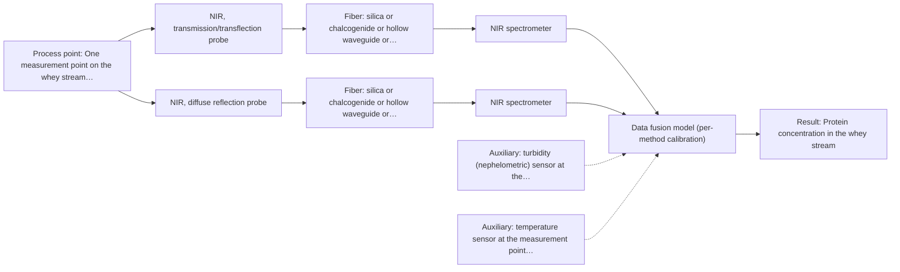
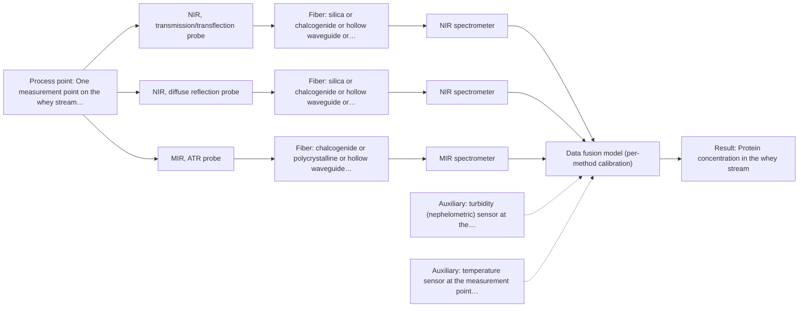

# First technical assessment: A clear whey stream before concentration

## Answer

**Customer request (our summary):** Customer wants to investigate whether optical spectroscopy can track protein concentration in a dairy whey stream ahead of a concentration stage, using laboratory results as reference, and asks for a first measurement concept that copes with the stream turning more turbid instead of assuming it always stays clear.

### Brief answer

Start with NIR transmission (or transflection) on the clear whey stream, using laboratory protein values as the reference; add NIR reflection for the turbid operating states, since transmission loses signal when the liquid becomes thick. Whether NIR alone reaches the protein accuracy you need, and how far the turbidity swings, are still open. Agree the accuracy, range and response time with us before the trials, and we will confirm the geometry and whether a second method is needed.

### Proposal

- **Best current option:** O2 (recommended): M1 NIR, transmission/transflection probe; M2 NIR, diffuse reflection probe
- **Basis:** supplied AFS sources
- **What would change it:** If the stream stays clear and NIR transmission meets the agreed protein accuracy, O1 is enough; if the turbidity swings widely or NIR cannot reach the required accuracy, the choice moves to O3 with its mid-infrared ATR channel.
- **Next step:** Run the feasibility experiment on representative clear and turbid whey samples, starting with NIR transmission, with laboratory protein values as the independent reference.

**Decision status:** Provisional feasibility assessment. A conditional shortlist can be justified: transmission or transflection is the geometry the source names for whey-like liquids, and reflection is the geometry the same source names for the turbid, more concentrated state. The deciding facts (target quantity, required accuracy, size and cause of the turbidity swing) are not yet known, so the choice between one, two or three measurement channels stays provisional.

### Solution options

| ID | Tier | Methods | Confidence | Cost class, S01 Table 1 (p.6) | Ease of use | Maintenance | Performance fit | Sources |
|---|---|---|---|---|---|---|---|---|
| O1 | Simple | M1 NIR, transmission/transflection probe | High | average cost (row 7) | Single probe and spectrometer; simplest to operate and calibrate. | Routine cleaning of one flow cell or probe. | Least effort; answers the main question while the stream stays clear. | [1: S01 p.18] [2: S01 p.18] [3: S01 p.18] |
| O2 | Recommended | M1 NIR, transmission/transflection probe; M2 NIR, diffuse reflection probe | Medium: uncited auxiliary sensor | average cost (rows 7, 8) | Two geometries, one spectrometer; switching and calibration need care. | Two probes or windows to clean; the reflection port is prone to fouling. | Fits the stated need: covers clear and turbid states with one method. | [4: S01 p.18] [5: S01 p.18] [6: S01 p.18] [7: S01 p.17] [8: S01 p.18] [9: S01 p.17] |
| O3 | Extended (multi-method) | M1 NIR, transmission/transflection probe; M2 NIR, diffuse reflection probe; M3 MIR, ATR probe + NIR (combination) | Low: uncited auxiliary sensor; multi-method, fusion benefit not yet shown | high cost (rows 2, 7, 8) | Two instruments and fused data; most demanding to run and maintain. | Per-instrument calibration and drift checks; ATR crystal cleaning. | Adds selective protein bands if NIR accuracy falls short across the turbidity range. | [10: S01 p.18] [11: S01 p.18] [12: S01 p.18] [13: S01 p.17] [14: S01 p.18] [15: S01 p.17] [16: S01 p.5] [17: S04 p.3] [18: S01 p.7] [19: S01 p.5] [20: S01 p.13] |

*Confidence rates the basis of the advice (how much is known and cited), not a predicted accuracy or probability of success. It starts at High and drops one level per weakness listed.*

*Cost class is the relative rating in S01 Table 1 (p.6) for the in-line method+technique rows named (the highest one for a multi-method option); it is not a price.*

### Setup sketch

*Recommended option O2; drawn by code from the option, a schematic, not a configuration.*

*Extended (multi-method) option O3; drawn by code from the option, a schematic, not a configuration.*

### Key questions

1. Which protein quantity must be tracked (total protein, a specific whey protein fraction, or something else), and does your laboratory reference measure exactly that quantity?
2. What protein concentration range must be covered, and what accuracy, detection limit and response time does the process need?
3. How far and how often does the stream become turbid, what causes it (fat droplets, protein aggregates, particulates, air), and how fast does it change?

## Expert detail

**Customer enquiry**

> Our dairy process includes a relatively clear whey stream before a concentration stage. We want to investigate whether spectroscopy can track protein concentration as the stream changes, with laboratory results used as the reference. The stream can become more turbid under some operating conditions. We need a first measurement concept that handles this change rather than assuming the liquid always remains clear.

### Parameters

| ID | Parameter | Kind | Need | Measured by | Why | Sources |
|---|---|---|---|---|---|---|
| P1 | Protein concentration in the whey stream | quantitative | required | Spectroscopy: NIR | It is the target the customer wants to track as the stream changes. | [21: S01 p.17] |
| P2 | Turbidity / physical scatter state of the stream at the measurement point | quantitative | required | Auxiliary sensor: turbidity (nephelometric) sensor at the measurement point (cited; confirm availability with AFS) | The stream becomes more turbid under some conditions, and this state decides whether the transmission path still carries a usable signal. | [22: S01 p.17] |
| P3 | Stream temperature at the measurement point | quantitative | optional | Auxiliary sensor: temperature sensor at the measurement point (engineering judgement: confirm availability with AFS) | It should be available because temperature shifts the water bands and the instrument response, so it helps to interpret and compare spectra taken at different times. | *(no verified source: engineering judgement)* |

### Solution option details

- **O1 cost drivers:** one spectrometer, one transmission or transflection probe or cell, chemometric calibration and reference analyses
- **O2 cost drivers:** one spectrometer with two probe geometries, more calibration runs across clear and turbid states, extra reference analyses
- **O3 cost drivers:** a second spectrometer, mid-infrared fiber and ATR probe, data fusion software, per-instrument calibration and maintenance
- **O3 combining methods:** Fusion would start from one model per method and either join the spectral blocks with scaling or combine the per-method results, and only after the single-method tests. The ATR crystal and the NIR path sample different depths and volumes, so the probes must look at the same flowing material and the data must be aligned to a common time step. Each instrument keeps its own calibration, and the fused model must beat the best single method on independent runs before the extra instrument is kept.

### Premise check

- **Not covered:** Laboratory results are an adequate and comparable reference for the in-line measurement. The supplied material requires independent reference measurements in a feasibility plan but says nothing about whether a given laboratory method measures the same quantity as the in-line measurement on this stream. *(no verified source: engineering judgement)*
- **Precedent only:** One measurement concept can handle both the clear and the more turbid state of the stream. A dairy example shows a single transflection probe serving both a low-fat and a high-fat product, which is a reason to test this, not proof for this stream; the size and frequency of the turbidity change here are unknown. [23: S01 p.18]
- **Precedent only:** Optical spectroscopy can track protein concentration in a whey stream (feasibility to be investigated, not assumed). NIR is shown quantifying fat and protein in milk, which is a reason to test NIR here, not proof that it will reach the accuracy this process needs for whey. [24: S01 p.17]

### Requirements

**Stated by the customer**

**Key unknowns**

- Which protein quantity is meant (total protein or a specific whey fraction) and whether the laboratory reference measures the same quantity.
- Protein concentration range, the size of the changes to be tracked, and the required accuracy, detection limit and response time.
- Magnitude, frequency and cause of the turbidity change (fat droplets, protein aggregates, particulates or air).
- Other matrix components and interferences (fat, lactose, minerals, cleaning chemicals).
- Installation geometry: probe or flow-cell location, path length, and distance between instrument and stream.
- Stream temperature, pressure, and cleaning (CIP) and hygiene requirements at the measurement point.

### Clarification questions (most decision-relevant first)

Q1. Which protein quantity must be tracked (total protein, a specific whey protein fraction, or something else), and does your laboratory reference measure exactly that quantity? *Why it matters:* The calibration can only be as good as the match between what the spectra are modelled against and what the laboratory reports. *(affects: method, technique, status)*
Q2. What protein concentration range must be covered, and what accuracy, detection limit and response time does the process need? *Why it matters:* These numbers decide whether one NIR geometry is enough or whether a second, more selective method has to be added. *(affects: method, technique, status)*
Q3. How far and how often does the stream become turbid, what causes it (fat droplets, protein aggregates, particulates, air), and how fast does it change? *Why it matters:* This decides whether a transmission path stays usable and whether a reflection geometry must be part of the concept from the start. *(affects: technique, installation)*
Q4. Where will the measurement sit (pipe, bypass, tank) and how far is the instrument from that point? *Why it matters:* It fixes the probe or flow-cell geometry, the fiber family, and whether a mid-infrared link is practical at that distance. *(affects: installation, technique)*
Q5. What are the stream temperature and pressure at the measurement point, and what cleaning (CIP) and hygiene rules apply? *Why it matters:* These constrain probe materials, sealing and cleaning, and they affect the spectra and the achievable stability. *(affects: installation, status)*

### Recommendation

- **M1 · Primary candidate: NIR, transmission/transflection probe.** Whey is a transparent to semi-transparent dairy liquid, the case for which transmission or transflection is the preferred geometry and gives higher accuracy for low-concentration components. It is the single method to test first, with the optical pathlength controlled for the actual sample. *Conditions:* Applies while the stream stays clear enough for light to cross the measurement path; the pathlength must be set for the real sample and re-checked when the stream changes. [25: S01 p.18] [26: S01 p.18] [27: S01 p.18]
- **M2 · Conditional candidate: NIR, diffuse reflection probe.** NIR reflection is used for opaque or highly concentrated dairy products and works in highly scattering environments, which is what the turbid operating states are. It is kept as a conditional second test because reflection can be less representative for clear liquids. *Conditions:* Applies if the stream becomes too turbid for the transmission path to carry a usable signal. [28: S01 p.17] [29: S01 p.18] [30: S01 p.17]
- **M3 · Conditional candidate: MIR, ATR probe.** MIR gives well-defined absorption bands, including the protein amide bands, and ATR needs only a thin surface layer in contact with the crystal, which can add selectivity that broad NIR bands lack. Combining it with NIR transmission is a later hypothesis, to be tested only if the NIR results fall short of what the process needs. *Conditions:* Applies only if the NIR options cannot reach the accuracy the process needs for protein across the turbidity range. [31: S01 p.5] [32: S04 p.3] [33: S01 p.7] [34: S01 p.5] [35: S01 p.13] Later hypothesis, after single-method tests: combine with NIR.

### Measurement concept

- **Probe and geometry:** A contact NIR transmission or transflection probe or flow cell at the whey line before the concentration stage; a second NIR reflection window at the same line for the turbid states. A mid-infrared ATR probe is only a later option, and its link length to the spectrometer is an open point.
- **Location:** One measurement point on the whey stream ahead of the concentration stage, chosen where the flow is well mixed and the probe can be cleaned in place.
- **Fiber link:** Standard Vis-NIR silica fibers are the family for the NIR channels; a mid-infrared channel would need chalcogenide or polycrystalline infrared fibers, for which no achievable process link length is stated in the supplied material. *(no verified source: engineering judgement)*

### Spectral range

- **NIR:** Nominal NIR range 780-2500 nm; the usable range depends on the instrument, fiber and probe actually selected. [36: S01 p.10] [37: REF §5]
- **MIR:** Nominal MIR range 4000-400 cm-1 (2.5-25 µm); the usable range depends on the crystal, fibers and probe actually selected. [38: S01 p.9] [39: REF §5]

### Risks and uncertainty

- The stream may become too turbid for a transmission path, so the primary measurement could lose signal exactly in the states the customer wants to cover. *(rules: R-GEO-2)* [40: S01 p.18]
- NIR protein bands are broad and overlap with water, so the calibration is specific to this matrix and must be rebuilt or re-checked when the stream composition changes. *(rules: R-NIR-2, R-CAL-1)* [41: S01 p.10] [42: REF §5]
- Scatter from fat droplets, protein aggregates or particulates can change the signal independently of protein, so a physical change may look like a concentration change. *(rules: R-GEO-6, R-GEN-5)* [43: S01 p.17] [44: S01 p.7]
- If a second method is added, the ATR crystal and the NIR path sample different depths and volumes and acquire at different rates, so the fused model may not beat the best single method. *(rules: R-CMB-1, R-CMB-2, R-CMB-3)* [45: S01 p.8] [46: S01 p.8]

### First feasibility experiment

1. **Collect representative whey samples and process states across the expected range: the clear stream in normal operation and the more turbid states seen under some conditions, at several protein levels, using the same sampling procedure the plant would use.** Cover the real chemical and physical variation before any model is built. [47: REF §3]
2. **Measure every sample with the single methods first: NIR transmission or transflection as the primary, and NIR diffuse reflection on the same states, recording turbidity and temperature alongside each spectrum; keep the MIR ATR channel for the later combination test.** Compare the single methods before any fusion is attempted. [48: S01 p.18]
3. **Take the independent reference: a laboratory protein determination on the same samples, sampled at the same time as the spectra, plus a laboratory turbidity or total-solids value to describe the physical state.** Give the calibration an independent anchor and record the state the spectra were taken in. *(no verified source: engineering judgement)*
4. **Build one calibration per geometry from the reference values and test it on held-out runs or batches, not on random splits of the same run; then compare the single-method models with the later NIR plus MIR ATR fused model.** Show whether a second method actually adds, rather than only fitting the same data. *(no verified source: engineering judgement)*
5. **Agree the go/no-go numbers with the customer before starting (protein range, required accuracy or detection limit, response time, and the turbidity range the concept must survive) and use them to decide whether one geometry, two geometries or an added MIR ATR channel is kept.** Make the decision rest on the customer's own criteria, not on our judgement of a spectrum. *(no verified source: engineering judgement)*

**Reference measurements:** Laboratory protein determination on the same samples, taken at the same time as the spectra, plus a laboratory turbidity or total-solids value.

**Decision basis:** Customer-defined numerical criteria for protein accuracy, detection limit, response time and the turbidity range the concept must survive.

### Assumptions

- The measurement point is a well-mixed section of the whey line ahead of the concentration stage, reachable by a contact probe or flow cell.
- The clear state dominates normal operation and the turbid state is an excursion, so a transmission-based primary measurement is worth testing first.
- A laboratory protein method exists and can be sampled close enough in time to the spectra to serve as the reference.

### Not covered by the supplied sources

- The supplied material gives no accuracy, detection limit or response time for protein in whey with any of the methods considered here.
- The supplied material states no achievable fiber-link length for a mid-infrared link in a process installation.

### Further notes

- **Chemometrics:** Tracking protein quantitatively from NIR needs a calibration model built on laboratory reference values for this stream. Because the bands overlap and the matrix is specific, the model has to be rebuilt or re-checked whenever the stream composition or the turbidity behaviour changes, and it should be tested on held-out runs or batches rather than on random splits of the same run.
- **Real-time tracking:** The measurement is intended in-line and continuous, so the acquisition rate must be fast enough for the process decision and aligned with the timing of the laboratory samples used as reference.
- **Future direction:** If the trials show that a few informative wavelengths carry the protein signal, a compact spectral fiber sensor for this single measurement point could be a later step, once the laboratory method selection has been made.

### Evidence (verified quotes)

1. ✓ **S01 p.18** (general): "Transmission is the preferred method for transparent or semi-transparent liquids, such as skim milk, whey, or permeate."
2. ✓ **S01 p.18** (general): "transmission is superior for the high-precision analysis of dilute process streams (like whey filtration)"
3. ✓ **S01 p.18** (general): "the precise control of the optical pathlength (usually 1 - 10 mm)"
4. ✓ **S01 p.18** (general): "Transmission is the preferred method for transparent or semi-transparent liquids, such as skim milk, whey, or permeate."
5. ✓ **S01 p.18** (general): "transmission is superior for the high-precision analysis of dilute process streams (like whey filtration)"
6. ✓ **S01 p.18** (general): "the precise control of the optical pathlength (usually 1 - 10 mm)"
7. ✓ **S01 p.17** (general): "NIR Reflection is primarily used for opaque or highly concentrated dairy products, such as yogurt, butter, or whole milk concentrates."
8. ✓ **S01 p.18** (general): "reflection can work well in highly scattering environments but can be less representative for clear liquids."
9. ✓ **S01 p.17** (general): "the method is sensitive to the surface characteristics and fat globule size."
10. ✓ **S01 p.18** (general): "Transmission is the preferred method for transparent or semi-transparent liquids, such as skim milk, whey, or permeate."
11. ✓ **S01 p.18** (general): "transmission is superior for the high-precision analysis of dilute process streams (like whey filtration)"
12. ✓ **S01 p.18** (general): "the precise control of the optical pathlength (usually 1 - 10 mm)"
13. ✓ **S01 p.17** (general): "NIR Reflection is primarily used for opaque or highly concentrated dairy products, such as yogurt, butter, or whole milk concentrates."
14. ✓ **S01 p.18** (general): "reflection can work well in highly scattering environments but can be less representative for clear liquids."
15. ✓ **S01 p.17** (general): "the method is sensitive to the surface characteristics and fat globule size."
16. ✓ **S01 p.5** (general): "Mid-IR band spectra contain well-defined peaks (absorption bands), while NIR, UV, and fluorescence spectra contain broad, highly overlapping signals"
17. ✓ **S04 p.3** (general): "These are, respectively, the amide I and II bands, two major absorption peaks of the protein peptide group in the infrared region."
18. ✓ (precedent only) **S01 p.7** (method gain): "The analysis of such systems may require a combination of two or even more spectral methods."
19. ✓ **S01 p.5** (general): "strong absorption in the mid-IR region limits the corresponding spectral method to the analysis of very thin samples (usually less than 50 μm), but it opens up the possibility of using attenuated total reflectance (ATR)"
20. ✓ **S01 p.13** (general): "typically at a depth of few microns"
21. ✓ **S01 p.17** (application precedent): "before using Partial Least Squares (PLS) regression to quantify fat and protein."
22. ✓ **S01 p.17** (general): "the method is sensitive to the surface characteristics and fat globule size."
23. ✓ **S01 p.18** (application precedent): "In some cases, a Transflection probe can already be a combined solution working well for low-fat and high-fat containing milk products."
24. ✓ **S01 p.17** (application precedent): "before using Partial Least Squares (PLS) regression to quantify fat and protein."
25. ✓ **S01 p.18** (general): "Transmission is the preferred method for transparent or semi-transparent liquids, such as skim milk, whey, or permeate."
26. ✓ **S01 p.18** (general): "transmission is superior for the high-precision analysis of dilute process streams (like whey filtration)"
27. ✓ **S01 p.18** (general): "the precise control of the optical pathlength (usually 1 - 10 mm)"
28. ✓ **S01 p.17** (general): "NIR Reflection is primarily used for opaque or highly concentrated dairy products, such as yogurt, butter, or whole milk concentrates."
29. ✓ **S01 p.18** (general): "reflection can work well in highly scattering environments but can be less representative for clear liquids."
30. ✓ **S01 p.17** (general): "the method is sensitive to the surface characteristics and fat globule size."
31. ✓ **S01 p.5** (general): "Mid-IR band spectra contain well-defined peaks (absorption bands), while NIR, UV, and fluorescence spectra contain broad, highly overlapping signals"
32. ✓ **S04 p.3** (general): "These are, respectively, the amide I and II bands, two major absorption peaks of the protein peptide group in the infrared region."
33. ✓ (precedent only) **S01 p.7** (method gain): "The analysis of such systems may require a combination of two or even more spectral methods."
34. ✓ **S01 p.5** (general): "strong absorption in the mid-IR region limits the corresponding spectral method to the analysis of very thin samples (usually less than 50 μm), but it opens up the possibility of using attenuated total reflectance (ATR)"
35. ✓ **S01 p.13** (general): "typically at a depth of few microns"
36. ✓ **S01 p.10** (general): "NIR spectra (780-2500 nm) contain predominantly overtones and component bands of fundamental vibrations"
37. ✓ **REF §5** (general): "It is not a product specification: actual spectral coverage, fiber length, component ratings, detection limits and accuracy depend on the configuration and the sample."
38. ✓ **S01 p.9** (general): "Vibrational spectroscopy in the mid-IR range (4000-400 cm-1) is one of the most informative methods of chemical analysis."
39. ✓ **REF §5** (general): "It is not a product specification: actual spectral coverage, fiber length, component ratings, detection limits and accuracy depend on the configuration and the sample."
40. ✓ **S01 p.18** (general): "it fails when the milk becomes too "thick" or fat-rich, as the light cannot penetrate the sample."
41. ✓ **S01 p.10** (general): "The broad absorption bands observed in this region overlap, suggesting the use of chemometrics for quantitative and qualitative analysis of spectral data."
42. ✓ **REF §5** (general): "physical variation; calibration specific to the matrix."
43. ✓ **S01 p.17** (general): "the method is sensitive to the surface characteristics and fat globule size."
44. ✓ **S01 p.7** (general): "Morphological factors, such as sample inhomogeneity (e.g., biological tissue) or process turbulence, must also be considered when selecting a measurement technique."
45. ✓ **S01 p.8** (general): "It is crucial that the spectral information obtained by different methods-Mid-IR, NIR, Raman, and fluorescence spectra-is collected from the same small, even pinpoint, area of the sample."
46. ✓ **S01 p.8** (general): "data synchronization can be challenging, as the acquisition rates of different spectra can vary greatly-from milliseconds to minutes"
47. ✓ **REF §3** (general): "Representative samples or process states, independent reference measurements, what is compared, and the basis for the go / no-go decision."
48. ✓ **S01 p.18** (application precedent): "By maintaining both, a lab can calibrate models for every stage of production"

### Verification

- Citations verified: 28 of 28 (exact or whitespace/hyphen-tolerant match on the cited page, scope checked).
- Hard check failures before deterministic corrections: 0; still open: 0; soft warnings: 2; repair rounds: 0.
- Corrected deterministically after verification (1):
  - ⚠ recommendations[2].combined_with: combined_with normalised to ['NIR'] (duplicates and the entry's own method removed)

*Run D03-20261017T143805Z · models deepseek/deepseek-v4.1-flash*
