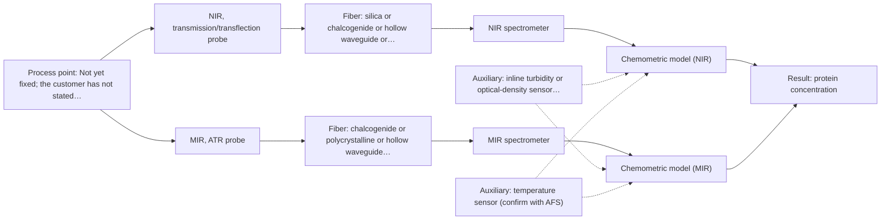

# First technical assessment: A clear whey stream before concentration

## Answer

**Customer request (our summary):** Customer wants to investigate whether spectroscopy can track protein concentration in a dairy whey stream ahead of a concentration stage, using laboratory results as reference, and wants a first measurement concept that also copes with the stream turning more turbid under some operating conditions.

### Brief answer

Start with NIR transmission/transflection: the sources name whey as a preferred case for it, and it is the least effort. Because the stream can turn turbid, keep mid-IR ATR as the fallback and treat a fused NIR plus mid-IR ATR model as a later hypothesis. The protein range, required accuracy and the nature of the turbidity are still open.

### Proposal

- **Best current option:** O2 (recommended)
- **Basis:** supplied AFS sources
- **What would change it:** If the required accuracy or the turbidity range shows that NIR transmission cannot cover the stream, the choice moves to M2 alone or to the fused M3. A cleaning or mid-IR link-length problem at the measurement point would do the same.
- **Next step:** Answer Q1 to Q3 and run the sample series with NIR transmission first, then mid-IR ATR on the same samples.

**Secondary evidence (external, not AFS material):** G1: no usable external source found; G2: E02 ¶12; G3: E04 ¶46, E05 ¶25; G4: E04 ¶42. See Expert detail.

**Decision status:** Provisional feasibility assessment

### Solution options

| ID | Tier | Methods | Confidence | Cost class, S01 Table 1 (p.6) | Ease of use | Maintenance | Performance fit | Sources |
|---|---|---|---|---|---|---|---|---|
| O1 | Simple | M1 NIR, transmission/transflection probe | Medium: open question: Q1 (starts at Medium) | average cost (row 7) | single standard probe and flow cell | probe cleaning and periodic recalibration | sourced whey case, clear stream only | [1: S01 p.18] [2: S01 p.5] [3: S01 p.18] |
| O2 | Recommended | M1 NIR, transmission/transflection probe; M2 MIR, ATR probe | Medium: open question: Q1, Q2 (starts at Medium) | high cost (rows 2, 7) | two probes, one method at a time | two probes, two calibrations to keep | covers clear and turbid operating states | [4: S01 p.18] [1: S01 p.18] [2: S01 p.5] [3: S01 p.18] [5: S01 p.13] [6: S04 p.4] [7: S01 p.9] |
| O3 | Extended (multi-method) | M3 NIR, transmission/transflection probe + MIR (combination) | Low: open question: Q1 (starts at Medium); multi-method, fusion benefit not yet shown | high cost (rows 2, 7) | two instruments feeding one fused model | per-instrument calibration and diagnostics | may add robustness across the turbidity range | [8: S01 p.8] [9: S01 p.8] [10: S01 p.18] [11: S01 p.7] |

*Confidence rates the basis of the advice (how much is known and cited), not a predicted accuracy or probability of success. It starts at High, or at Medium when a key question on the method or the option is open, and drops one level per weakness listed (floor Low).*

*Cost class is the relative rating in S01 Table 1 (p.6) for the in-line method+technique rows named (the highest one for a multi-method option); it is not a price.*

### Setup sketch

*Recommended option O2; drawn by code from the option, a schematic, not a configuration.*

### Key questions

1. What protein concentration range must be covered, and what accuracy and response time are required?
2. How turbid does the stream become, and what causes the turbidity (particles, fat or dissolved species)?
3. Where is the measurement point, is it in-line in the pipe, in a bypass or at-line, and how far is the analyzer from it?

## Expert detail

**Customer enquiry**

> Our dairy process includes a relatively clear whey stream before a concentration stage. We want to investigate whether spectroscopy can track protein concentration as the stream changes, with laboratory results used as the reference. The stream can become more turbid under some operating conditions. We need a first measurement concept that handles this change rather than assuming the liquid always remains clear.

**Decision status:** Provisional feasibility assessment. A method shortlist can be justified from the sources: whey is a named case for NIR transmission, and ATR is the in-line option that does not depend on light crossing a turbid bulk. The protein range, the required accuracy and the severity of the turbidity change are not stated, so the shortlist stays provisional.

### Parameters

| ID | Parameter | Kind | Need | Measured by | Why | Sources |
|---|---|---|---|---|---|---|
| P1 | protein concentration | quantitative | required | Spectroscopy: NIR | It is the stated target of the investigation. | [12: S01 p.17] |
| P2 | turbidity (optical density) of the stream | quantitative | required | Auxiliary sensor: inline turbidity or optical-density sensor (cited; confirm availability with AFS) | The stream can become more turbid, and physical variation can mimic a composition change, so the state must be recorded with each spectrum. | [13: S01 p.7] |
| P3 | process temperature at the measurement point | quantitative | optional | Auxiliary sensor: temperature sensor (engineering judgement: confirm availability with AFS) | Temperature shifts the water and protein bands and the physical state of the stream; a temperature signal should already be available at a dairy process point. | *(no verified source: engineering judgement)* |

### Solution option details

- **O1 cost drivers:** one NIR spectrometer, probe and flow cell
- **O2 cost drivers:** NIR and MIR spectrometers, MIR fibers, ATR probe
- **O3 cost drivers:** second spectrometer, MIR fibers, fusion modelling effort
- **O3 combining methods:** Fusion level: one model per method first, then a joined, block-scaled matrix, because variables from different methods are not equivalent. The NIR transmission path and the mid-IR ATR crystal must sit at the same flow-cell location and the data must be normalised to a common time step, since the two techniques sample different volumes. The fused model must beat the best single method on held-out runs, and each instrument keeps its own calibration and diagnostics.

*Extended (multi-method) option O3; drawn by code from the option, a schematic, not a configuration.*

### Premise check

- **Not covered:** One measurement concept can cover both the clear and the more turbid stream state. The sources do not settle whether one concept covers both states. They do show that NIR transmission alone fails once a dairy stream becomes too thick, so the concept should not rest on transmission alone. [14: S01 p.18]
- **Supported:** Laboratory results will serve as an adequate reference for the in-line measurement. Feasibility guidance requires independent reference measurements on representative samples or process states, which matches a laboratory reference anchored to the same samples. [15: REF §3]

### Requirements

**Stated by the customer**

- Whey stream in a dairy process, relatively clear before a concentration stage.
- Target: track protein concentration as the stream changes.
- Reference: laboratory results.
- The stream can become more turbid under some operating conditions; the concept must handle this.

**Key unknowns**

- Protein concentration range, required accuracy and response time.
- How far and how fast the turbidity changes, and what causes it (particles, fat or dissolved species).
- Installation point, interface (in-line, bypass or at-line) and distance from the analyzer.
- Process temperature, pressure and cleaning (CIP) regime at the measurement point.
- Whey type (sweet or acid) and the levels of fat, lactose and other solids.
- Reference laboratory method, its uncertainty and its sampling frequency.

### Clarification questions (most decision-relevant first)

Q1. What protein concentration range must be covered, and what accuracy and response time are required? *Why it matters:* These decide whether one method can cover the target and they set the go/no-go criteria for the test. *(affects: method, status)*
Q2. How turbid does the stream become, and what causes the turbidity (particles, fat or dissolved species)? *Why it matters:* The severity and nature decide whether NIR transmission still works or whether ATR is needed. *(affects: technique, M2)*
Q3. Where is the measurement point, is it in-line in the pipe, in a bypass or at-line, and how far is the analyzer from it? *Why it matters:* This fixes the probe type and the fiber link, which differ between NIR and mid-IR. *(affects: installation)*
Q4. What are the temperature, pressure and cleaning conditions at that point? *Why it matters:* They constrain probe materials and cleaning, and temperature shifts the water and protein bands. *(affects: installation, status)*
Q5. Which laboratory method and sampling frequency will give the reference protein values, and what is its uncertainty? *Why it matters:* The reference defines the accuracy against which the spectroscopic model can be judged. *(affects: status)*

### Recommendation

- **M1 · Primary candidate: NIR, transmission/transflection probe.** The sources name whey as a preferred case for NIR transmission, and NIR suits online measurement through fiber probes. It is the least-effort single method to test first, provided the optical pathlength is controlled. *Conditions:* Applies while the stream stays clear enough for transmission with a controlled optical pathlength. [1: S01 p.18] [2: S01 p.5] [3: S01 p.18]
- **M2 · Conditional candidate: MIR, ATR probe.** ATR probes sample only a very thin surface layer and suit liquids in tight contact, so the measurement does not depend on light crossing the bulk of a turbid stream. Mid-IR is described as one of the most informative methods of chemical analysis. *Conditions:* Applies only if the turbid operating state defeats NIR transmission. [5: S01 p.13] [6: S04 p.4] [7: S01 p.9]
- **M3 · Comparison candidate: NIR, transmission/transflection probe + MIR (combination).** The sources show NIR and mid-IR ATR used together in dairy analysis and state that complex samples may require more than one spectral method. Any gain from a fused model is a hypothesis to test against the best single method. *Conditions:* Applies only after the single-method NIR and mid-IR ATR tests. [10: S01 p.18] [11: S01 p.7] Later hypothesis, after single-method tests.
- **M4 · Not recommended: NIR, diffuse reflection probe.** NIR reflection is the usual dairy route for opaque or concentrated streams, but the whey stream is normally clear and reflection is less representative for clear liquids. The turbid state is addressed by M2 instead. [16: S01 p.17] [17: S01 p.18]

### Measurement concept

- **Probe and geometry:** In-line probe at the whey line before the concentration stage: NIR transmission or transflection through a controlled pathlength for the normal clear state, with a mid-IR ATR probe as the fallback for the more turbid state. Which geometry fits depends on the answers to Q2 and Q3.
- **Location:** Not yet fixed; the customer has not stated the measurement point or the distance to the analyzer (Q3).
- **Fiber link:** NIR is carried by silica fibers in the sources; mid-IR needs chalcogenide or polycrystalline fibers, and no source states an achievable link length for a mid-IR installation. [18: S01 p.5]

### Spectral range

- **NIR:** Nominal NIR range 780-2500 nm; the usable range depends on the instrument, fiber and probe actually selected. [19: S01 p.10]
- **MIR:** Nominal mid-IR range 4000-400 cm-1; the usable range depends on the fiber, crystal and probe actually selected. [7: S01 p.9]

### Risks and uncertainty

- The protein range, required accuracy and response time are not stated, so the method choice cannot be confirmed. *(rules: R-PRO-2)* *(no verified source: engineering judgement)*
- NIR transmission loses signal when a dairy stream becomes too thick, so the turbid state may not be covered by M1. *(rules: R-GEO-2, R-GEN-4)* [14: S01 p.18]
- The calibration is specific to the matrix, so a change of whey type or of fat and solids level would require re-validation. *(rules: R-CAL-1)* [20: REF §5]
- Mid-IR light needs chalcogenide or polycrystalline fibers, and no source states an achievable link length for a mid-IR installation, so the M2 hardware and fouling behaviour remain open. *(rules: R-FIB-1, R-FIB-2, R-MIR-3)* [21: S02 p.7] [22: S02 p.10]

### First feasibility experiment

1. **Collect representative whey samples across the expected variation: the clear state and the more turbid operating states, spanning the protein range, and record temperature and turbidity for each.** Representative samples or process states are the basis of the comparison. [15: REF §3]
2. **Obtain independent reference values on every sample: protein by the customer's laboratory method and turbidity by a reference measurement.** Independent reference measurements. [15: REF §3]
3. **Record NIR transmission/transflection spectra on all samples with the optical pathlength controlled, and build one calibration per state (clear, turbid) as well as one combined model.** Single method first; overlapping NIR bands require a chemometric calibration. [23: S01 p.10]
4. **If the turbid state degrades the NIR model, record mid-IR ATR spectra on the same samples and compare the two single methods on the same reference values.** Establish whether one method is enough before any combination is tried. [24: REF §5]
5. **Validate on held-out runs or batches and only then test the NIR plus mid-IR ATR fused model against the best single method; the go/no-go threshold is the accuracy required by the customer (Q1).** A fused model must beat the best single method on independent data, otherwise the extra instrument is dropped. *(no verified source: engineering judgement)*

**Reference measurements:** Protein by the customer's laboratory method, with turbidity and temperature logged at the same time as the spectra.

**Decision basis:** Go/no-go against the customer's required accuracy and protein range (Q1), once stated.

### Assumptions

- The stream can be measured in contact with a probe at a single point.
- Laboratory protein values are available for the same samples and can be matched to the spectra.
- The turbid state is a scattering or absorbing change in the liquid, not a phase change or blockage.

### Further notes

- **Chemometrics:** NIR bands overlap, so a calibration model such as PLS is required, and it is specific to the matrix: the model must be built and validated on this whey and re-checked when the stream type or composition changes. The clear and turbid states should be represented in the calibration set, either as one model with state variables or as separate models.
- **Real-time tracking:** The enquiry is about tracking a changing stream, so spectra should be logged continuously against a common time stamp, with turbidity and temperature recorded alongside. Online measurements require high-speed spectral acquisition, and the acquisition rate must match how fast the stream changes.
- **Future direction:** If the single-method or fused tests succeed, a compact dedicated sensor for the selected protein band could be a later extension, once the informative spectral regions for this stream are known.

### Secondary evidence (external, not AFS material)

*Found by a literature search for gaps the supplied AFS sources leave open. Not AFS material and not proof for this case; every quote below was verified verbatim against the fetched text.*

**G1 · auxiliary sensor:** In-line measurement of turbidity (optical density) of the stream with inline turbidity or optical-density sensor

- No usable external source found.

**G2 · auxiliary sensor:** In-line measurement of process temperature at the measurement point with temperature sensor

- **E02 ¶12** The source says temperature sensitivity of OH bands is a severe drawback for aqueous NIR and MIR measurement, making tempered sample holders necessary. *How it applies:* This could inform the measurement concept by supporting temperature control or temperature monitoring at the flow cell, and by prompting tests of how process temperature shifts affect the NIR/MIR signal. *Limits and transfer risks:* The source is a review of biopharmaceutical downstream processing, not dairy whey, and it discusses tempered sample holders rather than an in-line temperature sensor at a dairy process point. *(supports O2)*
  > "Additionally, the temperature sensitivity of the OH bands is a severe drawback for measuring aqueous solution in NIR and MIR, which makes tempered sample holders necessary [29]."
  > A critical review of recent trends, and a future perspective of optical spectroscopy as PAT in biopharmaceutical downstream processing. (2020) · Analytical and bioanalytical chemistry · doi:10.1007/s00216-020-02407-z · https://europepmc.org/article/PMC/PMC7072065 · retrieved 2026-10-17, full text, licence: cc by, via curated library

**G3 · multi-method:** Combining several spectroscopy methods (data fusion) (Fusion level: one model per method first, then a joined, block-scaled matrix, because variables from different methods are not equivalent. The NIR transmission path and the mid-IR ATR crystal must sit at the same flow-cell location and the data must be normalised to a common time step, since the two techniques sample different volumes. The fused model must beat the best single method on held-out runs, and each instrument keeps its own calibration and diagnostics.)

- **E04 ¶46** The source describes multiblock modeling as combining multiple data sources from the same sample into a contiguous data set, with UV-vis, NIR, and Raman spectra combined into fused spectral matrices. *How it applies:* This supports testing a fused matrix approach for multiple spectroscopy methods, while keeping the same-sample requirement in mind when aligning NIR and MIR data. *Limits and transfer risks:* The work is on lanthanide solutions in a PMMA microfluidic device, not dairy whey or an in-line flow cell, so the fusion benefit may not transfer to protein concentration in a turbid stream. *(supports O3)*
  > "Multiblock modeling involves combining multiple sources of data measured from the same sample into a contiguous data set.36 In this case, UV-vis, NIR, and Raman spectra were combined to form fused spectral matrices."
  > Quantification of Lanthanides on a PMMA Microfluidic Device with Three Optical Pathlengths Using PCR of UV-Visible, NIR, and Raman Spectroscopy. (2024) · ACS omega · doi:10.1021/acsomega.4c03857 · https://europepmc.org/article/PMC/PMC11411548 · retrieved 2026-10-17, full text, licence: cc by-nc-nd, via europepmc
- **E05 ¶25** The source reports that mid-level data fusion outperformed low-level data fusion for rapid quality detection of wheat flour. *How it applies:* This could inform the fusion strategy by suggesting that a joined, block-scaled matrix (low-level) should be compared against mid-level fusion rather than assumed best. *Limits and transfer risks:* The result is from wheat flour quality detection, not dairy whey, and it does not test NIR and MIR at a shared flow-cell location or normalisation to a common time step. *(supports O3)*
  > "The results indicated that mid-level data fusion outperformed low-level data fusion, providing an effective solution for the rapid quality detection of wheat flour (Zareef et al., 2023) (Fig. 4C)."
  > Spectroscopy-multimodal data fusion empowers smart food quality analysis: Challenges and prospects. (2026) · Food chemistry: X · doi:10.1016/j.fochx.2026.103939 · https://europepmc.org/article/PMC/PMC13147839 · retrieved 2026-10-17, full text, licence: cc by, via europepmc

**G4 · premise not covered:** One measurement concept can cover both the clear and the more turbid stream state.

- **E04 ¶42** The source states that one model can quantify spectra from all pathlengths despite significant differences in measurement conditions at multiple physical locations. *How it applies:* This could inform the premise by suggesting a single robust model be tested across clear and more turbid states, with attention to whether turbidity acts like a pathlength or scattering change. *Limits and transfer risks:* The source is a microfluidic study with lanthanide solutions and varying optical pathlengths, not dairy whey or turbidity, so the transfer to a clear/turbid stream state is uncertain.
  > "The goal of quantifying spectra from all pathlengths using one model is to allow for simultaneous measurement and quantification of solutions at multiple physical locations in a system despite significant differences in the measurement conditions at those locations."
  > Quantification of Lanthanides on a PMMA Microfluidic Device with Three Optical Pathlengths Using PCR of UV-Visible, NIR, and Raman Spectroscopy. (2024) · ACS omega · doi:10.1021/acsomega.4c03857 · https://europepmc.org/article/PMC/PMC11411548 · retrieved 2026-10-17, full text, licence: cc by-nc-nd, via europepmc

### Evidence (verified quotes)

1. ✓ **S01 p.18** (general): "NIR Transmission is the preferred method for transparent or semi-transparent liquids, such as skim milk, whey, or permeate."
2. ✓ **S01 p.5** (general): "making it ideal for online applications, including remote measurements via fiber optic probes."
3. ✓ **S01 p.18** (general): "the precise control of the optical pathlength (usually 1 - 10 mm); if the pathlength is too wide, the signal is lost to absorption; if too narrow, the sample represents a negligible volume."
4. ✓ **S01 p.18** (general): "having both fiber optic techniques available in a lab rather than relying on one provides the flexibility needed to monitor the entire production chain."
5. ✓ **S01 p.13** (general): "typically at a depth of few microns"
6. ✓ **S04 p.4** (general): "suitability of analyzed samples for ATR measurements, which is true for liquid or soft solid samples and their components, allowing a tight contact with the probe head."
7. ✓ **S01 p.9** (general): "Vibrational spectroscopy in the mid-IR range (4000-400 cm-1) is one of the most informative methods of chemical analysis."
8. ✓ **S01 p.8** (general): "It is crucial that the spectral information obtained by different methods-Mid-IR, NIR, Raman, and fluorescence spectra-is collected from the same small, even pinpoint, area of the sample."
9. ✓ **S01 p.8** (general): "Ultimately, the measurement data must be normalized to a common time step."
10. ✓ **S01 p.18** (general): "advanced labs often incorporate Fluorescence, Raman, and Mid-Infrared (MIR) ATR fiber optic techniques to capture specific chemical or structural information that NIR might miss."
11. ✓ (precedent only) **S01 p.7** (method gain): "The analysis of such systems may require a combination of two or even more spectral methods."
12. ✓ **S01 p.17** (application precedent): "using Partial Least Squares (PLS) regression to quantify fat and protein."
13. ✓ **S01 p.7** (general): "Morphological factors, such as sample inhomogeneity (e.g., biological tissue) or process turbulence, must also be considered when selecting a measurement technique."
14. ✓ **S01 p.18** (general): "it fails when the milk becomes too "thick" or fat-rich, as the light cannot penetrate the sample."
15. ✓ **REF §3** (general): "Representative samples or process states, independent reference measurements, what is compared, and the basis for the go / no-go decision."
16. ✓ **S01 p.17** (general): "NIR Reflection is primarily used for opaque or highly concentrated dairy products, such as yogurt, butter, or whole milk concentrates."
17. ✓ **S01 p.18** (general): "reflection can work well in highly scattering environments but can be less representative for clear liquids."
18. ✓ **S01 p.5** (general): "Immersible fiber optic probes operating in various spectral regions from UV to mid-IR are increasingly being used for measuring liquid and soft or powdered solid samples."
19. ✓ **S01 p.10** (general): "NIR spectra (780-2500 nm) contain predominantly overtones and component bands of fundamental vibrations"
20. ✓ **REF §5** (general): "physical variation; calibration specific to the matrix."
21. ✓ **S02 p.7** (general): "Robust 100-300m cables made with Silica fibers of low OH-content (<0.1ppm OH) enable remote industrial process-control"
22. ✓ **S02 p.10** (general): "1.25 Meter Silver Halide - straight run"
23. ✓ **S01 p.10** (general): "The broad absorption bands observed in this region overlap, suggesting the use of chemometrics for quantitative and qualitative analysis of spectral data."
24. ✓ **REF §5** (general): "compare with the best single method."

### Verification

- Citations verified: 29 of 29 (exact or whitespace/hyphen-tolerant match on the cited page, scope checked).
- Hard check failures before deterministic corrections: 0; still open: 0; soft warnings: 2; repair rounds: 0.
- Corrected deterministically after verification (1):
  - ⚠ recommendations[2].combined_with: combined_with normalised to ['MIR'] (duplicates and the entry's own method removed)
- Removed 1 intake item(s) not quoted verbatim from the enquiry:
  - intake.sample.heterogeneous: slot value without a verbatim enquiry quote; reset to unknown
- External evidence (live): 4 quote(s) verified verbatim (exact or whitespace/hyphen-tolerant, at most 400 characters and 2 sentences, against the cited paragraph); 0 item(s) dropped.
- External search: 6 query(ies), 45 hit(s), 5 source(s) (3 from the curated library).
- External step: 2 model call(s), 55.3 s extra (cost in the run JSON).

*Run D03-20261017T222314Z · models deepseek/deepseek-v4.1-flash*
