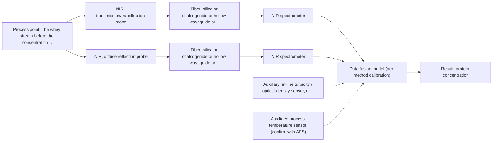

# First technical assessment: A clear whey stream before concentration

**Customer enquiry**

> Our dairy process includes a relatively clear whey stream before a concentration stage. We want to investigate whether spectroscopy can track protein concentration as the stream changes, with laboratory results used as the reference. The stream can become more turbid under some operating conditions. We need a first measurement concept that handles this change rather than assuming the liquid always remains clear.

## Brief answer

Test NIR spectroscopy first, at the whey line: transmission/transflection for the clear stream and diffuse reflection for the turbid state. The sources give a dairy precedent, not proof for your stream, so the two geometries should be compared on representative samples across the clear-to-turbid range against your laboratory protein values. Still open: the required accuracy, the turbidity range and the process conditions at the measurement point.

## Proposal

- **Best current option:** O2 (recommended): R1 NIR, transmission/transflection probe; R2 NIR, diffuse reflection probe
- **Basis:** supplied AFS sources
- **What would change it:** Answers to Q1-Q3. If the turbidity change proves strong or fast enough that NIR cannot separate protein from scatter, or the required accuracy is not reached, the conditional MIR-ATR option becomes the next test. If temperature, CIP or the distance to the analyzer exclude the probes, the installation concept changes.
- **Next step:** Run the NIR trial on representative whey samples across the clear-to-turbid range, with the customer's laboratory protein values as reference, and confirm the go/no-go numbers before any in-line installation.

**Decision status:** Provisional feasibility assessment. A shortlist can be justified from the supplied dairy example (NIR for clear whey-like liquids, reflection for turbid dairy), but the achievable accuracy for protein in this stream, the turbidity range and the process conditions are unknown. The shortlist is conditional on those answers.

## Parameters

| ID | Parameter | Kind | Need | Measured by | Why | Sources |
|---|---|---|---|---|---|---|
| P1 | protein concentration | quantitative | required | Spectroscopy: NIR | This is the target variable the customer wants to track as the stream changes. | [1: S01 p.17] |
| P2 | turbidity / optical density of the stream | quantitative | required | Auxiliary sensor: in-line turbidity / optical-density sensor, or the customer's existing turbidity signal | The stream changes between a clear and a more turbid state; turbidity selects the geometry and must be separated from the protein signal, because reflection is sensitive to surface and particle size. | [2: S01 p.17] |
| P3 | temperature at the measurement point | quantitative | optional | Auxiliary sensor: process temperature sensor (engineering judgement: confirm availability with AFS) | Should be available: NIR water and hydrogen-bond bands shift with temperature, so a calibration built at one temperature may not hold across the process range; the reference samples must also be compared at a known temperature. A dairy process normally already has this signal. | *(no verified source: engineering judgement)* |

## Solution options

| ID | Tier | Methods | Cost class, S01 Table 1 (p.6) | Ease of use | Maintenance | Performance fit | Sources |
|---|---|---|---|---|---|---|---|
| O1 | Simple | R1 NIR, transmission/transflection probe | average (row 7) | standard dairy probe geometry, single probe | one probe window to clean; CIP compatibility to confirm | covers the clear state well; may lose signal in the turbid state | *(no verified source: engineering judgement)* |
| O2 | Recommended | R1 NIR, transmission/transflection probe; R2 NIR, diffuse reflection probe | average (rows 7, 8) | two probe geometries to install and compare; one transflection probe may replace the pair if it covers both states | two windows to clean, or one if the transflection probe suffices; CIP compatibility to confirm | covers the stated clear-to-turbid change with a single method and a single spectrometer | *(no verified source: engineering judgement)* |

*Cost class is the relative rating in S01 Table 1 (p.6) for the in-line method+technique rows named (the highest one for a multi-method option); it is not a price.*

- **O1 cost drivers:** one NIR spectrometer and fiber probe, probe or flow-cell integration, calibration work and reference analyses
- **O2 cost drivers:** one NIR spectrometer with a second probe port or multiplexing, two probe installations, calibration across both states and reference analyses

## Setup sketch

*Recommended option O2; drawn by code from the option, a schematic, not a configuration.*

## Premise check

- **Precedent only:** A first measurement concept can handle the change from relatively clear to more turbid without assuming the liquid always remains clear. The sources show a geometry for clear liquids and one for opaque/concentrated dairy, and state that a transflection probe can in some cases cover both low- and high-fat products. That is a reason to test both states on real samples, not proof for this stream. [3: S01 p.18] [4: S01 p.18]
- **Not covered:** Laboratory results are suitable as the reference. No supplied source describes a reference method for protein in whey, its uncertainty or the sampling frequency. The guidance only says that a feasibility plan needs independent reference measurements. The lab method and its uncertainty have to be confirmed by the customer. [5: REF §3]

## Requirements

**Stated by the customer**

**Key unknowns**

- What protein is meant (total protein or a specific fraction) and the accuracy, precision and response time required.
- How turbid the stream becomes, what causes the turbidity and how fast it changes.
- Process temperature, pressure, flow and the cleaning/fouling (CIP) regime at the proposed measurement point.
- Distance from the measurement point to a possible analyzer location (fiber link).
- The laboratory reference method for protein, its uncertainty and the sampling frequency.
- Whether a turbidity/optical-density signal and a temperature signal already exist at that point.

## Clarification questions (most decision-relevant first)

Q1. What is the target protein (total protein or a specific fraction), over what concentration range, and what accuracy, precision and response time do you need? These numbers are the go/no-go basis and are not in the sources. *Why it matters:* They decide whether NIR alone is enough and how the trial is judged. *(affects: method, status)*
Q2. How turbid does the stream get under those operating conditions, is the change fast or slow, and is it a particle/scatter change or a composition change? *Why it matters:* Turbidity selects the geometry (transmission/transflection vs. diffuse reflection) and decides whether one probe can cover both states. *(affects: technique, installation)*
Q3. What are the temperature, pressure, flow rate and cleaning regime at the measurement point, and how far is it from a possible analyzer location? *Why it matters:* These govern probe choice, fouling/contact risk and the fiber link; no source states an achievable link length for a MIR probe. *(affects: installation, status)*
Q4. Which laboratory method gives the protein reference, what is its uncertainty, and how often can samples be taken against the process? *Why it matters:* The calibration can only be as good as the reference; the sampling frequency limits validation. *(affects: method, status)*
Q5. Is there already a turbidity/optical-density measurement and a temperature signal at that point that we can use? *Why it matters:* Turbidity and temperature are needed to interpret the spectra and to separate scatter from protein. *(affects: installation)*

## Recommendation

- **R1 · Primary candidate: NIR, transmission/transflection probe.** The dairy example names whey and permeate as the clear liquids for which NIR transmission is the preferred geometry, and a transflection probe is described as possibly covering both low- and high-fat products, i.e. the clear and the turbid state of this stream. This is a reason to test, not proof for this process. The transmission path length must be controlled and matched to the stream. *Conditions:* Applies while the stream is clear enough for a controlled transmission/transflection path; path length and probe to be fixed with AFS. [6: S01 p.18] [7: S01 p.18] [8: S01 p.18]
- **R2 · Comparison candidate: NIR, diffuse reflection probe.** Reflection is the dairy geometry for opaque or concentrated streams and is the natural candidate for the turbid state. It is sensitive to surface characteristics and particle/globule size, so it must be measured against the transmission/transflection result on the same samples rather than assumed to be better; for a clear liquid it can be less representative. *Conditions:* Test on the same samples as R1, with the turbid state represented; compare which geometry tracks protein better in each state. [9: S01 p.17] [10: S01 p.17] [11: S01 p.18]
- **R3 · Conditional candidate: MIR, ATR probe.** Conditional only: if NIR cannot separate the protein change from the turbidity change, or the required accuracy is not reached. ATR is the MIR route for liquids and needs only a very thin layer in contact with the crystal, so it is less dependent on a transmission path length; the deciding question is whether the stream at the measurement point is optically dense enough that a stable NIR path cannot be held. *Conditions:* Applies only if the NIR comparison (R1 vs R2) fails the customer's accuracy criterion, or if the stream at the point of measurement is too turbid for a controlled transmission path. [12: S01 p.5] [13: S01 p.10]

## Measurement concept

- **Probe and geometry:** In-line fiber probes at the whey line: a transmission/transflection probe for the clear state and a diffuse-reflection probe for the turbid state (or one transflection probe, to be tested across both states). ATR only in the conditional MIR case.
- **Location:** The whey stream before the concentration stage; the exact tapping point, temperature and cleaning regime are open.
- **Fiber link:** Vis-NIR silica fibers are the family for NIR; the exact transmission limits of the fiber actually selected must be confirmed in the supplier's fiber data, since a nominal method range is not the range of a specific instrument, fiber or probe. [14: S02 p.6] [15: REF §3]

## Spectral range

- **NIR:** Nominal NIR range 780-2500 nm; the usable range depends on the instrument, fiber and probe actually selected. [16: S01 p.10] [17: REF §5]
- **MIR:** Nominal MIR range 4000-400 cm-1 (2.5-25 µm) for the conditional ATR option; usable range is limited by fiber and crystal. [18: S01 p.9] [19: REF §5]

## Risks and uncertainty

- The turbidity change may dominate the NIR signal, so the model could follow scatter (particle size) rather than protein. Reflection is explicitly sensitive to surface characteristics and globule size, and scatter correction is needed. *(rules: R-GEO-6)* [20: S01 p.17]
- A single fixed transmission path length may not suit both states: too wide and the signal is lost to absorption, too narrow and the sampled volume is negligible. The path length must be chosen with AFS against the real turbidity range. *(rules: R-GEN-4)* [21: S01 p.18]
- The calibration is specific to the matrix and to physical variation. A change of whey composition, product or upstream process invalidates it and requires re-checking on the new material. *(rules: R-CAL-1)* [22: REF §5]
- Installation facts are unknown (temperature, CIP/fouling, distance to analyzer). ATR needs tight contact and is limited by fiber and crystal; if a MIR option is later needed, silica fibers cannot carry that range, and no source states an achievable MIR link length. *(rules: R-FIB-1, R-FIB-2, R-MIR-2, R-MIR-3)* [23: REF §5] [24: S02 p.7]

## First feasibility experiment

1. **Collect representative whey samples or process states across the expected variation: the protein range, the clear state through the most turbid operating condition, and the process temperature range. Record turbidity and temperature with each sample.** Representative coverage of the chemical and physical variation the method must survive. [25: REF §3]
2. **Measure the reference protein value for every sample with the customer's laboratory method and record its uncertainty. These values are the reference; the spectroscopy result is compared with them.** Independent reference measurement. *(no verified source: engineering judgement)*
3. **Acquire NIR spectra on the same samples with both geometries (transmission/transflection and diffuse reflection), check spectral quality in the clear and the turbid state, and build a chemometric calibration (for example PLS) on part of the samples.** Single-method comparison first, before any combination is considered. [26: S01 p.10] [27: S01 p.17]
4. **Validate on held-out runs or batches, not on the calibration samples. With a limited sample set use cross-validation and random-subset validation.** Guard against overfitting and against a result that only holds for the calibration samples. [28: S03 p.14]
5. **Compare the two geometries against the best single result (and, only if that fails the criterion, test the conditional MIR-ATR measurement on the same samples). The go/no-go numbers for protein accuracy, and the turbidity range over which they must hold, come from the customer.** A go/no-go basis with customer-defined numbers. [29: REF §5]

**Reference measurements:** Customer's laboratory protein method on every sample, with its uncertainty stated; turbidity and temperature recorded alongside.

**Decision basis:** Customer-defined numbers: the accuracy, precision and response time needed to track protein, and the turbidity range over which they must hold. Without these numbers the trial cannot be judged. No accuracy, detection limit or response time for this application is stated in the supplied sources.

## Assumptions

- The measurement point can be reached with an in-line fiber probe and the stream is liquid and pumpable at that point.
- The customer's laboratory method gives a protein value of sufficient quality to serve as the reference; this is not covered by the sources and must be confirmed.
- The turbid state occurs in the same stream and can be reproduced or sampled for the trial.

## Not covered by the supplied sources

- No accuracy, detection limit or response time for protein in a whey stream is stated.
- Whey is named only as an example of a clear liquid for NIR transmission; no whey-protein calibration or application precedent is given.
- No achievable fiber link length for a MIR-ATR installation is stated.
- No information on dairy cleaning/fouling behaviour of these probes is given.

## Further notes

- **Chemometrics:** The protein value will come from a chemometric calibration (for example PLS) built on the laboratory reference data, not from a single peak, because NIR bands overlap. The calibration is specific to the matrix and to physical variation; if the whey composition or the product changes, it must be re-checked and usually rebuilt on the new material. Validate on held-out runs or batches.
- **Real-time tracking:** The purpose of the in-line probe is continuous, sampling-free measurement in the process flow, so the protein signal can be followed as the stream changes; the achievable time resolution still has to be checked against how fast the turbidity and composition change.
- **Future direction:** If the full-range trial is successful, the application can later be reduced to a few selected wavelengths in a compact sensor; that is a later development step and not part of this first measurement concept.

## Evidence (verified quotes)

1. ✓ **S01 p.17** (application precedent): "using Partial Least Squares (PLS) regression to quantify fat and protein"
2. ✓ **S01 p.17** (general): "the method is sensitive to the surface characteristics and fat globule size."
3. ✓ **S01 p.18** (general): "Transmission is the preferred method for transparent or semi-transparent liquids, such as skim milk, whey, or permeate."
4. ✓ **S01 p.18** (application precedent): "In some cases, a Transflection probe can already be a combined solution working well for low-fat and high-fat containing milk products."
5. ✓ **REF §3** (general): "Representative samples or process states, independent reference measurements, what is compared, and the basis for the go / no-go decision."
6. ✓ **S01 p.18** (general): "Transmission is the preferred method for transparent or semi-transparent liquids, such as skim milk, whey, or permeate."
7. ✓ **S01 p.18** (application precedent): "In some cases, a Transflection probe can already be a combined solution working well for low-fat and high-fat containing milk products."
8. ✓ **S01 p.18** (general): "if the pathlength is too wide, the signal is lost to absorption; if too narrow, the sample represents a negligible volume."
9. ✓ **S01 p.17** (application precedent): "NIR Reflection is primarily used for opaque or highly concentrated dairy products, such as yogurt, butter, or whole milk concentrates."
10. ✓ **S01 p.17** (general): "the method is sensitive to the surface characteristics and fat globule size."
11. ✓ **S01 p.18** (general): "reflection can work well in highly scattering environments but can be less representative for clear liquids."
12. ✓ **S01 p.5** (general): "strong absorption in the mid-IR region limits the corresponding spectral method to the analysis of very thin samples (usually less than 50 μm), but it opens up the possibility of using attenuated total reflectance (ATR)"
13. ✓ **S01 p.10** (general): "ATR fiber probes (Fig.1) enable the analysis of liquids and solid elastic samples"
14. ✓ **S02 p.6** (general): "350 nm Standard VIS-NIR Silica Fibers Al/Cu-coated VIS-NIR Silica Fibers 2400 nm"
15. ✓ **REF §3** (general): "A nominal method range is not the range of a specific instrument, fiber or probe."
16. ✓ **S01 p.10** (general): "NIR spectra (780-2500 nm) contain predominantly overtones and component bands of fundamental vibrations"
17. ✓ **REF §5** (general): "It is not a product specification: actual spectral coverage, fiber length, component ratings, detection limits and accuracy depend on the configuration and the sample."
18. ✓ **S01 p.9** (general): "Vibrational spectroscopy in the mid-IR range (4000-400 cm-1) is one of the most informative methods of chemical analysis."
19. ✓ **REF §5** (general): "Usable range limited by fiber and crystal; contact, fouling, compatibility."
20. ✓ **S01 p.17** (general): "the method is sensitive to the surface characteristics and fat globule size."
21. ✓ **S01 p.18** (general): "if the pathlength is too wide, the signal is lost to absorption; if too narrow, the sample represents a negligible volume."
22. ✓ **REF §5** (general): "physical variation; calibration specific to the matrix."
23. ✓ **REF §5** (general): "Usable range limited by fiber and crystal; contact, fouling, compatibility."
24. ✓ **S02 p.7** (general): "Robust 100-300m cables made with Silica fibers of low OH-content (<0.1ppm OH) enable remote industrial process-control"
25. ✓ **REF §3** (general): "Representative samples or process states, independent reference measurements, what is compared, and the basis for the go / no-go decision."
26. ✓ **S01 p.10** (general): "The broad absorption bands observed in this region overlap, suggesting the use of chemometrics for quantitative and qualitative analysis of spectral data."
27. ✓ **S01 p.17** (application precedent): "using Partial Least Squares (PLS) regression to quantify fat and protein"
28. ✓ **S03 p.14** (general): "A thorough validation, including full, segmented and random-subset CVs, as well as randomization tests, are recommended in any cases for which important conclusions depend on calibration or discrimination models built on limited experimental material."
29. ✓ (precedent only) **REF §5** (method gain): "compare with the best single method."

## Verification

- Citations verified: 29 of 29 (exact or whitespace/hyphen-tolerant match on the cited page, scope checked).
- Hard check failures before deterministic corrections: 0; still open: 0; soft warnings: 2; repair rounds: 1.

*Run D03-20261017T120206Z · models deepseek/deepseek-v4.1-flash · cost $0.0320*
