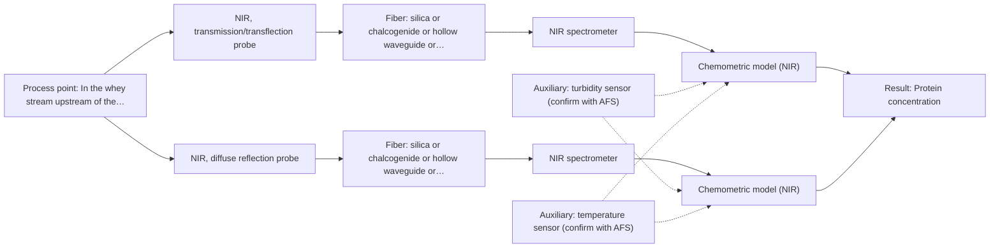

# First technical assessment: A clear whey stream before concentration

## Answer

**Customer request (our summary):** The customer wants a measurement concept to track protein concentration in a dairy whey stream that transitions between clear and turbid states, using laboratory results as a reference.

### Brief answer

Test NIR first: a transmission or transflection probe is the documented geometry for clear whey streams, while diffuse reflection provides a fallback if turbidity increases. We recommend testing both probe geometries on representative whey samples spanning clear and turbid conditions against laboratory protein reference data. If single NIR techniques cannot handle heavy turbidity, MIR ATR remains a conditional multi-method option. Open points: protein range, turbidity cause and frequency, and process temperature.

### Proposal

- **Best current option:** O2 (recommended)
- **Basis:** supplied AFS sources
- **What would change it:** If transflection alone handles the turbid episodes with acceptable error, option O1 suffices; if both NIR geometries fail under turbidity, the multi-method NIR and MIR option O3 should be tested.
- **Next step:** Test transflection and reflection NIR probes on representative clear and turbid whey samples against laboratory protein reference measurements.

**Secondary evidence (external, not AFS material):** G1: no usable external source found; G2: E03 ¶12; G3: no usable external source found; G4: no usable external source found. See Expert detail.

**Decision status:** Provisional feasibility assessment

### Solution options

| ID | Tier | Methods | Confidence | Cost class, S01 Table 1 (p.6) | Ease of use | Maintenance | Performance fit | Sources |
|---|---|---|---|---|---|---|---|---|
| O1 | Simple | M1 NIR, transmission/transflection probe | Low: open question: Q1, Q2, Q3 (starts at Medium); uncited auxiliary sensor | average cost (row 7) | Standard probe, straightforward installation | Low; window cleaning and periodic recalibration | Fits the clear baseline state directly | [1: S01 p.18] [2: S01 p.18] [3: S01 p.18] |
| O2 | Recommended | M1 NIR, transmission/transflection probe; M2 NIR, diffuse reflection probe | Low: open question: Q1, Q2, Q3 (starts at Medium); uncited auxiliary sensor | average cost (rows 7, 8) | Two probe tests before selection | Moderate; scatter correction and wider calibration upkeep | Covers both clear and turbid states with one spectrometer | [2: S01 p.18] [4: S01 p.17] [1: S01 p.18] [3: S01 p.18] [5: S01 p.17] |
| O3 | Extended (multi-method) | M1 NIR, transmission/transflection probe; M3 MIR, ATR probe + NIR (combination) | Low: open question: Q1, Q2, Q3 (starts at Medium); uncited auxiliary sensor; multi-method, fusion benefit not yet shown | high cost (rows 2, 7) | Requires dual spectrometer integration and synchronization | Higher; two independent spectrometers to operate | Combines bulk NIR transmission with surface MIR specificity | [6: S01 p.8] [7: S01 p.8] [8: S01 p.9] [1: S01 p.18] [2: S01 p.18] [3: S01 p.18] [9: S01 p.18] [10: S01 p.9] |

*Confidence rates the basis of the advice (how much is known and cited), not a predicted accuracy or probability of success. It starts at High, or at Medium when a key question on the method or the option is open, and drops one level per weakness listed (floor Low).*

*Cost class is the relative rating in S01 Table 1 (p.6) for the in-line method+technique rows named (the highest one for a multi-method option); it is not a price.*

### Setup sketch

*Recommended option O2; drawn by code from the option, a schematic, not a configuration.*

### Key questions

1. What is the protein concentration range, and how large and how fast are the changes to be tracked?
2. What causes the turbid episodes (e.g. fat, precipitated protein, air) and how often do they occur?
3. What are the process temperature, pressure and the available installation point and pipe dimensions?

## Expert detail

**Customer enquiry**

> Our dairy process includes a relatively clear whey stream before a concentration stage. We want to investigate whether spectroscopy can track protein concentration as the stream changes, with laboratory results used as the reference. The stream can become more turbid under some operating conditions. We need a first measurement concept that handles this change rather than assuming the liquid always remains clear.

**Decision status:** Provisional feasibility assessment. A method shortlist can be justified from the dairy NIR precedents in the sources, but the concentration range, temperature and installation details are unknown and the clear-to-turbid transition must be validated on real samples.

### Parameters

| ID | Parameter | Kind | Need | Measured by | Why | Sources |
|---|---|---|---|---|---|---|
| P1 | Protein concentration | quantitative | required | Spectroscopy: NIR | It is the target variable the in-line model must predict. | *(no verified source: engineering judgement)* |
| P2 | Turbidity / optical state | qualitative | required | Auxiliary sensor: turbidity sensor (cited; confirm availability with AFS) | The clear-to-turbid transition changes the scattering regime and decides which technique and calibration are valid. | [5: S01 p.17] |
| P3 | Process temperature | quantitative | required | Auxiliary sensor: temperature sensor (engineering judgement: confirm availability with AFS) | Temperature shifts NIR spectra and must be represented or compensated in the calibration. | *(no verified source: engineering judgement)* |
| P4 | Fat content | quantitative | optional | Reference lab method: laboratory fat analysis | Fat strongly affects scattering in dairy streams and should be available as a covariate if it varies; if it does not vary it can be dropped. | [11: S01 p.17] |

### Solution option details

- **O1 cost drivers:** One NIR spectrometer, one transflection probe, calibration samples and lab reference analyses
- **O2 cost drivers:** Same NIR spectrometer, transflection and reflection probes, broader calibration set spanning both optical states
- **O3 cost drivers:** NIR spectrometer, FTIR mid-IR spectrometer, ATR probe, multi-block chemometric software
- **O3 combining methods:** Data fusion merges synchronized NIR transflection and MIR ATR spectra into an augmented matrix with block autoscaling so neither spectral method dominates. Probes must sample the same stream point simultaneously, with spectral acquisitions normalized to a common time step. Separate calibration and drift diagnostics must be maintained for each instrument block, and the fused model must demonstrate superior prediction accuracy over the best single method on held-out runs.

*Extended (multi-method) option O3; drawn by code from the option, a schematic, not a configuration.*

### Requirements

**Stated by the customer**

- Track protein concentration in a whey stream before a concentration stage, in-line, with laboratory results as reference.
- The concept must handle the stream becoming more turbid under some operating conditions, rather than assuming it stays clear.

**Key unknowns**

- Protein concentration range and expected step changes
- Cause, frequency and duration of the turbid episodes
- Process temperature and pressure at the measurement point
- Available installation point, pipe size and probe access
- Laboratory reference method and its sampling frequency
- Whether fat or other scattering components vary together with protein

### Clarification questions (most decision-relevant first)

Q1. What is the protein concentration range, and how large and how fast are the changes to be tracked? *Why it matters:* The range sets the calibration design and whether NIR sensitivity is sufficient for the lowest levels. *(affects: method, M1, M2)*
Q2. What causes the turbid episodes (e.g. fat, precipitated protein, air) and how often do they occur? *Why it matters:* The scattering source decides whether one transflection probe can cover both states or a second reflection measurement is needed. *(affects: method, technique, M1, M2, M3)*
Q3. What are the process temperature, pressure and the available installation point and pipe dimensions? *Why it matters:* These determine the probe type, flow cell or immersion design and the pathlength that can be used. *(affects: installation, M1)*
Q4. Which laboratory method measures the reference protein values, and how often can samples be taken during turbid episodes? *Why it matters:* Calibration quality depends on representative reference samples, especially covering the turbid state. *(affects: status)*
Q5. Do fat content and temperature vary significantly in this stream? *Why it matters:* Both change scattering and absorption and must be represented in the calibration for the model to stay valid. *(affects: method, M1, M2)*

### Recommendation

- **M1 · Primary candidate: NIR, transmission/transflection probe.** NIR transmission or transflection is the preferred geometry for transparent or semi-transparent liquids, and dairy is a documented application area for inline NIR. A transflection probe with a controlled pathlength is the single technique most likely to work across both the clear and the moderately turbid state. *Conditions:* The pathlength must be controlled (typically 1-10 mm in the dairy example) and re-checked if the turbid state absorbs too strongly. [1: S01 p.18] [2: S01 p.18] [3: S01 p.18]
- **M2 · Comparison candidate: NIR, diffuse reflection probe.** NIR diffuse reflection is the documented geometry for opaque or highly concentrated dairy products, so it is the natural fallback or complement when the stream turns turbid and transmission saturates. It should be tested against M1 on samples spanning both optical states. *Conditions:* Reflection signals are sensitive to surface characteristics and particle size, so scatter correction and a calibration covering the physical variation are required. [4: S01 p.17] [5: S01 p.17]
- **M3 · Conditional candidate: MIR, ATR probe + NIR (combination).** MIR ATR provides well-defined fundamental vibrational bands and high molecular specificity, and advanced dairy analysis incorporates MIR ATR when NIR misses specific details. It is a conditional multi-method candidate to evaluate if NIR cannot resolve protein during heavy turbidity. *Conditions:* Applies only if NIR alone cannot achieve acceptable accuracy across the clear-to-turbid transition. [9: S01 p.18] [10: S01 p.9] Later hypothesis, after single-method tests.

### Measurement concept

- **Probe and geometry:** Immersion or flow-cell NIR transflection probe (M1) at a representative point in the whey line before the concentration stage; diffuse reflection (M2) or MIR ATR (M3) as comparators.
- **Location:** In the whey stream upstream of the concentration stage, at a point representative of the flow.
- **Fiber link:** Vis-NIR silica fibers; the usable range depends on the spectrometer, fiber and probe actually selected. [12: S01 p.10] [13: S02 p.6]

### Spectral range

- **NIR:** Nominal NIR range 780-2500 nm; usable range depends on the spectrometer, fiber and probe actually selected. [12: S01 p.10]
- **MIR:** Nominal mid-IR range 4000-400 cm-1; usable range depends on the spectrometer, fiber and probe actually selected. [10: S01 p.9]

### Risks and uncertainty

- The turbid state may saturate a transmission/transflection signal, so the pathlength or geometry may need to change between states. *(rules: R-GEN-4, R-GEO-2)* [14: S01 p.18]
- Reflection signals respond to surface characteristics and particle or globule size, so physical variation could mimic protein changes unless the calibration covers it. *(rules: R-GEO-6)* [5: S01 p.17]
- The calibration is specific to this whey matrix; changes in composition, fat or temperature require re-validation. *(rules: R-CAL-1, R-NIR-2)* [15: S01 p.10]
- If turbid episodes are rare, few reference samples from those states will exist and the model may be unreliable exactly when it is needed. *(rules: R-GEN-2)* *(no verified source: engineering judgement)*

### First feasibility experiment

1. **Collect representative whey samples spanning the full expected protein range and both optical states (clear and turbid), including samples taken during real turbid episodes.** Cover the chemical and physical variation the in-line model must handle. *(no verified source: engineering judgement)*
2. **Measure each sample with the laboratory reference protein method, at matched temperature, as the independent reference.** Provide the target values for calibration and validation. *(no verified source: engineering judgement)*
3. **Record NIR spectra of all samples with a transmission/transflection probe (M1) and, in parallel, a diffuse reflection probe (M2), at the process temperature.** Compare the single techniques on the same samples before any combined use. [16: S01 p.18]
4. **Build separate chemometric calibration models for each optical geometry and validate them on held-out samples before assessing multi-method options.** Establish whether a single technique provides sufficient predictive accuracy. *(no verified source: engineering judgement)*
5. **Agree go/no-go criteria with the customer (e.g. maximum acceptable prediction error per state and response time) and decide the final probe concept against them.** Make the decision basis explicit and numerical before any in-line installation. *(no verified source: engineering judgement)*

**Reference measurements:** Laboratory protein analysis on every calibration and validation sample, taken at matched temperature.

**Decision basis:** Customer-defined maximum prediction error for protein in each optical state (clear and turbid) and acceptable response time; these numbers must come from the customer.

### Assumptions

- The whey stream is aqueous, as whey is a dairy stream; this affects water absorption and the need for a controlled pathlength.
- The turbidity change is physical (particles, fat or air) rather than a step change in dissolved composition; this is to be confirmed via Q2.

### Not covered by the supplied sources

- Protein concentration range and accuracy targets for this specific whey stream
- Achievable in-line accuracy for protein in whey under changing turbidity

### Further notes

- **Chemometrics:** A PLS regression model per technique is the baseline; scatter corrections such as MSC or SNV are standard for scattering dairy streams, and the calibration set must include samples from both the clear and turbid states, validated on held-out batches.
- **Real-time tracking:** The goal is continuous in-line tracking of protein as the stream changes; diode-array type NIR analyzers allow instantaneous full-spectrum acquisition, which suits fast process changes.
- **Future direction:** If the concept proves out, the same NIR hardware could later be extended to other stream points (e.g. after the concentration stage) using the dual-technique dairy approach.

### Secondary evidence (external, not AFS material)

*Found by a literature search for gaps the supplied AFS sources leave open. Not AFS material and not proof for this case; every quote below was verified verbatim against the fetched text.*

**G1 · auxiliary sensor:** In-line measurement of Turbidity / optical state with turbidity sensor

- No usable external source found.

**G2 · auxiliary sensor:** In-line measurement of Process temperature with temperature sensor

- **E03 ¶12** The temperature sensitivity of the OH bands is a severe drawback for measuring aqueous solution in NIR and MIR, which makes tempered sample holders necessary. *How it applies:* Temperature variations can strongly affect water-dominated spectra such as dairy whey, indicating that process temperature should be monitored or controlled to maintain model stability. *Limits and transfer risks:* This finding refers to laboratory or specific optical setups rather than an in-line dairy whey stream, so the exact temperature coefficient must be determined empirically for the chosen probe. *(supports O2)*
  > "Additionally, the temperature sensitivity of the OH bands is a severe drawback for measuring aqueous solution in NIR and MIR, which makes tempered sample holders necessary [29]."
  > A critical review of recent trends, and a future perspective of optical spectroscopy as PAT in biopharmaceutical downstream processing. (2020) · Analytical and bioanalytical chemistry · doi:10.1007/s00216-020-02407-z · https://europepmc.org/article/PMC/PMC7072065 · retrieved 2026-10-17, full text, licence: cc by, via curated library

**G3 · multi-method:** Combining several spectroscopy methods (data fusion) (Data fusion merges synchronized NIR transflection and MIR ATR spectra into an augmented matrix with block autoscaling so neither spectral method dominates. Probes must sample the same stream point simultaneously, with spectral acquisitions normalized to a common time step. Separate calibration and drift diagnostics must be maintained for each instrument block, and the fused model must demonstrate superior prediction accuracy over the best single method on held-out runs.)

- No usable external source found.

**G4 · not in the supplied sources:** Protein concentration range and accuracy targets for this specific whey stream

- No usable external source found.

### Evidence (verified quotes)

1. ✓ **S01 p.18** (application precedent): "Transmission is the preferred method for transparent or semi-transparent liquids, such as skim milk, whey, or permeate."
2. ✓ **S01 p.18** (application precedent): "In some cases, a Transflection probe can already be a combined solution working well for low-fat and high-fat containing milk products."
3. ✓ **S01 p.18** (general): "the precise control of the optical pathlength (usually 1 - 10 mm); if the pathlength is too wide, the signal is lost to absorption; if too narrow, the sample represents a negligible volume."
4. ✓ **S01 p.17** (application precedent): "NIR Reflection is primarily used for opaque or highly concentrated dairy products, such as yogurt, butter, or whole milk concentrates."
5. ✓ **S01 p.17** (general): "the method is sensitive to the surface characteristics and fat globule size."
6. ✓ **S01 p.8** (general): "Variables obtained from different spectral methods are not equivalent."
7. ✓ **S01 p.8** (general): "Ultimately, the measurement data must be normalized to a common time step."
8. ✓ **S01 p.9** (general): "One of the challenges of multispectral analysis is the need to simultaneously connect at least two independently operating measuring instruments."
9. ✓ **S01 p.18** (application precedent): "While NIR is the workhorse of the dairy industry, advanced labs often incorporate Fluorescence, Raman, and Mid-Infrared (MIR) ATR fiber optic techniques to capture specific chemical or structural information that NIR might miss."
10. ✓ **S01 p.9** (general): "Vibrational spectroscopy in the mid-IR range (4000-400 cm-1) is one of the most informative methods of chemical analysis."
11. ✓ **S01 p.17** (application precedent): "(PLS) regression to quantify fat and protein."
12. ✓ **S01 p.10** (general): "NIR spectra (780-2500 nm) contain predominantly overtones and component bands of fundamental vibrations"
13. ✓ **S02 p.6** (general): "350 nm Standard VIS-NIR Silica Fibers Al/Cu-coated VIS-NIR Silica Fibers 2400 nm"
14. ✓ **S01 p.18** (general): "it fails when the milk becomes too "thick" or fat-rich, as the light cannot penetrate the sample."
15. ✓ **S01 p.10** (general): "The broad absorption bands observed in this region overlap, suggesting the use of chemometrics for quantitative and qualitative analysis of spectral data."
16. ✓ **S01 p.18** (general): "NIR Spectrometer and NIR light source remain the same for both reflection and transmission techniques."

### Verification

- Citations verified: 23 of 23 (exact or whitespace/hyphen-tolerant match on the cited page, scope checked).
- Hard check failures before deterministic corrections: 0; still open: 0; soft warnings: 0; repair rounds: 1.
- External evidence (live): 1 quote(s) verified verbatim (exact or whitespace/hyphen-tolerant, at most 400 characters and 2 sentences, against the cited paragraph); 1 item(s) dropped.
- External search: 5 query(ies), 40 hit(s), 5 source(s) (3 from the curated library).
- External step: 2 model call(s), 7.0 s extra (cost in the run JSON).
  - ⚠ dropped G5  ¶0: unknown gap 'G5'; unknown source ''; empty how_it_applies; no limits and transfer risks; finding shares fewer than 2 content words with its quote

*Run D03-20261018T094733Z-df2a · models google/gemini-3.5-flash-lite, google/gemini-3.8-flash, z-ai/glm-5.3-flash*
