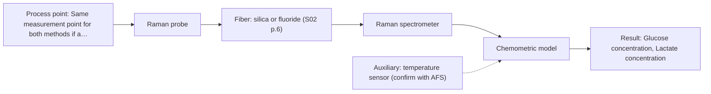

# First technical assessment: Glucose and lactate trends in an aqueous bioprocess

## Answer

**Customer request (our summary):** Customer runs an aqueous cell culture process and currently measures glucose and lactate from samples, which is too slow to see changes promptly. They want to explore an in situ spectroscopy pilot, checked against their existing laboratory measurements. No probe, calibration strategy, measurement ranges or process conditions are specified.

### Brief answer

For an aqueous cell culture, Raman is the method to test first: it suits water-based media and has reported use for glucose and lactate in bioprocess monitoring. Mid-IR ATR is worth measuring on the same samples as a comparison, and combining the two is a later hypothesis only if one method is not enough. Still open: concentration ranges and required accuracy, medium turbidity and fluorescence, and the reference method's uncertainty.

### Proposal

- **Best current option:** O2 (recommended)
- **Basis:** supplied AFS sources
- **What would change it:** If the medium proves too turbid or too fluorescent for Raman, or if the required detection limits are below what Raman can reach, the choice moves to mid-IR ATR or to the combined option. A reference method with large uncertainty would also change how the pilot is judged.
- **Next step:** Run the feasibility trial on representative samples across the run, single methods first, and compare each model against the existing laboratory measurements.

**Secondary evidence (external, not AFS material):** G1: E03 ¶12, E01 ¶19; G2: no usable external source found. See Expert detail.

**Decision status:** Provisional feasibility assessment

### Solution options

| ID | Tier | Methods | Confidence | Cost class, S01 Table 1 (p.6) | Ease of use | Maintenance | Performance fit | Sources |
|---|---|---|---|---|---|---|---|---|
| O1 | Simple | M2 MIR, ATR probe | Low: open question: Q1 (starts at Medium); uncited auxiliary sensor | high cost (row 2) | one probe and one spectrometer | crystal cleaning and contact check | well-defined mid-IR bands for both targets | [1: S01 p.9] [2: S01 p.5] [3: S01 p.11] |
| O2 | Recommended | M1 Raman probe | Low: open question: Q1, Q3 (starts at Medium); uncited auxiliary sensor | high cost (row 12) | single probe, one laser and spectrometer | probe cleaning; laser and detector service | aqueous medium suits Raman; glucose and lactate precedent | [4: S01 p.16] [5: S01 p.16] |
| O3 | Extended (multi-method) | M3 Raman probe + MIR (combination) | Low: open question: Q1 (starts at Medium); precedent only; uncited auxiliary sensor; multi-method, fusion benefit not yet shown | high cost (rows 2, 12) | two instruments aligned to one point | two calibrations and two diagnostics to keep aligned | complementary mid-IR and Raman information for difficult cases | [6: S01 p.8] [7: REF §5] [8: REF §5] [9: S01 p.8] |

*Confidence rates the basis of the advice (how much is known and cited), not a predicted accuracy or probability of success. It starts at High, or at Medium when a key question on the method or the option is open, and drops one level per weakness listed (floor Low).*

*Cost class is the relative rating in S01 Table 1 (p.6) for the in-line method+technique rows named (the highest one for a multi-method option); it is not a price.*

### Setup sketch

*Recommended option O2; drawn by code from the option, a schematic, not a configuration.*

### Key questions

1. What glucose and lactate concentration ranges must the pilot cover, and what accuracy and detection limits must it reach?
2. How turbid is the medium, and how strongly do cell density and cell debris change during a run?
3. Does the medium or any of its components fluoresce at the Raman excitation wavelength?

## Expert detail

**Customer enquiry**

> We run a cell culture process in an aqueous medium. Glucose and lactate are measured from samples, and the delay makes it difficult to see changes promptly. We are exploring an in situ spectroscopy pilot that can be checked against those existing laboratory measurements. The medium and cell population change during the run; we have not yet selected a probe or a calibration strategy.

**Decision status:** Provisional feasibility assessment. The aqueous medium and the two stated targets (glucose and lactate) justify a provisional shortlist of single methods worth testing in-line. The concentration ranges, the medium's optical behaviour and the uncertainty of the existing laboratory method are still open and could change the choice.

### Parameters

| ID | Parameter | Kind | Need | Measured by | Why | Sources |
|---|---|---|---|---|---|---|
| P1 | Glucose concentration | quantitative | required | Spectroscopy: Raman | It is one of the two targets the customer currently measures from samples. | [5: S01 p.16] |
| P2 | Lactate concentration | quantitative | required | Spectroscopy: Raman | It is the second target the customer currently measures from samples. | [5: S01 p.16] |
| P3 | Process temperature | quantitative | required | Auxiliary sensor: temperature sensor (engineering judgement: confirm availability with AFS) | Spectral band positions and intensities shift with temperature, so the calibration needs the process temperature alongside the spectra. | *(no verified source: engineering judgement)* |
| P4 | Cell density (viable cell count) | quantitative | optional | Reference lab method: laboratory viable cell count | The cell population changes during the run and drives scattering, so it should be available to interpret and maintain the model. | [10: S01 p.16] |

### Solution option details

- **O1 cost drivers:** one FTIR spectrometer, ATR probe, mid-IR fibers
- **O2 cost drivers:** one Raman spectrometer, laser, fiber probe
- **O3 cost drivers:** two spectrometers, combined probe, data fusion effort
- **O3 combining methods:** Fusion level: start with one calibration model per method, then fuse the Raman and mid-IR variables with block scaling so that neither block dominates the model. Both methods must look at the same small volume of the medium at the same time - a combined probe is the practical route - and the data must be normalised to a common time step. Each block keeps its own calibration and diagnostics, and the fused model must beat the best single method on independent runs, otherwise the second instrument is dropped.

*Extended (multi-method) option O3; drawn by code from the option, a schematic, not a configuration.*

### Premise check

- **Supported:** An in situ spectroscopy pilot can be checked against the existing laboratory glucose and lactate measurements. A feasibility plan is expected to include independent reference measurements and a defined comparison, so the existing laboratory values are the right comparison basis. [11: REF §3]
- **Supported:** In situ measurement removes the sampling delay, so changes can be seen promptly. In-process measurement without sampling is described as removing delays; the achievable response time itself is not stated and has to be set by the customer. [12: S01 p.3]
- **Precedent only:** Spectroscopy can measure glucose and lactate directly in this aqueous medium in line. A published bioprocess example reports direct detection of such metabolites by Raman; that is a reason to test, not proof for this medium, cell line or concentration range. [5: S01 p.16]

### Requirements

**Stated by the customer**

- In-line (in situ) measurement of glucose and lactate in an aqueous cell culture medium
- Result available promptly enough to see changes the current sampling delay hides
- Comparison of the spectroscopy result against the existing laboratory measurements

**Key unknowns**

- Glucose and lactate concentration ranges and the required accuracy and detection limits
- Medium turbidity and cell density, and how strongly they change during a run
- Fluorescence background of the medium at the Raman excitation wavelength
- Uncertainty of the existing laboratory glucose and lactate method
- Required response time for seeing a change
- Installation point, cleaning and sterilisation requirements, process temperature and pressure

### Clarification questions (most decision-relevant first)

Q1. What glucose and lactate concentration ranges must the pilot cover, and what accuracy and detection limits must it reach? *Why it matters:* These numbers decide whether Raman or mid-IR can reach the targets and they set the go/no-go criteria for the trial. *(affects: method)*
Q2. How turbid is the medium, and how strongly do cell density and cell debris change during a run? *Why it matters:* Scattering and matrix change decide whether a non-contact Raman probe or an ATR contact probe is the right geometry and how often the calibration has to be re-validated. *(affects: technique)*
Q3. Does the medium or any of its components fluoresce at the Raman excitation wavelength? *Why it matters:* A strong fluorescence background can mask the weak Raman bands and would make Raman the wrong first choice. *(affects: M1)*
Q4. What is the uncertainty of your existing laboratory glucose and lactate method? *Why it matters:* If that uncertainty is larger than the change of interest, the existing measurements cannot serve as the comparison basis for the pilot. *(affects: status)*
Q5. How quickly must a change in glucose or lactate become visible to be useful? *Why it matters:* The required interval sets the acquisition and data-processing rate the probe and spectrometer must deliver. *(affects: technique)*
Q6. Where would the probe be installed, and what cleaning, sterilisation, temperature and pressure does that point require? *Why it matters:* These conditions decide whether an ATR contact probe or a non-contact probe can be used and which probe materials are suitable. *(affects: installation)*

### Recommendation

- **M1 · Primary candidate: Raman probe.** The medium is aqueous, and Raman is described as well suited to aqueous environments because water absorbs little compared with infrared methods. Raman also has a reported use for direct detection of metabolites such as glucose and lactate in bioprocess monitoring. *Conditions:* Applies unless the medium itself fluoresces strongly enough to mask the Raman bands. [4: S01 p.16] [5: S01 p.16]
- **M2 · Comparison candidate: MIR, ATR probe.** Mid-IR is described as one of the most informative methods of chemical analysis, and strong mid-IR absorption is handled by ATR, which samples only a very thin layer of a strongly absorbing aqueous medium. Mid-IR and Raman spectra are complementary, so the two methods carry different information on the same targets. *Conditions:* Applies if the medium makes tight contact with the ATR crystal and the crystal does not foul during the run. [1: S01 p.9] [2: S01 p.5] [3: S01 p.11]
- **M3 · Conditional candidate: Raman probe + MIR (combination).** If neither single method reaches the required accuracy, joining the complementary mid-IR and Raman information is the next hypothesis to test. Any gain must be shown against the best single method, on independent runs. *Conditions:* Applies only if the single-method tests fall short of the accuracy the customer requires. [8: REF §5] [9: S01 p.8] Later hypothesis, after single-method tests.

### Measurement concept

- **Probe and geometry:** In-line fiber probe in the vessel or a bypass loop: a Raman probe (with the excitation wavelength chosen after the fluorescence check) and, as a comparison, an ATR mid-IR probe in contact with the medium. Nominal ranges: Raman is reported as Raman shift (cm-1) with the laser excitation stated separately; mid-IR is 4000-400 cm-1. The usable range of each configuration depends on the instrument, fiber and probe actually selected.
- **Location:** Same measurement point for both methods if a combination is later tested.
- **Fiber link:** Silica fibers are stated for the visible and near-infrared ranges (standard and Al/Cu-coated VIS-NIR silica fibers up to 2400 nm) and low-OH silica cables of 100-300 m are stated for remote process control; no source states an achievable length for a mid-IR link. [13: S02 p.6] [14: S02 p.7] [15: S01 p.11] [1: S01 p.9]

### Spectral range

- **Raman:** Raman shift in cm-1; the laser excitation wavelength is stated separately and must be chosen for this medium. [15: S01 p.11]
- **MIR:** Nominal 4000-400 cm-1; the usable range depends on the fiber, crystal and spectrometer selected. [1: S01 p.9]

### Risks and uncertainty

- The medium's turbidity and cell density are unknown, and strong scattering or a strong fluorescence background can degrade or mask the Raman signal. *(rules: R-RAM-1, R-GEN-5)* [16: S01 p.11]
- The glucose and lactate levels and the required detection limits are not stated, so it is not yet clear whether Raman or mid-IR can reach them. *(rules: R-NIR-4)* [17: S01 p.16]
- The uncertainty of the existing laboratory glucose and lactate method is unknown; if it is larger than the change of interest, the pilot cannot be judged against it. *(rules: R-GEN-2)* *(no verified source: engineering judgement)*
- Raman and mid-IR calibrations are specific to the sample matrix, and the medium and cell population change during the run, so the model may need rebuilding or extending. *(rules: R-CAL-1)* [18: REF §5]

### First feasibility experiment

1. **Collect representative samples and process states across the run - early, mid and late, with different cell densities and glucose/lactate levels - so the trial covers the variation described.** Cover the chemical and physical variation before any method is chosen. [11: REF §3] [19: S01 p.3]
2. **Measure the samples with the single methods first - Raman and mid-IR ATR - at the same sampling point where possible, before testing any combination.** Single methods first; a combination is a later hypothesis. [8: REF §5] [9: S01 p.8]
3. **Measure the same samples with the existing laboratory glucose and lactate method, with replicates, and record its uncertainty.** Independent reference values and a realistic comparison basis. [11: REF §3]
4. **Build one calibration model per method and validate it on held-out runs or batches, not on the samples used for calibration.** Avoid over-optimistic statistics from a small sample set. [20: S01 p.12] [21: S03 p.14]
5. **Go/no-go: compare each model's prediction error against the accuracy and response time the customer requires, and against the reference method's uncertainty; only if no single method meets the requirement, test the combined Raman + mid-IR model on independent runs.** The numerical go/no-go criteria must come from the customer and are not yet stated. [11: REF §3]

**Reference measurements:** The customer's existing laboratory glucose and lactate method, with replicates and a stated uncertainty.

**Decision basis:** Prediction error and response time measured against the customer's required values, compared with the reference method's uncertainty. The numerical thresholds are not yet known.

### Assumptions

- The medium can be brought into contact with a probe, in the vessel or in a bypass loop.
- The process temperature is within the range the selected probe and fiber can tolerate; this is not yet stated.
- The existing laboratory method is accurate enough to act as the comparison; this is not yet known.

### Further notes

- **Chemometrics:** One calibration model per method, built on representative samples across the run and validated on held-out runs rather than on the calibration samples. Raman and mid-IR calibrations are specific to the medium, so a change of medium, feed or cell line must be re-validated on the new material.
- **Real-time tracking:** The pilot is aimed at continuous in-line tracking of glucose and lactate, so acquisition settings and the data pipeline have to deliver results at the interval the process needs; that interval is not yet stated.
- **Future direction:** If the single-method or combined laboratory trial succeeds, a later step would be a dedicated compact analyser focused on the informative spectral regions for this process, rather than a full laboratory spectrometer.

### Secondary evidence (external, not AFS material)

*Found by a literature search for gaps the supplied AFS sources leave open. Not AFS material and not proof for this case; every quote below was verified verbatim against the fetched text.*

**G1 · auxiliary sensor:** In-line measurement of Process temperature with temperature sensor

- **E03 ¶12** The source states that temperature sensitivity of OH bands is a severe drawback for measuring aqueous solutions in NIR and MIR, making tempered sample holders necessary. *How it applies:* For an aqueous cell culture medium, this suggests temperature should be controlled or monitored during spectral measurement to reduce OH-band variation; a temperature sensor could be tested alongside the probe. *Limits and transfer risks:* The statement concerns NIR and MIR, not Raman, and refers to tempered sample holders rather than an in-line process temperature sensor; transfer to a pilot cell culture is uncertain.
  > "Additionally, the temperature sensitivity of the OH bands is a severe drawback for measuring aqueous solution in NIR and MIR, which makes tempered sample holders necessary [29]."
  > A critical review of recent trends, and a future perspective of optical spectroscopy as PAT in biopharmaceutical downstream processing. (2020) · Analytical and bioanalytical chemistry · doi:10.1007/s00216-020-02407-z · https://europepmc.org/article/PMC/PMC7072065 · retrieved 2026-10-17, full text, licence: cc by, via curated library
- **E01 ¶19** The source says acid concentrations, ionic strength and temperature were varied to obtain a robust model. *How it applies:* This could support including temperature as a varied factor in calibration and monitoring it during runs, so the model is not fitted to a single temperature. *Limits and transfer risks:* The work is on reactive liquid-liquid extraction in lithium recycling, not cell culture, and does not describe an in-line temperature sensor.
  > "The concentrations of nitric acid and hydrochloric acid as well as the ionic strength and temperature were varied to obtain a robust model."
  > Process Analytical Technology-Integrated FT-IR and Raman Spectroscopies for Efficient Reactive Liquid-Liquid Extraction Processing in Lithium Recycling. (2025) · ACS omega · doi:10.1021/acsomega.5c05705 · https://europepmc.org/article/PMC/PMC12573149 · retrieved 2026-10-17, full text, licence: cc by, via curated library

**G2 · multi-method:** Combining several spectroscopy methods (data fusion) (Fusion level: start with one calibration model per method, then fuse the Raman and mid-IR variables with block scaling so that neither block dominates the model. Both methods must look at the same small volume of the medium at the same time - a combined probe is the practical route - and the data must be normalised to a common time step. Each block keeps its own calibration and diagnostics, and the fused model must beat the best single method on independent runs, otherwise the second instrument is dropped.)

- No usable external source found.

### Evidence (verified quotes)

1. ✓ **S01 p.9** (general): "Vibrational spectroscopy in the mid-IR range (4000-400 cm-1) is one of the most informative methods of chemical analysis."
2. ✓ **S01 p.5** (general): "strong absorption in the mid-IR region limits the corresponding spectral method to the analysis of very thin samples (usually less than 50 μm), but it opens up the possibility of using attenuated total reflectance (ATR)"
3. ✓ **S01 p.11** (general): "This property makes mid-IR and Raman spectra complementary, that is, they complement each other."
4. ✓ **S01 p.16** (general): "Raman is particularly well-suited for aqueous environments, as it exhibits low absorbance for water molecules compared to infrared methods."
5. ✓ **S01 p.16** (application precedent): "direct detection of specific metabolites like glucose, acetate, or lactate."
6. ✓ (precedent only) **S01 p.8** (method gain): "Ultimately, the measurement data must be normalized to a common time step."
7. ✓ (precedent only) **REF §5** (method gain): "Sampling location and timing must be aligned; a gain is a hypothesis to test."
8. ✓ (precedent only) **REF §5** (method gain): "compare with the best single method."
9. ✓ (precedent only) **S01 p.8** (method gain): "It is crucial that the spectral information obtained by different methods-Mid-IR, NIR, Raman, and fluorescence spectra-is collected from the same small, even pinpoint, area of the sample."
10. ✓ **S01 p.16** (general): "cell suspension turbidity correlates well with cell density."
11. ✓ **REF §3** (general): "Representative samples or process states, independent reference measurements, what is compared, and the basis for the go / no-go decision."
12. ✓ **S01 p.3** (general): "It allows for in-process analysis, i.e., directly in the process flow or reactor without sampling, eliminating delays and the risk of sample contamination."
13. ✓ **S02 p.6** (general): "350 nm Standard VIS-NIR Silica Fibers Al/Cu-coated VIS-NIR Silica Fibers 2400 nm"
14. ✓ **S02 p.7** (general): "Robust 100-300m cables made with Silica fibers of low OH-content (<0.1ppm OH) enable remote industrial process-control"
15. ✓ **S01 p.11** (general): "The Raman shift is used as the horizontal (spectral) axis in Raman spectroscopy"
16. ✓ **S01 p.11** (general): "superposition of luminescence (fluorescence), which has a significantly higher intensity."
17. ✓ **S01 p.16** (general): "may lack the sensitivity to detect trace compounds below 0.1 percent."
18. ✓ **REF §5** (general): "physical variation; calibration specific to the matrix."
19. ✓ **S01 p.3** (general): "samples of incompletely known composition, in order to select the most suitable method or combination of methods."
20. ✓ **S01 p.12** (general): "Raman spectra (as well as IR absorption spectra) can be used to construct chemometric models-calibration or classification ones."
21. ✓ **S03 p.14** (general): "A thorough validation, including full, segmented and random-subset CVs, as well as randomization tests, are recommended in any cases for which important conclusions depend on calibration or discrimination models built on limited experimental material."

### Verification

- Citations verified: 34 of 34 (exact or whitespace/hyphen-tolerant match on the cited page, scope checked).
- Hard check failures before deterministic corrections: 0; still open: 0; soft warnings: 5; repair rounds: 1.
- Corrected deterministically after verification (1):
  - ⚠ recommendations[2].combined_with: combined_with normalised to ['MIR'] (duplicates and the entry's own method removed)
- External evidence (live): 2 quote(s) verified verbatim (exact or whitespace/hyphen-tolerant, at most 400 characters and 2 sentences, against the cited paragraph); 0 item(s) dropped.
- External search: 5 query(ies), 40 hit(s), 5 source(s) (3 from the curated library).
- External step: 2 model call(s), 37.4 s extra (cost in the run JSON).

*Run D04-20261018T031621Z · models deepseek/deepseek-v4.1-flash*
