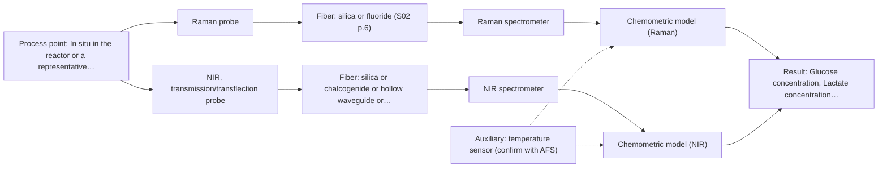
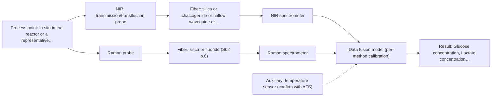

# First technical assessment: Glucose and lactate trends in an aqueous bioprocess

## Answer

**Customer request (our summary):** The customer wants to explore an in situ spectroscopy pilot to monitor glucose and lactate in a cell culture process to overcome measurement delays.

### Brief answer

Test a Raman fiber probe first: it suits aqueous media and has published precedent for direct glucose and lactate detection in reactors. Test NIR transmission/transflection alongside it as a comparison, since NIR is the most common online fiber method but needs a matrix-specific calibration. Combine the two only if a single method misses your accuracy targets. Open points: required accuracy and response time, turbidity range, fluorophore content and probe installation constraints.

### Proposal

- **Best current option:** O2 (recommended)
- **Basis:** supplied AFS sources
- **What would change it:** If the required accuracy is beyond what published single-method precedents suggest, or if strong fluorescence background disables Raman, the ranking between M1 and M2 changes; if no probe port or bypass exists, installation must be redesigned first.
- **Next step:** Run the multi-method lab trial on representative samples from your process with matched laboratory reference measurements, starting with the Raman probe.

**Secondary evidence (external, not AFS material):** G1: no usable external source found; G2: E01 ¶31, E01 ¶82. See Expert detail.

**Decision status:** Provisional feasibility assessment

### Solution options

| ID | Tier | Methods | Confidence | Cost class, S01 Table 1 (p.6) | Ease of use | Maintenance | Performance fit | Sources |
|---|---|---|---|---|---|---|---|---|
| O1 | Simple | M1 Raman probe | Medium: open question: Q1 (starts at Medium) | high cost (row 12) | single probe, straightforward lab trial | one instrument, one calibration | tests the water-tolerant method first at least effort | [1: S02 p.20] [2: S01 p.16] [3: S01 p.16] |
| O2 | Recommended | M1 Raman probe; M2 NIR, transmission/transflection probe | Medium: open question: Q1 (starts at Medium) | high cost (rows 7, 12) | two probes in lab, one in-line | two calibrations to maintain | compares the two strongest aqueous candidates before committing | [4: S01 p.3] [2: S01 p.16] [3: S01 p.16] [5: S01 p.10] [6: S01 p.10] |
| O3 | Extended (multi-method) | M3 NIR, transmission/transflection probe + Raman (combination) | Low: open question: Q1, Q3 (starts at Medium); multi-method, fusion benefit not yet shown | high cost (rows 7, 12) | two instruments, fused data pipeline | each block needs its own calibration and diagnostics | only if fusion beats the best single method on held-out runs | [7: S01 p.8] [8: S01 p.8] [9: S01 p.15] |

*Confidence rates the basis of the advice (how much is known and cited), not a predicted accuracy or probability of success. It starts at High, or at Medium when a key question on the method or the option is open, and drops one level per weakness listed (floor Low).*

*Cost class is the relative rating in S01 Table 1 (p.6) for the in-line method+technique rows named (the highest one for a multi-method option); it is not a price.*

### Setup sketch

*Recommended option O2; drawn by code from the option, a schematic, not a configuration.*

### Key questions

1. What accuracy, detection limit and response time do you need for glucose and lactate, and how precise and frequent are the existing laboratory measurements?
2. What optical density / turbidity and cell density range does the medium cover during a run?
3. Does your medium contain known fluorescent species such as NADH, tryptophan or riboflavin?

## Expert detail

**Customer enquiry**

> We run a cell culture process in an aqueous medium. Glucose and lactate are measured from samples, and the delay makes it difficult to see changes promptly. We are exploring an in situ spectroscopy pilot that can be checked against those existing laboratory measurements. The medium and cell population change during the run; we have not yet selected a probe or a calibration strategy.

**Decision status:** Provisional feasibility assessment. A shortlist can be justified from the sources for aqueous cell culture, but the required accuracy, turbidity range and installation constraints are unknown, so the assessment stays provisional.

### Parameters

| ID | Parameter | Kind | Need | Measured by | Why | Sources |
|---|---|---|---|---|---|---|
| P1 | Glucose concentration | quantitative | required | Spectroscopy: Raman | It is a primary target the in-line method must predict against the laboratory reference. | [3: S01 p.16] |
| P2 | Lactate concentration | quantitative | required | Spectroscopy: Raman | It is the second target the in-line method must predict against the laboratory reference. | [3: S01 p.16] |
| P3 | Turbidity / cell density (optical state of the medium) | quantitative | required | Spectroscopy: NIR | The changing cell population drives scattering, which affects both the spectra and the choice of geometry. | [10: S01 p.16] |
| P4 | Temperature | quantitative | optional | Auxiliary sensor: temperature sensor (engineering judgement: confirm availability with AFS) | Temperature should be available because it shifts spectra and LED/laser stability; a standard process sensor normally provides it. | *(no verified source: engineering judgement)* |

### Solution option details

- **O1 cost drivers:** Raman spectrometer and probe, lab trial time, reference sampling
- **O2 cost drivers:** Raman and NIR spectrometers with probes, chemometric model development, reference lab workload
- **O3 cost drivers:** two spectrometers and probes, synchronisation software, fused model development and validation
- **O3 combining methods:** Low-level fusion: synchronised NIR and Raman spectra from the same sampling spot merged into one augmented matrix, with block scaling so neither method dominates. Data from both methods must be normalised to a common time step, and each instrument keeps its own calibration. The fused model must beat the best single method on independent runs, otherwise the extra instrument is dropped.

*Extended (multi-method) option O3; drawn by code from the option, a schematic, not a configuration.*

### Premise check

- **Precedent only:** In situ spectroscopy can track metabolites such as glucose and lactate in a cell culture process. The sources show Raman used in a reactor for direct metabolite detection and NIR/fluorescence for bioprocess variables; these are published examples and reasons to test, not proof for this customer's process. [3: S01 p.16]
- **Supported:** An aqueous medium is compatible with in-line fiber-optic measurement. The sources state Raman has low water absorbance compared with infrared methods, which supports optical in-line use in aqueous media, while MIR would need ATR. [2: S01 p.16]

### Requirements

**Stated by the customer**

- Track glucose and lactate in near real time in an aqueous cell culture medium.
- Check the in-line results against the existing laboratory measurements.
- Cope with medium and cell population changes during the run.

**Key unknowns**

- Required accuracy, detection limits and response time for glucose and lactate
- Turbidity / optical density range and cell density over the run
- Which fluorescent species (e.g. NADH, riboflavin) the medium contains
- Installation point, sterilisation and cleaning constraints for a probe
- Frequency and analytical precision of the existing laboratory glucose/lactate measurements

### Clarification questions (most decision-relevant first)

Q1. What accuracy, detection limit and response time do you need for glucose and lactate, and how precise and frequent are the existing laboratory measurements? *Why it matters:* This sets the go/no-go criteria for the pilot and determines whether NIR sensitivity is sufficient or Raman is needed. *(affects: method, status)*
Q2. What optical density / turbidity and cell density range does the medium cover during a run? *Why it matters:* Scattering changes with the cell population and drives the choice between transmission, transflection and reflection geometry. *(affects: technique, installation)*
Q3. Does your medium contain known fluorescent species such as NADH, tryptophan or riboflavin? *Why it matters:* Fluorescence is only usable if a defined fluorophore is present, and it can also interfere with Raman. *(affects: M3, technique)*
Q4. Where could a probe be installed (reactor port, bypass loop), and what sterilisation and cleaning constraints apply? *Why it matters:* This determines probe type, fouling risk and whether a combined multi-method probe is feasible. *(affects: installation)*

### Recommendation

- **M1 · Primary candidate: Raman probe.** Raman tolerates water far better than infrared methods and has published precedent for direct glucose and lactate detection in a reactor. A fiber Raman probe is the single method to test first on your samples. *Conditions:* Fluorescence background from the medium must be checked on real samples before committing. [2: S01 p.16] [3: S01 p.16]
- **M2 · Comparison candidate: NIR, transmission/transflection probe.** NIR is the most common online fiber-optic method and can quantify major components like glucose, but its broad overlapping bands require a chemometric calibration specific to your matrix. Test it against Raman on the same samples. *Conditions:* The optical pathlength must be controlled and the calibration re-validated as the medium changes. [5: S01 p.10] [6: S01 p.10]
- **M3 · Comparison candidate: NIR, transmission/transflection probe + Raman (combination).** If neither single method meets the accuracy target across the changing medium, fused NIR and Raman data are a later hypothesis; published work reports higher accuracy than single-method models, but that gain must be demonstrated on your process. *Conditions:* Only after the single-method tests, with spectra from the same sampling spot synchronised to a common time step, and only if the fused model beats the best single method. [9: S01 p.15] [8: S01 p.8]

### Measurement concept

- **Probe and geometry:** Immersion Raman fiber probe (M1) and, in parallel lab tests, an NIR transmission/transflection probe with controlled pathlength (M2); a combined or co-located probe pair only if fusion (M3) is pursued.
- **Location:** In situ in the reactor or a representative bypass loop; exact port to be fixed with the customer (Q4).
- **Fiber link:** Silica fibers carry the Raman excitation/collection and NIR ranges; the usable range depends on the spectrometer, fiber and probe actually selected, not on the nominal method range. [11: S01 p.15]

### Spectral range

- **Raman:** Raman shift in cm-1 with laser excitation wavelength stated separately; the usable range depends on the instrument, fiber and probe actually selected. [12: S01 p.11]
- **NIR:** Nominal NIR range 780-2500 nm; the usable range depends on the instrument, fiber and probe actually selected. [13: S01 p.10]

### Risks and uncertainty

- Fluorescence background from medium components can swamp the weak Raman signal and must be checked on real samples. *(rules: R-RAM-1)* [14: S01 p.11]
- The medium and cell population change during the run, so a calibration built on one phase may not hold across the whole process. *(rules: R-CAL-1)* [15: REF §5]
- Changing turbidity and scattering can mimic composition changes, especially in reflection-type measurements. *(rules: R-GEO-6, R-GEN-5)* [16: S01 p.7]
- Probe windows in a cell culture reactor can foul, degrading contact and signal quality over a run. *(rules: R-MIR-3)* [17: REF §5]

### First feasibility experiment

1. **Collect representative samples across the expected chemical and physical variation (early/mid/late run, different cell densities and medium states).** Cover the matrix variation the calibration must handle. *(no verified source: engineering judgement)*
2. **Measure each sample with the existing laboratory glucose and lactate methods as independent reference, at matched times.** Provide the reference values for calibration and validation. *(no verified source: engineering judgement)*
3. **Record Raman probe spectra (M1) and, in parallel, NIR transmission/transflection spectra (M2) on the same samples; check Raman fluorescence background first.** Compare the single methods before any combination. *(no verified source: engineering judgement)*
4. **Build chemometric calibration models per method and validate on held-out runs or batches not used for calibration.** Estimate real prediction error rather than calibration fit. *(no verified source: engineering judgement)*
5. **Go/no-go: the customer-defined accuracy and response-time targets (Q1) must be met by at least one single method on held-out data; only then test the fused NIR+Raman model (M3) and require it to beat the best single method.** Decide whether to proceed to an in situ pilot and whether fusion adds value. *(no verified source: engineering judgement)*

**Reference measurements:** Existing laboratory glucose and lactate measurements, with their precision quantified (Q1).

**Decision basis:** Customer-defined accuracy, detection limit and response-time criteria evaluated on held-out runs or batches.

### Assumptions

- The existing laboratory glucose and lactate measurements are accurate enough to serve as calibration reference.
- A probe port or bypass loop can be made available in the reactor.

### Further notes

- **Chemometrics:** Both Raman and NIR calibrations will be matrix-specific; build per-method PLS models on representative samples spanning the run, validate on held-out runs or batches, and re-validate whenever the medium formulation or cell line changes.
- **Real-time tracking:** The aim is continuous in-line tracking of glucose and lactate to replace delayed sampling; acquisition conditions should be chosen so the update rate matches the process dynamics, and results are checked against the laboratory measurements.
- **Future direction:** If a validated single-method model exists, a later step could be a compact customized sensor or multispectral probe for routine in-line use, following the multi-method trial to custom solution pathway.

### Secondary evidence (external, not AFS material)

*Found by a literature search for gaps the supplied AFS sources leave open. Not AFS material and not proof for this case; every quote below was verified verbatim against the fetched text.*

**G1 · auxiliary sensor:** In-line measurement of Temperature with temperature sensor

- No usable external source found.

**G2 · multi-method:** Combining several spectroscopy methods (data fusion) (Low-level fusion: synchronised NIR and Raman spectra from the same sampling spot merged into one augmented matrix, with block scaling so neither method dominates. Data from both methods must be normalised to a common time step, and each instrument keeps its own calibration. The fused model must beat the best single method on independent runs, otherwise the extra instrument is dropped.)

- **E01 ¶31** Low-level data fusion rearranges data into a new matrix by placing variables from different sources one after the other. *How it applies:* This approach can be tested to structure the synchronized NIR and Raman spectra into a single augmented matrix for multivariate calibration. *Limits and transfer risks:* The review discusses general analytical data fusion rather than cell culture bioprocesses, so matrix effects and biological variability may alter fusion performance. *(supports O3)*
  > "Low-level data fusion (LLDF) is considered the simplest method to achieve a combination of inputs. In this case, the data is rearranged into a new data matrix, where the variables coming from different sources are placed one after the other."
  > Challenges and Opportunities of Implementing Data Fusion in Process Analytical Technology-A Review. (2022) · Molecules (Basel, Switzerland) · doi:10.3390/molecules27154846 · https://europepmc.org/article/PMC/PMC9369811 · retrieved 2026-10-17, full text, licence: cc by, via curated library
- **E01 ¶82** Evaluating the contribution and complementarity of each individual dataset prior to fusion is essential. *How it applies:* Individual NIR and Raman models should be assessed for their unique contributions before attempting low-level fusion. *Limits and transfer risks:* Findings from a food analytical study may not directly transfer to real-time biopharmaceutical fermentation monitoring due to distinct spectral interferences. *(supports O3)*
  > "Before fusing data from multiple sources, it is essential to evaluate the contribution of each dataset to the model and its complementarity."
  > Challenges and Opportunities of Implementing Data Fusion in Process Analytical Technology-A Review. (2022) · Molecules (Basel, Switzerland) · doi:10.3390/molecules27154846 · https://europepmc.org/article/PMC/PMC9369811 · retrieved 2026-10-17, full text, licence: cc by, via curated library

### Evidence (verified quotes)

1. ✓ **S02 p.20** (general): "1. Multi-Method Lab Trials AFS tests your process using all key fiber optic spectroscopy methods."
2. ✓ **S01 p.16** (general): "Raman is particularly well-suited for aqueous environments, as it exhibits low absorbance for water molecules compared to infrared methods."
3. ✓ **S01 p.16** (application precedent): "Raman spectroscopy can be used in the same reactor to provide a "molecular fingerprint" for direct detection of specific metabolites like glucose, acetate, or lactate."
4. ✓ **S01 p.3** (general): "The ability to test various optical spectroscopy approaches is crucial for solving complex analytical problems"
5. ✓ **S01 p.10** (general): "Near-IR vibrational spectroscopy (NIR) is the most common online analysis method performed using fiber optic probes."
6. ✓ **S01 p.10** (general): "The broad absorption bands observed in this region overlap, suggesting the use of chemometrics for quantitative and qualitative analysis of spectral data."
7. ✓ **S01 p.8** (general): "It is crucial that the spectral information obtained by different methods-Mid-IR, NIR, Raman, and fluorescence spectra-is collected from the same small, even pinpoint, area of the sample."
8. ✓ **S01 p.8** (general): "Ultimately, the measurement data must be normalized to a common time step."
9. ✓ (precedent only) **S01 p.15** (method gain): "By combining Raman and NIR, these models can predict API potency or coating thickness with higher accuracy and robustness than single-method models."
10. ✓ **S01 p.16** (general): "cell suspension turbidity correlates well with cell density."
11. ✓ **S01 p.15** (general): "The use of fiber optics is critical here, as it allows the sensitive spectrometers to be located safely away from the vibration and dust of the manufacturing floor."
12. ✓ **S01 p.11** (general): "The Raman shift is used as the horizontal (spectral) axis in Raman spectroscopy"
13. ✓ **S01 p.10** (general): "NIR spectra (780-2500 nm) contain predominantly overtones and component bands of fundamental vibrations"
14. ✓ **S01 p.11** (general): "superposition of luminescence (fluorescence), which has a significantly higher intensity."
15. ✓ **REF §5** (general): "calibration specific to the matrix."
16. ✓ **S01 p.7** (general): "Morphological factors, such as sample inhomogeneity (e.g., biological tissue) or process turbulence, must also be considered when selecting a measurement technique."
17. ✓ **REF §5** (general): "Usable range limited by fiber and crystal; contact, fouling, compatibility."

### Verification

- Citations verified: 22 of 22 (exact or whitespace/hyphen-tolerant match on the cited page, scope checked).
- Hard check failures before deterministic corrections: 0; still open: 0; soft warnings: 1; repair rounds: 1.
- External evidence (live): 2 quote(s) verified verbatim (exact or whitespace/hyphen-tolerant, at most 400 characters and 2 sentences, against the cited paragraph); 0 item(s) dropped.
- External search: 3 query(ies), 30 hit(s), 5 source(s) (3 from the curated library).
- External step: 2 model call(s), 20.7 s extra (cost in the run JSON).

*Run D04-20261018T094733Z-e516 · models google/gemini-3.5-flash-lite, google/gemini-3.8-flash, z-ai/glm-5.3-flash*
