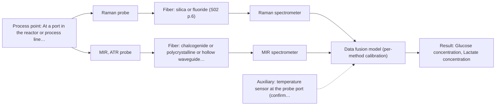
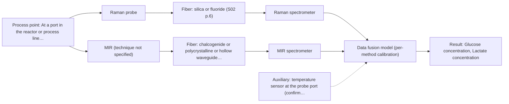

# First technical assessment: Glucose and lactate trends in an aqueous bioprocess

## Answer

**Customer request (our summary):** Customer runs a cell culture process in aqueous medium, currently measures glucose and lactate from samples, and is exploring an in situ spectroscopy pilot validated against lab measurements. Medium and cell population change during the run; no probe or calibration strategy selected.

### Brief answer

Test Raman first: it tolerates the aqueous medium and has been used in reactors for glucose and lactate, and compare it with MIR-ATR on the same samples before deciding. Both can be checked against your existing lab results. Whether one method is enough, and how the changing cell population affects the calibration, stays open until you tell us the required accuracy, response time and the medium's optical behaviour.

### Proposal

- **Best current option:** O2 (recommended): M1 Raman probe; M2 MIR, ATR probe
- **Basis:** supplied AFS sources
- **What would change it:** If the medium turns out to be clear and low-scattering, NIR transmission becomes a further candidate to compare against M1 and M2. If one single method already meets the accuracy and response-time targets on both analytes, the fused option O3 is dropped.
- **Next step:** Answer the questions on required accuracy, response time and the medium's optical behaviour, then run the feasibility experiment on representative samples, starting with the single methods.

**Decision status:** Provisional feasibility assessment. Raman is a defensible first single method for an aqueous cell culture with glucose and lactate as targets, and MIR-ATR is the natural second single method to compare; a fused option is kept as a later hypothesis. The optical behaviour of the medium, the required accuracy and the required response time are not yet known, so the ranking stays provisional.

### Solution options

| ID | Tier | Methods | Confidence | Cost class, S01 Table 1 (p.6) | Ease of use | Maintenance | Performance fit | Sources |
|---|---|---|---|---|---|---|---|---|
| O1 | Simple | M1 Raman probe | Medium: uncited auxiliary sensor | high cost (row 12) | One probe and one model to run | Probe cleaning and one calibration to maintain | Least effort that still tests the best-matched single method | [1: S01 p.16] [2: S01 p.16] |
| O2 | Recommended | M1 Raman probe; M2 MIR, ATR probe | Low: uncited auxiliary sensor; multi-method, fusion benefit not yet shown | high cost (rows 2, 12) | Two instruments, but each method is judged alone | Two probe types and two calibrations to maintain | Compares both candidates against your reference before committing | [3: S01 p.16] [4: S01 p.16] [5: S01 p.9] [6: S01 p.10] [7: S01 p.5] |
| O3 | Extended (multi-method) | M3 Raman probe + MIR (combination) | Low: uncited auxiliary sensor; multi-method, fusion benefit not yet shown | high cost (row 12); not rated in S01 Table 1: MIR (technique not specified) | One probe head, but fused data handling | Two spectrometers and two calibrations kept in step | Adds complementary information only if one method misses an analyte | [8: S01 p.11] [9: S01 p.7] [10: S02 p.16] |

*Confidence rates the basis of the advice (how much is known and cited), not a predicted accuracy or probability of success. It starts at High and drops one level per weakness listed.*

*Cost class is the relative rating in S01 Table 1 (p.6) for the in-line method+technique rows named (the highest one for a multi-method option); it is not a price.*

### Setup sketch

*Recommended option O2; drawn by code from the option, a schematic, not a configuration.*

*Extended (multi-method) option O3; drawn by code from the option, a schematic, not a configuration.*

### Key questions

1. What accuracy and measurement range do you need for glucose and lactate, and what response time counts as prompt?
2. How does the medium and cell suspension behave optically during the run: clear, turbid or opaque?
3. Where can a probe be installed, how far is it from the spectrometer, and what cleaning or sterilisation does the port see?

## Expert detail

**Customer enquiry**

> We run a cell culture process in an aqueous medium. Glucose and lactate are measured from samples, and the delay makes it difficult to see changes promptly. We are exploring an in situ spectroscopy pilot that can be checked against those existing laboratory measurements. The medium and cell population change during the run; we have not yet selected a probe or a calibration strategy.

### Parameters

| ID | Parameter | Kind | Need | Measured by | Why | Sources |
|---|---|---|---|---|---|---|
| P1 | Glucose concentration | quantitative | required | Spectroscopy: Raman | It is one of the two stated targets of the pilot. | [11: S01 p.16] |
| P2 | Lactate concentration | quantitative | required | Spectroscopy: Raman | It is the second stated target of the pilot. | [12: S01 p.16] |
| P3 | Temperature at the measurement point | quantitative | optional | Auxiliary sensor: temperature sensor at the probe port (engineering judgement: confirm availability with AFS) | It should already be available from the reactor control system and helps explain or correct spectral drift, even though it is not a target. | *(no verified source: engineering judgement)* |
| P4 | Cell density and viability (matrix and scattering factor) | quantitative | optional | Reference lab method: off-line cell count / viability from the existing samples | The cell population changes during the run and alters the scattering background, so it should be recorded with the spectra if it is available from the existing samples. | *(no verified source: engineering judgement)* |

### Solution option details

- **O1 cost drivers:** One spectrometer, one fiber probe, one calibration campaign
- **O2 cost drivers:** Two spectrometers, two probes, a larger reference campaign
- **O3 cost drivers:** Combined probe head, two spectrometers, fusion model development
- **O3 combining methods:** Level: each method keeps its own calibration and the fused model joins the two blocks after scaling, so neither block dominates. Both signals must come from the same measurement point, which favours a combined ATR/Raman probe head, and the two acquisition rates must be aligned to a common time step. The fused model must beat the best single-method model on held-out runs, otherwise the second instrument is dropped.

### Premise check

- **Supported:** In situ spectroscopy can be checked against the existing laboratory measurements. The feasibility-plan guidance puts independent reference measurements into the plan itself, so comparing the in-line result with your lab values is the expected route. [13: REF §3]
- **Supported:** The medium and cell population change during the run, which may affect the measurement. The sources state that inhomogeneity and turbulence must be taken into account when the measurement technique and sampling location are chosen. [14: S01 p.7]
- **Supported:** A pilot is being explored before a probe or calibration strategy is selected. Testing several approaches on samples of incompletely known composition in order to select the most suitable method or combination is the recommended starting point. [15: S01 p.3]

### Requirements

**Stated by the customer**

**Key unknowns**

- Optical behaviour of the medium and cell suspension during the run (clear, turbid, opaque)
- Required accuracy and measurement range for glucose and lactate
- Required response time for the in-line measurement
- Installation point, distance to the spectrometer, and the cleaning / sterilisation regime at the port
- Details of the existing laboratory reference method (sampling frequency, uncertainty)
- Presence of fluorescent species in the medium or cells (for example phenol red, riboflavin, NADH)

### Clarification questions (most decision-relevant first)

Q1. What accuracy and measurement range do you need for glucose and lactate, and what response time counts as prompt? *Why it matters:* These decide whether one method can cover both analytes or whether the fused option is needed, and they set the go / no-go criteria. *(affects: method, technique, status)*
Q2. How does the medium and cell suspension behave optically during the run: clear, turbid or opaque? *Why it matters:* This decides the measurement geometry (transmission, reflection or ATR) and whether the NIR or UV-Vis geometries are usable at all. *(affects: technique, installation)*
Q3. Where can a probe be installed, how far is it from the spectrometer, and what cleaning or sterilisation does the port see? *Why it matters:* It fixes the probe type and the fiber run, and deposits on an ATR crystal or window are a known risk. *(affects: installation, technique)*
Q4. What exactly is your existing laboratory method for glucose and lactate, and how often and how precisely does it report? *Why it matters:* It is the reference the pilot will be judged against, so its sampling frequency and uncertainty set what agreement is achievable. *(affects: status, method)*
Q5. Does the medium contain fluorescent components, or is the run designed to accumulate them? *Why it matters:* Fluorescence background can swamp Raman signals, so this decides how much fluorescence testing is worth adding. *(affects: method, status)*

### Recommendation

- **M1 · Primary candidate: Raman probe.** Raman tolerates the aqueous medium better than infrared methods and has been used in a reactor for direct detection of metabolites such as glucose and lactate, which are exactly the two targets here. It is therefore the single method to test first. [16: S01 p.16] [17: S01 p.16]
- **M2 · Comparison candidate: MIR, ATR probe.** Mid-IR is one of the most informative methods, and in the ATR geometry it copes with strong water absorption by sampling only a very thin layer, with fiber ATR probes already used in biotechnological process environments. It is the natural second single method to compare against Raman on the same samples. *Conditions:* Applies if a probe can keep contact with the medium and crystal fouling can be managed. [18: S01 p.9] [19: S01 p.10] [20: S01 p.5]
- **M3 · Conditional candidate: Raman probe.** Mid-IR and Raman spectra are complementary, and combining methods of this kind may give a synergy that neither method alone can reach. Here that is a later hypothesis, to be tested only if a single method cannot cover both analytes. *Conditions:* Applies only if neither single method reaches the required accuracy for glucose and lactate on held-out runs. [21: S01 p.11] [22: S01 p.7] [23: S02 p.16] Later hypothesis, after single-method tests: combine with MIR.

### Measurement concept

- **Probe and geometry:** In-line fiber probe in contact with the medium: a Raman probe first, an ATR probe as the second candidate. Geometry for NIR (transmission versus reflection) cannot be fixed until the medium's optical behaviour is known.
- **Location:** At a port in the reactor or process line, with the spectrometers remote from the process point.
- **Fiber link:** Fiber family follows the method: silica fibers for Raman and NIR, chalcogenide or polycrystalline fibers for MIR. No link length can be quoted from the supplied material. [24: S01 p.15]

### Spectral range

- **Raman:** Raman is reported as a Raman shift in cm-1; the laser excitation wavelength must be stated separately. No excitation wavelength is fixed yet. [25: S01 p.11]
- **MIR:** Nominal mid-IR range 4000-400 cm-1; the usable range depends on the fiber, crystal and spectrometer actually chosen. [26: S01 p.9] [27: REF §5]
- **NIR:** Nominal NIR range 780-2500 nm; not part of the shortlist, because its in-line geometry depends on the still unknown optical behaviour of the medium. [28: S01 p.10]

### Risks and uncertainty

- The optical behaviour of the medium is unknown, and if the suspension becomes opaque or strongly scattering, transmission geometries are unusable and the ranking of methods changes. *(rules: R-GEO-2, R-GEO-3)* [29: S01 p.18]
- Raman signals are weak and can be swamped by fluorescence from medium components or cells, which would weaken the primary recommendation. *(rules: R-RAM-1)* [30: S01 p.11]
- The medium and cell population change during the run, so a calibration built on one matrix state may not transfer to another. *(rules: R-CAL-1)* [31: REF §5]
- Your existing lab measurements may be too infrequent or too imprecise to act as an independent reference for the in-line result. *(rules: R-EVI-2)* *(no verified source: engineering judgement)*

### First feasibility experiment

1. **Collect representative samples across the expected variation: several runs, different cell densities, and glucose and lactate levels spanning the working range, taken under process conditions.** Cover the chemical and physical variation the model must survive. [32: REF §3]
2. **Measure every sample with the single methods first (Raman, then MIR-ATR) and obtain the reference glucose and lactate values from your existing lab method in parallel.** Single methods first; independent reference data for calibration. *(no verified source: engineering judgement)*
3. **Build one calibration model per method on a training subset and validate it on held-out runs, keeping repeated measurements from the same run together.** Avoid an over-optimistic validation that reuses measurements from the same run. [33: S03 p.13]
4. **Only if neither single method meets the targets on both analytes, measure the same samples with a combined Raman + MIR-ATR setup and compare the fused model with the best single-method model.** Test the combination as a hypothesis, not as a default. [34: REF §5] [35: S01 p.8]
5. **Go / no-go: compare predicted against reference glucose and lactate on the held-out runs against the accuracy and response-time limits you set; a method that misses them is dropped or combined as in the previous step.** The numerical criteria have to come from your process; they are not known yet. *(no verified source: engineering judgement)*

**Reference measurements:** Your existing laboratory glucose and lactate measurements from samples.

**Decision basis:** Agreement of the in-line prediction with the reference values on held-out runs, against the accuracy and response-time limits set by the customer (not yet known).

### Assumptions

- The medium and cell suspension are liquid and can be brought into contact with a probe.
- The existing laboratory measurements are available with a documented sampling frequency.
- The process runs long enough for several independent runs or batches to be sampled.

### Not covered by the supplied sources

- Achievable accuracy, detection limits or response times for glucose and lactate in cell-culture medium by these fiber-probe methods; no supplied source gives figures for this matrix.
- An achievable fiber length for a mid-IR link between process point and spectrometer; no supplied source states one.

### Further notes

- **Chemometrics:** Glucose and lactate models will be calibration models specific to this matrix, so they need reference data from this process and re-validation whenever the medium or feed changes; the spectra themselves need chemometric processing because the bands overlap.
- **Real-time tracking:** The purpose of the pilot is time-resolved in-line tracking of glucose and lactate, which needs fast acquisition and a defined time step; fiber probes let the spectrometers sit away from the process point.
- **Future direction:** Once the best method is identified, a compact dedicated sensor at selected wavelengths (an optical multisensor or IoT spectral sensor) could be a later step for routine control.

### Evidence (verified quotes)

1. ✓ **S01 p.16** (general): "Raman is particularly well-suited for aqueous environments, as it exhibits low absorbance for water molecules compared to infrared methods."
2. ✓ **S01 p.16** (general): "Raman spectroscopy can be used in the same reactor to provide a "molecular fingerprint" for direct detection of specific metabolites like glucose, acetate, or lactate."
3. ✓ **S01 p.16** (general): "Raman is particularly well-suited for aqueous environments, as it exhibits low absorbance for water molecules compared to infrared methods."
4. ✓ **S01 p.16** (general): "Raman spectroscopy can be used in the same reactor to provide a "molecular fingerprint" for direct detection of specific metabolites like glucose, acetate, or lactate."
5. ✓ **S01 p.9** (general): "Vibrational spectroscopy in the mid-IR range (4000-400 cm-1) is one of the most informative methods of chemical analysis."
6. ✓ **S01 p.10** (general): "Probe-based analysis is gaining widespread use in online analysis, such as in-line, in-process (chemical, biotechnological, natural) environments"
7. ✓ **S01 p.5** (general): "strong absorption in the mid-IR region limits the corresponding spectral method to the analysis of very thin samples"
8. ✓ **S01 p.11** (general): "This property makes mid-IR and Raman spectra complementary, that is, they complement each other."
9. ✓ (precedent only) **S01 p.7** (method gain): "This often provides a synergistic effect, allowing one to solve a problem that either method alone cannot handle or only partially."
10. ✓ **S02 p.16** (application precedent): "Combi probe with 2 IR-fibers coupled to FTIR-spectrometer and 2 Silica fibers coupled to Fluo or Raman spectrometers"
11. ✓ **S01 p.16** (general): "Raman spectroscopy can be used in the same reactor to provide a "molecular fingerprint" for direct detection of specific metabolites like glucose, acetate, or lactate."
12. ✓ **S01 p.16** (general): "Raman spectroscopy can be used in the same reactor to provide a "molecular fingerprint" for direct detection of specific metabolites like glucose, acetate, or lactate."
13. ✓ **REF §3** (general): "Representative samples or process states, independent reference measurements, what is compared, and the basis for the go / no-go decision."
14. ✓ **S01 p.7** (general): "Morphological factors, such as sample inhomogeneity (e.g., biological tissue) or process turbulence, must also be considered when selecting a measurement technique."
15. ✓ **S01 p.3** (general): "samples of incompletely known composition, in order to select the most suitable method or combination of methods."
16. ✓ **S01 p.16** (general): "Raman is particularly well-suited for aqueous environments, as it exhibits low absorbance for water molecules compared to infrared methods."
17. ✓ **S01 p.16** (general): "Raman spectroscopy can be used in the same reactor to provide a "molecular fingerprint" for direct detection of specific metabolites like glucose, acetate, or lactate."
18. ✓ **S01 p.9** (general): "Vibrational spectroscopy in the mid-IR range (4000-400 cm-1) is one of the most informative methods of chemical analysis."
19. ✓ **S01 p.10** (general): "Probe-based analysis is gaining widespread use in online analysis, such as in-line, in-process (chemical, biotechnological, natural) environments"
20. ✓ **S01 p.5** (general): "strong absorption in the mid-IR region limits the corresponding spectral method to the analysis of very thin samples"
21. ✓ **S01 p.11** (general): "This property makes mid-IR and Raman spectra complementary, that is, they complement each other."
22. ✓ (precedent only) **S01 p.7** (method gain): "This often provides a synergistic effect, allowing one to solve a problem that either method alone cannot handle or only partially."
23. ✓ **S02 p.16** (application precedent): "Combi probe with 2 IR-fibers coupled to FTIR-spectrometer and 2 Silica fibers coupled to Fluo or Raman spectrometers"
24. ✓ **S01 p.15** (general): "located safely away from the vibration and dust of the manufacturing floor."
25. ✓ **S01 p.11** (general): "The Raman shift is used as the horizontal (spectral) axis in Raman spectroscopy"
26. ✓ **S01 p.9** (general): "Vibrational spectroscopy in the mid-IR range (4000-400 cm-1) is one of the most informative methods of chemical analysis."
27. ✓ **REF §5** (general): "It is not a product specification: actual spectral coverage, fiber length, component ratings, detection limits and accuracy depend on the configuration and the sample."
28. ✓ **S01 p.10** (general): "NIR spectra (780-2500 nm) contain predominantly overtones and component bands of fundamental vibrations"
29. ✓ **S01 p.18** (general): "it fails when the milk becomes too "thick" or fat-rich, as the light cannot penetrate the sample."
30. ✓ **S01 p.11** (general): "superposition of luminescence (fluorescence), which has a significantly higher intensity."
31. ✓ **REF §5** (general): "physical variation; calibration specific to the matrix."
32. ✓ **REF §3** (general): "Representative samples or process states, independent reference measurements, what is compared, and the basis for the go / no-go decision."
33. ✓ **S03 p.13** (general): "Repeated measurements in the same sample position produced similar spectra or sensor data; therefore, these should always be simultaneously excluded for every CV iteration."
34. ✓ (precedent only) **REF §5** (method gain): "compare with the best single method."
35. ✓ **S01 p.8** (general): "It is crucial that the spectral information obtained by different methods-Mid-IR, NIR, Raman, and fluorescence spectra-is collected from the same small, even pinpoint, area of the sample."

### Verification

- Citations verified: 25 of 25 (exact or whitespace/hyphen-tolerant match on the cited page, scope checked).
- Hard check failures before deterministic corrections: 0; still open: 0; soft warnings: 2; repair rounds: 1.

*Run D04-20261017T144436Z · models deepseek/deepseek-v4.1-flash*
